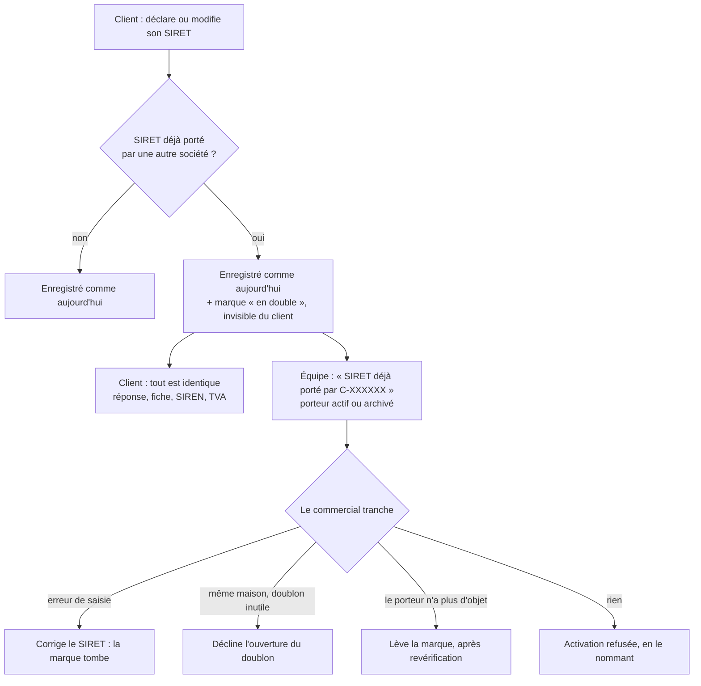

# Plan — un SIRET déjà connu ne se dit plus au client

> 📦 **Rangé le 2026-11-14 : Hugo garde l'oracle** (risque accepté, raisons
> dans [`../todos/todo-oracle-siret.md`](../todos/todo-oracle-siret.md)). Ce plan est
> la réponse prête si la fuite devient sensible ; rien n'en est bâti.

> Plan du 2026-11-14 (v4 : « décliner » a son propre statut, `declined`,
> parce que `terminated` veut dire « client perdu » et que la croissance le
> compte ; v3 : la v2 n'offrait au commercial aucune sortie réelle,
> et un porteur résilié bloquait son successeur ; v2, après `vitruve` : la v1 rangeait le SIRET pris à
> part, et le client le voyait au SIREN, au contrôle de TVA et à la seconde
> modification), piste 1 de [`../todos/todo-oracle-siret.md`](../todos/todo-oracle-siret.md),
> retenue par Hugo. Pas encore bâti. Frontière de divulgation et migration :
> `vitruve` avant Hugo.

## 1. En simple

Aujourd'hui, un client qui déclare une société avec un SIRET déjà chez nous
reçoit « Une entreprise portant ce SIRET est déjà enregistrée ». Comme un SIRET
est public, n'importe qui peut ainsi tester, SIRET par SIRET, qui est client
de La Folie Coffee.

Demain : **la société garde son SIRET exactement comme si de rien n'était** —
même SIREN, même contrôle de TVA, même fiche, même réponse. Elle porte en plus
une marque invisible du client, « SIRET en double », que seule l'équipe voit :
la fiche du back-office dit « SIRET déjà porté par C-XXXXXX », et l'activation
reste bloquée tant que le commercial n'a pas tranché.

L'unicité en base reste vraie là où elle compte : deux sociétés **vivantes et
sans marque** ne portent jamais le même SIRET, et une société marquée ne peut
pas être activée. Une société **résiliée** libère son SIRET : rouvrir un compte
pour la même maison n'est pas un doublon.

## 2. Technique

### 2.1 Ce qui existe (vérifié le 2026-11-14)

- Deux chemins **client** révèlent le doublon :
  - `POST /companies` → `create-company.handler.ts:107`
    (`existsBySiret` puis `SiretAlreadyRegisteredError`, 409) ;
  - `PATCH /companies/:id/identity` → `update-company-identity.handler.ts`
    (`completeLegalIdentity`, puis `save` ; la violation de l'index partiel
    `companies_siret_unique_when_known` — `siret <> ''`, migration
    `20260811160000` — est traduite en 409 par `translateSiretClash`,
    `prisma-company.repository.ts:388`).
- Les chemins **staff** (`create-company-by-staff`, `create-sub-account`,
  `update-identity-by-staff`) gardent leur 409 : l'équipe a le droit de savoir.
- Sans identité légale complète, l'activation est refusée (`activation-gate.ts`)
  et la fiche le signale (`company-warnings.projection.ts`).

### 2.2 Ce qui change

- **Migration** : `companies.siret_duplicate boolean NOT NULL DEFAULT false` ;
  l'index unique partiel est recréé sous un nom qui garde `siret`
  (`companies_siret_unique_when_live`, lu par `translateSiretClash`) avec la
  condition `siret <> '' AND NOT siret_duplicate AND status NOT IN ('terminated', 'declined')`
  (création du nouveau, puis suppression de l'ancien). `declined` est une
  **nouvelle valeur** de l'enum `CompanyStatus` (`ALTER TYPE … ADD VALUE`,
  dans une migration à part, avant celle de l'index). Renommer une de ces
  valeurs un jour demandera de recréer l'index.
- **Agrégat `Company`** : **rien ne change dans l'identité** (`registration`,
  SIREN dérivé, `ensureVatMatchesSiren`, `complete` qui fige un SIRET posé et
  ignore en silence un renvoi) — c'est ce qui rend les deux cas
  indiscernables. Il gagne :
  - un drapeau `siretDuplicate`, posé par `markSiretDuplicate()` ;
  - `activate` refuse une société marquée, avec une erreur qui le nomme ;
  - `correctLegalIdentity` (staff) efface la marque **quand le SIRET change** ;
    l'écriture et l'effacement partent dans la même transaction, et un SIRET
    corrigé vers un SIRET encore pris rend le 409 staff d'aujourd'hui ;
  - `clearSiretDuplicate()` (staff, « lever la marque ») : le handler revérifie
    qu'aucune autre société vivante et sans marque ne porte ce SIRET, et rend
    un 409 qui la nomme sinon. Couvre le porteur corrigé ou résilié après coup ;
  - `decline()` : **nouvelle transition** `pending → declined`, geste staff
    « décliner l'ouverture » (décidé par Hugo le 2026-11-14), pour le doublon
    d'une maison déjà cliente **ou pour le porteur** quand c'est lui le
    mauvais (celui qui a déclaré le premier un SIRET qui n'est pas le sien :
    décliner le porteur, puis lever la marque du vrai). Aujourd'hui une société
    en attente ne peut pas être close (`terminate` refuse `pending`,
    `company.ts:971-973`) : le geste sert aussi aux ouvertures abandonnées.
    **Un statut à part, pas `terminated`** : `terminated` veut dire « a été
    client, puis perdu », et des lecteurs en dépendent
    (`prisma-market-adoption.reader.ts:47,72` le compte comme une perte).
    `declined` est terminal, comme `terminated` : une erreur se répare en
    rouvrant un compte. `decline` refuse une société qui a des sous-comptes
    non clos (les décliner d'abord). Fait `company.declined`, distinct de
    `CompanyStatusChangedByStaffEvent`.
  - **Chaque lecteur de `CompanyStatus` est trié** au bâti : le compilateur
    signale les `switch` exhaustifs, et une recherche de `"terminated"` dans
    `src/` (dix fichiers le 2026-11-14 : adoption, ouverture des commandes,
    avis aux sous-comptes, qualité d'une société, audiences, règlement,
    codes postaux, service catalogue…) dit pour chacun si `declined` s'y lit
    comme `terminated` (accès, commande, avis) ou s'en écarte (adoption,
    cohortes). Le tri s'écrit dans la doc d'état.
- **Le port** gagne deux lectures distinctes, nommées par qui les lit :
  - `siretTakenByAnother(siret, excludeCompanyId)` — pour les **chemins
    client** : sociétés vivantes (non résiliées) et sans marque, soi-même
    exclue ;
  - `siretHeldForStaff(siret, excludeCompanyId?)` — pour les **chemins
    staff** (`create-company-by-staff`, `create-sub-account`, et désormais
    `update-identity-by-staff`, qui ne s'appuyait que sur l'index) :
    sociétés **vivantes** (ni `terminated` ni `declined`), **marquées
    comprises** ; rend le porteur, pour que le 409 staff le nomme. Une maison
    résiliée ou déclinée peut ainsi être rouverte par l'équipe comme par le
    client. `existsBySiret` disparaît.
- **Les deux handlers client** :
  - POST : `siretTakenByAnother` avant d'écrire ⇒ `markSiretDuplicate()` ;
    aucune erreur.
  - PATCH : le test ne se fait **que si le SIRET passe de vide à posé**
    (`fields.includes("siret")`), avec `excludeCompanyId` — jamais à une
    modification d'enseigne.
  - **course** (deux déclarations simultanées du même SIRET neuf) : le `save`
    lève `SiretAlreadyRegisteredError` (et elle seule déclenche la reprise).
    POST : l'agrégat est **reconstruit** (la ligne n'existe pas ; nouvelle
    référence), marqué, et une seconde `uow.run` rejoue dans le même callback
    de `runSealed` — la violation tombe avant le scellé. PATCH (route
    `@Idempotent`, non scellée) : recharger, marquer, rejouer `save` et
    `publishTraced`. Une seule reprise.
- **Une société déclinée, côté client** : son espace se comporte comme pour
  une résiliée (même accès, même libellé neutre « compte fermé ») ; **aucun
  e-mail** ne part au déclin.
- **Course sur « lever la marque »** : deux levées simultanées passent la
  revérification ; l'index rattrape la seconde, et son 409 nomme le porteur
  (relu par `siretHeldForStaff`).
- **Avertissement** : `siret_duplicate` ne compte que les sociétés vivantes ;
  une déclinée sort du compteur.
- **Ce que voit le client** : strictement ce qu'il voit aujourd'hui avec un
  SIRET libre — `CompanyView` et toute projection servie au client ignorent la
  marque et l'avertissement ; mêmes faits (`company.identity_edited` nomme
  les mêmes champs), même `CompanySiretSetEvent`, même résolution NAF
  (donnée publique), même PDF de mandat.
- **Ce que voit l'équipe** : la marque, la société qui porte ce SIRET
  (référence, statut) sur la fiche ; un avertissement `siret_duplicate` dans
  `company-warnings` (liste et compteur du menu) ; les gestes « lever la
  marque » et « décliner l'ouverture ». Faits staff
  `company.siret_duplicate_marked`, `…_cleared` et `company.declined`,
  déclarés dans `packages/contracts`.

### 2.3 Ce qui ne change pas, et ce qui est assumé

- Les 409 des chemins staff, la limite de requêtes par IP de la passerelle.
- **Le client ne peut pas corriger un SIRET posé** — c'est vrai aujourd'hui
  (`complete` fige, `correctLegalIdentity` est staff) et ça le reste : celui
  qui s'est trompé de chiffre appelle. Le renvoi est ignoré à l'identique dans
  les deux cas.
- **Bruit** : rien ne borne le nombre de sociétés marquées sur un même SIRET ;
  la limite par IP le freine.
- **Oracle humain** : un doublon n'est jamais activé, ou tard. Inhérent.
- **Retour arrière** : dès la première société marquée en production, revenir
  en arrière demande de trancher les doublons à la main — recréer l'ancien
  index échoue, et retirer la colonne rendrait des doublons activables.

### 2.4 Tests

- Domaine : marquer ne touche ni SIRET, ni SIREN, ni TVA ; `activate` refuse
  une société marquée ; `correctLegalIdentity` efface la marque quand le SIRET
  change, pas quand il est reconfirmé ; `decline` n'accepte que `pending`.
- Application (ports doublés) : déclaration et modification avec SIRET pris ⇒
  aucune erreur, marque posée, mêmes faits qu'un SIRET libre ; course (le
  `save` lève) ⇒ nouvelle transaction, marque posée, scellé rejoué.
- **E2E de non-divulgation** : un client déclare un SIRET libre, un autre le
  SIRET d'un client existant ; statut HTTP, corps de réponse, `GET /me`
  (SIRET, SIREN), contrôle de TVA (même n° faux ⇒ même refus) et seconde
  modification d'identité **identiques** entre les deux.
- PATCH d'enseigne sur une société au SIRET posé ⇒ jamais marquée.
- E2E staff : avertissement, référence et statut du porteur sur la fiche ;
  activation refusée en le nommant ; correction du SIRET ⇒ marque effacée ;
  « lever la marque » refusé tant qu'un porteur vivant existe, accepté après sa
  résiliation ; « décliner » clôt le doublon ; une société résiliée ne marque
  pas son successeur ; une création staff sur un SIRET porté par une société
  marquée rend toujours le 409.

## 3. Doutes, tranchés en attendant Hugo

- **Le vrai gérant qui se trompe de chemin** (sa maison est déjà cliente, il
  recrée un compte) ne l'apprend plus de l'écran : c'est le commercial qui le
  rappelle. Assumé : c'est le prix de la non-divulgation, et le cas est rare.
- **Pas de durée de vie** pour une marque : elle reste tant que l'équipe ne
  tranche pas, comme toute société en attente.
