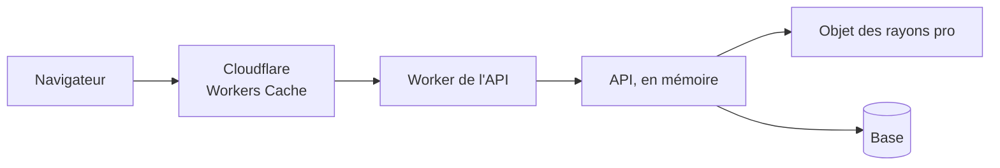

# Les caches du système

> ✅ **Carte relue contre le code le 2026-11-04.** Ce dossier rassemble tout ce
> qui garde une donnée pour ne pas la relire : ce qui est caché, où, combien de
> temps, et **qui le vide**. Partie 1 : la carte. Partie 2 : les documents.

# Partie 1 — La carte

## Pourquoi on cache

La base de production (Prisma Postgres) est **facturée à l'opération**, et loin
de l'API. Chaque lecture évitée est de l'argent et du temps. Mais un cache qui
garde une donnée fausse, ou qui sert la réponse d'un client à un autre, est
pire que pas de cache. D'où trois règles qui valent pour tous :

- **celui qui écrit vide** le cache, après l'enregistrement en base ;
- **une durée courte** rattrape ce qui change sans que personne n'écrive ;
- **si le cache tombe, on relit la base** : aucun cache n'est sur le chemin de
  la disponibilité.

## Ce qui est caché aujourd'hui

| Quoi                                                                                      | Où                                                                                         | Combien de temps                                                                                           | Qui le vide                                                                                                                           |
| ----------------------------------------------------------------------------------------- | ------------------------------------------------------------------------------------------ | ---------------------------------------------------------------------------------------------------------- | ------------------------------------------------------------------------------------------------------------------------------------- |
| **Les règles de prix** (règles, planchers, barèmes, engagements, mercuriales, promotions) | mémoire de l'API (`PricingMaterialsCache`)                                                 | jusqu'à la prochaine écriture tarifaire                                                                    | `PricingActWriter`, et une estampille (`pricing_events`) relue une fois par requête, qui le rend juste à plusieurs instances          |
| **Le rayon d'une société** (`/shop/catalogue/mine`, pros et particuliers connectés)       | Durable Object `ProShelves`, une entrée par société, compressée                            | 30 s                                                                                                       | `ShelfChanges` après toute écriture qui change un rayon ; l'interrupteur `ops_shelf_cache`                                            |
| **Le rayon public** (`/shop/catalogue`, `/shop/featured`)                                 | Cloudflare, Workers Cache, au plus près du visiteur                                        | 30 s                                                                                                       | la purge de l'étiquette `rayon-public` sur une écriture qui touche tout le monde ; **éteint par défaut** (`public-on` pour l'allumer) |
| **Les textes de la boutique** (`/shop/copy`)                                              | Cloudflare, Workers Cache, et le navigateur                                                | 60 s, puis jusqu'à 10 min de version précédente pendant le rafraîchissement                                | la purge de l'étiquette `textes-boutique` à chaque publication                                                                        |
| **Les textes publiés de la boutique et des e-mails**, côté serveur                        | mémoire de l'API (`CachedPublishedShopCopyReader`, `CachedPublishedMailCopyReader`)        | la version publiée est relue au plus toutes les 15 s ; les textes ne se relisent que si elle a changé      | `forget()` sur l'instance qui publie ; les autres par la version (une estampille qui ne monte qu'à « Publier »)                       |
| **Le rayon dans la boutique**                                                             | le navigateur (`ShopCatalogue`), une photo prise à l'ouverture                             | jusqu'au changement d'espace, ou au retour sur l'onglet **si le panier est vide** et la photo a une minute | — ; le panier recalcule toujours au vrai prix                                                                                         |
| **Les versions de journée** (Supervision, fournil, comptoir)                              | rien n'est gardé : l'écran demande `GET admin/day-versions` et ne relit que ce qui a bougé | —                                                                                                          | —                                                                                                                                     |
| **Les sondes de la carte de santé** (tiers, Auth0, CPU du conteneur)                      | mémoire de l'API (`ops/cached.ts`, `Cached<T>`)                                            | 30 s                                                                                                       | l'expiration ; un échec n'est jamais gardé                                                                                            |

## Ce qui n'est jamais caché

- **Toute réponse d'API** porte par défaut `private, no-store` (appelant
  identifié) ou `private, no-cache` (visiteur) : aucun cache partagé ne la
  garde (`cache-control-by-default.middleware.ts`). Seules trois routes
  publiques, qui ne lisent jamais l'appelant, ont le droit de dire `public` ;
  `lint:cache-control` le tient.
- **L'identité et les droits** sont relus en base à chaque requête : c'est ce
  qui bloque tout de suite un compte désactivé.
- **La passation d'une commande** relit tout : c'est elle qui fait foi.

## Ce qui est prévu

- **Les matériaux du catalogue, chargés une fois** par requête et gardés en
  mémoire de l'API, vidés par `ShelfChanges` — plan ci-dessous.
- **La surveillance du cache** sur la carte de santé (lot C5 du plan du cache
  du catalogue).

# Partie 2 — Les documents

| Document                                                                       | État                              | Sujet                                                                                                       |
| ------------------------------------------------------------------------------ | --------------------------------- | ----------------------------------------------------------------------------------------------------------- |
| [`plan-cache-du-catalogue.md`](plan-cache-du-catalogue.md)                     | C1 à C4 bâtis sur dev, C5 à faire | le rayon pro dans un Durable Object, le rayon public dans Workers Cache, la purge, l'interrupteur, le repli |
| [`plan-materiaux-du-catalogue.md`](plan-materiaux-du-catalogue.md)             | 📝 plan                           | un seul chargement du catalogue par requête, par construction                                               |
| [`plan-aucun-cache-sur-le-personnel.md`](plan-aucun-cache-sur-le-personnel.md) | ✅ bâti                           | aucune réponse personnelle dans un cache partagé : le middleware et la porte                                |
| [`plan-latence-de-navigation.md`](plan-latence-de-navigation.md)               | 📝 plan                           | le changement d'espace lent : mesurer le plancher par appel, aplatir la cascade, un appel d'entrée          |
| [`version-par-journee.md`](version-par-journee.md)                             | ✅ bâti                           | ne relire que ce qui a bougé, une porte par journée                                                         |
| [`cache-compte-client.md`](cache-compte-client.md)                             | 📝 doc-first                      | le cache des comptes clients du back-office                                                                 |

Ailleurs, mais à lire avec : [`../pricing/moteur/optimisation-resolution-de-prix.md`](../pricing/moteur/optimisation-resolution-de-prix.md),
ce que coûte un prix et le cache des règles de prix.
