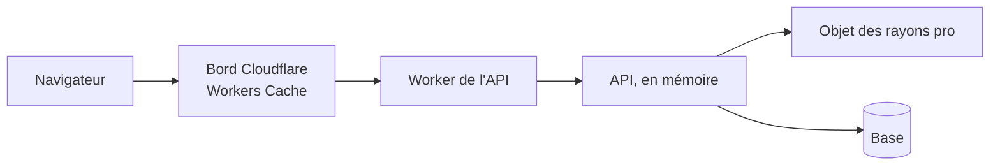

# Les caches du système

> ✅ **Index du dossier, relu le 2026-11-05** (grand ménage). Tout ce qui
> garde une donnée pour ne pas la relire : ce qui est caché, où, combien de
> temps, et **qui le vide**. La porte d'entrée est
> [`carte-des-caches.md`](carte-des-caches.md) — chaque cache, les dernières
> mesures, et les **objectifs restants** de tout le dossier, priorisés.

# Partie 1 — Pourquoi on cache

La base de production (Prisma Postgres) est **facturée à l'opération**, et loin
de l'API. Chaque lecture évitée est de l'argent et du temps. Mais un cache qui
garde une donnée fausse, ou qui sert la réponse d'un client à un autre, est
pire que pas de cache. D'où trois règles qui valent pour tous :

- **celui qui écrit vide** le cache, après l'enregistrement en base ;
- **une durée courte** rattrape ce qui change sans que personne n'écrive ;
- **si le cache tombe, on relit la base** : aucun cache n'est sur le chemin de
  la disponibilité.

# Partie 2 — Les documents

| Document                                                                           | État                  | Sujet                                                                                                                                                           |
| ---------------------------------------------------------------------------------- | --------------------- | --------------------------------------------------------------------------------------------------------------------------------------------------------------- |
| [`carte-des-caches.md`](carte-des-caches.md)                                       | ✅ relu le 2026-11-05 | **la porte d'entrée** : objectifs restants priorisés, dernières mesures, chaque cache couche par couche (clé, durée, purge), comment le constater en production |
| [`le-rayon-en-cache.md`](le-rayon-en-cache.md)                                     | ✅ état 2026-11-05    | le rayon public au bord de Cloudflare, le rayon d'une société dans l'objet `ProShelves` : purge, durée, repli, interrupteur, surveillance                       |
| [`qui-est-le-client.md`](qui-est-le-client.md)                                     | ✅ état 2026-11-05    | le principal gardé en mémoire et relu sur une estampille posée par la base                                                                                      |
| [`dans-quel-espace-est-le-client.md`](dans-quel-espace-est-le-client.md)           | ✅ état 2026-11-05    | le contexte de lecture de la boutique, la brique `contextKeyed`, l'oubli à la déconnexion                                                                       |
| [`aucune-reponse-personnelle-en-cache.md`](aucune-reponse-personnelle-en-cache.md) | ✅ état 2026-11-05    | rien de personnel dans un cache partagé : le middleware et la porte `lint:cache-control`                                                                        |
| [`version-par-journee.md`](version-par-journee.md)                                 | ✅ état 2026-11-04    | ne relire que ce qui a bougé, un numéro par journée                                                                                                             |
| [`plan-materiaux-du-catalogue.md`](plan-materiaux-du-catalogue.md)                 | 📝 plan, M0 mesuré    | le catalogue chargé une fois par requête ; ordre proposé M2 (devis) avant M1 (rayon)                                                                            |

Les petits restes : [`../todos/todo-cache-restes.md`](../todos/todo-cache-restes.md).
Ailleurs, à lire avec :
[`../pricing/moteur/optimisation-resolution-de-prix.md`](../pricing/moteur/optimisation-resolution-de-prix.md),
ce que coûte un prix et le cache des règles de prix.
