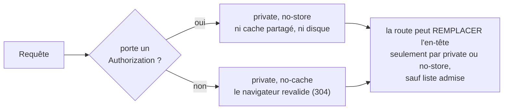

# Aucune réponse personnelle dans un cache

> ✅ **Doc d'état au 2026-11-05.** Bâti le 2026-11-02 (plan du même jour,
> contredit par `vitruve` : aucun bloquant, cinq sérieux, tous repris ; le
> plan est dans l'historique git). En production depuis le 2026-11-02 :
> `GET /api/lfd/health` y rend `private, no-cache`, la zone Cloudflare ne
> réécrit pas l'en-tête. La carte de tous les caches est
> [`carte-des-caches.md`](carte-des-caches.md).

# Partie 1 — Comprendre

## Le risque

Deux façons de servir à quelqu'un la réponse d'un autre :

1. **un cache partagé** (au bord de Cloudflare, ou un `caches.default` dans la
   passerelle) qui garde la réponse d'un client et la sert au suivant — ou le
   prix pro d'un rayon à un particulier. Une réponse `max-age=600` **sans**
   `public` y suffit : un cache partagé peut garder une réponse à une requête
   sans `Authorization` (RFC 9111) ;
2. **un poste partagé** (la tablette du comptoir ou du fournil) : le
   navigateur garde les réponses sur disque, et « retour » réaffiche l'écran
   de la personne précédente.

## La règle : décidée par l'appelant, pas par la route

Rien n'est `public` par défaut. Les quelques routes qui le sont (le rayon
public, les textes, les réglages publics, les points de retrait) ne lisent
jamais l'appelant, et une porte de CI tient leur liste.

# Partie 2 — Le code

## 1. Le middleware

`apps/lfd-api/src/platform/security/cache-control-by-default.middleware.ts`,
branché dans `AppModule.configure()` (`apps/lfd-api/src/appBootstrap/app.module.ts`)
par `forRoutes("{*splat}")` — pas dans `main.ts`, que le harnais e2e ne
recopie pas. Il pose l'en-tête **avant** le handler et les guards : une 401,
une 403 ou une erreur rendue par `AppErrorFilter` le portent.

| La requête                       | L'en-tête           |
| -------------------------------- | ------------------- |
| porte un `Authorization`         | `private, no-store` |
| n'en porte pas (visiteur, sonde) | `private, no-cache` |

Un `@Header()` ou un `res.setHeader()` le remplace : les photos
(`private, immutable`) et les exports en flux (`no-store`) gardent le leur.

## 2. La porte `lint:cache-control`

`dev-toolbox/gates/cache-control.mjs` lit `apps/lfd-api/src` (hors
`__tests__/`), `apps/lfd-api/container/` et `gateway/src/` :

- toute écriture de l'en-tête est repérée (`Header(`, `setHeader(`, `set(`,
  `header(`, clé d'objet), la valeur suivie jusqu'à sa constante ; une valeur
  calculée qu'elle ne sait pas lire échoue en nommant le fichier ;
- une valeur est admise si elle contient `private` ou `no-store` ; toute
  autre (`public`, `max-age` seul, `s-maxage`) n'est admise que dans la liste
  `ADMITTED`, chaque entrée avec sa raison — aujourd'hui les en-têtes du rayon
  public, des textes de la boutique, des réglages publics et des points de
  retrait ([`carte-des-caches.md`](carte-des-caches.md) § 1) ;
- les fichiers qui servent une route `public` doivent figurer dans
  `CALLER_BLIND` (ils ne lisent pas l'appelant) ;
- `caches.default` et `caches.open` sont refusés dans `gateway/src/` ;
- dans le container, seuls `worker.ts` et `pro-shelves.ts` purgent,
  interceptent ou déclarent un `DurableObject` (`CONTAINER_ADMITTED`).

## 3. Les tests

- unitaire du middleware ;
- `apps/lfd-api/test/cache-control.e2e-spec.ts` : `/me` et `/admin/…` en
  `no-store`, le rayon pro avec et sans jeton, une 401 et une 404, les textes
  et leur 304, une photo, un PDF en flux, les points de retrait publics ;
- unitaire de la porte.

## 4. Ce que ça ne fait pas

Ça ne cache rien : les caches publics ont chacun leur doc
([`le-rayon-en-cache.md`](le-rayon-en-cache.md), [`carte-des-caches.md`](carte-des-caches.md)).
Ça ne touche pas aux fronts (statiques).

## 5. Ce que `vitruve` a renversé (2026-11-02)

| Objection                                                   | Reprise                                                  |
| ----------------------------------------------------------- | -------------------------------------------------------- |
| la liste des routes qui varient par l'appelant était fausse | la règle se décide sur la **requête**, plus aucune liste |
| interdire le mot `public` ne ferme pas un cache partagé     | seules `private` ou `no-store` sont admises              |
| le cache de zone ne voit pas les réponses du Worker         | la porte garde `caches.*` dans `gateway/src`             |
| `no-store` partout coûte les 304 des routes publiques       | `no-cache` sans `Authorization`                          |
| la porte ne lisait que trois formes d'écriture              | toute écriture repérée, l'illisible échoue               |
