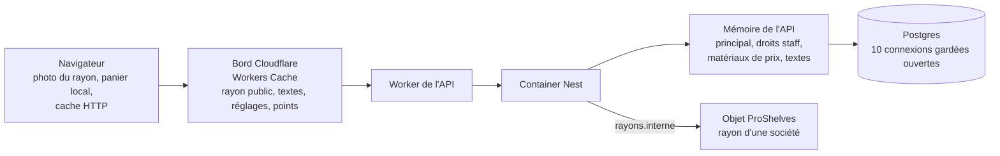
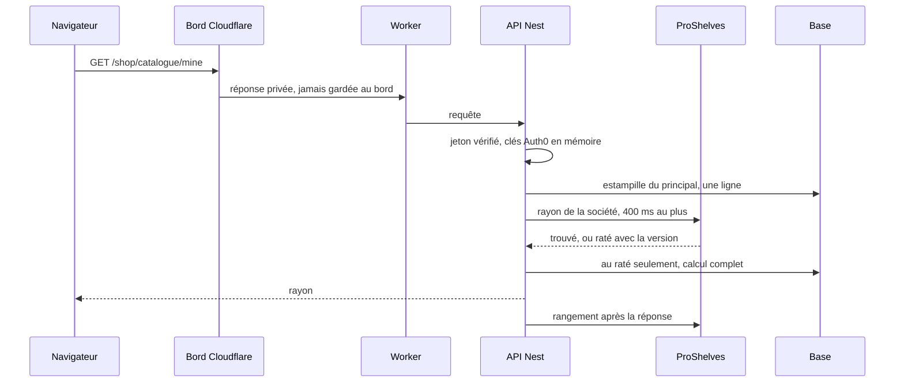

# La carte des caches — ce qui est gardé, où, et qui le vide

> ✅ **La porte d'entrée du dossier, relue contre le code le 2026-11-05**
> (`dev` = `cde0901cf` ; production = `8710ec3ac`). Elle recense chaque endroit
> où le système garde une réponse pour ne pas la relire, et, en tête, **ce
> qui reste à faire** de tous les plans du dossier. Grand ménage du
> 2026-11-05 : six plans terminés ou dépassés sont devenus des docs d'état ou
> ont été retirés ; leurs objectifs encore actuels sont ci-dessous.

## Objectifs restants

Priorisés. Chacun dit son gain, ce qui le déclenche, et le doc où il vit.

| #   | Objectif                                                                                                                                                                                                                                   | Gain attendu                                                                                                                                                                            | Déclencheur                                                                                                                                                         | Où                                                                                 |
| --- | ------------------------------------------------------------------------------------------------------------------------------------------------------------------------------------------------------------------------------------------ | --------------------------------------------------------------------------------------------------------------------------------------------------------------------------------------- | ------------------------------------------------------------------------------------------------------------------------------------------------------------------- | ---------------------------------------------------------------------------------- |
| 1   | **Prouver que Workers Cache sépare les adresses par leur paramètre** — `/shop/catalogue` et `?audience=pro`, `/pickup-addresses` et `?audience=pro`, `/delivery-zones` et `?audience=b2b` (aucun `cacheKey` dans le code : clé par défaut) | la justesse : sinon une clientèle reçoit la liste, les frais ou le seuil d'une autre                                                                                                    | **au déploiement sur `main` de `0d0ff6b4c`** (`/delivery-zones?audience=`, sur `dev` seulement) — deux `curl` en production, contenus et `cf-cache-status` comparés | ici, § 1 ; [`le-rayon-en-cache.md`](le-rayon-en-cache.md) § 3                      |
| 2   | ✅ **Le catalogue en mémoire**, versionné par la base, un numéro par contexte : M1a, M1b, M2 en production le 2026-11-06                                                                                                                   | devis anonyme : catalogue 127 → 12 ms, 7 → 1 lecture ; rayon recalculé : ~65 → ~14 ms, 6 → 1 lecture                                                                                    | reste : mesurer le panier connecté, resserrer le lecteur des réglages du jour même                                                                                  | [`le-catalogue-en-memoire.md`](le-catalogue-en-memoire.md)                         |
| 3   | **Alerter sur une purge ratée** (relais 503, Cloudflare qui refuse, redémarrage dans la seconde) et sur le disjoncteur ouvert                                                                                                              | voir un cache qui sert du vieux au lieu d'attendre qu'un client le dise ; aujourd'hui une purge ratée n'est que journalisée, ni comptée ni alertée                                      | avant l'ouverture commerciale ; prouve du même coup le relais `ctx.exports`, encore « non prouvé en production »                                                    | ici, § 1 et § 6 ; [`le-rayon-en-cache.md`](le-rayon-en-cache.md) § 4 quater        |
| 4   | **Accélérer `/me` davantage** — 226 ms relevés ce soir, déjà en lectures parallèles (`840e5dd46`, sur `dev`)                                                                                                                               | non chiffré : une partie des lectures n'existe que parce que Prisma 7 charge chaque relation par une requête séparée                                                                    | le passage à Prisma 8 (jointures), ou `/me` redevenu le plus lent de l'ouverture                                                                                    | [`../todos/todo-prisma-8-et-jointures.md`](../todos/todo-prisma-8-et-jointures.md) |
| 5   | **Le `stale-while-revalidate` des réglages publics** (pied de page, ouverture, zones, disponibilité : 90 s au pire après une écriture dont la purge s'est perdue). Hugo : « on y reviendra »                                               | décider si les zones, qui portent désormais frais et seuil de livraison, gardent leur version précédente 60 s comme aujourd'hui, ou la perdent comme les points de retrait (2026-11-05) | décision de Hugo                                                                                                                                                    | ici, § 1                                                                           |
| 6   | **Le rayon pro précalculé** (phase 3) — **seulement si 400 ms ne suffit pas**                                                                                                                                                              | le client ne paierait plus jamais le calcul (300 ms à 2 s quand l'objet manque)                                                                                                         | la page Santé : part `hit` de `shelf.read` et p95 de `cacheCalls` après le passage à 400 ms — non relevés au 2026-11-05 ; demande d'abord la phase 2 (a) et (c)     | [`le-rayon-en-cache.md`](le-rayon-en-cache.md) § 6.2 et § 8                        |
| 7   | **L'objet des journées** (singleton qui relit le numéro de journée pour tous les écrans)                                                                                                                                                   | moins de lectures au rush quand plusieurs écrans regardent la même journée                                                                                                              | la mesure au rush du nombre d'écrans simultanés et du coût d'une relecture                                                                                          | [`version-par-journee.md`](version-par-journee.md) § 4                             |

Les petits restes (pas assez pour un plan) sont dans
[`../todos/todo-cache-restes.md`](../todos/todo-cache-restes.md).

### Abandonnés ou dépassés (2026-11-05)

- **Un appel unique « entrer dans l'espace »** — abandonné le 2026-11-04 :
  les petites lectures partent déjà ensemble et finissent sous 900 ms ; le
  chemin critique était fait des calculs de prix.
- **« Ne plus attendre `/me` pour la vague suivante »** — dépassé par l'espace
  retenu : le rayon part avec `/me`
  ([`dans-quel-espace-est-le-client.md`](dans-quel-espace-est-le-client.md)).
- **Les connexions froides à la base** (~200 ms après une pause) — traité
  par le pool gardé ouvert (`min: 10`, `prisma.service.ts:72`, `962dda506`) ;
  relevé de Hugo ce soir : estampille 10–19 ms après 2 min de calme,
  10–52 ms après 10 min.
- **Le cache de `/pickup-addresses/mine`** — renoncé (`vitruve`, 2026-11-05) :
  1 à 2 lectures gagnées pour un cache à estampiller.
- **Le cache de `/fulfillment-days/mine`** — renoncé : il dépend du stock du
  jour et des plans clos ; un cache proposerait un jour impossible.
- **Le cache de l'accès aux fonctions** — dépassé : la route
  `/feature-access/mine` est retirée, les niveaux voyagent dans `/me`, en un
  `findMany` (`840e5dd46`), toujours sans cache (décision écrite dans
  `documentation/b2b/architecture-feature-flags.md`).
- **Le rayon pro « jusqu'à la prochaine heure, plafond 1 h »** — remplacé
  par 5 minutes ou la prochaine opération datée (trois objections bloquantes
  de `vitruve`, 2026-11-04).
- **Le cache des comptes clients du back-office** (doc-first du 2026-09-09) —
  ajourné : son lot `cacheStrategy` est sans objet depuis la sortie
  d'Accelerate (2026-09-19), et le reste ne vise qu'un écran du staff, peu
  lu en pré-release. Le doublon de lecture de la liste et le piège à retenir
  sont au TODO.

# Partie 1 — L'explication simple

Une requête de la boutique traverse jusqu'à six étages. À chaque étage, un
cache peut répondre à la place du suivant. La règle commune : **celui qui
écrit vide le cache après l'enregistrement**, une **durée courte** rattrape ce
qui change sans écriture (une promotion qui s'ouvre à midi), et **si le cache
tombe, on relit la base** — aucun cache n'est sur le chemin de la
disponibilité.

Le chemin d'un pro qui ouvre son rayon :

## Les dernières mesures

Relevé de Hugo **en production le 2026-11-05 au soir, après dix minutes sans
trafic** (non remesuré ici) :

| Étape ou appel                    | Durée    | Avant                                         |
| --------------------------------- | -------- | --------------------------------------------- |
| vérification du jeton (`verify`)  | 1–10 ms  | 3,3–3,8 s quand les clés Auth0 avaient expiré |
| estampille du principal (`stamp`) | 10–52 ms | ~200 ms sur une connexion froide              |
| `GET /me`                         | 226 ms   | —                                             |
| `GET /shop/catalogue/mine`        | 385 ms   | —                                             |
| panier                            | 110 ms   | —                                             |
| ouverture après une pause         | —        | 3,4–4,2 s                                     |

Carte de santé (C5), 2026-11-05 : principal **92 %** servi en mémoire,
matériaux de prix **86–96 %**, rayon public **100 %** offert au bord ; rayon
d'une société **0 % en lecture avant le passage à 400 ms** (la lecture
dépassait 100 ms), part depuis non relevée.

## Une ligne par cache

| Quoi                                                                        | Où                                  | Clé                             | Combien de temps                                                      | Qu'est-ce qui le vide                                                                                        |
| --------------------------------------------------------------------------- | ----------------------------------- | ------------------------------- | --------------------------------------------------------------------- | ------------------------------------------------------------------------------------------------------------ |
| Rayon public (`/shop/catalogue`, `/shop/featured`)                          | bord Cloudflare                     | l'adresse                       | 30 s                                                                  | purge de l'étiquette `rayon-public` ; drapeau public (`public-on` / `public-off`)                            |
| Textes de la boutique (`/shop/copy`)                                        | bord Cloudflare + navigateur        | l'adresse                       | 60 s, puis 10 min de version précédente pendant la revalidation       | purge `textes-boutique` à chaque publication                                                                 |
| Réglages publics (pied de page, ouverture, zones, disponibilité)            | bord Cloudflare + navigateur        | l'adresse                       | 30 s, puis 60 s de version précédente                                 | purge `reglages-publics` à chaque écriture d'un des quatre                                                   |
| Points de retrait publics (`/pickup-addresses`)                             | bord Cloudflare + navigateur        | l'adresse                       | 30 s, **sans** version précédente                                     | purge `reglages-publics` : points, rôles d'un site, promotions                                               |
| Images de la médiathèque (R2, domaine public)                               | bord Cloudflare + navigateur        | l'adresse = le contenu          | un an, immuable                                                       | rien : une image changée a une autre adresse                                                                 |
| Rayon d'une société (`/shop/catalogue/mine`)                                | objet `ProShelves`                  | révision + société (ou perso)   | 5 min au plus, ou jusqu'à la prochaine opération datée                | `ShelfChanges` (regroupé à la seconde) ; interrupteur ; nouvelle révision déployée                           |
| Le principal (qui est le client, sa société, son rôle)                      | mémoire de l'API                    | le `sub`                        | 10 min au plus, **et** tant que l'estampille n'a pas bougé ; 20 000   | toute écriture sur `users`, `memberships`, `companies` (déclencheurs)                                        |
| Les droits d'un membre du staff                                             | mémoire de l'API                    | le `sub`                        | 30 s                                                                  | l'expiration ; `forget`/`forgetAll` sur l'instance qui change un droit                                       |
| Les matériaux de prix (règles, planchers, barèmes, promotions)              | mémoire de l'API                    | six clés fixes                  | tant que l'estampille `pricing_events` n'a pas bougé                  | tout acte tarifaire (une ligne dans `pricing_events`)                                                        |
| Les matériaux du catalogue (articles, familles, opérations, heures limites) | mémoire de l'API                    | trois morceaux, un par contexte | tant que le numéro de SON contexte (`context_versions`) n'a pas bougé | toute écriture d'une colonne lue (déclencheurs) — [`le-catalogue-en-memoire.md`](le-catalogue-en-memoire.md) |
| Les textes publiés (boutique, e-mails), côté serveur                        | mémoire de l'API                    | la langue                       | version relue toutes les 15 s                                         | `forget()` sur l'instance qui publie ; les autres par la version                                             |
| Le drapeau du rayon public                                                  | mémoire de l'API                    | —                               | 5 s                                                                   | l'expiration                                                                                                 |
| Clés de signature Auth0 (JWKS)                                              | mémoire de l'API                    | l'URI JWKS                      | **24 h** ; une clé inconnue recharge (30 s entre deux)                | l'expiration                                                                                                 |
| Jeton Auth0 de gestion, sondes de la carte de santé                         | mémoire de l'API                    | —                               | jusqu'à l'expiration du jeton ; 30 s ; refus de portée retenu 1 h     | l'expiration ; un échec n'est pas gardé                                                                      |
| Géocodages d'adresses                                                       | **base** (table de cache)           | l'adresse                       | jusqu'à la purge RGPD                                                 | `purge-stale-geocodes`                                                                                       |
| Photo du rayon dans la boutique                                             | navigateur (`ShopCatalogue`)        | l'espace                        | jusqu'au changement d'espace, ou 1 min au retour d'onglet panier vide | relecture ; le panier recalcule toujours au vrai prix                                                        |
| Panier, mode de service                                                     | navigateur (`localStorage`, `lfc.`) | —                               | jusqu'à effacement ; le panier d'un client reconnu est aussi en base  | `ShopCartSync`                                                                                               |

**Ce qui n'est jamais caché** : le stock, le devis, la passation, les
suggestions, les jours de service, et toute réponse qui dépend de l'appelant
hors du rayon reconnu. Le stable va dans le rayon, le dynamique à côté.

**Ce qui n'est pas un cache mais garde quelque chose chaud** : le pool
Postgres garde **10 connexions ouvertes** (`min: 10`,
`apps/lfd-api/src/platform/database/prisma.service.ts:72`, 2026-11-05) pour
qu'une requête après une pause n'ouvre pas de connexion neuve.

## Les documents du dossier

| Document                                                                           | Sujet                                                                                      |
| ---------------------------------------------------------------------------------- | ------------------------------------------------------------------------------------------ |
| [`le-rayon-en-cache.md`](le-rayon-en-cache.md)                                     | le rayon public au bord, le rayon d'une société dans l'objet, la purge, la durée, le repli |
| [`qui-est-le-client.md`](qui-est-le-client.md)                                     | le principal en mémoire, sous une estampille posée par la base                             |
| [`dans-quel-espace-est-le-client.md`](dans-quel-espace-est-le-client.md)           | le contexte de lecture de la boutique, la brique `contextKeyed`                            |
| [`aucune-reponse-personnelle-en-cache.md`](aucune-reponse-personnelle-en-cache.md) | la règle par défaut : rien de personnel dans un cache, et la porte                         |
| [`version-par-journee.md`](version-par-journee.md)                                 | ne relire que ce qui a bougé, un numéro par journée                                        |
| [`le-catalogue-en-memoire.md`](le-catalogue-en-memoire.md)                         | ✅ le catalogue en mémoire, et sa relation avec la mémoire des règles de prix              |

Ailleurs, à lire avec :
[`../pricing/moteur/optimisation-resolution-de-prix.md`](../pricing/moteur/optimisation-resolution-de-prix.md)
(le cache des règles de prix).

# Partie 2 — Le détail technique

Les chemins sont relatifs à la racine du dépôt.
Numéros de ligne relevés le 2026-11-05.

## 0. La règle par défaut : rien ne se garde

`apps/lfd-api/src/platform/security/cache-control-by-default.middleware.ts` pose
`private, no-store` (appelant identifié) ou `private, no-cache` (visiteur) sur
**toute** réponse. Seuls trois fichiers d'en-têtes ont le droit d'écrire
`public`, tenus par la liste `ADMITTED` de `dev-toolbox/gates/cache-control.mjs:47`
(`lint:cache-control`) ; la même porte n'admet une purge de Workers Cache, un
gestionnaire de sortie et une classe `DurableObject` que dans `worker.ts` et
`pro-shelves.ts` (`CONTAINER_ADMITTED`, `:123`). Détail :
[`aucune-reponse-personnelle-en-cache.md`](aucune-reponse-personnelle-en-cache.md).

## 1. Le bord Cloudflare (Workers Cache)

Activé par `"cache": { "enabled": true }` (`apps/lfd-api/wrangler.jsonc:46`). Le Worker
garde ce que l'API marque `public` ; il purge par étiquette, et seulement les
étiquettes de la liste fermée `PURGEABLE_TAGS`
(`apps/lfd-api/container/public-shelf.ts:50`).

| Routes                                                                                                                    | En-têtes (fichier)                                                                             | `Cache-Control`                                                            | `Cache-Tag`        | Condition                                                        | Purge déclenchée par                                                                                                                                                                                                                                                                                                                                            |
| ------------------------------------------------------------------------------------------------------------------------- | ---------------------------------------------------------------------------------------------- | -------------------------------------------------------------------------- | ------------------ | ---------------------------------------------------------------- | --------------------------------------------------------------------------------------------------------------------------------------------------------------------------------------------------------------------------------------------------------------------------------------------------------------------------------------------------------------- |
| `GET /shop/catalogue`, `GET /shop/featured`                                                                               | `apps/lfd-api/src/b2b/catalog/http/public-shelf-cache-headers.ts:16`                           | `public, max-age=30`                                                       | `rayon-public`     | drapeau public allumé **et** version inchangée pendant le calcul | `PublicShelfPurge` (`apps/lfd-api/src/b2b/catalog/application/public-shelf-purge.ts:24`), au bout de la fenêtre `ShelfChangeWindow`                                                                                                                                                                                                                             |
| `GET /shop/copy`                                                                                                          | `apps/lfd-api/src/b2b/shop-copy/http/shop-copy-cache-headers.ts:8-24`                          | `public, max-age=60, stale-while-revalidate=600`                           | `textes-boutique`  | toujours                                                         | `publish-shop-copy.handler.ts:53`, après validation (`AfterCommit`)                                                                                                                                                                                                                                                                                             |
| `GET /content/footer`, `/order-opening`, `/delivery-zones`, `/delivery-availability`                                      | `apps/lfd-api/src/b2b/shared/public-settings-cache/http/public-settings-cache-headers.ts:8-24` | `public, max-age=30, stale-while-revalidate=60`                            | `reglages-publics` | toujours (aucune ne lit l'appelant)                              | `save-footer-content.handler.ts`, `update-order-opening.handler.ts`, `create-delivery-zone.handler.ts`, `update-delivery-zone.handler.ts`, `remove-delivery-zone.handler.ts`, `update-delivery-availability.handler.ts`, par `InternalPublicSettingsEdgeCache` (`…/infrastructure/internal-public-settings-edge-cache.ts`) — commit `474dd915d` du 2026-11-05   |
| `GET /pickup-addresses` (et `?audience=pro` ; toute autre audience = 400) — **pas** `:id/creneaux`, qui dépend de l'heure | `apps/lfd-api/src/b2b/pickup-addresses/http/public-pickup-cache-headers.ts`                    | `public, max-age=30` (**sans** `stale-while-revalidate`, Hugo, 2026-11-05) | `reglages-publics` | toujours (ne lit pas l'appelant)                                 | `create-`, `update-`, `remove-pickup-address.handler.ts`, `set-site-roles.handler.ts`, et les cinq gestes de promotion (`pose`, `revise`, `pause`, `resume`, `archive-promotion.handler.ts` — la remise annoncée vient des promotions), après validation, par le même port. Une promotion à horaires s'ouvre et se ferme sans écriture : au plus 30 s de retard |

**Le chemin d'une purge.** L'API ne peut pas purger le cache du Worker
elle-même : elle appelle `http://rayons.interne/public/purge?tag=…`, que le
gestionnaire de sortie du container intercepte (`proShelvesGateway`,
`apps/lfd-api/container/worker.ts:241`), qui refuse tout appelant autre que `Backend`
(403), relit l'étiquette contre la liste fermée, puis relaie au point d'entrée
par défaut par `ctx.exports` (`relayPublicPurge`, `:277`) — parce que deux
points d'entrée ont deux caches séparés. `ctx.cache.purge({ tags })` (`:314`).

**Si la purge se perd** (redémarrage dans la seconde de regroupement, 503 du
relais, Cloudflare qui refuse) : l'échec est journalisé, jamais vu d'un client,
et la durée rattrape — 30 s pour le rayon public, 1 min 30 au pire pour un
réglage, 11 min au pire pour un texte. ⚠️ Le relais par `ctx.exports` est
marqué « non prouvé en production » dans son propre JSDoc (2026-11-04) ;
non revérifié ici.

**Les images.** `apps/lfd-api/src/platform/storage/r2-media-store.ts:32` dépose chaque
image avec `public, max-age=31536000, immutable` : l'adresse est le contenu,
une image changée est une autre clé. Les objets déposés avant 2026-10-10
gardent l'en-tête du bucket (4 h).

## 2. Les Durable Objects

Déclarés dans `apps/lfd-api/wrangler.jsonc:104-109` : `BACKEND` (`Backend`) et
`PRO_SHELVES` (`ProShelves`). Ce sont les deux seules classes `DurableObject`
du dépôt (porte `lint:cache-control`, vérifié le 2026-11-05).

### `Backend` n'est pas un cache

`apps/lfd-api/container/worker.ts:202` : c'est le container Nest, adressé par un nom
fixe (`primary-weur`, `:351`), `max_instances: 1` (`wrangler.jsonc:77`). Il ne
touche jamais `ctx.storage` : c'est un routeur vers l'image, il ne garde rien.

### `ProShelves` — le rayon d'une société

`apps/lfd-api/container/pro-shelves.ts:46`, une instance unique, SQLite intégré :
table `shelves (key, body, version, principal, expires_at)` et table `meta`
(version globale, drapeaux).

- **Clé** : `r:<révision>/company:<id>` ou `r:<révision>/personal`
  (`storageKeyOf`, `apps/lfd-api/container/shelf-store.ts:125`). La révision est celle
  du déploiement (`config.revision()`, `appBootstrap/shop-shelf-cache.module.ts:56`) :
  un déploiement ne lit jamais le rayon de l'autre. La société est celle que
  `@ActingCompany` a résolue en base, jamais une valeur du client.
- **Durée** : `min(5 min, prochain instant d'opération datée)`
  (`recognisedShelfExpiry`, `apps/lfd-api/src/b2b/catalog/application/recognised-shelf.service.ts:23-33`).
  Le plafond borne ce que le calcul ne connaît pas (une promotion qui s'ouvre,
  le plancher dynamique, une purge perdue).
- **Corps** : la vue compressée en gzip par l'API (`shelf-wire.ts`, `node:zlib`), en
  `application/octet-stream` ; l'objet la range telle quelle (colonne `body BLOB`
  du stockage SQLite, `pro-shelves.ts:50`) et la rend telle quelle, sans jamais
  l'ouvrir. Compressée depuis C2 (`a8c07257f`) : ~120 à 145 Ko de JSON, ~11 Ko
  compressé (mesuré en production le 2026-11-04) — loin de la limite de 2 Mo
  d'une ligne du stockage SQLite d'un Durable Object.
- **Justesse** : la version est relevée **avant** le calcul ; le rangement est
  refusé (409) si un effacement l'a montée entre-temps (`store`, `pro-shelves.ts:104`).
- **Rangement après la réponse** (2026-11-05) : `RecognisedShelf.read` rend
  la vue sans attendre le rangement (`ResilientShopShelfCache.storeAfterReply`,
  un `void` sur une promesse qui ne lève jamais). Un échec est compté
  `fallback` / `operation: store` par les signaux, qui le journalisent. Le
  rangement a son propre délai, 2 s (`SHELF_STORE_LIMIT_MS`, le filet du
  socket) : au délai d'une lecture, on comptait `timeout` des rangements qui auraient
  abouti. La version reste celle relevée avant le calcul : un rangement
  tardif peut seulement être refusé plus souvent (`stale_refused`).
- **Purge** : `ShelfChanges` (port `apps/lfd-api/src/b2b/shared/shelf-changes/domain/ports/shelf-changes.ts`)
  → `ShelfChangeWindow` (une purge par seconde au plus, `shelf-change-window.ts`,
  `SHELF_PURGE_WINDOW_MS = 1000`) → `ProShelfPurge` (`pro-shelf-purge.ts:18`) :
  efface une société, ou tout, et monte la version. Les écrivains qui doivent
  émettre `ShelfChanges` sont tenus par `lint:shelf-writes`.
- **Interrupteur** : `on`, `off`, `purge`, `public-on`, `public-off`
  (`shelf-store.ts:53`), conservé dans `meta` ; l'interrupteur `ops_shelf_cache`
  côté écran OPS. Éteint, rien n'est servi ni rangé.
- **Si l'objet tombe** : chaque lecture (et chaque effacement) est bornée à 400 ms
  (`SHELF_CALL_LIMIT_MS`, `shelf-call-guard.ts`), le rangement à 2 s. 100 ms
  jusqu'au 2026-11-05 : en production, deux lectures sur trois dépassaient, et
  l'API recalculait le rayon (300 ms à 2 s) — attendre 400 ms coûte moins. Une
  lecture au-delà reste un repli compté `timeout` ; après 5 échecs, le disjoncteur coupe 30 s
  (`shelf-cache-breaker.ts:2-5`) ; dans tous les cas l'API calcule depuis la base.
- **Plusieurs instances d'API** : sans effet, l'objet est unique et la version
  est la sienne.

Le rayon public, lui, **n'est pas** dans l'objet : l'objet ne porte que son
drapeau (`public/state`), relu par l'API et retenu 5 s
(`PUBLIC_FLAG_MEMORY_MS`, `public-shelf-flag-memory.ts:9`).

Détail : [`le-rayon-en-cache.md`](le-rayon-en-cache.md).

## 3. La mémoire de l'API (Nest)

Aujourd'hui `max_instances: 1` : une seule mémoire. La colonne « à plusieurs
instances » dit ce qui resterait juste si ce chiffre montait.

| Cache                                                                                                                                                                                                                                                             | Clé                                           | Durée / borne                                                             | Invalidation                                                                                                                                                                                                            | À plusieurs instances                                                                     |
| ----------------------------------------------------------------------------------------------------------------------------------------------------------------------------------------------------------------------------------------------------------------- | --------------------------------------------- | ------------------------------------------------------------------------- | ----------------------------------------------------------------------------------------------------------------------------------------------------------------------------------------------------------------------- | ----------------------------------------------------------------------------------------- |
| Principal client — `CachedPrincipalResolver` (`apps/lfd-api/src/b2b/account/infrastructure/cached-principal.resolver.ts:47`) + `PrincipalMemory` (`principal-memory.ts:24`)                                                                                       | le `sub`                                      | 10 min, 20 000 entrées (1 000 jusqu'au 2026-11-05), la plus ancienne sort | estampille `principal_stamp` relue à **chaque** requête ; trois déclencheurs par instruction sur `users`, `memberships`, `companies` (`prisma/migrations/20261104120000_l_estampille_du_principal/migration.sql:84-94`) | juste : l'estampille est en base. Rangement sous l'estampille lue **avant** la lecture    |
| Droits staff — `PrismaStaffAccessResolver` (`apps/lfd-api/src/staff/permissions/prisma-staff-access.resolver.ts:99`)                                                                                                                                              | le `sub`                                      | 30 s (`CACHE_TTL_MS`, `:27`) ; ⚠️ aucune borne de taille vue              | `forget(subject)` / `forgetAll()` (`:153-164`) sur l'instance qui écrit                                                                                                                                                 | une autre instance garderait l'ancien droit jusqu'à 30 s                                  |
| Matériaux de prix — `PricingMaterialsCache` (`apps/lfd-api/src/b2b/pricing/infrastructure/pricing-materials.cache.ts:107`)                                                                                                                                        | six clés fixes (`PRICING_CACHE_KEYS`, `:233`) | tant que l'estampille ne bouge pas ; borne naturelle de six entrées       | estampille = dernier identifiant de `pricing_events` (`prisma/schema/public/pricing.prisma:632`), relue une fois par requête ; tout acte tarifaire y écrit (`PricingActWriter`)                                         | juste. ⚠️ Un `UPDATE promotion_settings` à la main ne bouge pas l'estampille : redémarrer |
| Textes publiés — `CachedPublishedShopCopyReader` (`apps/lfd-api/src/b2b/shop-copy/infrastructure/cached-published-shop-copy.reader.ts:47`), `CachedPublishedMailCopyReader` (`apps/lfd-api/src/mail/copy/infrastructure/cached-published-mail-copy.reader.ts:52`) | la langue                                     | version relue toutes les 15 s (`:17`, `:21`)                              | `forget()` sur l'instance qui publie ; les autres par la version                                                                                                                                                        | juste à 15 s près                                                                         |
| Drapeau du rayon public — `public-shelf-flag-memory.ts`                                                                                                                                                                                                           | —                                             | 5 s                                                                       | expiration                                                                                                                                                                                                              | juste à 5 s près                                                                          |
| Sondes OPS — `Cached<T>` (`apps/lfd-api/src/ops/cached.ts`), utilisé par `ops-health.service.ts:54-55` et `container-usage.service.ts:39`                                                                                                                         | une valeur par sonde                          | 30 s                                                                      | expiration ; un échec n'est pas gardé                                                                                                                                                                                   | sans enjeu (observation)                                                                  |
| Refus de portée Auth0 — `auth0-readings.reader.ts:21`                                                                                                                                                                                                             | —                                             | 1 h                                                                       | expiration                                                                                                                                                                                                              | sans enjeu                                                                                |
| Jeton de gestion Auth0 — `apps/lfd-api/src/platform/identity/auth0-management.client.ts:50`                                                                                                                                                                       | —                                             | jusqu'à `expiresAtMs` du jeton                                            | expiration                                                                                                                                                                                                              | un jeton par instance                                                                     |
| Clés de signature Auth0 — `remoteKeySet` (`apps/lfd-api/src/platform/auth/remote-key-set.ts:20-21`, seul appel de `createRemoteJWKSet`), utilisé par `access-token.verifier.ts:32`, `admin-token.verifier.ts:49`, `id-token.verifier.ts:128`                      | l'URI JWKS                                    | **24 h** (`REMOTE_KEY_SET_MAX_AGE_MS`, `:17`, `7563aeef2`, 10 min avant)  | une clé inconnue force un rechargement, au plus une fois toutes les 30 s (`cooldownDuration` de `jose` 6.2.3, lu le 2026-11-05)                                                                                         | un jeu par instance                                                                       |

**Ce qui ressemble à un cache et n'en est pas un** (relu le 2026-11-05) :
`InMemoryShopShelfCache` ne sert qu'aux tests d'application (le module ne
branche que `DurableObjectShopShelfCache` ou `NoShopShelfCache`,
`appBootstrap/shop-shelf-cache.module.ts:55-56`) ; `VitalsStore` et
`InMemoryTimings` sont des fenêtres de mesure (30 min), pas des réponses
gardées ; les `Map` des services de commande, de livraison et de prix sont
locales à un appel.

**En base** : le géocodage d'adresses garde ses réponses de la BAN
(`apps/lfd-api/src/delivery/infrastructure/prisma-geocode-cache.reader.ts`), purgé par
`purge-stale-geocodes` — cf. [`../legal/rgpd-purge-du-geocodage.md`](../legal/rgpd-purge-du-geocodage.md).

Conception : [`qui-est-le-client.md`](qui-est-le-client.md),
[`../pricing/moteur/optimisation-resolution-de-prix.md`](../pricing/moteur/optimisation-resolution-de-prix.md).

## 4. Le navigateur (boutique)

- **La photo du rayon** : `ShopCatalogue` (`apps/lfc-ecommerce-frontend/src/app/client/shop/shop-catalogue.store.ts`)
  la prend à l'ouverture et la garde jusqu'au changement d'espace ; au retour
  sur l'onglet, elle est relue si elle a au moins `STALE_PHOTO_MS = 60_000`
  (`:30`, `:207-223`) **et** que le panier est vide. Le panier recalcule
  toujours au vrai prix par le devis.
- **Le stockage local** : préfixe `lfc.` (`apps/lfc-ecommerce-frontend/src/app/client/local-store.ts`) —
  panier (mémoire immédiate ; le panier d'un client reconnu est en base par
  `ShopCartSync`), mode de service. La liste des clés est au
  [`registre des traceurs`](../legal/registre-des-traceurs.md).
- **Le cache HTTP** : le navigateur suit les en-têtes de l'API — il garde
  `/shop/copy` et les réglages publics (§1) et ne garde rien d'autre (`private`).
  Aucun `Cache-Control` n'est posé par le code de la boutique elle-même
  (grep vide dans `apps/lfc-ecommerce-frontend/src` le 2026-11-05) ; ⚠️ ce que
  la configuration Cloudflare de la boutique fait de ses fichiers statiques
  n'est pas vérifié ici.

## 5. Ce qui n'est pas caché, et pourquoi

Règle : **le stable dans le rayon, le dynamique à côté**
([`le-rayon-en-cache.md`](le-rayon-en-cache.md)).

- **Le stock** : il change à chaque commande ; le garder ferait vendre ce qui
  n'existe plus. La vue gardée du rayon n'en porte aucun.
- **Le devis** : il recompose le panier à chaque changement — c'est lui qui
  rattrape un rayon gardé trop longtemps.
- **La passation** : relit tout et refuse un total que le client n'a pas vu.
  C'est elle qui rend sûrs tous les caches de prix ci-dessus.
- **Les suggestions** : dépendent du panier courant.
- **Le rayon reconnu au bord** : jamais en `public` ; il vit dans l'objet,
  derrière la résolution en base de la société.
- **Les versions de journée** (Supervision, fournil, comptoir) : rien n'est
  gardé, l'écran ne relit que ce qui a bougé
  ([`version-par-journee.md`](version-par-journee.md)).

## 6. Savoir en production si un cache a servi

- **`X-Shelf-Cache`** sur `/shop/catalogue` et `/shop/featured`
  (`SHELF_CACHE_DECISION_HEADER`, `public-shelf-cache-headers.ts`) : `cacheable`,
  ou la raison du refus — `disabled`, `version_moved`, `breaker_open`,
  `timeout`, `unavailable`, `error`, `unreadable`, `closed`, `no_day`,
  `day_outside`, `not_yet_open`. Il dit si la réponse **a été offerte** au bord,
  pas si le bord l'a servie.
- **`Server-Timing`** : le Worker ajoute `worker;dur=…;desc="<colo>"`
  (`worker.ts:783`) et `container;dur=…` (`:223`) ; Nest ajoute ses étapes
  (`verify`, `principal`, `apps/lfd-api/src/platform/metrics/server-timing.ts:53`,
  `auth.guard.ts:109-112`), et, depuis le 2026-11-05, `catalogue` (temps
  mural des lectures du catalogue) et `catalogue-reads` (leur nombre, en
  `desc`) — cf. [`le-catalogue-en-memoire.md`](le-catalogue-en-memoire.md)
  § 10. Une réponse servie par le bord n'a **pas** d'étape
  `container` (le container n'a pas été appelé) — ⚠️ déduction, non éprouvée
  sur la production.
- **`cf-cache-status`** : posé par Cloudflare lui-même (`HIT`, `MISS`…) ;
  ⚠️ non vérifié qu'il soit présent sur les réponses du Workers Cache.
- **Le rayon pro** : pas d'en-tête dédié vu le 2026-11-05 ; les signaux
  `ShelfCacheSignals` sont journalisés (`logging-shelf-cache-signals.ts`). La
  surveillance sur la carte de santé est décrite ligne suivante et dans
  [`le-rayon-en-cache.md`](le-rayon-en-cache.md) § 4 quater.
- **Constater de l'intérieur** (C5, bâti le 2026-11-05, affiché à la page Santé du back-office, `79bdf21cc`) : trois caches
  comptent leurs issues dans `CacheOutcomeRecorder`
  (`apps/lfd-api/src/platform/metrics/`), compteurs par minute en mémoire,
  fenêtre de 30 min, **par instance** — le principal (`principal` : la même
  issue que la marque `principal-source`), le rayon pro (`shelf.read` :
  `hit`/`miss`/`fallback_*` ; `shelf.store` : `stored`/`stale_refused`/
  `not_kept`/`fallback_*` ; `shelf.public` : `cacheable`/`not_cacheable_*`)
  et les matériaux de prix (`pricing.materials` : `hit`/`miss`/`stamp_moved`,
  une issue par table demandée). La carte de santé
  (`GET /admin/ops/health`, champ `caches`) rend par cache le total et la part
  de chaque issue ; la page Santé l'affiche. Les **purges ne sont pas
  comptées** (événements journalisés seulement) et rien n'alerte.
- **La durée de l'appel à l'objet** (2026-11-05) : `ShelfCallGuard` range
  chaque appel dans les minuteurs (`TimingRecorder`, 30 min, par instance) —
  `shelf_cache.round_trip` (étiquettes `operation`, `outcome` : `in_time`,
  `late` = durée jusqu'à l'abandon, `error`) et, pour un appel abandonné qui
  finit quand même, `shelf_cache.late_finish` (`settled` / `failed`, durée
  totale). La carte de santé les rend dans `cacheCalls` : par opération, le
  nombre d'appels, d'abandons, p50, p95 et le p95 de la fin des abandonnés
  (`apps/lfd-api/src/ops/health/cache-call-readings.ts`). C'est cette mesure qui a porté
  `SHELF_CALL_LIMIT_MS` à 400 ms le 2026-11-05 (`f631e0fb4`). Affiché à la page Santé (`aeeb14d05`).

## Ce qui n'est pas vérifié

- le relais de purge par `ctx.exports` en production ;
- la présence de `cf-cache-status` et l'absence d'étape `container` sur un
  `HIT` du bord ;
- la configuration de cache des fichiers statiques de la boutique côté
  Cloudflare ;
- la borne de taille du cache des droits staff (aucune vue dans le fichier).
