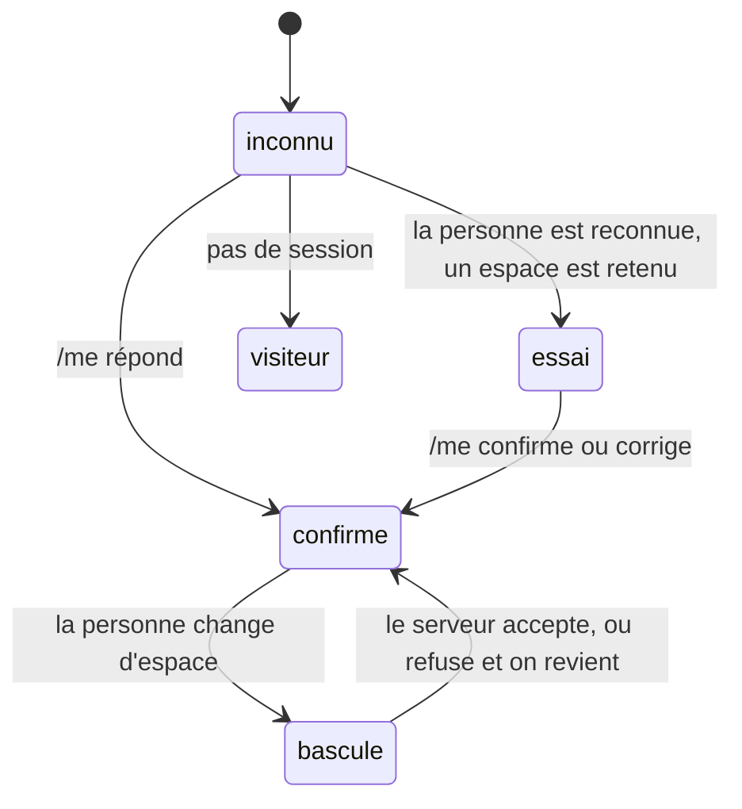

# Dans quel espace est le client — le contexte de lecture de la boutique

> 📍 **État au 2026-11-05.** Tout ce qui est décrit ici existe, en
> production depuis `8710ec3`. Ce document remplace le plan de « l'espace
> retenu », dont les six lots (a, b, c, c bis, d, e) sont bâtis ; le plan
> reste dans l'historique git. Son voisin côté serveur :
> [`qui-est-le-client.md`](qui-est-le-client.md).

# Partie 1 — L'explication simple

## Le problème qu'on a réglé

Une même personne peut acheter **pour elle** (son espace perso) ou **pour une
société** à laquelle elle est rattachée. Les prix, le panier, les adresses, le
RIB, les commandes : tout dépend de cet **espace**. Trois défauts en venaient :

1. **On attendait.** Au démarrage, la boutique ne savait pas dans quel espace
   la personne travaillait tant que `/me` n'avait pas répondu, et ne demandait
   rien d'autre en attendant : ~280 ms d'attente pure à chaque ouverture.
2. **On mélangeait.** En changeant d'espace, certaines parties de l'écran
   passaient tout de suite à la nouvelle société (l'audience, le statut « en
   attente ») pendant que d'autres montraient encore l'ancienne (le carnet
   d'adresses, le RIB, le rayon) — un instant, deux maisons sur le même
   écran.
3. **On oubliait mal.** À la déconnexion, des copies (paniers, espace choisi)
   restaient dans le navigateur, y compris sur un appareil partagé.

## Ce qui se passe maintenant

**L'espace est connu en un seul endroit** : le _contexte_ de la boutique. Il
est dans l'un de ces cinq états :

- **inconnu** : on ne sait pas encore ; les lecteurs qui dépendent de
  l'espace attendent.
- **visiteur** : pas de session ; les routes publiques.
- **essai** : au démarrage seulement — le navigateur se souvient de l'espace
  de la dernière visite et **lit d'avance** pour lui, en même temps que `/me`.
  **Rien ne s'affiche** tant que `/me` n'a pas confirmé. Si l'espace a changé
  entre-temps, ce qui a été lu d'avance est jeté sans jamais avoir été montré.
- **bascule** : la personne a demandé un autre espace. On **montre encore
  l'ancien** et on **lit déjà le nouveau** ; tout l'écran passe d'un bloc
  quand le serveur accepte. S'il refuse, rien n'a changé à l'écran.
- **confirmé** : l'espace accepté.

**La règle qui tient tout :** une donnée n'est montrée que pour l'espace
**réellement affiché**. Un tarif de société n'est jamais montré à qui n'y est
plus rattaché, ni un tarif perso sous le nom d'une société.

## Ce que voit le client

- **Ouvrir la boutique** : dans le cas courant (même espace que la dernière
  fois), le rayon, le panier et le reste partent sans attendre `/me`.
- **Changer d'espace** : l'écran ne mélange plus deux maisons. Vers un espace
  déjà ouvert pendant la visite, l'affichage est **immédiat** (gardé en
  mémoire). Vers un espace jamais ouvert, le panier dit **« chargement »** —
  jamais « vide » —, et le devis **attend** le catalogue du nouvel espace
  au lieu de chiffrer le panier avec celui de l'ancien.
- **Se déconnecter** : le navigateur oublie le maximum (Hugo, 2026-11-05 :
  « supprimons le maximum du local à la déconnexion ») — l'espace retenu, les
  paniers rangés, les lectures gardées en mémoire.

## Ce que ça ne fait pas

- Ça ne remplace pas les caches du serveur (le principal en mémoire, l'objet
  des rayons, le bord Cloudflare) : ça évite seulement de redemander ce que le
  navigateur a déjà, et d'afficher ce qu'il ne faut pas.
- Les **écritures** (panier, préférences, passation de commande, règlement)
  n'y passent pas : elles restent des services qui agissent sur l'espace
  capturé **au moment du geste**.
- Regrouper toutes les lectures du démarrage en un seul appel a été écarté
  (mesuré le 2026-11-05). Accélérer `/me` lui-même reste à faire.

# Partie 2 — La partie technique

Vérifié dans le code le 2026-11-05. Tout vit sous
`apps/lfc-ecommerce-frontend/src/app/client/`.

## Le contexte — `client-context.service.ts`

`ClientContext`, en lecture seule :

- `state` : `ClientContextState` — `unknown`, `trying { hint }`, `visitor`,
  `switching { from, to }`, `confirmed { workspace }`.
- `prefix` : la clé de l'espace **montré** (`VISITOR` = `'visiteur'`, l'id
  d'une société, ou l'espace perso) ; `null` tant qu'on ne sait pas — et
  donc pendant `trying`.
- `ahead` : l'espace où l'on lit d'avance (`trying`, ou la cible d'un
  `switching`).
- `shownCompany`, `shownReachableSite`, `shownSiteBillingReadable`,
  `shownIsPersonal` : la société, le site et le perso de l'espace **montré**,
  dérivés de `prefix()` par les mêmes fonctions que `ClientWorkspace`
  (`companyOf`, `reachableSiteOf`) — la règle n'est écrite qu'une fois.

⚠️ `ClientWorkspace.current()` / `company()` passent à la cible **dès le
départ** d'une bascule (écriture optimiste). Un lecteur qui affiche quelque
chose lit `ClientContext.shown*`, jamais `ClientWorkspace`, sauf s'il est
admis (ci-dessous).

L'espace retenu est rangé sous `lfc.workspace-hint` (`WORKSPACE_HINT_KEY`) ;
il est inscrit au [registre des traceurs](../legal/registre-des-traceurs.md).

## La brique — `context-keyed/context-keyed.ts`

`contextKeyed<T>(load)` range chaque lecture sous une `ContextKey`
(`{ workspace, own }` : l'espace, plus ce qui est propre au lecteur — le
rayon, la visite pro…) :

- `ensure(key)` : lit une fois par clé, sans relance ;
- `read(key)` : relit (après une écriture) ;
- `ahead(key)` : lecture d'avance, **coupée** si l'espace est abandonné
  (`Lecture abandonnée : son espace ne sera pas montré.`) ;
- `shown(key)` : la valeur à afficher, **seulement** si la clé est celle de
  l'espace montré ;
- `forget(workspace)` : oublie un espace.

L'en-tête d'espace (`x-lfc-company`) est posé par `workspaceRequestOf(key)`,
c'est-à-dire **par la clé de la lecture**, pas par l'espace courant au moment
de l'envoi. `NO_WORKSPACE` marque une lecture publique.

Contredite par `vitruve` le 2026-11-05, la brique a été **réduite** : Angular
`resource()` remet sa valeur à `undefined` quand ses paramètres changent ; la
brique tient donc elle-même la valeur de chaque clé, et n'utilise pas
`httpResource`.

## Qui passe par la brique, et qui en est dispensé

La porte `pnpm lint:context-keyed-readers`
([`dev-toolbox/gates/context-keyed-readers.mjs`](../../dev-toolbox/gates/context-keyed-readers.mjs))
refuse tout fichier de la boutique qui lit l'espace hors de la brique.
**Dette : 0** depuis le 2026-11-05 (`15747b5e0`). Sa liste `ADMITTED` nomme
chaque exception et sa raison ; elles sont de trois familles :

- **ceux dont le métier est l'espace** : l'espace lui-même, sa bascule,
  l'intercepteur, la garde de route, les menus qui le choisissent, le
  contexte ;
- **les écritures**, qui capturent l'espace au geste : la synchronisation du
  panier, le devis (un POST à anti-rebond), la suggestion du staff, le
  règlement, la passation de commande ;
- **ce qui suit l'espace en direct** sans rien lire : l'effacement du choix de
  service au **départ** d'une bascule (D7, `order-context.store.ts`).

Un lecteur neuf qui lit l'espace hors de la brique fait échouer la porte. Un
fichier de la liste qui devient propre la fait aussi échouer, pour qu'on le
retire.

## Le rayon et le panier pendant une bascule

- `shop/shop-catalogue.store.ts` : `contextKeyed<Photo>`, clé `prefix()` ;
  la visite pro est une part propre (`own: 'pro'`) sous `VISITOR`.
- `cart/client-cart.service.ts`, `linesPending` : vrai quand le catalogue de
  l'espace montré est en chargement (hors visite pro) ;
  `cart/cart-summary/` affiche alors `fold-loading` avec le texte
  `shop.cartLoading`, jamais « Panier vide ».
- `cart/shop-quote.service.ts` : la clé du devis porte `lines: null` tant que
  le catalogue n'est pas prêt ; aucun POST ne part, puis le POST part sans
  anti-rebond à son arrivée.
  Son interlocuteur est l'espace **montré** (`ClientContext.prefix()`), et
  il pose lui-même l'en-tête `x-lfc-company` de cette clé : l'intercepteur
  aurait posé l'espace demandé, qui passe à la cible dès le clic (corrigé le
  2026-11-05, test « pendant une bascule, chiffre pour l'espace MONTRÉ »).

## L'oubli à la déconnexion — `sign-out/`

`sign-out-forgetting.ts` s'accroche à la déconnexion et efface les clés
listées dans `stored-keys.ts` (dont `lfc.workspace-hint`), alignées sur le
registre des traceurs ; la brique est vidée.

## Ce qui reste ouvert

- **Le bon de fidélité** reste choisi pendant une bascule et s'éteint à son
  acceptation, plus à son départ (décision du 2026-09-27 : « s'éteint dès la
  bascule »). Sans risque d'argent, vérifié le 2026-11-05 : un bon appartient
  à une PERSONNE (`loadOwnedVoucher`), et une commande de société le refuse
  (`ensureVoucherUsable` → `VoucherNotForCompanyOrderError`, testé dans
  `order.spec.ts`, `place-order.handler.spec.ts` et l'e2e
  `loyalty-voucher-order`).
- **Accélérer `/me`** (277 ms mesurés, dont 122 ms dans Nest).
