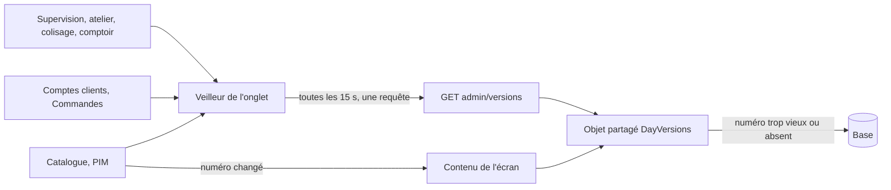
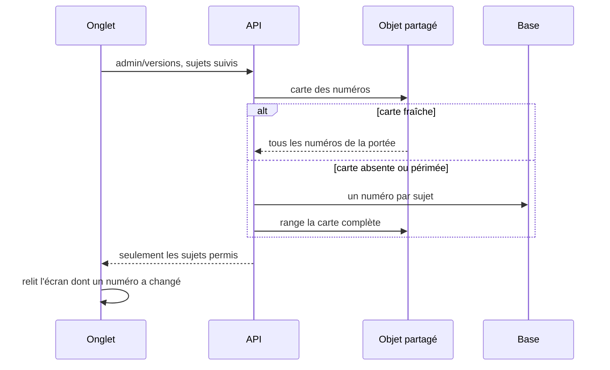
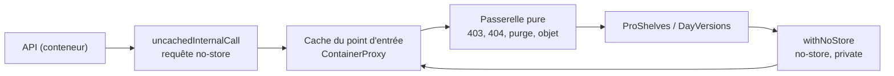

# Le cache du back-office — un numéro par sujet, un veilleur par onglet

> ✅ **Doc d'état, relue dans le code le 2026-11-13.** En production : les
> numéros par sujet, l'objet des journées, l'écran Catalogue, les lectures
> du PIM, l'onglet Cache, l'aiguillage des objets par le chemin (§ 3), les
> contenus rangés en gzip, et les écrans de journée branchés sur l'objet
> (§ 3.1 à 3.6), servis depuis l'objet en production (prouvé le 2026-11-13,
> § 3.0). Le chemin vers les objets ne garde rien (§ 3.0) : passerelle
> pure, test du faux cache et porte `internal-objects-door`. Ce document
> remplace les six plans du chantier (veilleur unique, écran Catalogue,
> lectures du PIM, onglet Cache, objet des journées, écrans de journée) ;
> leurs contradictions par `vitruve` sont dans l'historique git.

# Partie 1 — L'explication simple

## 1. Ce que fait le back-office pour ne pas relire la base

La base de production est facturée à l'opération. Un écran du back-office
ouvert toute la journée ne doit donc pas tout relire à chaque instant.

- **Chaque sujet a un numéro** : une journée (commandes, fournil, livraison,
  ma tournée), les comptes clients, toutes les commandes, l'écran Catalogue,
  le référentiel (PIM). Le numéro est écrit **par la base**, par des
  déclencheurs : une écriture ne peut pas l'oublier.
- **Un seul veilleur par onglet** demande toutes les 15 s, en une requête,
  les numéros des sujets que suivent les écrans ouverts. Un écran ne se
  relit que si l'un de SES numéros a changé. Un filet relit tout au bout de
  5 minutes.
- **Un objet partagé** (Durable Object `DayVersions`) garde les numéros et
  les contenus lourds (l'écran Catalogue, les listes et fiches du PIM) pour
  tous les postes et toutes les instances de l'API : une seule lecture de la
  base par changement, quel que soit le nombre d'onglets.
- **Si l'objet tombe, on lit la base** : la disponibilité ne dépend jamais
  de lui.
- **L'onglet Cache** de la page Santé montre, par cache, le taux de réussite
  et la taille rangée, heure par heure sur 30 jours.

# Partie 2 — La technique

## 2. Les numéros

### 2.1 Des sujets, journaliers ou globaux

Le fil (`packages/contracts/src/versions.ts`) connaît deux portées :

- **journalière** — les journaux de journée `DAY_JOURNALS` (`orders`,
  `production`, `delivery`, `my-round`), dont le numéro dépend d'une journée
  de service, d'où la `date` ;
- **globale** — `GLOBAL_VERSION_SUBJECTS` : `companies`, `orders-all`,
  `catalog-admin`, `pim`.

Côté API, deux registres (`apps/lfd-api/src/platform/day-versions/`) :
`DayVersionRegistry` (ports `DayVersionSource`) et `VersionRegistry` (ports
`GlobalVersionSource`). Chaque source déclare son nom, ses lecteurs (les
droits qui l'ouvrent) et sa fenêtre de fraîcheur `freshMs`. Les sources
vivent dans leur bloc et sont reliées par
`appBootstrap/day-version-sources.module.ts` :

| Sujet            | Source                                                                                                        | Fenêtre                        | Droit                                                                                 |
| ---------------- | ------------------------------------------------------------------------------------------------------------- | ------------------------------ | ------------------------------------------------------------------------------------- |
| journaux du jour | `OrdersDayVersionSource`, `ProductionDayVersionSource`, `DeliveryDayVersionSource`, `MyRoundDayVersionSource` | 15 s (`DAY_VERSIONS_FRESH_MS`) | celui de chaque journal                                                               |
| `companies`      | `lafoliecoffee/account/application/services/companies-version.source.ts`                                      | 30 s                           | `b2b_companies:read`                                                                  |
| `orders-all`     | `lafoliecoffee/orders/application/services/all-orders-version.source.ts`                                      | 15 s                           | `b2b_orders:read` seul — pas les lecteurs du journal `orders` (comptoir, Supervision) |
| `catalog-admin`  | `lafoliecoffee/catalog/application/catalog-admin-version.source.ts`                                           | 15 s                           | `lfc_catalog:read`                                                                    |
| `pim`            | `pim/changes/application/pim-version.source.ts`                                                               | 30 s                           | `pim_catalog:read`, `pim_tax:read`, `pim_settings:read` ou `allergen_matrix:read`     |

### 2.2 Les journaux et leur numéro

Chaque numéro est lu sur **un journal en ajout seul**, alimenté par des
déclencheurs `FOR EACH STATEMENT` — jamais par un compteur d'une ligne, qui
verrouillerait toutes les écritures d'un sujet jusqu'au commit :

| Journal                                                           | Migration                                                  | Alimenté par                                                                                      |
| ----------------------------------------------------------------- | ---------------------------------------------------------- | ------------------------------------------------------------------------------------------------- |
| `public.day_change`, `production.day_change`, colisage, livraison | `20260928140000_la_version_par_journee` et suivantes       | les tables de la journée ([`version-par-journee.md`](version-par-journee.md))                     |
| `public.company_change`                                           | `20261112180000_les_journaux_des_comptes_et_des_commandes` | la société, ses membres, comptes bancaires, forme de prélèvement, adresses, procédures, contacts… |
| `public.order_change`                                             | même migration                                             | `orders`, `order_lines`, `order_handover`, **sans condition de date**                             |
| `public.catalog_admin_change`                                     | `20261112190000_le_journal_de_l_ecran_catalogue`           | § 4.3                                                                                             |
| `pim.pim_change`                                                  | `20261112210000_le_journal_du_referentiel`                 | § 5.2                                                                                             |

**Le numéro est `max(id)` + `count(*)`** sur le même périmètre, lus dans la
même requête et encodés en un nombre (`platform/day-versions/journal-version.ts`,
`journalVersion`). `max(id)` seul rate une validation tardive : A prend 100,
B prend 101 et valide d'abord ; quand A valide, le maximum reste 101. Le
compte, lui, monte. Un numéro se compare **par égalité**, jamais par ordre
(décidé par Hugo le 2026-11-12). Un identifiant au-delà de 2^32 lève
`JournalVersionOverflowError`.

**Purge à 7 jours**, comme `day_change` : chaque journal a son élagueur
(`prune-company-changes`, `prune-order-changes`, `prune-catalog-admin-changes`,
`prune-pim-changes`) sur la passe nocturne. Le PIM a sa propre route,
`admin/pim/changes/sweep`, appelée par le cron du Worker
(`container/worker.ts`). Une purge fait baisser le compte : une relecture de
trop, jamais un numéro qui ment.

### 2.3 La porte et l'objet

`GET admin/versions?date=AAAA-MM-JJ&subjects=orders,companies`
(`platform/day-versions/versions.controller.ts`, `@AdminSelfSurface`) →
`{ date, versions: { sujet: numéro } }`. `date` n'est exigée que si un sujet
journalier est demandé ; un sujet inconnu est un 400 qui le nomme. Le droit
se tranche **par sujet** dans `get-versions.handler.ts` : un sujet non permis
est absent, sans refuser les autres.

L'objet garde deux sortes de cartes : (révision, journée) et (révision,
`global`). **La carte rangée contient tous les sujets de sa portée** ; le
droit filtre après la lecture, jamais avant (un poste limité ne fait pas
ranger une carte partielle qui laisserait un autre poste sans numéro).
Chaque sujet garde son instant de lecture : un sujet à 30 s n'oblige pas à
relire un sujet à 15 s. Une relecture à la fois par carte et par instance
(single-flight).

### 2.4 Le veilleur de l'écran

`VersionWatcher` (`apps/lfd-backoffice-frontend/src/app/shared/version/version-watcher.ts`) :

- un écran appelle `watch({ subjects, date?, reload })` — les sujets globaux
  passent par `watchGlobalSubjects` (`watch-global-subjects.ts`) ;
- toutes les 15 s, onglet visible, le veilleur rassemble les sujets de TOUS
  les écrans ouverts et fait une seule requête (une par journée affichée) ;
- il ne rappelle que les écrans dont un sujet a bougé ; filet de 5 min ; il
  s'arrête quand plus personne ne regarde.

Abonnés : les écrans de journée ; la liste et le détail des sociétés et le
compteur du menu (`comptes-clients/company-cache/`, `companies`) ; l'onglet
Commandes de la fiche et `/commandes` (`orders-all`) ; l'écran Catalogue
(§ 4.4) ; les stores du PIM (§ 5.4). Le store du détail des sociétés ne garde
que les 50 dernières fiches ouvertes (`COMPANY_DETAIL_MAX_ENTRIES`, décidé
par Hugo le 2026-11-12). La porte `day-version-door`
(`dev-toolbox/gates/day-version-door.mjs`) tient l'appel de la porte par le
seul veilleur.

## 3. L'objet partagé et son chemin

- **L'objet** `DayVersions` (`apps/lfd-api/container/day-versions.ts`,
  stockage SQLite `day-versions-store.ts` pour les numéros et
  `versioned-contents-store.ts` pour les contenus), lié dans `wrangler.jsonc`
  par la migration de classe `v3` (`new_sqlite_classes: ["DayVersions"]`).
- **La clé porte la révision du code** : une carte se remplace par la plus
  récemment LUE (instant pris au début de la lecture en base), jamais par
  comparaison de numéros — une formule qui change au déploiement ne fige
  aucun écran.
- **Le chemin** : l'API appelle `http://objets.interne/journees/…` ; le
  Worker intercepte ce seul hôte (`Backend.outboundByHost`) et choisit
  l'objet par le **préfixe du chemin** (`container/internal-objects.ts` :
  `/rayons/…` → `ProShelves`, `/journees/…` → `DayVersions`, préfixe retiré,
  404 sinon). Deux hôtes fictifs distincts livraient en production les appels
  des journées à `ProShelves` : l'objet répondait 400, l'API relisait la
  base, rien de faux n'était servi mais rien n'était gardé. La cause exacte
  côté runtime n'est pas prouvée (non reproduite sous `wrangler dev`) ; le
  préfixe ne dépend d'aucun choix d'hôte.
- **Les briques de l'appel** (`apps/lfd-api/src/platform/cache-calls/`) :
  garde borné (`bounded-call-guard.ts`), disjoncteur (`call-breaker.ts`),
  mesure par cache nommé (`cache-call-timings.ts`), partagées avec le rayon.
  Lecture bornée à 400 ms, rangement à 2 s, disjoncteur ouvert 30 s
  (`resilient-day-versions-cache.ts`). Objet injoignable, lent ou disjoncteur
  ouvert → `null`, et le handler lit la base.
- **Les e2e** tournent sans URL d'objet (adaptateurs `NoDayVersionsCache`,
  `NoVersionedContentCache`) : la porte est éprouvée en base, le cache par
  les tests des adaptateurs et des handlers, et par
  `container/__tests__/internal-objects.spec.ts`, qui fait passer les vrais
  adaptateurs par l'aiguillage du Worker.
- **Les contenus** (`versioned-contents.ts`, port `VersionedContentCache`) :
  une ligne par clé, remplacée à chaque rangement, sous un numéro. Une clé
  admet `[a-z0-9:-]{1,64}`. Côté objet, la table `contents`
  (`apps/lfd-api/container/versioned-contents.ts`, décisions dans
  `versioned-contents-store.ts`) : un rangement **efface les lignes de toute
  autre révision du code**, que ce code ne lira plus. Pendant un déploiement,
  deux révisions qui rangent tour à tour s'effacent l'une l'autre, ce qui ne
  coûte qu'une relecture en base le temps que l'ancienne s'arrête.
- **La charge est compressée** (décidé par Hugo le 2026-11-13) : l'API la
  compresse en gzip avant l'envoi et la décompresse à la lecture
  (`apps/lfd-api/src/platform/day-versions/content-compression.ts`, `CompressionStream` du standard Web, global sous
  Node 22). L'objet range des **octets opaques** (`contents.body`, un BLOB) et
  la taille en clair que l'API annonce (en-tête `x-content-raw-bytes`,
  colonne `contents.raw_bytes`). Le plafond de 1 Mo (`CONTENT_MAX_BYTES`,
  `VERSIONED_CONTENT_MAX_BYTES`) se mesure **compressé** ; au-delà, la
  réponse n'est pas rangée et l'écart est journalisé avec ses deux tailles.
- **Une charge illisible est un raté** : des octets que gzip refuse sont
  journalisés (`versioned_contents.unreadable`) et l'API relit la base,
  jamais une erreur servie. Une ligne rangée en JSON clair (sans l'en-tête
  gzip) se lit telle quelle, et le prochain rangement la remplace.

### 3.0 Le chemin ne garde rien

Entre l'API et un objet, le cache du point d'entrée `ContainerProxy` (le
Workers Cache est allumé, `wrangler.jsonc`) garderait toute réponse qui ne
l'interdit pas, un 404 compris. Le chemin le lui interdit des deux côtés,
et une porte l'exige de tout appel et de tout objet à venir.

- **Côté API** : tout adaptateur qui reçoit l'adresse d'un objet appelle par
  `this.fetchFn(url, uncachedInternalCall(…))`
  (`apps/lfd-api/src/platform/outbound/uncached-internal-call.ts`), qui pose
  `Cache-Control: no-store` sur la requête. Neuf adaptateurs aujourd'hui.
- **Côté objets** : `DayVersions.fetch` et `ProShelves.fetch` répondent par
  `withNoStore(…)` (`apps/lfd-api/container/no-store.ts`,
  `no-store, private`), et la passerelle aussi, ses refus compris.
- **C'est `withNoStore` qui porte la protection documentée.** La
  documentation du Workers Cache (relue le 2026-11-13,
  developers.cloudflare.com/workers/cache/configuration) nomme deux façons
  de ne pas garder : une réponse `private` ou `no-store`, et l'option
  `cache: "no-store"` d'un `fetch` entre Workers — que le `fetch` de Node,
  dans le conteneur, ne peut pas poser. Un `Cache-Control: no-store` de
  requête n'y est pas nommé : l'en-tête de l'API est une seconde ceinture,
  pas la première.
- **La passerelle est un module pur**
  (`apps/lfd-api/container/internal-objects-gateway.ts`,
  `answerInternalObjectsCall`) : ni `cloudflare:workers`, ni
  `@cloudflare/containers`. Dans l'ordre : appelant étranger → 403, préfixe
  inconnu → 404, `POST /rayons/public/purge` → relais de la purge publique
  (étiquette hors liste → 400), sinon l'objet que nomme le préfixe, chemin
  sans préfixe. `worker.ts` ne garde que ce qui lit `env` ou
  `cloudflare:workers` — les liaisons des objets (`objectStubs`),
  l'identifiant admis, le relais de purge — et l'affectation
  `Backend.outboundByHost`, que `container-start` surveille. Le tsconfig du
  Worker (`container/tsconfig.json`) inclut la passerelle : le contrat entre
  les deux est compilé.
- **Le test du faux cache**
  (`apps/lfd-api/container/__tests__/no-cache-in-between.spec.ts`) rejoue le
  trajet entier — l'appel, un cache au milieu, la passerelle, un objet de
  test qui compte ses requêtes (`/journees` sur le vrai `DayContentsTable`,
  `/rayons` un faux minimal) — pour **chaque** clé de
  `INTERNAL_OBJECT_PREFIXES`. Le faux cache existe en deux variantes : l'une
  respecte le `no-store` de requête, l'autre suit la documentation
  Cloudflare et l'ignore. Les deux côtés posés : l'objet reçoit les deux
  lectures. Aucun des deux : la 2ᵉ lecture est servie par le cache (le
  témoin négatif). `uncachedInternalCall` seul : servie par le cache
  documenté. `withNoStore` seul : l'objet reçoit tout. L'ordre de la
  passerelle est figé par `internal-objects-gateway.spec.ts`.
- **La porte `internal-objects-door`**
  (`dev-toolbox/gates/internal-objects-door.mjs`) : (A) elle part des
  lectures de `shopShelfCacheUrl()` / `dayVersionsCacheUrl()`, suit chaque
  classe construite avec l'adresse (`new C(url, …)`, ou le tableau
  `{ origin: config.…() }` d'`ops.module.ts`) jusqu'à son fichier, et y
  refuse tout appel réseau autre que `this.fetchFn(url,
uncachedInternalCall(…))` — seul le repli par défaut du constructeur,
  `(url, init) => fetch(url, init)`, porte un `fetch` nu. Une lecture
  qu'elle ne sait pas suivre (classe qui lit `AppConfig` elle-même,
  fabrique, fonction) est refusée : on réécrit, on n'élargit pas. Hors de
  ces fichiers, `objets.interne` et les deux variables d'environnement ne se
  nomment que dans `app-config.ts`, `capability-audit.ts` et le message de
  `shelf-cache-not-configured.error.ts`. (B) Tout `fetch` d'une classe
  `extends DurableObject`, et toute fonction exportée de la passerelle, ne
  rend que `withNoStore(…)`. (C) Le test du faux cache importe la table,
  itère dessus, compare le nombre d'objets atteints au nombre de clés et
  garde son témoin négatif. (D) Elle compile le Worker
  (`tsc -p apps/lfd-api/container/tsconfig.json`).
- **Prouvé en production le 2026-11-13** (`main` = `482cb0d9e`) : trois
  ouvertures de la Supervision, puis Santé, section « Caches de l'API » —
  écrans de journée 9 lectures, 6 servies depuis l'objet (66,7 %), 3 ratées
  (la première ouverture, une par écran), 3 rangements, aucun repli, lecture
  médiane 57 ms. Sans les deux fermetures, le premier 404 de l'objet
  (`x-day-content: absent`) était resservi par le cache du point d'entrée
  sans atteindre l'objet.
- **Qui tient quoi** : `cache-control` refuse un `Cache-Control` ouvert et
  décide quels fichiers de `container/` portent une classe d'objet,
  `outboundByHost` ou une purge ; `internal-objects-door` refuse une
  réponse sans fermeture et un appel sans la fonction commune ;
  `container-start` garde la forme de l'affectation.

### 3.1 Les contenus des écrans de journée

Cinq écrans y sont branchés : la fiche du fournil (§ 3.2), le colisage
(§ 3.3), les deux files de retrait (§ 3.4) et les tournées (§ 3.5). Chacun lit
les numéros de son étiquette par le registre — `DayVersionRegistry.versionsOf`
pour des journaux de journée, `VersionRegistry.versionsOf` quand un sujet
global (`companies`) s'y ajoute —, en base, avant ses données.

- **La table** `day_contents(key, screen, day, tag, body, raw_bytes)` de
  l'objet (`container/day-contents.ts`, décisions dans
  `container/day-contents-store.ts`) : une ligne par (révision, écran,
  journée), `key = r:<révision>/<écran>/<AAAA-MM-JJ>`.
- **L'étiquette** est la liste des numéros en clair, sujets triés
  (`orders:12.production:4`), sans hachage : une collision servirait un
  mauvais contenu en silence. L'API la construit (`day-content-tag.ts`) à
  partir des numéros lus en base avant les données ; l'objet refuse une
  étiquette non canonique.
- **Servie à étiquette ÉGALE** seulement ; une autre est un raté (404).
- **Un rangement ne remplace la ligne que si chaque numéro de son étiquette
  est ≥ celui gardé** : les numéros ne font que monter, aucune horloge
  n'entre dans la décision. Une étiquette plus ancienne ou **incomparable**
  (plus haute sur un sujet, plus basse sur un autre) laisse la ligne en
  place, réponse 202 : la lecture suivante lit des numéros ≥ aux deux et la
  remplace.
- **Le ménage se fait au rangement** : les journées de plus de 3 jours
  (`FORGET_AFTER_DAYS`) avant l'horloge de l'objet s'oublient, toutes
  révisions comprises, et une autre révision du même écran et de la même
  journée est retirée. Le rangement d'une journée déjà assez vieille pour
  être oubliée n'est **pas écrit** (202) et se compte « trop vieux » dans
  l'onglet Cache : l'écrire pour l'effacer aussitôt ferait relire la base à
  chaque ouverture pour rien.
- **La route** : `GET` / `PUT /journees/day-contents/<écran>/<AAAA-MM-JJ>?revision=…&tag=…`,
  sous le même hôte interne ; plafond de 1 Mo compressé, 413 au-delà.
- **Côté API**, `DayContents.contentOf({ screen, day, versions }, load, { accepts, storable })`
  (`apps/lfd-api/src/platform/day-versions/day-contents.ts`, port
  `DayContentsCache`, adaptateurs `DurableObjectDayContentsCache` et
  `NoDayContentsCache`) : mêmes garde, disjoncteur et gzip que les contenus
  versionnés, une relecture à la fois par (écran, journée, étiquette) et par
  instance ; un contenu dégradé (`storable` faux) est servi, jamais rangé.
  Mesures sous `day_contents.*`.
- **L'onglet Cache** compte chaque écran sous `day-<écran>`.
- **L'hôte interne n'est pas joignable du dehors** (vérifié le 2026-11-13) :
  la passerelle n'atteint `lfd-api` que par sa liaison de service, qui
  aboutit au `fetch` par défaut du Worker ; celui-ci ne transmet qu'au
  conteneur. L'aiguillage vers les objets n'est inscrit que comme
  interception des appels SORTANTS du conteneur (`Backend.outboundByHost`),
  et refuse un autre conteneur (403) ; `workers_dev` est coupé.

### 3.2 La fiche du fournil

Les trois routes de la fiche — `GET admin/production/worksheet?date=`,
`GET admin/supervision/preparation?date=` et
`GET admin/production/worksheet/current` — passent par
`WorksheetContents` (`apps/lfd-api/src/production/application/services/worksheet-contents.service.ts`)
et partagent **une clé, l'écran `worksheet`** : les deux premières envoient
la même requête et rendent les mêmes octets (mesuré le 2026-11-13, § 3.6, tenu par
`apps/lfd-api/test/production-worksheet-contents.e2e-spec.ts`). La fiche en cours résout
sa journée hors de l'objet (l'heure, l'arrêt du plan de demain), puis lit
le contenu de cette journée par la même clé.

- **L'étiquette** : les numéros `production` (fournil + colisage) et
  `orders` de la journée, lus **en base** par les `DayVersionSource` du
  registre (`DayVersionRegistry`, déclaré dans `platform`), **avant** les
  données. La fiche ne porte aucun nom de société ni de client : le sujet
  `companies` n'en est pas.
- **Lu hors journal, accepté vieux jusqu'au prochain numéro** (Hugo,
  2026-11-13) : les contenants, le réglage d'affichage, les rayons du
  catalogue, le réglage des tranches (paliers d'échéance), les contrôles
  qualité.
- **Jamais rangée** : une fiche dont les rayons, les paliers ou l'attente du
  four sont en panne (`WorksheetContent.complete` faux) — servie, relue au
  prochain appel.
- **Recalculé à chaque réponse** : `relativeDay` (`servedWorksheet`) ; la
  lecture (`ProductionWorksheetReading.contentOf`) ne lit pas l'horloge.
- **Gain** : un appel servi depuis l'objet coûte les deux lectures de
  numéros (3 opérations Prisma) au lieu de la fiche entière (23 opérations
  sur la journée la plus chargée de la base de dev, § 3.6).
- **L'atelier** suit `production` et `orders` dans son veilleur
  (`fiche-atelier.ts`) : une commande du jour fait relire la fiche.

### 3.3 Le colisage

`GET admin/packing/:date/board` (`production_packing:read` ou
`b2b_supervision:read`) rend la même réponse au poste et à la Supervision :
une clé `packing`. Les numéros `production`, `orders` et `delivery` sont lus
en base avant les tables ; pas de `companies` (le nom du client est
l'instantané rangé par le colisage). Lu hors journal et accepté vieux jusqu'au
prochain numéro : les noms du personnel (qui a fermé un bac, qui a décidé un
départ incomplet). Aucun repli dégradé : une panne d'un canal fait échouer la
réponse, et rien n'est rangé. `relativeDay` est recalculé à chaque réponse
(`servedPackingBoard`). Un appel servi par l'objet épargne les huit lectures
des ports (environ 18 requêtes sur une journée colisée) pour 4 lectures de
numéros. Code : `packing/application/board/get-packing-board.handler.ts`,
`packing-board-reading.service.ts`, `packing-board-content.ts`.

### 3.4 La file du retrait

Deux routes, deux périmètres posés par la route, **deux clés** (leurs octets
diffèrent) :

| Route                                  | Droit              | Périmètre   | Clé                |
| -------------------------------------- | ------------------ | ----------- | ------------------ |
| `GET admin/handover/file?jour=`        | `handover_counter` | `counter`   | `handover-counter` |
| `GET admin/supervision/handover?jour=` | `b2b_supervision`  | `whole_day` | `handover-day`     |

Le comptoir ne reçoit ni livraison ni tournée : la lecture retire les
livraisons avant de lire les tournées, et sa clé ne se partage jamais avec
celle de la journée entière. Les chiffres du cockpit
(`admin/cockpit/handovers`) ne passent pas par l'objet.

- **L'étiquette** : `orders` (la commande, son règlement et son retrait,
  écrits dans la même transaction), `production` (retenues qualité, prêt du
  colisage), `delivery` (transferts, réassort, place en tournée) et le sujet
  **global** `companies` : la ligne porte la raison sociale, l'enseigne et le
  nom de qui a commandé (`handover-order.query.ts`), que le journal des
  comptes suit (`companies`, `users`). Lus en base par
  `VersionRegistry.versionsOf`, avant les tables ; l'étiquette s'écrit
  `companies:…delivery:…orders:…production:…`. Les veilleurs du comptoir et
  de la Supervision suivent aussi `companies`, ouvert à `handover_counter` et
  `b2b_supervision` (décidé par Hugo le 2026-11-13) : un nom changé se relit
  dans les 30 s.
- **Aucune heure** : la vue rangée est servie telle quelle.
- **Lu hors journal, accepté vieux jusqu'au prochain numéro** : le libellé du
  site d'un transfert.
- **Aucun repli dégradé** : une panne d'une lecture fait échouer la réponse,
  rien n'est rangé.
- **Gain** : un appel servi par l'objet coûte quatre lectures de numéros au
  lieu de la file (environ 11 requêtes sur la journée la plus chargée de la
  base de dev, § 3.6 : file, attestations, retenues, transferts,
  réassort, tournées).

Code : `handover/application/queries/get-handover-queue.handler.ts`,
`apps/lfd-api/src/handover/application/queries/handover-queue-content.ts`, `apps/lfd-api/src/handover/application/services/handover-queue-reading.service.ts`.

### 3.5 Les tournées

`GET admin/delivery/rounds?day=` (`delivery_rounds`), clé `rounds`. « Ma
tournée » n'y passe pas : sa réponse dépend de la personne.

- **L'étiquette** : `delivery` et `orders`, lus en base avant les tables. Pas
  de `companies` : l'écran ne sert que la référence et la clientèle d'une
  commande, jamais un nom.
- **Ce qui est rangé** (`RoundsDayComposition`,
  `apps/lfd-api/src/delivery/application/rounds-day-composition.ts`) :
  ce que les numéros de CETTE journée suivent — les tournées et la place de
  leurs arrêts, les livraisons attendues du jour non annulées, les
  signalements.
- **Ce qui est lu à CHAQUE appel** (`RoundsDayLiveReading`) et posé sur le
  contenu par `servedRoundsDay` :
  - les livreurs, leurs droits et leur nom (Hugo, 2026-11-13) : un droit
    retiré se voit au prochain appel ;
  - la flotte (Hugo, 2026-11-13) : zones autorisées (« hors zone ») et
    véhicule retiré ;
  - la place au dépôt : elle se tire de la charge des véhicules — la flotte —
    et des réglages de tournée ; rangée, elle avertirait sur une flotte qui
    n'est plus ;
  - les commandes rapportées à replacer et la date de chaque retour : elles
    viennent de n'importe quel jour, qu'aucun numéro de CETTE journée ne suit ;
  - ce que le commerce dit des commandes composées (annulée, jour, retrait
    au comptoir, zone, clientèle, référence), et les attendues déjà placées
    dans une tournée vivante : une commande d'un autre jour annulée, ou
    placée dans une tournée d'un autre jour, fait monter le numéro de CET
    autre jour, jamais celui de l'écran.
- **Aucun repli dégradé** dans ce qui est rangé.
- **Gain** : un appel servi par l'objet épargne les tournées, les attendues
  et les signalements (trois lectures de ports) pour deux lectures de
  numéros ; tout le reste est lu à chaque appel.

Code : `delivery/application/queries/get-delivery-rounds-day.handler.ts`,
`apps/lfd-api/src/delivery/application/rounds-day-reading.service.ts`, `apps/lfd-api/src/delivery/application/rounds-day-live.service.ts`,
`apps/lfd-api/src/delivery/application/rounds-day-composition.ts`, `delivery-rounds-view.ts`.

### 3.6 Ce qui est tranché, et ce qui est mesuré

**Les décisions de Hugo (2026-11-13)** :

- **Un contenu par (écran, journée), jamais par droit ni par personne.** Les
  lectures rangées ne reçoivent que la date : ni droits, ni personne, ni
  site (le personnel n'a pas de rattachement à un site dans les droits). Le
  droit se vérifie à la porte de la route. Un champ un jour réservé à un
  droit plus étroit se lira à part, sur le modèle du catalogue — jamais par
  un masque.
- **Une route par usage** pour le retrait (§ 3.4) : le comptoir
  (`handover_counter`) ne reçoit que les retraits, et aucune tournée ; la
  Supervision reçoit la journée entière ; le bandeau du cockpit lit
  `GET admin/cockpit/handovers?jour=` (`b2b_growth`, dans `handover/http/`),
  qui ne rend que ses chiffres (`CockpitHandoversView`) et ne passe pas par
  l'objet. Le droit `handover_counter` couvre la consultation d'une commande
  par son QR, son identifiant ou sa référence, livraison comprise ; seule la
  **tournée** n'est pas de son ressort.
- **Ce qui est lu hors journal est accepté vieux jusqu'au prochain numéro**
  pour la fiche et le colisage ; livreurs et flotte des tournées sont lus à
  chaque appel (§ 3.5).
- **Les numéros sont lus en base**, jamais depuis la carte de l'objet : son
  propre geste se voit tout de suite.
- **Le ménage se fait au rangement**, sans alarme ; les contenus ont leur
  table, `day_contents` ; l'atelier suit aussi `orders`.
- **Hors de l'objet** : le bandeau de la Supervision (il dépend de l'heure
  en profondeur), les relances et le stock (lus hors journaux), la qualité,
  « Ma tournée » (par personne). Ni recalcul poussé par l'objet, ni alarme,
  ni WebSockets.

**La mesure (2026-11-13)**, API locale sur la base de dev, une ligne par
appel ORM (l'unité que Prisma facture), seconde de deux lectures retenue,
journée 2026-11-03 (26 commandes dont 18 livraisons, la plus chargée) :

| Écran (route)                         | Opérations |      Brut / gzip |
| ------------------------------------- | ---------: | ---------------: |
| `admin/production/worksheet?date=`    |         23 | 41,1 Ko / 2,2 Ko |
| `admin/supervision/preparation?date=` |         23 | 41,1 Ko / 2,2 Ko |
| `admin/packing/:date/board`           |         18 | 57,5 Ko / 5,0 Ko |
| `admin/supervision/handover?jour=`    |         11 | 16,9 Ko / 2,2 Ko |
| `admin/delivery/rounds?day=`          |         19 |  4,0 Ko / 0,9 Ko |

Compressées, toutes les réponses tiennent sous 5 Ko. La fiche datée et la
Supervision rendent les mêmes octets, d'où leur clé commune (§ 3.2).

**Les bacs vivants se lisent en une requête.** `BinDesk.liveBins`, que le
colisage lit pour la fiche et le tableau, passe par
`DeliveryBinOffice.liveAmong`, qui lit tous les bacs d'un coup
(`DeliveryBinRepository.loadMany`, un `findMany … in`), comme
`assertAtHand`. Lus un par un, ils coûtaient 73 opérations à la fiche et 68
au colisage sur la même journée.

## 4. L'écran Catalogue

### 4.1 Une route pour l'écran

`GET admin/catalog/screen`
(`lafoliecoffee/catalog/http/admin-catalog-screen.controller.ts`, sous
`lfc_catalog`) rend en une fois la vue publiée, les lignes de paramétrage et
le numéro `catalog-admin`, lu **avant** les données. Les marqueurs du sur
mesure n'y entrent que si l'appelant a `lfc_made_to_order:read` : le handler
(`get-catalog-screen.handler.ts`) reçoit les permissions et tranche. La
route ne résout pas les auteurs des décisions et ne compte pas les
réservations : l'écran ne les affiche pas. Les routes `admin/catalog`,
`admin/catalog/published` et les marqueurs restent servies pour Mise en
avant, Promotions, la fiche client et l'offre pro.

### 4.2 Un geste relit ses lignes

Masquer et valider relisent **les lignes touchées** par
`GET admin/catalog/screen/rows?sku=…`, sous le même droit, avec le numéro
lu avant les lignes. Les comptes par rayon et la liste en attente se
calculent sur tout le catalogue : le calcul vit dans `@lfd/contracts`
(`published-catalog-counts.ts`), lu par le serveur et par l'écran après un
geste — une seule arithmétique.

### 4.3 Le numéro `catalog-admin`

`public.catalog_admin_change`, déclencheurs sur `catalog_entries`,
`catalog_items`, `catalog_categories`, `catalog_item_overrides` et
`catalog_item_reservations`. Une instruction **n'écrit une ligne que si une
ligne a vraiment changé** (`old_table` et `new_table` comparées par
`EXCEPT ALL`) : le projecteur du référentiel réécrit les articles à
l'identique à chaque rejeu, et chaque rejeu relirait sinon tous les onglets.
`context_versions('catalog')` est un autre numéro, celui de l'instantané du
rayon ([`le-catalogue-en-memoire.md`](le-catalogue-en-memoire.md)).

### 4.4 Le store

`CatalogueScreenStore`
(`apps/lfd-backoffice-frontend/src/app/b2b/catalogue/catalogue-screen.store.ts`)
charge à la première ouverture de l'onglet, garde la copie tant que l'onglet
du navigateur vit, **retient le numéro rendu avec la copie** (l'écho du
propre geste de l'onglet ne relit rien), relit tout quand le numéro diffère,
filet de 5 min.

### 4.5 Le contenu partagé

La réponse de l'écran **sans les marqueurs du sur mesure** est la même pour
tout porteur de `lfc_catalog` : elle est rangée dans l'objet sous
(révision, `catalog-admin`, numéro), décidé par Hugo le 2026-11-12. Une
seule relecture pour tous les postes quand le numéro bouge. Les marqueurs
sont lus à chaque appel, sous leur droit ; les lignes relues après un geste
ne passent pas par l'objet.

## 5. Le PIM

### 5.1 Les gains directs

- `GET catalogue/products` rend aussi les alertes de conformité calculées
  sur la même lecture ; la fiche lit les alertes de son seul produit par
  `catalogue/products/compliance-warnings?productId=…`.
- `vatPercents` reçoit les familles déjà chargées par la liste et les
  alertes, qui lisent toutes les familles, archivées comprises ; une famille
  absente lève toujours `CategoryNotFoundError`.
- Un store de session du référentiel des allergènes (`eu`, `world`),
  `pim/catalogue/allergen-reference-store.ts`.
- La source de la matrice des allergènes lit un type allégé ; le filtre
  reste au serveur, partagé avec les exports CSV et PDF.
- Les ancêtres d'une famille en une requête (`WITH RECURSIVE`,
  `pim/catalogue/history/infrastructure/prisma-product-lineage.reader.ts`).
- La vue d'ensemble compte par une requête d'agrégat.

### 5.2 Le numéro `pim`

`pim.pim_change`, une ligne **par instruction qui touche au moins une
ligne** (pas de filtre « vrai changement » : les `@updatedAt` et le
`deleteMany` + `create` des `save` le rendraient vain). Les tables suivies
sont dans `PIM_VERSIONED_TABLES`
(`apps/lfd-api/src/pim/changes/domain/pim-versioned-tables.ts`) ; un test
(`infrastructure/__tests__/pim-versioned-tables.spec.ts`) la compare aux
tables connues, et l'e2e `pim-changes.e2e-spec.ts` vérifie un déclencheur
par table. Hors numéro : les révisions et la réémission, les opérations, la
liaison des canaux. `nutrition_declaration` n'y est pas : plus aucun code ne
la lit, et elle n'existe plus en production (incident du 2026-11-12,
[`../ops/runbook.md`](../ops/runbook.md)).

Le numéro ne dit qu'« un changement a eu lieu » : il s'ouvre aux quatre
droits du § 2.1, et chaque contenu reste servi sous la garde de sa route.

### 5.3 Le contenu partagé

Par le port des contenus versionnés, sous le numéro `pim`
(`pim/changes/application/pim-contents.ts`, clés dans `pim-content-keys.ts`) :
la liste des produits avec ses alertes (`pim-products`), chaque référentiel
(familles, taux de TVA avec leur usage, contextes de vente, appellations,
ingrédients, allergènes par portée et langue), et le détail d'une fiche sous
`pim-product:<id>` — une ligne par fiche, remplacée à chaque rangement. Le
numéro est global : pendant une séance d'édition le détail se relit à chaque
geste, et ne sert l'objet que pour une fiche rouverte sans écriture
entre-temps.

**Accepté** : le détail lit aussi hors du schéma `pim` — la péremption de la
signature (`growth.activity_events`), le nom de celui qui l'a posée
(annuaire `staff`), la description d'un visuel (médiathèque). Un fait de
contenu accompagne toujours une écriture dans `pim` ; un nom de staff
renommé ou un visuel redécrit reste ancien dans l'objet jusqu'au prochain
changement du PIM (`get-product-detail.ts`).

### 5.4 Les écrans

- `ProductListStore` (`pim/catalogue/product-list-store.ts`), lu par
  `GET catalogue/products/screen` (`{ version, items }`) : première
  ouverture seulement, numéro retenu, l'écho du propre geste ignoré.
- Les stores des familles, de la TVA, des contextes de vente, de la
  provenance et des allergènes s'abonnent à `pim` (`pim/data/watch-pim.ts`)
  et se relisent en fond quand le numéro diffère ; la fiche les lit sans
  forcer de relecture. Un store dont la route n'est pas permise à la
  personne (TVA sans `pim_tax`) garde sa relecture à l'ouverture.
- La fiche relit son détail après une section (servi par l'objet si rien
  n'a changé) ; la péremption de la signature reste celle du serveur.

## 6. L'onglet Cache

- **Les compteurs vivent dans les objets** (`ProShelves` et `DayVersions`),
  seul endroit commun à tous les conteneurs : par cache et par heure, les
  lectures servies (réussites), les relectures (ratés), les rangements, les
  refus trop gros, les refus « journée trop vieille » (contenus de journée),
  la taille rangée (octets **compressés** pour les contenus, tels que l'objet
  les garde ; entrées), la même taille **en clair** (somme des `raw_bytes`
  des lignes ; inconnue si une ligne ne la porte pas, et pour les rayons et
  les numéros), le pic de requêtes en une seconde et les personnes
  distinctes servies. Table SQLite horaire
  gardée 30 jours (`container/cache-metrics-store.ts`,
  `hourly-cache-metrics.ts`, `METRICS_KEEP_DAYS`), lue par
  `GET <adresse de l'objet>/metrics`.
- **Les personnes** : l'API joint à chaque appel l'empreinte
  `sha256(sel, type, identifiant interne)` dans l'en-tête `x-cache-person`
  (`platform/cache-calls/served-person.ts`) — jamais d'e-mail, de nom ni de
  `sub` ; un appel sans personne (cron, visiteur) n'est pas compté. L'objet
  ne garde que le compte de l'heure.
- **La route** `GET admin/ops/caches?days=30`
  (`apps/lfd-api/src/ops/caches/admin-caches.controller.ts`, `ops_health`) :
  la tête (dernière heure, 24 h) et les séries horaires par cache, avec les
  replis et durées d'appel mesurés par l'API.
- **L'écran** : onglet Cache de Santé
  (`apps/lfd-backoffice-frontend/src/app/ops/cache-board/`), chiffres clés en
  tête (taille rangée, et en clair pour les contenus), courbes de taille et
  de taux de réussite par cache, un tableau par cache (taille rangée et en
  clair, refus trop gros et trop vieux), et les replis de l'instance par
  cache et par raison (délai, erreur, illisible, disjoncteur ouvert) avec
  les ouvertures du disjoncteur. Relu à l'ouverture.
- **La section « Caches de l'API » de Santé** (par instance, 30 min,
  `ops/cache-outcomes/`) compte les issues que l'API enregistre
  (`CacheOutcomeRecorder`) : le principal et les rayons de la boutique, les
  matériaux de prix, et les écrans de journée (`day_contents` : `hit`,
  `miss`, `unreadable`, `fallback`). Les numéros et les contenus versionnés
  n'y comptent pas d'issue : leurs compteurs sont ceux de l'objet, plus haut.
  Sous les issues, la durée des appels de l'instance à chaque magasin
  partagé (objet des rayons, et les trois de l'objet des journées).
- Un compteur ne fait jamais échouer ni ralentir une lecture : il s'écrit en
  fin de réponse, et une erreur de comptage est avalée et journalisée une
  fois.

## 7. Reste à faire

- **Option non décidée : couper le cache du point d'entrée de la
  passerelle** dans la table `exports` de `wrangler.jsonc`, comme la
  documentation du Workers Cache le recommande, plutôt que de répondre
  `no-store` à tout — sinon chaque appel consulte quand même les étages du
  cache avant d'atteindre la passerelle. Changement de configuration du
  Worker, à mesurer. Le défaut du 404 gardé, lui, est corrigé et prouvé en
  production le 2026-11-13 (§ 3.0).
- **Les écrans de journée sont servis par l'objet** (§ 3.1 à 3.6). Reste à lire, sur
  l'environnement déployé, les appels par jour de chaque route (onglet Ops)
  pour chiffrer le gain, et à écrire le seuil sous lequel il ne vaut pas
  l'objet (mesure locale : § 3.6).
- **La mesure avant / après** des requêtes de l'écran Catalogue, de la liste
  et d'une fiche du PIM, d'un filtre de la matrice (journal des requêtes
  Prisma) : pas faite. Elle dira si un numéro par fiche du PIM vaut son prix.
- La page `/commandes` relève de `orders-all` ; ce qui dépend de l'heure
  seule (échéance d'une invitation, historique) ne fait monter aucun numéro :
  le filet de 5 min reste.
- **Retirer l'objet** demanderait une migration `deleted_classes:
["DayVersions"]` dans un nouveau tag de `wrangler.jsonc`, après avoir
  retiré la liaison et le code qui l'appelle : un revert ne défait pas la
  migration de classe ([`../ops/runbook.md`](../ops/runbook.md)).

## 8. Marches à suivre

### 8.1 Un nouveau besoin de cache

**VersionedContents ou DayContents, jamais une troisième brique.**

1. Choisir la brique : un contenu global suivi par numéro va dans
   VersionedContents (§ 3) ; un contenu par journée va dans DayContents
   (§ 3.1).
2. Écrire la clé (sujet et jour), les numéros qui l'invalident, ce qui est
   **lu hors numéro** (l'heure, la personne) et ce qui est **non rangeable**
   (donnée personnelle, réponse partielle).
3. L'adaptateur reçoit l'adresse par son constructeur et appelle par
   `this.fetchFn(url, uncachedInternalCall(…))` ; la porte
   `internal-objects-door` le vérifie.
4. Vérifier en production : ouvrir deux fois l'écran, puis lire Santé. On
   attend un `hit` à la 2ᵉ ouverture.

### 8.2 Un nouvel objet

1. Ajouter la classe, sa liaison et un tag de migration `new_sqlite_classes`
   dans `wrangler.jsonc`. Un revert ne défait pas une migration.
2. Ajouter le fichier de la classe à `CONTAINER_ADMITTED`
   (`dev-toolbox/gates/cache-control.mjs`).
3. Ajouter une ligne dans `INTERNAL_OBJECT_PREFIXES`
   (`container/internal-objects.ts`) et une liaison dans `objectStubs`
   (`container/worker.ts`) — le type l'exige.
4. Faire répondre `fetch` par `withNoStore`.
5. Donner à l'objet sa route de test dans `OBJECTS` du test du faux cache
   (le type l'exige aussi) : le test rejoue chaque préfixe, et la porte
   échoue tant que l'objet ne répond pas par `withNoStore`.

## 9. Redis, plus tard

Rien n'est construit aujourd'hui. Une abstraction faite le jour où Redis
arrive devra :

- garder la distinction entre **absent**, **illisible** (la base fait foi)
  et **gardé** (202, `DAY_CONTENT_KEPT_STATUS`,
  `container/day-contents.ts`), sans en faire des statuts HTTP ;
- faire la comparaison de numéro par un script atomique (`EVAL`) au lieu de
  la décision prise dans l'objet ;
- remplacer le ménage SQL par une expiration par clé ;
- porter les compteurs de Santé (aujourd'hui `/metrics` dans l'objet) ;
- laisser la purge des caches publics côté Cloudflare.

La garde et le disjoncteur resteraient où ils sont : chaque cache garde le
sien (`platform/cache-calls/bounded-call-guard.ts`).
