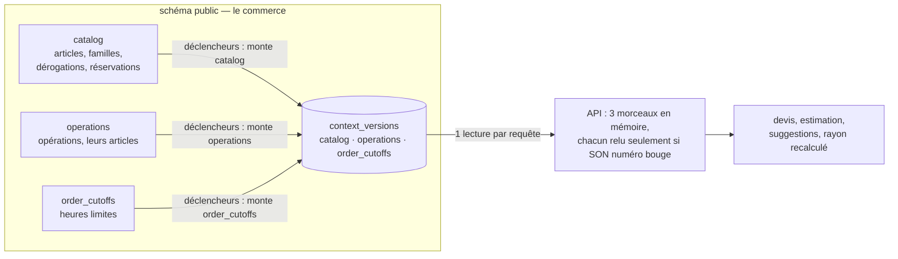
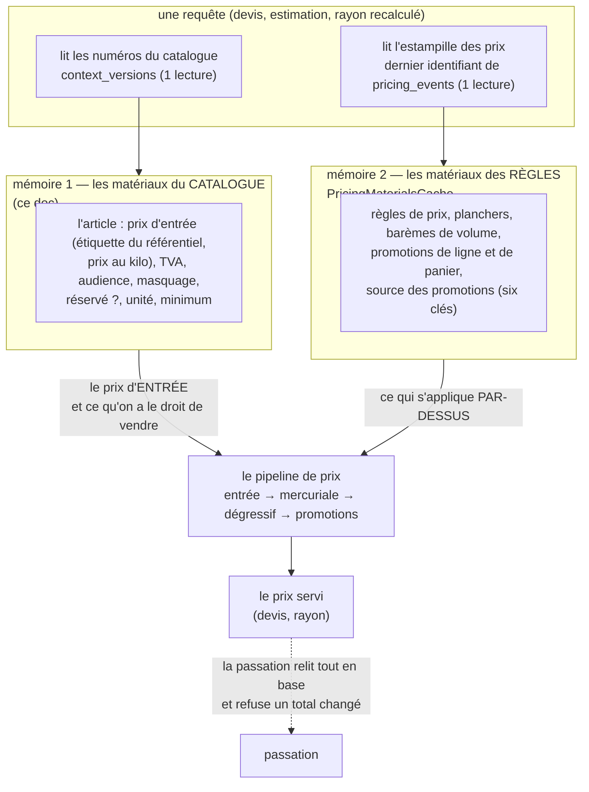

# Le catalogue en mémoire, versionné par la base

> **Doc d'état, au présent.** Elle remplace le plan des matériaux du catalogue
> (lots M0, M1a, M1b, M2, bâtis et en production du 2026-11-05 au 2026-11-06),
> supprimé une fois bâti. Son contenu, ses trois passages de `vitruve` et ses
> mesures intermédiaires restent dans l'historique git (dernier état :
> commit `91c94c241`, fichier `plan-materiaux-du-catalogue` du dossier).
> Les renvois « § n » écrits dans le code avant cette date visent ce plan.
>
> **État : implémenté, en production** (`a9c95d2ab`). Ce qui reste est au § 9.

## Partie 1 — Comprendre

### En une phrase

L'API garde le catalogue **en mémoire** et le relit seulement quand **la base
dit qu'il a changé** : chaque contexte du commerce tient un numéro, que la
base fait monter toute seule à chaque écriture qui compte.

### Ce que ça a changé, mesuré en production

| Lecture                                      | Avant                                          | Après                                                |
| -------------------------------------------- | ---------------------------------------------- | ---------------------------------------------------- |
| Devis anonyme (médiane, 30 appels)           | catalogue 127 ms en 7 lectures, requête 337 ms | catalogue **12 ms en 1 lecture**, requête **142 ms** |
| Rayon public recalculé (8 appels hors cache) | catalogue ~65 ms en 6 lectures                 | catalogue **~14 ms en 1 lecture**                    |

### Deux mémoires pour un prix : les matériaux du catalogue et ceux des règles

Un prix se fabrique en deux étages, et chacun a **sa** mémoire, **son**
numéro, relu une fois par requête. Ils sont indépendants : aucun ne vide
l'autre, et un devis les combine au moment où il calcule.

|                              | Mémoire 1 — catalogue                                                           | Mémoire 2 — règles                                                                                                                                                                                        |
| ---------------------------- | ------------------------------------------------------------------------------- | --------------------------------------------------------------------------------------------------------------------------------------------------------------------------------------------------------- |
| Ce qu'elle porte             | l'article et son **prix d'entrée**                                              | ce qui s'applique **par-dessus**, en six clés (`PRICING_CACHE_KEYS`, relu le 2026-11-06) : règles de prix, planchers, barèmes de volume, promotions de ligne, promotions de panier, source des promotions |
| Son numéro                   | `context_versions` (un par contexte : `catalog`, `operations`, `order_cutoffs`) | l'estampille : dernier identifiant de `pricing_events`                                                                                                                                                    |
| Qui le fait monter           | **la base**, par des déclencheurs sur les colonnes lues                         | **le code** : tout acte tarifaire écrit une ligne de journal (`PricingActWriter`)                                                                                                                         |
| Une correction SQL à la main | vue : le déclencheur monte                                                      | **pas vue** : redémarrer l'API (`carte-des-caches.md`)                                                                                                                                                    |
| Le code                      | `apps/lfd-api/src/lafoliecoffee/catalog/infrastructure/catalogue-snapshot/`     | `apps/lfd-api/src/lafoliecoffee/pricing/infrastructure/pricing-materials.cache.ts`                                                                                                                        |

**Pourquoi deux, et pas une.** Elles appartiennent à deux contextes qui
changent pour des raisons différentes : le catalogue suit le référentiel et
les décisions de vente (masquer, réserver), les règles suivent les actes
tarifaires (une promotion, un plancher). Une modification de prix
d'**entrée** fait monter `catalog` ; une promotion fait monter l'estampille
des prix. Un devis relit les deux numéros et combine deux états chacun à
jour : aucun mélange d'un état qui n'a jamais existé n'est possible au-delà
de l'écart d'une requête, et la passation relit tout de toute façon.

**L'asymétrie à connaître.** La mémoire des règles est vidée par le code : une
écriture faite hors de `PricingActWriter` (un `UPDATE promotion_settings` à
la main) ne bouge pas son estampille. La mémoire du catalogue, elle, est
tenue par la base. Ce n'est pas un défaut à corriger ici : c'est la forme
qu'avait la mémoire des règles avant celle-ci, et un incident SQL se termine
par un redémarrage.

### Ce qui ne passe PAS par la mémoire

- **La passation** d'une commande relit la base et fait foi ; un devis calculé
  sur un état qui vient de changer est refusé à la passation (409
  `orders.total_changed`), sans écriture.
- **Le stock du jour** : lu en base à la passation, sous verrou
  ([`../limites-de-commande/jour-meme-sur-stock.md`](../limites-de-commande/jour-meme-sur-stock.md)).
- **Le mur entre sociétés** : les réservations de l'appelant sont relues en
  SQL à chaque requête, filtrées par sa société. La mémoire ne porte que le
  NOMBRE de réservations d'un article, identique pour tous (option (a), Hugo,
  2026-11-05).
- **Le principal, l'administration, les aperçus du personnel.**
- **Les réglages du jour même**, encore lus en base sur le chemin du devis
  (§ 9).

### L'arrêt d'urgence

`CATALOGUE_SNAPSHOT_MEMORY=off`, lu par `AppConfig`, fait relire la base à
chaque requête, comme avant. Sans redéployer : `wrangler secret put
CATALOGUE_SNAPSHOT_MEMORY` avec `off`. Une fois posée, la retirer de GitHub
ne la retire pas du Worker : poser `on` pour revenir. Toute autre valeur
empêche l'API de démarrer.

## Partie 2 — Technique

### 1. Les numéros — `context_versions`

- Table `public.context_versions`, une ligne par contexte (`catalog`,
  `operations`, `order_cutoffs`, `CHECK`), migration
  `20261106120000_les_versions_par_contexte`.
- **Une fonction de montée par contexte** (`catalog_version_bump()`, …) :
  chaque déclencheur appelle celle de SON contexte. Elle **recrée** la ligne
  absente (un `UPDATE` sur zéro ligne laisserait passer l'écriture).
- **Huit déclencheurs `BEFORE … FOR EACH STATEMENT`**, resserrés aux colonnes
  lues (`UPDATE OF …`), sur `catalog_items`, `catalog_categories`,
  `catalog_item_overrides`, `catalog_item_reservations`,
  `catalog_operations`, `catalog_operation_items`, `order_cutoffs`,
  `order_cutoff_settings`. `catalog_operation_overrides` n'en a pas : personne
  ne la lit.
- **Le référentiel n'en a aucun** : quand il publie, le commerce écrit sa
  copie dans `catalog_items`, et c'est cette écriture qui fait monter
  `catalog`. Aucune frontière entre schémas n'est franchie.
- Masquer un article (`catalog_item_overrides.is_hidden`,
  `is_hidden_public`) fait monter `catalog` ; masquer une opération fait
  monter `operations`.

### 2. La mémoire

- Le code : `apps/lfd-api/src/lafoliecoffee/catalog/infrastructure/catalogue-snapshot/`
  — chargeur (`select` explicite tiré de la constante des colonnes), mémoire
  par morceau (`versioned-chunk-memory.ts`), magasin, lecteurs `Snapshot*`.
- **Les numéros sont lus une fois par requête**, sur le contexte de requête.
- **Un morceau est rangé sous le numéro lu AVANT son chargement** ; une seule
  lecture en vol par (morceau, numéro) ; la mémoire garde le dernier morceau
  et celui en chargement ; une lecture en échec n'est pas gardée ; une ligne
  de numéro absente = morceau non gardé ; hors requête (cron, semis), rien
  n'est gardé.
- **Les réservations de l'appelant sont lues AVANT les numéros** : un écart ne
  peut que refuser à l'appelant son propre article le temps d'une requête,
  jamais servir celui d'une autre société.
- **Le tri** (trois clés du rayon, clé des opérations) est demandé à Postgres
  au chargement : la mémoire a l'ordre de la base, quelle que soit sa
  collation.
- **Une portée explicite** décide qui lit la mémoire :
  `withCatalogueSnapshot`
  (`apps/lfd-api/src/lafoliecoffee/catalog/application/catalogue-snapshot-scope.ts`),
  posée sur les deux devis de la boutique, l'estimation de la saisie, les
  suggestions du panier, le rayon public (`/shop/catalogue`), le rayon pro
  recalculé (`RecognisedShelf.read`), la vitrine (`/shop/storefront/:key`,
  `/mine`) et les incontournables. Hors portée, les mêmes lecteurs lisent la
  base.

### 3. Le cache des rayons, au-dessus

La mémoire nourrit le recalcul des rayons ; les rayons gardent leur propre
cache (l'objet `ProShelves`, le bord Cloudflare, 30 s pour le public), purgé
par le signal `ShelfChanges`
([`le-rayon-en-cache.md`](le-rayon-en-cache.md)). **Ce signal part après la
validation** de la transaction, partout : une transaction ouverte hors unité
de travail a désormais sa file d'après validation
(`apps/lfd-api/src/platform/database/transactional-prisma.ts`). Une
correction faite en SQL à la main ne purge pas les rayons : c'est un
incident, et purger fait partie de sa procédure (Hugo, 2026-11-06).

### 4. Les portes

| Porte                             | Ce qu'elle tient                                                                                                                                                                                                     |
| --------------------------------- | -------------------------------------------------------------------------------------------------------------------------------------------------------------------------------------------------------------------- |
| `lint:context-version-columns`    | chaque colonne d'une table lue est classée (lue, donc sous déclencheur ; ou ignorée, avec sa raison au registre `catalogue-snapshot-registry.json`) ; le déclencheur d'une table appelle la fonction de SON contexte |
| `lint:catalogue-door`             | aucun fichier servi ne lit une table de la mémoire en direct, hors le chargeur, ses replis et une liste admise datée (administration, écritures, passation, livraison, `dev/`)                                       |
| `lint:shelf-changes-after-commit` | le signal des rayons passe par `AfterCommit`, jamais avant une écriture                                                                                                                                              |
| `lint:withdrawn-filter`           | le chargeur porte le filtre des articles retirés (`STILL_SOLD`, importé, jamais recopié)                                                                                                                             |

### 5. Le budget de lectures

`apps/lfd-api/test/catalogue-reads.e2e-spec.ts` le tient :

| Chemin                          | À chaud                   | À froid                                         |
| ------------------------------- | ------------------------- | ----------------------------------------------- |
| devis anonyme                   | 1 (numéros)               | + articles                                      |
| devis pro, estimation           | 2 (numéros, réservations) | + articles, heure limite                        |
| rayon public, rayon pro de base | 1                         | 4 (numéros, articles, opérations, heure limite) |
| rayon d'un pro connecté         | 2                         | 5                                               |

### 6. Les tests qui l'éprouvent

- `apps/lfd-api/test/context-versions.e2e-spec.ts` : chaque écriture fait
  monter SA ligne, et les deux autres ne bougent pas ; les colonnes ignorées
  ne font rien monter.
- `apps/lfd-api/test/catalogue-snapshot.e2e-spec.ts` : fiche modifiée entre
  deux devis, écriture SQL brute, article retiré, mur des réservations,
  passation refusée après une réservation par une autre société.
- `apps/lfd-api/test/catalogue-snapshot-shelf.e2e-spec.ts` : rayon recalculé
  après une fiche modifiée, opération masquée, mur au rayon pro, mémoire
  éteinte qui rend le même rayon.

### 7. Ce qui n'est pas vérifié

- la collation de la base de production (la mémoire n'en dépend plus) ;
- la taille de la mémoire indexée.

### 8. Les décisions, et d'où elles viennent

- un numéro **par contexte**, pas un seul (Hugo, 2026-11-06 : « le stamp est
  une conséquence de deux schémas qui ne devraient pas se parler ») ;
- le mur entre sociétés **dans la requête** (option (a), Hugo, 2026-11-05) ;
- les rayons purgés par le code après validation (option 1, Hugo,
  2026-11-06), plutôt qu'une clé de rayon portant les numéros, qui aurait
  fait attendre chaque visiteur.

### 9. Ce qui reste

- **Mesurer le panier d'un client connecté** (devis et suggestions, ~285 ms
  par clic avant M1b), sur le compte de test, panier vidé après.
- **Resserrer le lecteur des réglages du jour même**
  (`prisma-order-cutoff-settings.reader.ts`) : il rend aussi la garde en
  rayon, une colonne ignorée par les déclencheurs ; tant qu'il n'est pas
  resserré, ces réglages restent lus en base sur le chemin du devis.
