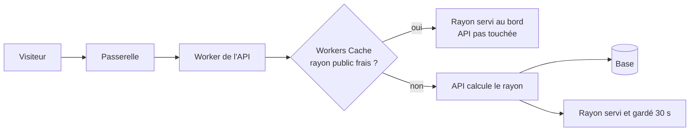
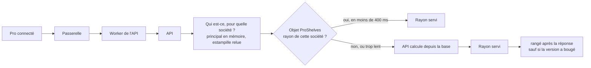
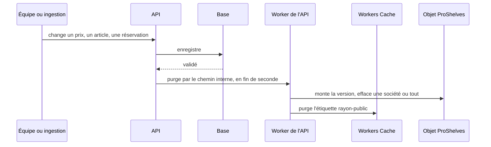

# Le rayon en cache — public au bord de Cloudflare, pro dans un objet

> ✅ **Doc d'état au 2026-11-05.** Elle remplace deux plans terminés : « le
> cache du catalogue » (lots C0b à C5, bâtis du 2026-11-04 au 2026-11-05) et
> « le rayon pro gardé jusqu'à la prochaine heure » (phase 1, en production
> le 2026-11-05, `398363b`). Leur récit est dans l'historique git ; la
> correspondance des anciennes sections est en fin de document. La carte de
> tous les caches est [`carte-des-caches.md`](carte-des-caches.md) ; ce qui
> reste à faire sur le rayon est au § 8 et, priorisé avec le reste, en tête
> de la carte.

# Partie 1 — Comprendre

## Pourquoi

La base de production (Prisma Postgres) est **facturée à l'opération**, et
loin de l'API. Calculer un rayon coûte 6 appels à chaud pour un visiteur, 13
pour un pro connecté (relevé M0 du 2026-11-05,
[`le-catalogue-en-memoire.md`](le-catalogue-en-memoire.md)). Le rayon
change rarement : on le garde.

## Deux caches, parce que deux sortes de rayons

- **Le rayon public** (visiteur, ou pro de base sans connexion) est **le même
  pour tous**. Cloudflare le garde au plus près du visiteur et le sert sans
  réveiller l'API.
- **Le rayon d'une société** (sa mercuriale, ses engagements, ses articles
  réservés) ne se sert qu'**après** avoir établi en base qui demande et pour
  quelle société. L'API le range ensuite dans **un seul objet** Cloudflare
  (`ProShelves`), une entrée par société : quel que soit le nombre
  d'instances de l'API, toutes lisent la même copie. Le particulier connecté a
  une entrée partagée (`personal`).

### Le chemin d'un visiteur

### Le chemin d'un pro

### Comment un changement arrive dans les caches

**Celui qui écrit efface**, après l'enregistrement, sans attendre qu'un
visiteur passe.

**Ce qu'une purge efface** :

| Changement                                                                               | Rayons effacés                                                                             |
| ---------------------------------------------------------------------------------------- | ------------------------------------------------------------------------------------------ |
| la mercuriale, une règle, l'engagement, le suivi ou le statut d'une société              | **cette société et ses sites** (un site hérite de son principal)                           |
| une règle de prix d'audience **segment**                                                 | **tous** : on ne sait pas énumérer les sociétés d'un segment                               |
| une réservation posée ou levée                                                           | **tous**, public compris : l'article disparaît ou se verrouille pour tous sauf une société |
| un article, une famille, un prix général, une promotion, une opération, une heure limite | **tous**                                                                                   |

### Un rayon calculé pendant une écriture

Il ne doit pas rester en cache. L'objet tient **la version** des rayons, qu'il
monte à chaque purge. L'API la relève **avant** de calculer : l'objet refuse de
ranger un rayon calculé sur une version dépassée, et l'API ne laisse pas
Cloudflare garder un rayon public si la version a bougé pendant le calcul.

### Ce qui change sans que personne n'écrive

Une promotion qui s'ouvre à midi, une opération datée, une heure limite :
aucune écriture, donc aucune purge. C'est **la durée** qui les rattrape :

- **rayon public : 30 s** ;
- **rayon d'une société : 5 minutes au plus**, et plus tôt au prochain instant
  d'une opération datée qui le change (annonce, ouverture, fermeture, fin du
  jour de retrait).

## Ce qui rend une erreur sans conséquence

Le rayon n'est qu'une **vitrine**. Le panier recalcule toujours au vrai prix
(le devis), et la passation refuse un total que le client n'a pas vu. Un
rayon un peu vieux peut **afficher** un prix dépassé ; il ne peut pas le
**facturer**. Ce qui serait grave : servir le rayon d'une société à une autre.
D'où la clé tirée de la résolution en base, jamais du client.

## La règle pour la suite : le stable dans le rayon, le dynamique à côté (Hugo, 2026-11-04)

Le rayon porte ce qui coûte à calculer et change rarement (articles, prix,
opérations). Le stock et les suggestions restent **hors** du rayon gardé,
dans leurs propres appels (`shop/suggestions/*`) ; la boutique compose les
deux à l'écran. Faire calculer une suggestion À L'INTÉRIEUR du rayon le
rendrait personnel et périssable, et tuerait le cache. La vue gardée
(`ShopCatalogueView`) ne porte aucun stock (vérifié par `vitruve` le
2026-11-04).

# Partie 2 — Le code

Chemins relatifs à la racine du dépôt. Les lignes de la carte
([`carte-des-caches.md`](carte-des-caches.md) § 1 et § 2) ont été relevées le
2026-11-05 ; celles d'ici renvoient aux fichiers.

## § 1. Ce qui est bâti

| Lot     | Ce qu'il a posé                                                                                                                                                               | Commit                   |
| ------- | ----------------------------------------------------------------------------------------------------------------------------------------------------------------------------- | ------------------------ |
| C0b     | `enable_ctx_exports` (sans avancer la date de compatibilité), `ContainerProxy` exporté, porte `lint:container-start`                                                          | `8aaa1f638`              |
| C1      | le port `ShelfChanges` (`apps/lfd-api/src/lafoliecoffee/shared/shelf-changes/`), la fenêtre d'une seconde, les écrivains, la porte `lint:shelf-writes`                        | `7a62edd7f`              |
| C2      | l'objet `ProShelves`, le port `ShopShelfCache`, le repli (délai, disjoncteur), la purge société + sites, le rayon rangé compressé                                             | `a8c07257f`              |
| C3      | Workers Cache sur `/shop/catalogue` et `/shop/featured`, derrière un drapeau public ; `lint:cache-control` étendue au container                                               | 2026-11-04               |
| C4      | le rayon relu au retour sur l'onglet **seulement si le panier est vide** et la photo a une minute (`ShelfRefreshOnReturn`, `ShopCatalogue.refreshIfStale`) — option b de Hugo | 2026-11-04               |
| C5      | les issues comptées (`CacheOutcomeRecorder`), la durée des appels à l'objet, champ `caches` et `cacheCalls` de la carte de santé, affichés au back-office (page Santé)        | `79bdf21cc`, `aeeb14d05` |
| phase 1 | 5 minutes au plus ou la prochaine opération datée ; la révision de l'API dans la clé                                                                                          | `5cb7790fc` → `398363b`  |
| —       | rangement après la réponse ; attente de l'objet portée à 400 ms                                                                                                               | `3b2ec33f5`, `f631e0fb4` |

## § 2. La mesure

- **Taille d'un rayon**, mesurée en production le 2026-11-04 :
  `GET /shop/catalogue` = 121 458 octets bruts, 11 126 compressés, 161
  articles. 1 000 sociétés font ~11 Mo compressés : l'objet range la vue
  compressée dans son stockage SQLite (limite d'une ligne : 2 Mo).
- **Phase 1** (2026-11-05) : rayon resservi par l'objet en 62 ms côté API au
  lieu de 349 ms recalculé.
- **Avant le passage à 400 ms** (2026-11-05, carte de santé) : deux lectures
  de l'objet sur trois dépassaient 100 ms, l'API recalculait (300 ms à 2 s).
- **Relevé de Hugo en production le 2026-11-05 au soir**, après dix minutes
  sans trafic : `GET /shop/catalogue/mine` en **385 ms**. Non remesuré ici ;
  la part servie par l'objet depuis le passage à 400 ms **n'est pas
  relevée** dans ce document.

## § 3. Le rayon public — Workers Cache

- Activé par `"cache": { "enabled": true }` (`apps/lfd-api/wrangler.jsonc`).
  Les réponses de `/shop/catalogue` et `/shop/featured` portent
  `public, max-age=30` et `Cache-Tag: rayon-public`
  (`apps/lfd-api/src/lafoliecoffee/catalog/http/public-shelf-cache-headers.ts`) ;
  toute autre réponse garde le `private` du middleware
  ([`aucune-reponse-personnelle-en-cache.md`](aucune-reponse-personnelle-en-cache.md)).
- **Ces deux routes ne lisent jamais l'appelant** (`read-shop-catalogue.ts`,
  `read-shop-featured.handler.ts`) : `public` y est juste, et un visiteur
  connecté profite du cache. `lint:cache-control` tient la liste des fichiers
  qui le peuvent.
- **Le drapeau public** vit dans l'objet (`meta.public_enabled`, absent =
  éteint), retenu 5 s par instance (`public-shelf-flag-memory.ts`). Hugo l'a
  allumé (`public-on`) le 2026-11-04 et un `HIT` servi en 11 ms par la
  passerelle a été constaté ce jour-là ; l'état courant se lit par
  `ops_shelf_cache`, pas dans le code.
- **Un rayon douteux n'est pas offert au bord** : drapeau éteint à l'un des
  deux relevés, version bougée, objet injoignable, lent, disjoncteur ouvert
  → l'en-tête du middleware (`private`). La raison est dans `X-Shelf-Cache`
  (`public-shelf-rules.ts`, `public-shelf-cacheability.ts`).
- **Une portée « une société » ne purge pas le public** : il se calcule sans
  société. Seul « tout » purge Workers Cache, et pas quand le drapeau est
  éteint.
- ⚠️ **Non prouvé** : que la clé de Workers Cache sépare
  `/shop/catalogue` de `/shop/catalogue?audience=pro`. Aucun `cacheKey` dans
  le code (grep du 2026-11-05) : c'est la clé par défaut. Objectif restant
  (§ 8).

## § 4. Le rayon d'une société — l'objet `ProShelves`

- **Où** : `apps/lfd-api/container/pro-shelves.ts`, une instance unique,
  stockage SQLite : table `shelves (key, body, version, principal,
expires_at)` et table `meta` (version globale, drapeaux).
- **Le chemin conteneur → objet** : un gestionnaire de sortie
  (`Backend.outboundByHost`, `apps/lfd-api/container/worker.ts`) intercepte
  `http://rayons.interne/…`. **Aucune route publique, aucun jeton** ; le
  gestionnaire refuse tout appelant autre que `Backend` (`ctx.containerId`).
- **Clé** : `r:<révision>/company:<id>` ou `r:<révision>/personal`
  (`storageKeyOf`, `apps/lfd-api/container/shelf-store.ts`). La société est
  celle que `@ActingCompany` a résolue en base.
- **Version globale** : relevée avant le calcul, le rangement est refusé (409)
  si elle a bougé. Une version par société rouvrirait le trou d'un site
  rattaché pendant le calcul.
- **Une société et ses sites** : chaque entrée range l'identifiant du
  principal actuel de la société (`ServedCompany`, actif ou non) ; la purge
  d'une société efface aussi les entrées dont elle est le principal.
- **Corps** : la vue compressée par l'API (`shelf-wire.ts`, gzip), rangée et
  rendue telle quelle ; l'objet ne l'ouvre jamais et ne lit jamais l'heure
  (l'API lui passe l'instant et l'échéance).
- **Rangement après la réponse** : `ResilientShopShelfCache.storeAfterReply`,
  délai 2 s (`SHELF_STORE_LIMIT_MS`).

## § 4 bis. Jamais sur le chemin de la disponibilité (Hugo, 2026-11-04)

« La prod ne peut jamais tomber en panne. » **Toute panne du cache retombe sur
la lecture en base.**

| Panne                                       | Ce qui se passe                                                                                                         |
| ------------------------------------------- | ----------------------------------------------------------------------------------------------------------------------- |
| Workers Cache vide, désactivé ou en panne   | l'API calcule depuis la base                                                                                            |
| l'objet ne répond pas, répond mal, ou tarde | lecture bornée à **400 ms** (`SHELF_CALL_LIMIT_MS`, `shelf-call-guard.ts`, 100 ms jusqu'au 2026-11-05) : passé, la base |
| l'objet est en panne durable                | disjoncteur : 5 échecs, coupé 30 s (`shelf-cache-breaker.ts`)                                                           |
| une purge échoue                            | journalisée, **pas comptée ni alertée** ; la durée rattrape (30 s public, 5 min pro)                                    |
| la version ne se lit pas                    | public : pas offert au bord ; pro : calcul sans rangement                                                               |

**La seule panne que ce repli ne couvre pas** : un conteneur qui ne démarre
pas (un gestionnaire de sortie sans `ContainerProxy` exporté — constaté en
local le 2026-11-04). Elle est tenue par `lint:container-start`.

## § 4 ter. Un port, pour pouvoir changer de magasin

Le service du rayon parle au port `ShopShelfCache`
(`apps/lfd-api/src/lafoliecoffee/catalog/domain/ports/shop-shelf-cache.ts`), relié dans
`apps/lfd-api/src/appBootstrap/shop-shelf-cache.module.ts` à
`DurableObjectShopShelfCache` ou `NoShopShelfCache` ; les tests d'application
tournent contre `InMemoryShopShelfCache`. Passer à Redis serait un adaptateur
de plus. **Durable Object plutôt qu'Upstash** (Hugo, 2026-11-04) : un seul
fournisseur, une seule facture, aucun secret de plus.

## § 4 quater. Surveiller

La carte de santé (`GET /admin/ops/health`, page Santé du back-office) rend :

- `caches` — par cache, le total et la part de chaque issue, par minute sur
  30 min, **par instance** : `shelf.read` (`hit`, `miss`, `fallback_*`),
  `shelf.store` (`stored`, `stale_refused`, `not_kept`, `fallback_*`),
  `shelf.public` (`cacheable`, `not_cacheable_*`) ;
- `cacheCalls` — par opération sur l'objet, le nombre d'appels, d'abandons,
  p50, p95 (`apps/lfd-api/src/ops/health/cache-call-readings.ts`).

Les purges, l'interrupteur et le disjoncteur sont des **événements
journalisés**, pas des compteurs
(`counting-shelf-cache-signals.ts`, relu le 2026-11-05). **Aucune alerte**
n'existe : c'est un objectif restant (§ 8).

## L'interrupteur

GitHub → Actions → **`ops_shelf_cache`** → « Run workflow » :

- `off` — chaque rayon se calcule depuis la base, tout est effacé (et le
  public éteint) ;
- `on` — le cache se remplit aux visites suivantes ;
- `purge` — tout est effacé, l'état ne change pas ;
- `public-on` / `public-off` — le seul drapeau public.

`off`, `public-off` et `purge` purgent aussi Workers Cache. Route
`POST /admin/ops/shelf-cache` (`{ action }`, jeton `RECOMPUTE_TOKEN`),
gestes `shelf-store.ts` ; journaux `shelf_cache.switched` et
`shelf_cache.purged_manually`.

## § 5. La purge

- **Après la validation** : le port `ShelfChanges` appelle
  `AfterCommit.defer` lui-même (`changed({ kind: "all" })` ou
  `{ kind: "company", companyId }`).
- **Regroupée** : au plus une purge par seconde (`ShelfChangeWindow`,
  `SHELF_PURGE_WINDOW_MS = 1000`) ; un `all` absorbe les sociétés. Une
  ingestion de 200 fiches fait une purge.
- **Par le chemin interne** : `ProShelfPurge` (`pro-shelf-purge.ts`) pour
  l'objet, `PublicShelfPurge` (`public-shelf-purge.ts`) pour le public, qui
  passe par le relais `relayPublicPurge` du Worker vers son point d'entrée par
  défaut (`ctx.exports`) — parce que seul le propriétaire purge son cache.
- **Les écrivains** sont tenus par `lint:shelf-writes` : tout fichier qui
  écrit un modèle que le rayon lit émet `ShelfChanges`, ou figure dans une
  liste admise datée. **Les commandes ne purgent pas** (Hugo, 2026-11-04) : un
  palier ouvert par une commande apparaît au rayon pro à l'expiration (5 min
  au plus) ; le panier, lui, calcule au vrai prix.
- **Une purge perdue** (redémarrage dans la seconde, relais en 503) n'est pas
  rejouée : la durée rattrape.

## § 6. La durée

`recognisedShelfExpiry`
(`apps/lfd-api/src/lafoliecoffee/catalog/application/recognised-shelf.service.ts`) :
`min(now + 5 min, prochain instant d'opération datée du rayon)` —
`RECOGNISED_SHELF_LIFETIME_MS = 5 * 60_000`. Les quatre instants d'une
opération (`announceFrom`, `orderFrom ?? announceFrom`, `orderUntil`, fin du
jour de retrait) viennent de `next-operation-change.ts`, sans franchir la porte
des prix ; une fin de jour introuvable est ignorée, le plafond la borne. La
révision de l'API (`AppConfig.revision()`) est dans la clé : un déploiement ne
relit jamais l'ancien rayon. Le rayon public reste à 30 s fixes. L'heure se
lit sur `Clock.now()` (`lint:clock-port`).

### § 6.1 Pourquoi pas plus de 5 minutes (`vitruve`, 2026-11-04)

1. **Les ouvertures à venir ne sont jamais chargées** : promotions et
   mercuriale ne lisent que ce qui est en vigueur ; une promotion qui ouvre à
   midi est invisible au calcul.
2. **D'autres heures changent la vue** : les plages hebdomadaires des offres
   d'acheminement, et le **plancher dynamique** (fenêtre glissante de ventes,
   qu'aucune commande ne purge).
3. **Une purge perdue n'est rattrapée que par la durée** : la fenêtre d'une
   seconde vit en mémoire, et un effacement en panne est compté puis laissé à
   la durée (`resilient-shop-shelf-cache.ts`).

### § 6.2 La phase 2, préalable à tout plafond plus long

(a) un lecteur des bornes À VENIR sur chaque table datée, avec une porte qui
part des modèles du rayon ; (b) la prochaine bascule des plages des offres ;
(c) un effacement en échec rejoué, ou le magasin éteint ; (d) une décision
écrite sur le plancher dynamique. **Rien n'est bâti** : elle ne se justifie
qu'avec le précalcul (§ 8).

### § 6.3 Tests

`apps/lfd-api/src/lafoliecoffee/catalog/domain/__tests__/next-operation-change.spec.ts`,
`apps/lfd-api/container/__tests__/shelf-store.spec.ts` (deux révisions, deux
clés), `apps/lfd-api/test/recognised-shelf-cache.e2e-spec.ts` (servi au second
appel, expiration à l'opération).

## § 7. Les portes

- `lint:shelf-writes` — les écrivains émettent `ShelfChanges` (§ 5).
- `lint:cache-control` — seuls les fichiers admis disent `public` ; dans
  `apps/lfd-api/container/`, seuls `worker.ts` et `pro-shelves.ts` purgent,
  interceptent ou déclarent un `DurableObject`.
- `lint:container-start` — pas de gestionnaire de sortie sans
  `ContainerProxy` ni `enable_ctx_exports`.

## § 8. Ce qui reste

Chaque point est repris, priorisé, dans les **Objectifs restants** de
[`carte-des-caches.md`](carte-des-caches.md).

- **Prouver la clé de Workers Cache par paramètre** (§ 3).
- **Alerter sur une purge ratée** et sur le disjoncteur ouvert (§ 4 quater).
- **Le précalcul (phase 3)** — décidé dans son principe par Hugo le
  2026-11-05 : le rayon de chaque société recalculé en tâche de fond à chaque
  `ShelfChanges` ou borne à venir, afficher n'étant plus qu'une lecture.
  **Seulement si 400 ms ne suffit pas** : la mesure qui le dira est la part
  `hit` de `shelf.read` et le p95 de `cacheCalls` sur la page Santé. Dépend de
  la phase 2 (a) et (c) ; touche l'argent : `vitruve` d'abord.

**Abandonné** :

- « jusqu'à la prochaine heure, plafond 1 h » (2026-11-04) — trois objections
  bloquantes (§ 6.1) ; remplacé par les 5 minutes de la phase 1 ;
- la vérification d'identité à la passerelle (2026-11-04) — elle ferait de la
  passerelle une seconde frontière de sécurité pour économiser deux lectures,
  et le principal en mémoire ([`qui-est-le-client.md`](qui-est-le-client.md))
  a depuis rendu ces lectures presque gratuites.

## Non vérifié

- que Workers Cache sépare les adresses par paramètre, respecte
  `Vary: Origin` et ignore les en-têtes de la passerelle ;
- le relais de purge par `ctx.exports` en production (« non prouvé » dans son
  propre JSDoc, 2026-11-04) ;
- si une société peut être principal ET site d'une autre (plus d'un niveau) :
  la purge « un niveau » ne suffirait plus ;
- la mémoire et le débit de l'objet à 1 000 sociétés ;
- qu'aucun champ du rayon ne dépende de l'heure au point d'être faux avant la
  durée (compte à rebours, `sealing`).

## Correspondance avec les plans retirés

Le code cite encore des sections par leur ancien numéro ; elles ont gardé leur
place ici.

| Ancienne référence                                      | Ici             |
| ------------------------------------------------------- | --------------- |
| plan du cache du catalogue, § 3, § 4, § 4 bis à quater  | mêmes numéros   |
| plan du cache du catalogue, § 5, § 6, § 7, interrupteur | mêmes numéros   |
| plan du cache du catalogue, C0b à C5                    | § 1             |
| plan du rayon jusqu'à la prochaine heure, § 0           | § 6.1           |
| plan du rayon jusqu'à la prochaine heure, § 1           | § 6             |
| plan du rayon jusqu'à la prochaine heure, § 2           | § 6.2           |
| plan du rayon jusqu'à la prochaine heure, § 2 bis       | § 8 (précalcul) |
| plan du rayon jusqu'à la prochaine heure, § 3           | § 6.3           |
