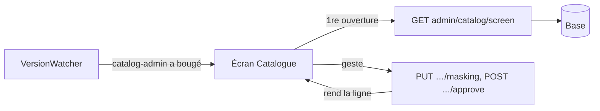

# Plan — l'écran Catalogue du back-office, lu une fois

> 📐 **Plan, 2026-11-12.** Rien n'est bâti. Demande de Hugo : « je veux
> optimiser le catalogue ». Suite du [veilleur unique](plan-veilleur-unique.md)
> (un numéro par sujet, une porte, un veilleur par onglet), sur lequel il
> s'appuie. Le PIM suivra dans un plan à part, sur le même modèle.

## 1. En simple

Aujourd'hui, ouvrir l'onglet Catalogue lit la base une dizaine de fois, dont
deux fois les mêmes articles, et **chaque geste** (masquer un article,
valider) relit tout le catalogue. Revenir sur l'onglet relit tout aussi.

Après ce plan :

- **une seule lecture** à l'ouverture, servie par une seule route ;
- **un geste ne relit que sa ligne** ;
- **revenir sur l'onglet ne lit rien** : la copie est gardée dans l'onglet,
  et un numéro `catalog-admin` dit quand un collègue a changé quelque chose.

## 2. Ce qui existe (vérifié le 2026-11-12)

- **L'écran** `apps/lfd-backoffice-frontend/src/app/b2b/catalogue/catalogue-page/catalogue-page.ts`
  charge en parallèle `admin/catalog/published`, `admin/catalog` et, sous son
  droit, les marqueurs du sur mesure. `toggleMasking` et `approve` rappellent
  `load()`, qui relit les trois.
- **`admin/catalog/published`** (`prisma-published-catalog.reader.ts`) :
  `catalogEntry`, `catalogItem` avec `override`, `catalogCategory`.
- **`admin/catalog`** (`prisma-catalog-admin.reader.ts`) : `catalogItem` avec
  `category`, `override` et `_count.reservations`, puis la résolution des
  auteurs des décisions (`StaffAuthorDirectory`).
- **Les marqueurs du sur mesure** (`prisma-made-to-order-admin.reader.ts`) :
  relisent `catalogItem`.
- **`context_versions('catalog')`** existe et monte sur les colonnes que lit
  l'instantané du rayon (`catalogue-snapshot-columns.ts`) ; il ne couvre ni
  `catalog_entries`, ni les colonnes propres à l'écran (auteur et date d'une
  décision, réservations comptées). Il ne peut donc pas servir tel quel.

## 3. La conception

Relue après `vitruve` (2026-11-12, § 5) : un geste ne peut pas relire sa seule
ligne, parce que la vue porte des comptes par rayon et la liste en attente de
validation, calculés sur tout le catalogue.

### 3.1 Une route pour l'écran

`GET admin/catalog/screen`, sous `@AdminSurface("lfc_catalog")`, rend en une
fois la vue publiée, les lignes de paramétrage et le numéro `catalog-admin`
lu **avant** les données. Les marqueurs du sur mesure n'y entrent que si
l'appelant a `lfc_made_to_order:read` : le handler reçoit
`@StaffPermissions()` et tranche, comme `versions.controller.ts` (une route
unique ne peut pas porter deux surfaces). Elle ne résout pas les auteurs des
décisions (l'écran ne les affiche pas) et ne compte pas les réservations
(l'écran les lit dans les marqueurs). Une lecture de `catalog_items`, une de
`catalog_entries`, une des familles, une des décisions, et les marqueurs sous
leur droit : **6 à 7 requêtes au lieu de 11 à 12**, les `include` de Prisma
faisant une requête par relation.

Les routes `admin/catalog`, `admin/catalog/published` et les marqueurs
restent : Mise en avant, Promotions, fiche client › articles réservés, offre
pro d'une variante et carte de sélection du commerce les lisent.

### 3.2 Un geste relit sa ligne, l'écran recalcule les comptes

Décidé avec Hugo le 2026-11-12. Les comptes par rayon et la liste en attente
de validation se calculent sur tout le catalogue, mais l'écran l'a déjà dans
son store. Le calcul (`shelvesOf`, `pendingOf`, aujourd'hui dans
`published-catalog-view.ts`) devient **une fonction pure partagée** dans
`@lfd/contracts`, lue par le serveur (route de l'écran) et par l'écran (après
un geste) : une seule arithmétique, testée une fois.

Masquer et valider relisent **les lignes touchées** par
`GET admin/catalog/screen/rows?sku=…` (les lignes validées après le
**dernier** lot), sous le même droit, avec le numéro `catalog-admin` lu avant
les lignes ; l'écran les remplace dans sa copie et recalcule. Fermer le
panneau du sur mesure relit les marqueurs seuls, comme aujourd'hui.

### 3.3 Le numéro `catalog-admin`

Journal en ajout seul `public.catalog_admin_change`, version = `max(id)` +
`count(*)`, déclencheurs `FOR EACH STATEMENT` sur `catalog_entries`,
`catalog_items`, `catalog_categories`, `catalog_item_overrides` et
`catalog_item_reservations`. Une instruction **n'écrit une ligne que si une
ligne a vraiment changé** (`old_table` et `new_table` comparées par
`IS DISTINCT FROM`) : le projecteur du référentiel réécrit les articles à
l'identique à chaque rejeu, et sans ce filtre chaque rejeu relirait tous les
onglets ouverts. Élagueur à 7 jours dans `lafoliecoffee/catalog` (port,
adaptateur, branchement sur la passe qui purge les autres journaux). Sujet
global sous `lfc_catalog:read`. `context_versions('catalog')` ne change pas.

### 3.4 Le store

`CatalogueScreenStore` dans `b2b/catalogue/` : charge à la première ouverture
de l'onglet, rien avant ; garde la copie tant que l'onglet du navigateur vit ;
**retient le numéro rendu avec la copie**, si bien que l'écho du propre geste
de l'onglet ne relit rien (le veilleur voit un numéro égal à celui de la
copie) ; relit tout quand le numéro diffère (le geste d'un collègue) ; filet
de 5 min.

### 3.5 Le contenu partagé dans l'objet

Décidé par Hugo le 2026-11-12 (« j'aime pas trop l'idée de cache navigateur
comparé au cache partagé »). La réponse de `admin/catalog/screen` **sans les
marqueurs du sur mesure** est la même pour tout porteur de `lfc_catalog` :
elle est rangée dans l'objet `DayVersions` sous la clé
(révision, `catalog-admin`, numéro). Tant que le numéro ne bouge pas, tous les
postes et tous les onglets la reçoivent sans toucher la base ; quand il
bouge, une seule relecture pour tous (single-flight par instance, comme les
numéros). Les marqueurs du sur mesure ne sont jamais rangés : ils sont lus à
chaque appel, sous leur droit. Une réponse au-delà d'une taille plafond
(1 Mo) n'est pas rangée et l'écart est journalisé ; objet indisponible →
lecture directe de la base, comme pour les numéros. Les lignes relues après
un geste ne passent pas par l'objet.

Le store de l'onglet reste, plus mince : il garde la copie et son numéro pour
remplacer une ligne après un geste et ignorer l'écho de son propre geste.

## 4. Le bâti

- **K1 — l'API** : la route de l'écran, le journal filtré (migration
  additive, `lecteur-de-migrations`), l'élagueur, la source `catalog-admin`.
- **K3 — le contenu partagé** (§ 3.5), dans le même lot que K1 côté API.
- **K2 — l'écran** : le store, la page qui le lit, la relecture après un
  geste, le numéro retenu, l'abonnement.
- **Mesure** : avant et après, sur dev, le nombre de requêtes à la base pour
  une ouverture et pour un geste (journal des requêtes Prisma).

## 5. Ce que `vitruve` a rendu (2026-11-12)

- BLOQUANT « un geste relit sa ligne » : la vue porte des comptes globaux →
  § 3.2, le calcul devient une fonction partagée que l'écran rejoue.
- BLOQUANT le droit : `lfc_catalog`, et le sur mesure tranché dans le
  handler → § 3.1.
- SÉRIEUX l'écho du propre geste → le store retient le numéro rendu (§ 3.4).
- SÉRIEUX le journal monte sur un rejeu à l'identique → filtre par ligne
  changée (§ 3.3).
- SÉRIEUX « une seule lecture » : faux avec les `include` → 6 à 7 requêtes,
  dit en § 3.1.
- SÉRIEUX auteurs et réservations lus pour rien → retirés de la route.
- SÉRIEUX élagueur absent → au lot K1.
- Rien de l'écran ne dépend de l'heure ; aucune fenêtre de prix datée : la
  question du prix périmé est couverte par les déclencheurs.
