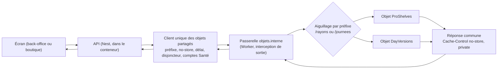

# Plan — un seul client pour tous les objets partagés

Décision : Hugo, le 2026-11-13 (« je veux le meilleur »). Le plan suit le défaut de production du même jour (commit `a831c0fd5`).

---

# Partie 1 — L'explication simple

Quand un écran du back-office ou de la boutique a besoin d'une donnée déjà calculée (un rayon, le contenu d'une journée), l'API la demande à un **objet partagé**. Un objet partagé est une petite mémoire tenue par Cloudflare.

**Le défaut du 13 novembre.** Entre l'API et l'objet, Cloudflare gardait une copie de la réponse « absent ». Les ouvertures suivantes recevaient cette copie et n'atteignaient plus l'objet. Le correctif d'urgence a posé un en-tête « ne garde rien » à neuf endroits du côté API et à trois endroits du côté objets. Un dixième appel oublié referait le même défaut.

**Ce que le chantier change.** Le comportement ne change pas. Ce qui change, c'est la forme du code :

- **côté API, un seul client.** Tous les appels aux objets passent par lui. Il pose le préfixe, l'en-tête « ne garde rien », le délai, le disjoncteur et les comptes de l'onglet Santé ;
- **côté objets, une seule fonction de réponse,** partagée par tous les objets ;
- **une seule table d'aiguillage** dit quels objets existent. Ajouter un objet revient à ajouter une ligne ;
- **une porte** (un contrôle automatique) refuse tout appel qui contourne le client et toute réponse qui contourne la fonction commune ;
- **un test** rejoue le piège de la production avec un faux cache placé au milieu. Pour chaque objet, deux lectures de suite doivent atteindre l'objet.

Le client ne dépend pas de Cloudflare. Si un jour on passe à Redis, on remplace un seul adaptateur.

---

# Partie 2 — La technique (vérifiée dans le code le 2026-11-13)

## 1. L'existant, fichier par fichier

| Affirmation                                                                                                                                               | Fichier:ligne                                                                                                                                                                                                                                                                                                                                                                                                                                                                                                                                                                                                                                                       |
| --------------------------------------------------------------------------------------------------------------------------------------------------------- | ------------------------------------------------------------------------------------------------------------------------------------------------------------------------------------------------------------------------------------------------------------------------------------------------------------------------------------------------------------------------------------------------------------------------------------------------------------------------------------------------------------------------------------------------------------------------------------------------------------------------------------------------------------------- |
| La valeur `no-store` envoyée par l'API, et `uncachedInternalCall(init)`, qui ne fait que poser l'en-tête                                                  | `apps/lfd-api/src/platform/outbound/uncached-internal-call.ts:2`, `:17-21`                                                                                                                                                                                                                                                                                                                                                                                                                                                                                                                                                                                          |
| L'option `cache: "no-store"` n'est volontairement pas posée (undici n'a pas de cache HTTP)                                                                | même fichier `:13-15`                                                                                                                                                                                                                                                                                                                                                                                                                                                                                                                                                                                                                                               |
| Côté objets, `INTERNAL_NO_STORE = "no-store, private"` et `withNoStore(response)`                                                                         | `apps/lfd-api/container/no-store.ts:12`, `:18-22`                                                                                                                                                                                                                                                                                                                                                                                                                                                                                                                                                                                                                   |
| `DayVersions.fetch` enveloppe `route()` dans `withNoStore`                                                                                                | `apps/lfd-api/container/day-versions.ts:28`, `:79-81`                                                                                                                                                                                                                                                                                                                                                                                                                                                                                                                                                                                                               |
| `ProShelves.fetch` fait de même                                                                                                                           | `apps/lfd-api/container/pro-shelves.ts:12`, `:65-67`                                                                                                                                                                                                                                                                                                                                                                                                                                                                                                                                                                                                                |
| La passerelle `internalObjectsGateway` : refus 403 d'un appelant étranger, 404 pour un préfixe inconnu, relais de la purge publique, puis appel à l'objet | `apps/lfd-api/container/worker.ts:272-293`                                                                                                                                                                                                                                                                                                                                                                                                                                                                                                                                                                                                                          |
| La passerelle est enveloppée par `uncachedInternalObjectsGateway`, puis inscrite par affectation                                                          | `worker.ts:363-369`, `:371`                                                                                                                                                                                                                                                                                                                                                                                                                                                                                                                                                                                                                                         |
| Une table `OBJECT_STUBS` dans le Worker double l'union `InternalObject`                                                                                   | `worker.ts:382-385`                                                                                                                                                                                                                                                                                                                                                                                                                                                                                                                                                                                                                                                 |
| La purge publique relayée (`relayPublicPurge`, `ctx.cache.purge`) passe par `/rayons`, mais ce n'est pas un objet                                         | `worker.ts:286-291`, `:312-325`, `:341-356`                                                                                                                                                                                                                                                                                                                                                                                                                                                                                                                                                                                                                         |
| L'hôte unique `objets.interne`, l'union `"pro-shelves" \| "day-versions"`, les préfixes `/rayons` et `/journees`                                          | `apps/lfd-api/container/internal-objects.ts:14`, `:17`, `:20-23`                                                                                                                                                                                                                                                                                                                                                                                                                                                                                                                                                                                                    |
| Les origines posées dans `SHOP_SHELF_CACHE_URL` et `DAY_VERSIONS_CACHE_URL`                                                                               | `internal-objects.ts:26`, `:29` ; lues par `apps/lfd-api/src/platform/config/app-config.ts:142-143`                                                                                                                                                                                                                                                                                                                                                                                                                                                                                                                                                                 |
| L'aiguillage par préfixe, et `objectUrlOf`, qui retire le préfixe                                                                                         | `internal-objects.ts:43-58`, `:61-65`                                                                                                                                                                                                                                                                                                                                                                                                                                                                                                                                                                                                                               |
| Les 9 adaptateurs. Chacun a son propre `fetchFn`, son `AbortSignal.timeout(...)` et son appel à `uncachedInternalCall`                                    | `platform/day-versions/durable-object-day-contents-cache.ts:49,101-105` · `durable-object-versioned-content-cache.ts:30,67-71` · `durable-object-day-versions-cache.ts:39,75-79` · `ops/caches/durable-object-cache-metrics.reader.ts:39,61-65` · `lafoliecoffee/catalog/infrastructure/durable-object-shop-shelf-cache.ts:54,116-120` · `internal-public-shelf.ts:40,67-71` · `durable-object-shop-shelf-switch.ts:28,35-41` · `lafoliecoffee/shared/public-settings-cache/infrastructure/internal-public-settings-edge-cache.ts:43,50-54` · `lafoliecoffee/shop-copy/infrastructure/internal-shop-copy-edge-cache.ts:40,47-51` (chemins sous `apps/lfd-api/src/`) |
| La garde bornée (délai, disjoncteur, repli `null`, mesures `<cache>.round_trip`, `.fallback`, `.breaker_opened`)                                          | `apps/lfd-api/src/platform/cache-calls/bounded-call-guard.ts:41-65`                                                                                                                                                                                                                                                                                                                                                                                                                                                                                                                                                                                                 |
| La garde est construite 4 fois, au-dessus des adaptateurs et pas dedans                                                                                   | `platform/day-versions/resilient-day-versions-cache.ts:46`, `day-contents.ts:88`, `versioned-contents.ts:63`, `lafoliecoffee/catalog/application/shelf-call-guard.ts:86`                                                                                                                                                                                                                                                                                                                                                                                                                                                                                            |
| Le port de comptage `CacheOutcomeRecorder.record(cache, outcome)`                                                                                         | `apps/lfd-api/src/platform/metrics/cache-outcome-recorder.ts:13-16` ; utilisé par exemple dans `day-contents.ts:86`, `:166`                                                                                                                                                                                                                                                                                                                                                                                                                                                                                                                                         |
| Le cache des Workers est allumé                                                                                                                           | `apps/lfd-api/wrangler.jsonc:46` (`"cache": { "enabled": true }`)                                                                                                                                                                                                                                                                                                                                                                                                                                                                                                                                                                                                   |
| Les classes d'objet et leurs migrations                                                                                                                   | `wrangler.jsonc:109`, `:111` (liaisons) et `:122-127` (tags v1 à v3)                                                                                                                                                                                                                                                                                                                                                                                                                                                                                                                                                                                                |
| Les tests du conteneur tournent déjà sous `node:sqlite`                                                                                                   | `apps/lfd-api/container/__tests__/day-contents.spec.ts:1`, `versioned-contents.spec.ts:1`                                                                                                                                                                                                                                                                                                                                                                                                                                                                                                                                                                           |
| Le lanceur des portes refuse de tourner si le compte de CLAUDE.md § 10 est faux                                                                           | `lint/run.mjs:56-61` ; `lint/lib/catalogue.mjs:64-76` ; le catalogue dit de l'ajouter au compte (`lint/lint-backend.json:2`)                                                                                                                                                                                                                                                                                                                                                                                                                                                                                                                                        |
| Le compte actuel est 72. Le catalogue liste aussi 72 portes                                                                                               | `CLAUDE.md:1440` ; `grep -c '"name"' lint/lint-backend.json` → 72                                                                                                                                                                                                                                                                                                                                                                                                                                                                                                                                                                                                   |
| La porte `cache-control` lit déjà `container/` et y admet par fichier le gestionnaire de sortie et les classes d'objet                                    | `dev-toolbox/gates/cache-control.mjs:24-28`                                                                                                                                                                                                                                                                                                                                                                                                                                                                                                                                                                                                                         |
| La doc garde le défaut dans « Reste à faire »                                                                                                             | `documentation/caching-usage/le-cache-du-back-office.md:547-576`                                                                                                                                                                                                                                                                                                                                                                                                                                                                                                                                                                                                    |

**Constat.** Aujourd'hui, le no-store, le délai de socket, le `fetchFn` et l'URL de base sont recopiés 9 fois. La garde et le comptage sont recopiés 4 fois, à un autre étage. Rien n'empêche un 10ᵉ adaptateur d'appeler `fetch` sans en-tête. Rien ne force non plus un 3ᵉ objet à envelopper sa réponse.

## 2. La cible

### 2.1 Côté API : le port et son client unique

Nouveau dossier : `apps/lfd-api/src/platform/shared-cache/`.

- **_shared-cache-store.ts_ (à créer) — le port** (classe abstraite, comme `CacheOutcomeRecorder`). C'est le vocabulaire d'un stockage partagé, sans HTTP :
  - `read(object, path, query?, headers?)` → `{ status: "hit", body, meta } | { status: "absent" } | null`. `null` veut dire « lis la base » ;
  - `write(object, path, body, options)` avec `options.ifVersion` (CAS) ;
  - `command(object, path, method, body?)` pour l'interrupteur, les purges et les compteurs.

  `object` est une clé de la table officielle, `InternalObject`, réexportée et non recopiée.

- **_shared-cache-client.ts_ (à créer) — la réalisation unique de l'appel borné.** Elle compose le port avec `BoundedCallGuard` (délai, disjoncteur, mesures) et `CacheOutcomeRecorder` (comptage Santé). Les adaptateurs métier ne voient que ce client.
- **_cloudflare/durable-object-shared-cache-store.ts_ (à créer) — la seule réalisation Cloudflare.** Elle construit `http://objets.interne<préfixe><path>` à partir de `INTERNAL_OBJECT_PREFIXES`, pose `uncachedInternalCall`, applique `AbortSignal.timeout` et prend un `fetchFn` injectable pour les tests. C'est **le seul fichier** de `src/` qui appelle `fetch` vers un objet.

Ce que garde chaque adaptateur actuel : seulement la traduction métier (sérialisation du rayon, clé de journée). Les 9 `fetchFn` et les 9 timeouts disparaissent. Le délai de chaque appel devient un paramètre déclaré à l'appel, avec les mêmes valeurs qu'aujourd'hui, donc sans changement de comportement.

**Partage du code entre `container/` et `src/`.** La table vit dans `container/internal-objects.ts`, qui a « zéro import » (`internal-objects.ts:10`). Le client l'importe en chemin relatif (à confirmer dans le lot 1, voir question 2), sinon un fichier miroir vérifié par la porte.

**Ce qui changerait pour Redis (un seul adaptateur, _redis/redis-shared-cache-store.ts_ (à créer)) :**

- **CAS** : `write(..., ifVersion)` devient un script Lua (`EVAL` : lire le numéro, comparer, écrire), au lieu de la décision prise dans l'objet ;
- **ménage** : un `EXPIRE`/`PX` sur chaque clé remplace le nettoyage SQL de l'objet ;
- **pas de no-store** : il n'y a pas d'intermédiaire HTTP, donc pas d'en-tête ;
- **préfixe** : le préfixe de la table devient un espace de clés (`rayons:`, `journees:`) ;
- **comptes Santé** : côté client, rien ne change. Le lecteur de compteurs (`durable-object-cache-metrics.reader.ts`) aurait sa réalisation Redis (`INCR` par heure) ;
- **inchangés** : les adaptateurs métier, la garde et le comptage ;
- **reste Cloudflare** : la purge des edge caches (§ 2.4).

### 2.2 Côté objets : une fonction de réponse commune

Nouveau fichier _container/object-response.ts_ (à créer), qui remplace `no-store.ts`. Il exporte `serveObject(route: (request) => Promise<Response>)`, qui renvoie le `fetch` d'une classe d'objet :

- il enveloppe toujours la réponse avec `withNoStore` ;
- il compte `metrics.request` s'il est fourni.

`DayVersions` et `ProShelves` écrivent `override fetch = serveObject(...)` ou `return serveObject.call(...)`. La forme exacte est à trancher selon la contrainte « affectation et non champ statique » décrite dans `worker.ts:261-271` (cette contrainte vise `outboundByHost`, pas `fetch`, mais il faut la vérifier). La passerelle (`worker.ts:363-369`) l'utilise aussi.

### 2.3 La table officielle

`internal-objects.ts` reste la liste officielle des objets. Elle passe à une ligne par objet, qui porte le préfixe **et** le nom de liaison (`binding: "PRO_SHELVES"`). Cela supprime le double de `OBJECT_STUBS` (`worker.ts:382-385`). Ajouter un objet revient à ajouter une ligne, plus sa classe et sa migration dans `wrangler.jsonc`.

### 2.4 La purge des edge caches n'est pas un objet

`relayPublicPurge` (`worker.ts:312-325`) emprunte le préfixe `/rayons`, mais elle purge le cache du point d'entrée par défaut. Ce n'est pas un objet. Le plan la garde dans la passerelle, mais :

- côté API, elle passe par le client unique comme une `command`, pour que l'en-tête et la porte s'appliquent ;
- la table la déclare comme **relais**, pas comme objet (`relays: { "public-purge": "/rayons/purge…" }`) ;
- la question 3 pour Hugo propose un préfixe propre.

## 3. La porte `shared-object-door`

Fichier : _dev-toolbox/gates/shared-object-door.mjs_ (à créer), sur le modèle de `day-version-door.mjs` (commentaires retirés, tests non lus, ROOT = `process.cwd()`).

Elle refuse :

1. **dans `apps/lfd-api/src`** : toute mention de `objets.interne`, de `INTERNAL_OBJECTS_HOST`, de `SHOP_SHELF_CACHE_URL`/`DAY_VERSIONS_CACHE_URL` ou d'un préfixe de la table utilisé dans une URL, hors de `platform/shared-cache/cloudflare/**` et de `app-config.ts`. Elle refuse aussi tout import de `uncached-internal-call` hors de ce dossier ;
2. **dans `apps/lfd-api/container`** : toute classe qui `extends DurableObject` dont le `fetch` ne passe pas par `serveObject`. Elle refuse aussi tout `return` de la passerelle hors `serveObject`/`withNoStore`. Une classe ou une passerelle qu'elle ne sait pas lire échoue (même règle que `cache-control.mjs:15-16`) ;
3. **un préfixe de la table sans test** : chaque clé de `INTERNAL_OBJECT_PREFIXES` doit apparaître dans le test du faux cache (§ 4). La porte lit la table et cherche la clé dans _container/**tests**/no-cache-in-between.spec.ts_ (à créer).

Pour l'inscrire :

- une entrée dans `lint/lint-backend.json` avec `name`, `script`, `holds` (« Un objet partagé ne se joint que par le client unique, et ne répond que par la réponse commune. »), `since: "2026-11-1x"` et `watch: ["apps/lfd-api/src/**", "apps/lfd-api/container/**"]` ;
- **CLAUDE.md:1440 passe de 72 à 73.** Sinon le lanceur refuse de tourner (`lint/run.mjs:60-61`) ;
- un test de la porte, sur le modèle des fonctions exportées testables de `day-version-door.mjs:56`.

Recouvrement avec `cache-control` : cette porte-là refuse un `Cache-Control` ouvert. La nouvelle refuse le contournement. Elles restent séparées : chacune tient une seule règle.

## 4. Le test qui rejoue la production

**Choix : un test d'intégration du conteneur sous `node:sqlite`** (_container/**tests**/no-cache-in-between.spec.ts_ (à créer)). On assemble le vrai chemin :

- le vrai client et sa réalisation Cloudflare ;
- leur `fetchFn` branché sur un **faux cache** qui imite le cache des Workers. Il garde toute réponse sans `Cache-Control`, y compris un 404, et respecte `no-store`/`private` ;
- derrière, la vraie passerelle (`internalObjectsGateway`, rendue appelable avec un `env` factice dont les stubs sont les vraies classes `DayVersions` et `ProShelves`, construites sur `node:sqlite` comme dans `day-contents.spec.ts:1`).

Pour **chaque préfixe de la table**, le test fait deux lectures « absent » de suite et vérifie que l'objet compte 2 requêtes. Un témoin négatif retire `serveObject` et montre que le faux cache sert alors la 2ᵉ lecture. Ce témoin prouve que le test sait voir le défaut.

Pourquoi pas les autres options :

- **un test unitaire** : il prouve l'en-tête, pas le trajet. C'est ce qui existe déjà (`shelf-calls-no-store.spec.ts`, `internal-calls-no-store.spec.ts`), et le défaut est passé quand même ;
- **un e2e `wrangler dev`** : en local, l'interception de sortie du conteneur n'a pas le cache des Workers. La doc le constate : « En local… l'objet sert » (`le-cache-du-back-office.md:552-554`). Un e2e serait vert même avec le défaut, en plus d'être lent et fragile.

La seule preuve sur le vrai runtime reste la vérification en production (§ 5).

## 5. Les marches à suivre (à écrire dans la doc)

**Nouveau besoin de cache.** Règle en tête de la doc : _on choisit VersionedContents ou DayContents, jamais une troisième brique._

1. Choisir la brique : un contenu global suivi par numéro → `VersionedContents` ; un contenu par journée → `DayContents`.
2. Écrire la clé (sujet et jour), les numéros qui l'invalident, ce qui est **lu hors numéro** (l'heure, la personne), et ce qui est **non rangeable** (donnée personnelle, réponse partielle).
3. Brancher l'adaptateur métier sur le client unique. Il n'écrit aucun `fetch`.
4. Vérifier en production : ouvrir deux fois l'écran, puis lire Santé. On attend un `hit` à la 2ᵉ ouverture et une requête comptée par l'objet à chaque lecture.

**Nouvel objet.**

1. Ajouter la classe dans `wrangler.jsonc`, ainsi que sa liaison et un nouveau tag de migration `new_sqlite_classes`. Un revert ne défait pas une migration.
2. Ajouter une ligne dans `internal-objects.ts` (préfixe et liaison).
3. Faire passer le `fetch` de la classe par `serveObject`.
4. Le test du faux cache et la porte le couvrent automatiquement. La porte échoue tant que le préfixe n'est pas testé. Santé le voit par ses comptes.

## 6. Les lots (chacun sans changement de comportement, vert de bout en bout)

1. **L0 — Le test du faux cache d'abord**, sur l'existant. Il doit être vert puisque le correctif est en place. Le témoin négatif est rouge sans `withNoStore`.
2. **L1 — La table enrichie** : la liaison passe dans la ligne, `OBJECT_STUBS` est dérivé de la table, la purge est déclarée comme relais. On vérifie l'import de la table depuis `src/`.
3. **L2 — `serveObject`** : `no-store.ts` devient _object-response.ts_ (à créer). On branche DayVersions, ProShelves et la passerelle.
4. **L3 — Le port, le client et la réalisation Cloudflare**, avec leurs tests. Aucun appelant pour l'instant.
5. **L4a à L4c — La migration des adaptateurs, par famille** : journées (3), rayons (3), purges, interrupteur et compteurs (3). À chaque fois, on garde les délais existants et on adapte les tests existants (no-store, timeouts).
6. **L5 — La garde et le comptage entrent dans le client.** Les 4 `new BoundedCallGuard` deviennent des déclarations par opération (nom du cache, délai, `gated`). Les noms de mesures restent identiques, pour que Santé ne voie rien changer.
7. **L6 — La porte**, plus `lint-backend.json`, plus CLAUDE.md 72 → 73. On supprime `uncached-internal-call.ts` de l'usage public (il devient interne à la réalisation Cloudflare).
8. **L7 — La doc** (§ 8).

## 7. Les tests

- les tests unitaires existants des 9 adaptateurs, réécrits contre un faux `SharedCacheStore` ;
- le test du client (no-store posé, délai, disjoncteur, comptage) ;
- `serveObject` : une réponse sans en-tête ressort en `no-store, private`, corps en flux ;
- l'intégration du faux cache (§ 4), pour chaque préfixe ;
- le test de la porte : un cas refusé par règle et un cas admis ;
- `pnpm lint:gates`, et `pnpm test:unit` pour l'API et le conteneur.

## 8. La doc (`le-cache-du-back-office.md`, au présent, deux parties)

- **En tête** : la règle « VersionedContents ou DayContents, jamais une troisième brique ».
- **Partie 1** : un paragraphe « un client, une réponse, une table », avec le schéma Mermaid ci-dessus.
- **Partie 2, § 3** : remplacer le récit d'urgence par l'état bâti : le port, le client, la réalisation Cloudflare, `serveObject`, la table, le relais de purge, la porte et le test du faux cache. Ajouter les deux marches à suivre (§ 5) et le paragraphe « ce qui changerait pour Redis ».
- **§ 7** : retirer l'entrée 🔴 une fois la confirmation en production lue. Elle bascule en « Ce qui est prouvé » : `hit` sous `day_contents` aux ouvertures suivantes.

## 9. Ce que le plan ne fait pas

- Il ne change aucun délai, aucune valeur de disjoncteur, aucun nom de mesure, aucune route.
- Il ne passe pas à Redis : il prépare seulement le port.
- Il ne touche pas au cache public du Worker (C3), ni au `cache.enabled` de `wrangler.jsonc`.
- Il ne fusionne pas DayVersions et ProShelves en un seul objet.
- Il ne crée pas de troisième brique de cache.

## 10. Risques

- **Un adaptateur oublié.** Le relevé `grep uncachedInternalCall` donne les 9 fichiers listés au § 1. Après L6, la porte refuse tout reste. L'ordre des lots laisse la porte au bout, donc entre L4 et L6 seule la revue protège. Mitigation : lancer en L3 une version « avertissement » de la porte.
- **La purge des edge caches** : elle emprunte `/rayons` sans être un objet. Si la porte la traite comme un objet, elle exigera à tort `serveObject`. D'où la déclaration « relais » dans la table, et la question 3.
- **Le partage de la table entre `container/` et `src/`** : deux tsconfig et deux paquets de build. Un import relatif peut casser le build Docker. À vérifier en L1, sinon un miroir.
- **La garde déplacée (L5)** : un nom de mesure changé casserait Santé et l'onglet Cache sans erreur. Il faut un test qui fige les noms.
- **Le faux cache est une imitation** : il imite la règle « 404 gardé sans en-tête », pas tout Cloudflare. La vérification en production reste obligatoire.

## 11. Questions pour Hugo (avec recommandation)

1. **La garde dans le client (L5) ou au-dessus ?** Recommandation : dans le client. C'est la demande « garde intégrée », et cela supprime 4 constructions.
2. **La table importée telle quelle par `src/`, ou un miroir vérifié par la porte ?** Recommandation : l'import, si le build du conteneur le permet. Sinon le miroir.
3. **Un préfixe propre pour la purge des edge caches (`/purges`) ?** Recommandation : oui, dans un lot à part après L7. Elle cesse alors de se déguiser en rayon.
4. **Une seule porte ou un ajout à `cache-control` ?** Recommandation : une porte nouvelle. Une règle par porte, et le compte passe à 73.
5. **La porte en avertissement dès L3 ?** Recommandation : oui, puis bloquante en L6.

---

### Fichiers ouverts

- /Users/hugo/WebstormProjects/LaFolieDouce/apps/lfd-api/src/platform/outbound/uncached-internal-call.ts
- /Users/hugo/WebstormProjects/LaFolieDouce/apps/lfd-api/container/no-store.ts
- /Users/hugo/WebstormProjects/LaFolieDouce/apps/lfd-api/container/internal-objects.ts
- /Users/hugo/WebstormProjects/LaFolieDouce/apps/lfd-api/container/worker.ts (lignes 249-385)
- /Users/hugo/WebstormProjects/LaFolieDouce/apps/lfd-api/container/day-versions.ts (75-110)
- /Users/hugo/WebstormProjects/LaFolieDouce/apps/lfd-api/container/pro-shelves.ts (60-90)
- les 9 adaptateurs (grep des appels) listés au § 1
- /Users/hugo/WebstormProjects/LaFolieDouce/apps/lfd-api/src/platform/cache-calls/bounded-call-guard.ts
- /Users/hugo/WebstormProjects/LaFolieDouce/apps/lfd-api/src/platform/metrics/cache-outcome-recorder.ts
- /Users/hugo/WebstormProjects/LaFolieDouce/apps/lfd-api/wrangler.jsonc (grep)
- /Users/hugo/WebstormProjects/LaFolieDouce/apps/lfd-api/src/lafoliecoffee/catalog/infrastructure/**tests**/shelf-calls-no-store.spec.ts
- /Users/hugo/WebstormProjects/LaFolieDouce/dev-toolbox/gates/day-version-door.mjs, cache-control.mjs
- /Users/hugo/WebstormProjects/LaFolieDouce/lint/lint-backend.json, lint/run.mjs, lint/lib/catalogue.mjs
- /Users/hugo/WebstormProjects/LaFolieDouce/CLAUDE.md (ligne 1440)
- /Users/hugo/WebstormProjects/LaFolieDouce/documentation/caching-usage/le-cache-du-back-office.md (titres, 1-12, 547-589)

### Critical Files for Implementation

- /Users/hugo/WebstormProjects/LaFolieDouce/apps/lfd-api/container/internal-objects.ts
- /Users/hugo/WebstormProjects/LaFolieDouce/apps/lfd-api/container/worker.ts
- /Users/hugo/WebstormProjects/LaFolieDouce/apps/lfd-api/src/platform/outbound/uncached-internal-call.ts
- /Users/hugo/WebstormProjects/LaFolieDouce/apps/lfd-api/src/platform/cache-calls/bounded-call-guard.ts
- /Users/hugo/WebstormProjects/LaFolieDouce/lint/lint-backend.json
