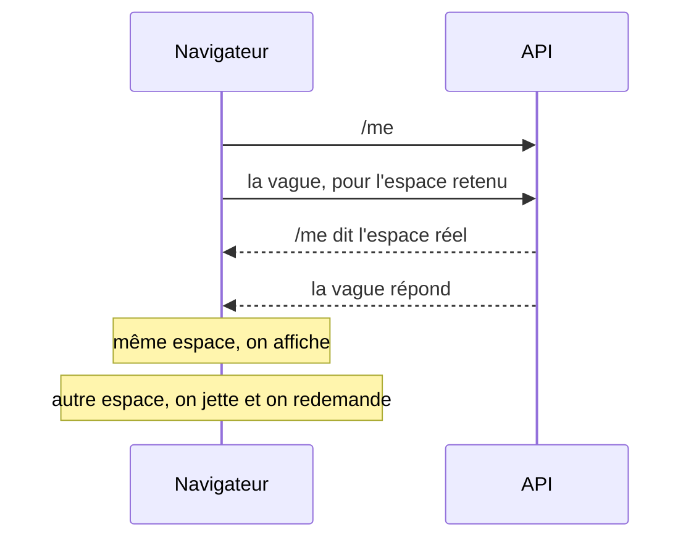

# Plan — l'espace retenu : ne plus attendre `/me` pour ouvrir la boutique

> 📝 **Plan, écrit le 2026-11-05.** Rien n'est bâti. Il touche **l'audience**
> (quel tarif sert-on à qui) : `vitruve` avant le bâti. Point « ne plus
> attendre `/me` » de [`plan-latence-de-navigation.md`](plan-latence-de-navigation.md).
> Partie 1 : comprendre. Partie 2 : le code.

# Partie 1 — Comprendre

## Le problème

À l'ouverture de la boutique, le front ne sait pas encore **dans quel espace**
(perso ou une société) la personne travaille : c'est `/me` qui le dit, par la
préférence `navPrefs.workspace`. Tant qu'il ne le sait pas, il ne demande
rien de ce qui dépend de l'espace — le rayon, le panier, les adresses,
l'admission, les commandes… Mesuré le 2026-11-05 en production :

| Instant | Ce qui se passe                                       |
| ------- | ----------------------------------------------------- |
| 254 ms  | `/me` part                                            |
| 532 ms  | `/me` répond                                          |
| 538 ms  | la vague « par espace » part (9 appels, en parallèle) |
| 780 ms  | le rayon répond — la boutique peut s'afficher         |

Les 280 ms entre le départ de `/me` et la vague sont **de l'attente pure** : le
plus souvent, l'espace est celui de la dernière visite.

## La réponse

Le navigateur **retient** l'espace de la dernière visite. Au démarrage, il
demande tout de suite la vague pour cet espace, **en même temps** que `/me`.
`/me` arrive et tranche :

- **Même espace** (le cas courant) : rien n'a été attendu, ~280 ms gagnées.
- **Autre espace** (changé sur un autre appareil, rattachement perdu) : les
  réponses de l'essai sont **jetées sans jamais être montrées**, et la vague
  repart pour le bon espace — le coût d'aujourd'hui, plus quelques appels
  pour rien.

**Rien de ce qui vient de l'essai ne s'affiche avant que `/me` ne l'ait
confirmé.** C'est la règle qui tient l'audience : un tarif de société n'est
jamais montré à qui n'y est plus rattaché, ni un tarif perso sous le nom d'une
société.

# Partie 2 — Le code

## 0. Ce que `vitruve` a établi (2026-11-05) — le plan est resserré

Deux bloquants, tous deux vérifiés dans le code :

1. **Le panier ÉCRIT à sa lecture de démarrage** (`shop-cart-sync.service.ts`
   `enter()` / `reconcile()` → `switchTo`, `replaceAll`, `pushNow`) : sur un
   essai faux, le panier visiteur partirait dans l'espace deviné et serait
   perdu pour le bon, ou des lignes s'écriraient dans le panier serveur d'un
   autre espace (le serveur se rabat sur la société résolue). **Le panier
   sort de l'essai** : il attend `/me`, comme aujourd'hui.
2. **Rien n'efface le stockage à la déconnexion** (`auth.facade.ts`
   `logout()` n'appelle qu'Auth0) : « effacé à la déconnexion, comme le
   panier » était faux. Un geste neuf, avant la redirection Auth0, est
   nécessaire ; une session expirée n'efface rien.

Et des sérieux qui changent la forme :

- **L'intercepteur ne change pas** : un `current() ?? tentative()` global
  ferait porter l'indice à TOUT appel d'avant `/me` (l'admission part déjà
  avec `current() === null`, `order-admission.store.ts:135`). L'essai pose
  son en-tête **explicitement**, lecteur par lecteur, comme l'écriture du
  panier le fait déjà.
- **Liste fermée de lecteurs essayés**, en lecture seule et rangés par clé
  d'espace : le rayon reconnu, la vitrine du rayon, les points de retrait.
  Pas la fidélité ni l'audience (elles raisonnent sur `isPersonal()` /
  `company()`, qu'un identifiant seul ne donne pas), pas le panier, pas
  l'admission.
- **Seulement sur la boutique sans garde** : `mon-compte`, `mes-factures`,
  `/ma-fidelite` et l'atterrissage de connexion attendent `/me` par leur
  garde — l'essai n'y gagne rien.
- **Pas d'essai au retour d'une connexion** (`LoginMoment.fresh()`) :
  `enterProAfterLogin` rebascule le perso vers le pro juste après `/me`.
- ProShelves n'est pas empoisonné : la clé vient de la société RÉSOLUE
  (`read-my-shop-catalogue.ts`, `container/shelf-store.ts`).
- Le traceur au registre : « pas une donnée personnelle » se tranche dans le
  registre (une entreprise individuelle porte le nom d'une personne).

**Le gain s'en trouve réduit** : le rayon (le plus lent de la vague, ~240 ms)
part en même temps que `/me` ; le panier, lui, attend toujours. L'affichage
de la boutique ne dépend que du rayon : le gain sur l'affichage reste de
l'ordre de 250 ms, à mesurer. Les sections suivantes décrivent le plan
d'origine ; ce §0 l'emporte là où ils divergent.

## 1. Ce qui existe (vérifié le 2026-11-05)

- `ClientWorkspace.current` (`apps/lfc-ecommerce-frontend/src/app/client/client-workspace.service.ts:65`)
  vaut `null` tant que `/me` n'est pas lu, puis `navPrefs.workspace` s'il est
  atteignable, sinon `defaultProWorkspace(companies)`, sinon le perso.
- `workspaceInterceptor` (`client/client-workspace.interceptor.ts`) ne pose
  l'en-tête d'espace que quand `current()` n'est pas `null`.
- Les lecteurs par espace attendent `current() !== null` : le rayon
  (`ShopCatalogue.readerKey`), l'admission (`OrderAdmissionStore`), la
  fidélité, le devis (`ShopQuote.key`)…
- Côté serveur, `resolveCompany` (`apps/lfd-api/src/platform/auth/resolve-company.ts`)
  **ignore** une société déclarée à laquelle la personne n'appartient pas, et
  retombe alors sur son seul rattachement, ou sur `null` (perso) s'il y en a
  plusieurs. **Une réponse à un essai faux n'est donc PAS une erreur** : c'est
  une réponse pour une AUTRE audience que celle qu'on a déclarée.

## 2. La mécanique

1. **Retenir** : après chaque `/me` lu, `lfc.workspace-hint` (stockage local)
   reçoit `current()`. Effacé à la déconnexion, comme le panier.
2. **Essayer** : au démarrage, si la personne est reconnue (session Auth0 en
   cache) et qu'un indice existe, `ClientWorkspace` expose `tentative()` = cet
   indice ; l'intercepteur pose l'en-tête depuis `current() ?? tentative()`.
3. **Ne rien montrer** : les lecteurs par espace partent sur
   `current() ?? tentative()`, mais leur **état affichable** ne passe à
   « prêt » que si la clé de leur réponse vaut `current()`. Tant que
   `current()` est `null`, ils restent « en chargement ».
4. **Trancher** : quand `/me` arrive, si `current() === tentative()`, les
   réponses déjà là s'affichent. Sinon, elles sont jetées (leur clé n'est plus
   jamais lue), et les lecteurs repartent pour `current()` par leur effet
   habituel.
5. **Une seule fois** : l'essai ne vaut qu'au démarrage. Une bascule d'espace
   passe par `current()`, comme aujourd'hui.

## 3. Ce qui reste à trancher par `vitruve`

- **Le cache ProShelves** : un essai faux sert un rayon pour l'audience que le
  serveur a résolue, rangé par le serveur sous la société RÉSOLUE — pas sous
  l'indice. Vérifier que la clé de rangement est bien la société résolue
  (`r:<rev>/company:<id>`), sans quoi un essai faux empoisonnerait le cache.
- **Les écritures** : aucune écriture ne part sur l'indice. Le panier écrit
  avec l'espace CAPTURÉ au geste (intercepteur, troisième retenue) ; vérifier
  qu'aucun lecteur de démarrage n'écrit (un panier fusionné, une préférence).
- **L'appareil partagé** : l'indice d'une autre personne. Il est effacé à la
  déconnexion ; une session qui change sans déconnexion (autre compte Auth0
  sur le même navigateur) le garderait — le serveur l'ignore (pas
  rattachée), et la règle 3 empêche tout affichage. Coût : une vague pour
  rien.
- **Le traceur** : `lfc.workspace-hint` entre au registre des traceurs
  (`documentation/legal/registre-des-traceurs.md`) — un identifiant de
  société, pas une donnée personnelle, mais il dit à quelle société la
  personne est rattachée.

## 4. Tests

- Indice = espace réel : la vague part avant la réponse de `/me`, et
  s'affiche dès `/me`.
- Indice ≠ espace réel : rien de l'essai ne s'affiche, la vague repart pour
  le bon espace.
- Sans indice, ou visiteur : comportement d'aujourd'hui.
- Déconnexion : l'indice est effacé.

## 5. Ce qui reste hors du lot

- Regrouper la vague en un appel : abandonné (mesuré le 2026-11-05, plan de
  latence).
- Accélérer `/me` lui-même (277 ms, dont 122 ms dans Nest).
