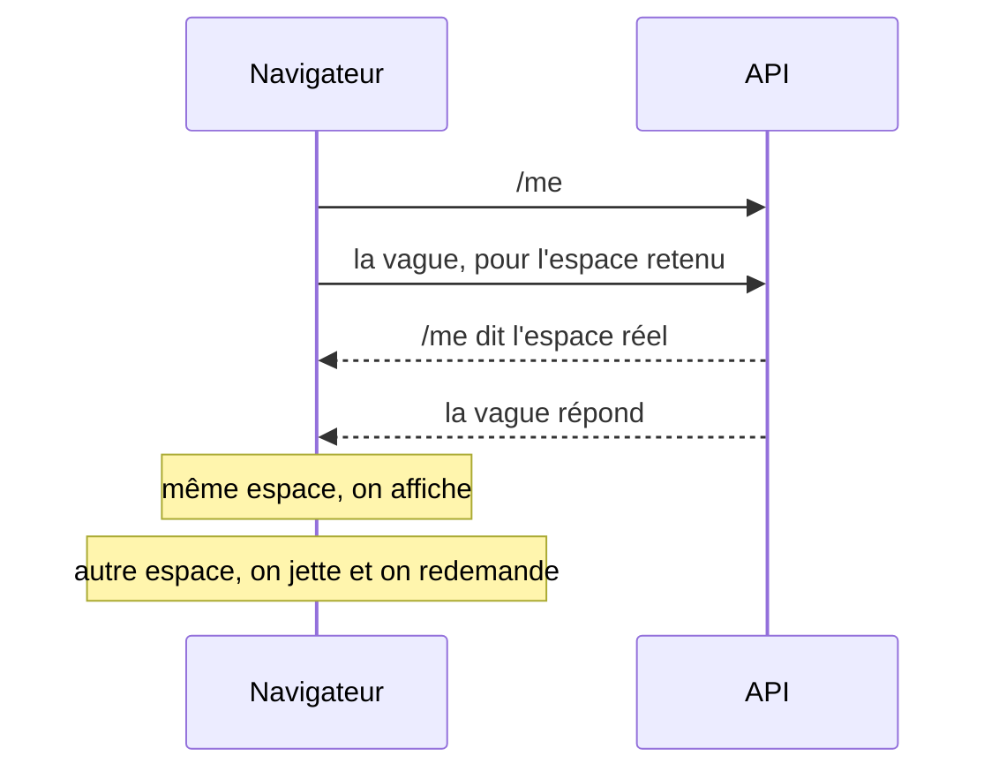
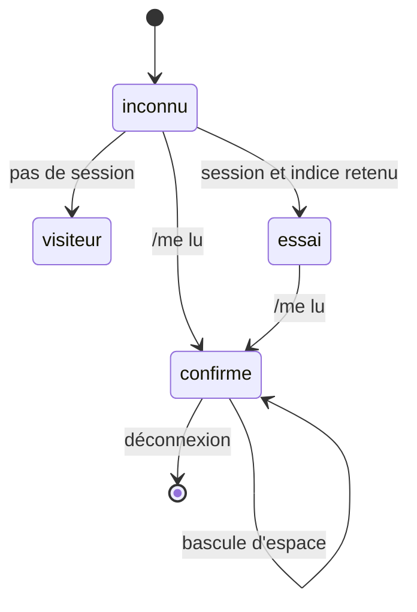

# Plan — l'espace retenu : ne plus attendre `/me` pour ouvrir la boutique

> 📝 **Plan, écrit le 2026-11-05.** Rien n'est bâti. Il touche **l'audience**
> (quel tarif sert-on à qui) : `vitruve` avant le bâti. Point « ne plus
> attendre `/me` » de [`plan-latence-de-navigation.md`](plan-latence-de-navigation.md).
> Partie 1 : comprendre. Partie 2 : le code.

# Partie 1 — Comprendre

## Le problème

À l'ouverture de la boutique, le front ne sait pas encore **dans quel espace**
(perso ou une société) la personne travaille : c'est `/me` qui le dit, par la
préférence `navPrefs.workspace`. Tant qu'il ne le sait pas, il ne demande
rien de ce qui dépend de l'espace — le rayon, le panier, les adresses,
l'admission, les commandes… Mesuré le 2026-11-05 en production :

| Instant | Ce qui se passe                                       |
| ------- | ----------------------------------------------------- |
| 254 ms  | `/me` part                                            |
| 532 ms  | `/me` répond                                          |
| 538 ms  | la vague « par espace » part (9 appels, en parallèle) |
| 780 ms  | le rayon répond — la boutique peut s'afficher         |

Les 280 ms entre le départ de `/me` et la vague sont **de l'attente pure** : le
plus souvent, l'espace est celui de la dernière visite.

## La réponse

Le navigateur **retient** l'espace de la dernière visite. Au démarrage, il
demande tout de suite la vague pour cet espace, **en même temps** que `/me`.
`/me` arrive et tranche :

- **Même espace** (le cas courant) : rien n'a été attendu, ~280 ms gagnées.
- **Autre espace** (changé sur un autre appareil, rattachement perdu) : les
  réponses de l'essai sont **jetées sans jamais être montrées**, et la vague
  repart pour le bon espace — le coût d'aujourd'hui, plus quelques appels
  pour rien.

**Rien de ce qui vient de l'essai ne s'affiche avant que `/me` ne l'ait
confirmé.** C'est la règle qui tient l'audience : un tarif de société n'est
jamais montré à qui n'y est plus rattaché, ni un tarif perso sous le nom d'une
société.

# Partie 2 — Le code

## 00. Lot préalable — le store de contexte (Hugo, 2026-11-05)

> 📝 Ajouté après le premier passage de `vitruve` : faute d'un point unique,
> la règle « rien d'affiché avant que `/me` confirme » devait être réécrite
> dans chaque store, et le panier y échappait. `vitruve` à nouveau avant le
> bâti.

**Le constat (vérifié le 2026-11-05).** L'identité et l'espace ont une source
unique — `AuthFacade` (le `sub`, le jeton), `AccountService` (`/me`),
`ClientWorkspace` (`current()`, `company()`, `isPersonal()`) — mais les
**appels** liés au contexte, non : une vingtaine de services de `client/`
lisent `ClientWorkspace`, chacun avec son effet, sa clé (`readerKey`,
`readFor`, `loadedFor`, `photoFor`, `mine.workspace`…) et sa propre règle
d'attente (l'admission part avec `current() === null`,
`order-admission.store.ts:135` ; la fidélité lit `isPersonal()`). Rien
n'efface le stockage du navigateur à la déconnexion (`auth.facade.ts`
`logout()`).

**Le lot.** Un `ClientContext` unique, au-dessus de `ClientWorkspace`, qui
porte :

1. **Un état et une clé** : `inconnu`, `visiteur`, `essai(indice)`,
   `confirmé(espace)`. La clé de contexte (`visiteur`, ou l'espace) est la
   SEULE que les stores utilisent pour ranger une réponse — leurs clés
   maison (`readFor`, `loadedFor`…) disparaissent.
2. **Une seule règle d'affichage** : `shown(key)` est vrai seulement si
   `key` vaut la clé confirmée. Un store range ce qu'il reçoit sous sa clé ;
   l'écran ne lit que ce que `shown` admet. La règle s'écrit une fois.
3. **Deux familles de stores, déclarées** : les **lecteurs** (lecture seule,
   peuvent partir à l'essai si la liste fermée les nomme) et les
   **écrivains** (panier, préférences) qui n'agissent qu'en `confirmé`. Une
   porte (ou un test d'architecture) refuse un store qui lit `ClientWorkspace`
   en direct.
4. **La bascule d'espace** passe par `ClientContext.switchTo()` : l'ordre
   des relectures est écrit une fois (aujourd'hui dispersé entre
   `ClientWorkspace.set`, `enterProAfterLogin` et les effets de chacun).
5. **La déconnexion** : `ClientContext.forget()` avant la redirection Auth0 —
   indice, panier par espace et préférences locales, selon une liste tenue
   à côté du registre des traceurs. Une session expirée oublie l'indice au
   prochain `/me` qui contredit.

**Ce que le lot ne fait pas** : il ne change aucun appel ni aucune route ; il
ne lance aucun essai. L'espace retenu (les sections suivantes) se bâtit
ensuite, sur lui, en ajoutant l'état `essai`.

**Migration** : un store à la fois, en commençant par ceux qui n'écrivent
pas ; chaque bascule garde ses tests et en ajoute un sur `shown`. Le
périmètre est d'une vingtaine de fichiers (liste à établir au bâti, par
`graphify explain "ClientWorkspace"` puis ouverture de chacun).

### 00 bis. Contredit par `vitruve` le 2026-11-05 — ce qui change

Le §00 tel qu'écrit ne tient pas ; ce qui suit l'emporte sur lui.

- **La clé de contexte est un PRÉFIXE, pas la clé.** Le catalogue distingue
  la visite pro (`PRO_VISITOR`, `shop-catalogue.store.ts:23`) du visiteur —
  deux tarifs —, la vitrine range sous `keyOf(reader, shelfKey)`
  (`shop-storefront.store.ts:119`). Chaque store compose son lecteur :
  contexte + ce qui lui est propre (visite pro, rayon, jour, mode).
  `readerKey` de `pickup-list.gateway.ts:30`, déjà partagé, est le modèle.
- **« Confirmé » veut dire aujourd'hui « choisi localement »** :
  `AccountService.setWorkspace` (`account.service.ts:202-225`) et
  `enterProAfterLogin` (`:501-512`) écrivent l'espace avant la réponse du
  serveur, et reviennent en arrière sur échec. Le contexte gagne un état
  **bascule en cours** et un retour arrière.
- **Pas de cycle d'injection** : `AuthFacade` → `ClientContext` →
  `ClientWorkspace` → `AccountService` → `AuthFacade`. La façade expose un
  **crochet « avant déconnexion »** auquel l'oubli s'abonne ; il couvre la
  branche `DEV_BYPASS_AUTH`, et coupe d'abord l'envoi différé du panier
  (`shop-cart-sync.service.ts:170-173`).
- **Périmètre réel : 37 fichiers** importent `ClientWorkspace` (composants,
  garde et routes compris), et trois services ont une clé `readFor` sans
  l'importer (`client-bank-account`, `client-activation`, `client-mandate`).
  La porte aura une liste admise (intercepteur, garde, bascule, menus) et
  une dette décroissante, sur le modèle de `lint:controller-buses`.
- **Trois états d'affichage, pas deux** : `affichable`, `même lecteur mais
périmé` (le dernier total atténué du devis, la photo `STALE_PHOTO_MS` du
  catalogue), `autre lecteur` (jeté).
- **La bascule réelle** est `ClientWorkspaceSwitch.switchTo` (`choose` →
  `routeAfterSwitch` → détour `WORKSPACE_RELOAD_ROUTE` → cible) : c'est le
  détour de routeur qui ordonne aujourd'hui les relectures. Le lot (c) dit
  qui déclenche qui.
- **La liste d'oubli se tranche ligne par ligne** contre le registre des
  traceurs — décision de Hugo (ci-dessous). Les clés anti-double-paiement
  (`lfc.orders`, `lfc.order-attempt`, `lfc.cart-awaiting-payment`) ne
  s'effacent pas sans y avoir réfléchi.
- **Session expirée** : elle ne produit pas de `/me` qui contredit, mais un
  401 ou un visiteur ; l'oubli doit aussi s'y accrocher.
- **SSR** : l'état `essai` lu au stockage local reste `inconnu` côté serveur,
  sans quoi l'hydratation diverge.

**Découpe retenue** (proposée par `vitruve`) :

| Lot   | Contenu                                                                                                                                      | Dépend de   |
| ----- | -------------------------------------------------------------------------------------------------------------------------------------------- | ----------- |
| a     | le crochet de déconnexion et la liste d'oubli, alignée sur le registre — un manque RGPD réel, autonome                                       | —           |
| b     | 🟦 bâti le 2026-11-05, sur `dev` — `ClientContext` en lecture seule (état, préfixe), branché sur le rayon, la vitrine, les points de retrait | —           |
| c     | la bascule : `switchTo`, état en cours, retour arrière                                                                                       | b           |
| c bis | **la brique de lecture par clé** (`contextResource`) : une seule mécanique de lecture rangée par clé de contexte — voir § 00 ter             | b, c        |
| d     | la migration des autres stores **vers la brique**, une par commit, porte en dette décroissante                                               | b, c, c bis |
| e     | l'espace retenu (état `essai`) sur les trois lecteurs du lot b                                                                               | a, b        |

Le gain (e) ne demande pas la migration complète (d).

### 00 ter. Lot c bis — la brique de lecture par clé (Hugo, 2026-11-05)

> 📝 Ajouté le 2026-11-05 avant le lot d. `vitruve` avant le bâti : c'est
> l'architecture de lecture du front pour longtemps.

**Pourquoi.** Les lots a à c posent une session unique (`ClientContext`).
Mais chaque store lit encore à sa façon : son `effect`, sa clé maison
(`readFor`, `loadedFor`, `photoFor`…), son « déjà demandé », son état périmé
— 37 fichiers lisent l'espace (§ 00 bis). Migrer chacun vers le contexte en
gardant ces mécaniques ferait 37 implémentations de la même règle. Les fronts
modernes ont **une seule brique** de lecture rangée par clé (le modèle de
TanStack Query) ; Angular en a la base native, `resource()` /
`httpResource()` (`@angular/core` 22.1.2, catalogue pnpm), qui relit quand
le signal de clé change et annule la demande précédente. Aucun fichier de
l'app ne s'en sert encore (vérifié le 2026-11-05).

**La brique.** `contextResource({ key, load })` :

- `key` : une fonction de signaux qui rend la part propre au store (rayon,
  jour, mode, visite pro), ou `null` tant qu'elle n'est pas connue ; la
  brique la préfixe par `ClientContext.prefix()`. Pas de préfixe, pas de
  demande.
- `load(key)` : l'appel, annulé si la clé change avant la réponse.
- Elle expose un état d'affichage unique — `chargement`, `prêt`, `périmé`
  (la dernière valeur de la MÊME clé de contexte, gardée pendant la
  relecture, comme le dernier total atténué du devis) et `échec` — et ne rend
  **jamais** une valeur lue pour une autre clé de contexte que la confirmée
  (bascule en cours, essai, espace refusé).
- Un rangement par clé, borné, pour qu'un retour à un espace déjà vu
  réaffiche sans attendre (ce que fait aujourd'hui la photo du catalogue).

**Ce qu'elle ne fait pas.** Les **écritures** (panier, préférences) n'y
passent pas : elles restent des services, qui n'agissent qu'en `confirmé`.
Elle ne remplace pas le cache serveur (`ProShelves`, bord Cloudflare) ; elle
évite seulement de redemander ce que le navigateur a déjà.

**Ce que le lot fait.** La brique, ses tests, et la migration des trois
lecteurs du lot b dessus (rayon, vitrine, points de retrait), à
comportement identique. Le lot d migre ensuite les autres stores vers elle,
et la porte refuse un store neuf qui lit l'espace hors de la brique.

**À trancher par `vitruve`** : `httpResource` sous le rendu serveur
(hydratation, transfert d'état) ; le comportement de la brique avec les
intercepteurs (l'en-tête d'espace doit suivre la clé de la demande, pas
l'espace courant à l'envoi) ; les lecteurs qui ne sont pas de simples GET
(le devis est un POST) ; la photo périmée du catalogue (`STALE_PHOTO_MS`) et
sa relecture au retour d'onglet ; la borne du rangement.

**Décisions pour Hugo** — la liste d'oubli à la déconnexion : le panier
visiteur `lfc.cart` (un visiteur qui se connecte puis se déconnecte perd-il
son panier ?), `lfc.order.choice`, les paniers par espace, l'espace retenu,
`lfc-b2b-commerce-company-v1`, `lfd.shop.pro-visit`.

## 0. Ce que `vitruve` a établi (2026-11-05) — le plan est resserré

Deux bloquants, tous deux vérifiés dans le code :

1. **Le panier ÉCRIT à sa lecture de démarrage** (`shop-cart-sync.service.ts`
   `enter()` / `reconcile()` → `switchTo`, `replaceAll`, `pushNow`) : sur un
   essai faux, le panier visiteur partirait dans l'espace deviné et serait
   perdu pour le bon, ou des lignes s'écriraient dans le panier serveur d'un
   autre espace (le serveur se rabat sur la société résolue). **Le panier
   sort de l'essai** : il attend `/me`, comme aujourd'hui.
2. **Rien n'efface le stockage à la déconnexion** (`auth.facade.ts`
   `logout()` n'appelle qu'Auth0) : « effacé à la déconnexion, comme le
   panier » était faux. Un geste neuf, avant la redirection Auth0, est
   nécessaire ; une session expirée n'efface rien.

Et des sérieux qui changent la forme :

- **L'intercepteur ne change pas** : un `current() ?? tentative()` global
  ferait porter l'indice à TOUT appel d'avant `/me` (l'admission part déjà
  avec `current() === null`, `order-admission.store.ts:135`). L'essai pose
  son en-tête **explicitement**, lecteur par lecteur, comme l'écriture du
  panier le fait déjà.
- **Liste fermée de lecteurs essayés**, en lecture seule et rangés par clé
  d'espace : le rayon reconnu, la vitrine du rayon, les points de retrait.
  Pas la fidélité ni l'audience (elles raisonnent sur `isPersonal()` /
  `company()`, qu'un identifiant seul ne donne pas), pas le panier, pas
  l'admission.
- **Seulement sur la boutique sans garde** : `mon-compte`, `mes-factures`,
  `/ma-fidelite` et l'atterrissage de connexion attendent `/me` par leur
  garde — l'essai n'y gagne rien.
- **Pas d'essai au retour d'une connexion** (`LoginMoment.fresh()`) :
  `enterProAfterLogin` rebascule le perso vers le pro juste après `/me`.
- ProShelves n'est pas empoisonné : la clé vient de la société RÉSOLUE
  (`read-my-shop-catalogue.ts`, `container/shelf-store.ts`).
- Le traceur au registre : « pas une donnée personnelle » se tranche dans le
  registre (une entreprise individuelle porte le nom d'une personne).

**Le gain s'en trouve réduit** : le rayon (le plus lent de la vague, ~240 ms)
part en même temps que `/me` ; le panier, lui, attend toujours. L'affichage
de la boutique ne dépend que du rayon : le gain sur l'affichage reste de
l'ordre de 250 ms, à mesurer. Les sections suivantes décrivent le plan
d'origine ; ce §0 l'emporte là où ils divergent.

## 1. Ce qui existe (vérifié le 2026-11-05)

- `ClientWorkspace.current` (`apps/lfc-ecommerce-frontend/src/app/client/client-workspace.service.ts:65`)
  vaut `null` tant que `/me` n'est pas lu, puis `navPrefs.workspace` s'il est
  atteignable, sinon `defaultProWorkspace(companies)`, sinon le perso.
- `workspaceInterceptor` (`client/client-workspace.interceptor.ts`) ne pose
  l'en-tête d'espace que quand `current()` n'est pas `null`.
- Les lecteurs par espace attendent `current() !== null` : le rayon
  (`ShopCatalogue.readerKey`), l'admission (`OrderAdmissionStore`), la
  fidélité, le devis (`ShopQuote.key`)…
- Côté serveur, `resolveCompany` (`apps/lfd-api/src/platform/auth/resolve-company.ts`)
  **ignore** une société déclarée à laquelle la personne n'appartient pas, et
  retombe alors sur son seul rattachement, ou sur `null` (perso) s'il y en a
  plusieurs. **Une réponse à un essai faux n'est donc PAS une erreur** : c'est
  une réponse pour une AUTRE audience que celle qu'on a déclarée.

## 2. La mécanique

1. **Retenir** : après chaque `/me` lu, `lfc.workspace-hint` (stockage local)
   reçoit `current()`. Effacé à la déconnexion, comme le panier.
2. **Essayer** : au démarrage, si la personne est reconnue (session Auth0 en
   cache) et qu'un indice existe, `ClientWorkspace` expose `tentative()` = cet
   indice ; l'intercepteur pose l'en-tête depuis `current() ?? tentative()`.
3. **Ne rien montrer** : les lecteurs par espace partent sur
   `current() ?? tentative()`, mais leur **état affichable** ne passe à
   « prêt » que si la clé de leur réponse vaut `current()`. Tant que
   `current()` est `null`, ils restent « en chargement ».
4. **Trancher** : quand `/me` arrive, si `current() === tentative()`, les
   réponses déjà là s'affichent. Sinon, elles sont jetées (leur clé n'est plus
   jamais lue), et les lecteurs repartent pour `current()` par leur effet
   habituel.
5. **Une seule fois** : l'essai ne vaut qu'au démarrage. Une bascule d'espace
   passe par `current()`, comme aujourd'hui.

## 3. Ce qui reste à trancher par `vitruve`

- **Le cache ProShelves** : un essai faux sert un rayon pour l'audience que le
  serveur a résolue, rangé par le serveur sous la société RÉSOLUE — pas sous
  l'indice. Vérifier que la clé de rangement est bien la société résolue
  (`r:<rev>/company:<id>`), sans quoi un essai faux empoisonnerait le cache.
- **Les écritures** : aucune écriture ne part sur l'indice. Le panier écrit
  avec l'espace CAPTURÉ au geste (intercepteur, troisième retenue) ; vérifier
  qu'aucun lecteur de démarrage n'écrit (un panier fusionné, une préférence).
- **L'appareil partagé** : l'indice d'une autre personne. Il est effacé à la
  déconnexion ; une session qui change sans déconnexion (autre compte Auth0
  sur le même navigateur) le garderait — le serveur l'ignore (pas
  rattachée), et la règle 3 empêche tout affichage. Coût : une vague pour
  rien.
- **Le traceur** : `lfc.workspace-hint` entre au registre des traceurs
  (`documentation/legal/registre-des-traceurs.md`) — un identifiant de
  société, pas une donnée personnelle, mais il dit à quelle société la
  personne est rattachée.

## 4. Tests

- Indice = espace réel : la vague part avant la réponse de `/me`, et
  s'affiche dès `/me`.
- Indice ≠ espace réel : rien de l'essai ne s'affiche, la vague repart pour
  le bon espace.
- Sans indice, ou visiteur : comportement d'aujourd'hui.
- Déconnexion : l'indice est effacé.

## 5. Ce qui reste hors du lot

- Regrouper la vague en un appel : abandonné (mesuré le 2026-11-05, plan de
  latence).
- Accélérer `/me` lui-même (277 ms, dont 122 ms dans Nest).
