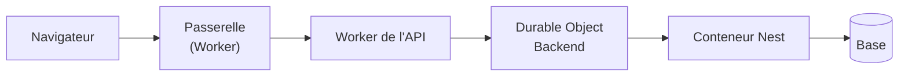
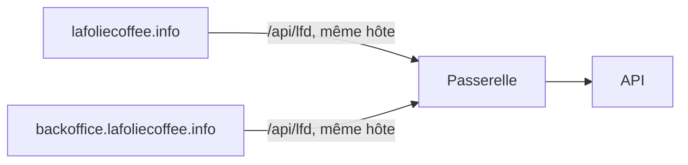

# Plan — la latence de navigation et du changement d'espace

> 📝 **Plan, écrit le 2026-11-04**, à partir des mesures de production du même
> jour (tableaux « surfaces » et « temps du prix » de la carte de santé, après
> dix changements d'espace). Rien n'est bâti. Partie 1 : comprendre. Partie 2 :
> les lots.

# Partie 1 — Comprendre

## Ce qu'on a constaté

Chaque changement d'espace est très lent, **même quand le cache des rayons pro
fonctionne** (capacité dégradée disparue, la lenteur restait). Le cache n'était
donc pas la cause : le calcul du rayon pro coûte **44 ms en médiane**.

Ce qui coûte, c'est **le trajet de chaque appel, multiplié par le nombre
d'appels, multiplié par leur enchaînement** :

- **Un plancher d'environ 140 ms par appel** : `/health` (ne lit rien) est à
  142 ms en p95, `/delivery-zones` (lit la base) à 207 ms en médiane contre
  197 ms pour `/health`. La base est proche ; le temps part dans le trajet.
- **Un chargement de la boutique, c'est ~21 appels en 4 vagues** qui
  s'attendent : ≈ 4 × plancher + le plus lent de chaque vague ≈ 2,6 s.
- **Pendant dix changements d'espace** : `companies/_` 334 ms (20 appels, donc
  deux par changement), `me/nav-prefs` 302 ms (une écriture qui bloque),
  `pickup-addresses/mine` 253 ms, `fulfillment-days/mine` 205 ms, `shop/cart`
  170 ms, `vitrine/catalogue` 1 125 ms.

**Le levier, dans l'ordre :** moins de vagues, puis moins d'appels, puis un
plancher plus bas. Gagner 40 ms sur un calcul ne se voit pas tant qu'on paie
quatre fois 140 ms d'attente.

# Partie 2 — Les lots

Chaque lot commence par **mesurer** et se termine par la même mesure sur la
production (la seule déployée), pour que le gain soit un chiffre et pas une
impression.

## L0 — Savoir où partent les 140 ms (d'abord)

- Un en-tête `Server-Timing` posé par chaque saut : passerelle, Worker de
  l'API, entrée du Durable Object, Nest (garde, résolution du principal,
  handler), base. Lisible dans l'onglet Réseau du navigateur, sans outil.
- **Hypothèses à départager** : la résolution du principal relue en base à
  chaque appel (identité, société, droits), le saut Worker → Durable Object →
  conteneur, la passerelle. Le lot suivant dépend de la réponse : si c'est
  le principal, L4 ; si c'est le trajet, L5.
- Sur la carte de santé, la lecture « latence » de la base est la dernière des
  lectures, et `formatReadings` n'en montre que trois : elle est cachée. La
  mettre en premier.

## L1 — Aplatir la cascade du changement d'espace (front)

- Dresser la liste exacte des appels d'un changement d'espace et de ce que
  chacun attend (onglet Réseau, cascade).
- Lancer en parallèle tout ce qui ne dépend que de la société choisie : rayon,
  panier, adresses de retrait, jours de commande.
- **Ne lire `companies/_` qu'une fois** par changement : la seconde lecture
  vient d'un deuxième lecteur du même état ; un seul magasin la garde.
- **`nav-prefs` ne bloque plus** : l'écriture part en arrière-plan, l'écran
  bascule sans l'attendre. Un échec se rejoue, il n'empêche pas de naviguer.
- Cible : 2 vagues au lieu de 4.

## L2 — Un seul appel d'entrée dans un espace

- Une lecture nommée « entrer dans l'espace » rend en une fois ce que l'écran
  demande au départ (société, adresses, jours ouverts, préférences), chaque
  morceau servi selon les droits de l'appelant, côté serveur.
- Elle compose des requêtes existantes ; elle ne les remplace pas. Rien de
  réservé à une clientèle n'y entre pour une autre (le serveur décide de
  l'audience).
- Cible : un aller-retour au lieu de cinq ou six.

## L3 — Le catalogue en un chargement

- C'est le plan [`plan-materiaux-du-catalogue.md`](plan-materiaux-du-catalogue.md),
  déjà écrit : un seul appel pour le rayon, prix au kilo et opérations datées
  compris.
- Allumer `public-on` (le rayon public dans Workers Cache) une fois vérifié en
  production que la purge marche.
- `vitrine/catalogue` (1,1 s, sans cache) : mesurer ce qui coûte, puis le servir
  par le même chemin que le rayon public s'il ne lit pas l'appelant.

## L4 — Si L0 désigne le principal : le relire moins cher

- Le principal reste résolu en base à chaque requête (c'est ce qui bloque tout
  de suite un compte désactivé) : **on ne le cache pas** sans passer par
  `vitruve`, c'est une frontière de sécurité.
- Ce qu'on peut faire sans y toucher : une seule requête au lieu de plusieurs
  pour l'identité, la société et les droits.

## L5 — Si L0 désigne le trajet : le raccourcir

- Servir depuis le Worker, sans réveiller le conteneur, les lectures publiques
  qui ne changent presque jamais (pied de page, zones, ouverture des
  commandes), par Workers Cache comme les textes de la boutique.
- Vérifier le placement du conteneur (`weur`) par rapport à la base et à la
  passerelle.

## L5 bis — Chaque front appelle l'API sur son propre hôte (décidé, pas bâti)

Mesuré le 2026-11-04 : la boutique (`lafoliecoffee.info`) appelait l'API sur
`lfd-gateway.lafoliedouce.workers.dev`. Pour le navigateur, c'est un autre
site : un contrôle CORS (`OPTIONS`) précédait chaque appel, gardé 5 s
seulement, et chacun traversait toute la chaîne jusqu'au conteneur.

- **Fait** : `Access-Control-Max-Age` à 2 h (`main.ts`). Reste un contrôle par
  adresse exacte nouvelle (identifiants, paramètres).
- **Décidé avec Hugo, à faire plus tard** : tout front web est servi par la
  passerelle sous un nom de `lafoliecoffee.info` et appelle l'API en
  `/api/lfd` **sur son propre hôte** — plus aucun contrôle CORS, et
  `Server-Timing` lisible dans le navigateur. Un sous-domaine qui
  appellerait la racine resterait cross-origin. La boutique d'abord
  (variable `LFD_API_URL`), la back-office (`pages.dev`) ensuite. Une app
  mobile reste cross-origin par nature : le `Max-Age` est sa seule parade.

## L6 — Le reste, déjà nommé ailleurs

- La version par journée en singleton
  ([`version-par-journee.md`](version-par-journee.md), partie 4) : les écrans
  d'atelier, pas le changement d'espace.
- C5, la surveillance du cache sur la carte de santé.
- Le back-office tourne en boucle sur 401 puis 403 Auth0 quand la session
  expire (64 requêtes vues le 2026-11-04) : il doit renvoyer à la connexion
  au premier refus.

## Ordre et contradiction

L0 → L1 → L2 → L3, puis L4 ou L5 selon L0. L1 et L3 se bâtissent sans
`vitruve`. L2 et L4 touchent l'audience et l'identité : `vitruve` d'abord.
