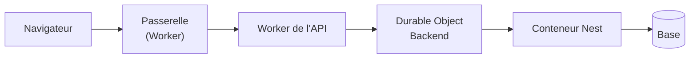
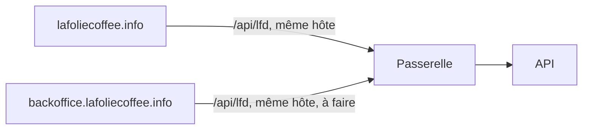

# Plan — la latence de navigation et du changement d'espace

> 🟨 **Plan en cours, écrit et mis à jour le 2026-11-04**, à partir des mesures
> de production du même jour. Chaque lot porte ce qui est **fait** (avec le
> commit, et 🟦 sur `dev` / ✅ en production) et ce qui **reste**. Partie 1 :
> comprendre. Partie 2 : les lots.

# Partie 1 — Comprendre

## Ce qu'on a constaté

Chaque changement d'espace est très lent, **même quand le cache des rayons pro
fonctionne** (capacité dégradée disparue, la lenteur restait). Le cache n'était
donc pas la cause : le calcul du rayon pro coûte **44 ms en médiane**.

Ce qui coûte, c'est **le trajet de chaque appel, multiplié par le nombre
d'appels, multiplié par leur enchaînement** :

- **Un plancher d'environ 140 ms par appel** : `/health` (ne lit rien) est à
  142 ms en p95, `/delivery-zones` (lit la base) à 207 ms en médiane contre
  197 ms pour `/health`. La base est proche ; le temps part dans le trajet.
- **Un chargement de la boutique, c'est ~21 appels en 4 vagues** qui
  s'attendent : ≈ 4 × plancher + le plus lent de chaque vague ≈ 2,6 s.
- **Pendant dix changements d'espace** : `companies/_` 334 ms (20 appels, donc
  deux par changement), `me/nav-prefs` 302 ms (une écriture qui bloque),
  `pickup-addresses/mine` 253 ms, `fulfillment-days/mine` 205 ms, `shop/cart`
  170 ms, `vitrine/catalogue` 1 125 ms.

**Le levier, dans l'ordre :** moins de vagues, puis moins d'appels, puis un
plancher plus bas. Gagner 40 ms sur un calcul ne se voit pas tant qu'on paie
quatre fois 140 ms d'attente.

# Partie 2 — Les lots

Chaque lot commence par **mesurer** et se termine par la même mesure sur la
production (la seule déployée), pour que le gain soit un chiffre et pas une
impression.

## Où on en est (mesuré le 2026-11-04, au soir)

| Mesure                               | Matin                | Soir                                         |
| ------------------------------------ | -------------------- | -------------------------------------------- |
| Un changement d'espace               | 2,0–2,6 s            | 1,4–2,0 s (cache pro manqué : jusqu'à 3,5 s) |
| Trajet passerelle → Nest, appel seul | ~55 ms d'inexpliqués | ~20–30 ms                                    |
| Principal, par appel                 | non mesuré           | 60–270 ms (L4 pas encore en production)      |
| Ajout au panier, total affiché       | non mesuré           | ~0,7 s (dont 300 ms d'attente voulue)        |

## L0 — Savoir où partent les 140 ms

**Fait**

- ✅ `Server-Timing` par saut : `verify`, `principal`, `app` (Nest),
  `container` (objet → conteneur), `worker`, `gateway`, avec le datacenter
  (`cac4bd1f7`, `bd73c3bdc`).
- ✅ Traces Cloudflare sur la passerelle et l'API (`b3725ff8e`).
- ✅ La latence de la base en tête des relevés de la carte de santé.
- ✅ Verdict : le trajet coûte ~20–30 ms ; le principal (60–270 ms) et le
  calcul des prix (rayon, devis, suggestions) sont les vrais postes.

**Reste**

- Rien. Le `Server-Timing` reste en place pour mesurer chaque lot.

## L1 — Aplatir la cascade du changement d'espace (front)

**Fait**

- ✅ Mesuré : la cascade n'a pas 4 vagues — un premier groupe part ensemble et
  finit en < 900 ms ; le chemin critique est fait de **trois calculs de prix
  simultanés** (rayon, devis, suggestions du panier).
- ✅ `nav-prefs` ne bloque déjà pas : l'écriture part en arrière-plan (lu dans
  `account.service.ts`, `setWorkspace`).

**Reste**

- 🟦 Les suggestions du panier ne sont plus demandées qu'une fois par geste :
  elles attendent le total du devis (`fe5afcfb3`). Elles partaient deux fois,
  et la seconde fixait la fin d'un changement d'espace (jusqu'à 3,5 s).
- **Ne charger que ce que la page affiche** (décidé avec Hugo le 2026-11-04) :
  changer d'espace recharge toute la page, et chaque store relit tout, même
  ce qu'elle ne montre pas — `companies/:id/orders` (« Mes commandes »),
  `subscriptions/mine`, `me/loyalty`. Chacun se charge à l'ouverture de son
  écran.
- **Regrouper les petites lectures de l'espace** (`me/contact-settings`,
  `order-admission/mine`, `pickup-addresses/mine`) en une lecture « contexte
  de l'espace », chaque morceau servi selon l'audience de l'appelant —
  `vitruve` d'abord (audience).
- Le délai avant le devis (300 ms) ramené à ~150 ms.
- `companies/_` lu deux fois par changement (vu le matin) : à revérifier, une
  seule lecture vue le soir.

## L2 — Recentré : moins de calculs de prix, pas un appel unique

**Fait**

- ✅ Mesuré : regrouper les petits appels en un seul « entrer dans l'espace »
  ne gagnerait que sur un groupe déjà fini en < 900 ms. **L'appel unique est
  abandonné** au profit des trois points ci-dessous.

**Reste**

- (a) Une seule demande de suggestions du panier (cf. L1).
- (b) **Le rayon pro gardé jusqu'au prochain changement d'heure connu** (une
  promotion qui ouvre, un prix daté), au lieu de 30 s fixes, avec un plafond.
  Aujourd'hui, revenir dans un espace après 30 s recalcule le rayon (2,2 s
  mesurées). Touche l'argent : `vitruve`. **En attente de la décision de
  Hugo.**
- (c) Le devis et les suggestions réutilisent les prix du rayon : c'est L3.

## L3 — Le catalogue en un chargement

**Fait**

- ✅ Le rayon public dans Workers Cache, allumé (`public-on` par Hugo) et
  constaté en production : `HIT`, servi en 11 ms par la passerelle.
- ✅ La réponse publique dit pourquoi elle est gardée ou non (`X-Shelf-Cache`,
  `854ce1d96`).

**Reste**

- Le plan [`plan-materiaux-du-catalogue.md`](plan-materiaux-du-catalogue.md) :
  un seul chargement des matériaux par requête, partagé par le rayon, le devis
  et les suggestions. M0 (mesurer) puis `vitruve`.
- `vitrine/catalogue` (1,1 s, sans cache) : mesurer ce qui coûte.
- Surveiller `X-Shelf-Cache: unavailable` : vu une fois juste après un
  déploiement ; s'il revient, revoir la limite de 100 ms vers l'objet.

## L4 — Le principal gardé en mémoire de l'API

**Fait**

- 🟦 Plan [`plan-principal-en-memoire.md`](plan-principal-en-memoire.md),
  contredit deux fois par `vitruve`, migration relue.
- 🟦 Bâti (`ad5c80190`, sur `dev`) : estampille posée par trois déclencheurs
  `BEFORE … FOR EACH STATEMENT`, mémoire par `sub`, une lecture à la fois par
  personne ; les préférences de navigation quittent `users` pour
  `user_nav_prefs`.

**Reste**

- Promotion vers `main`, puis mesurer `principal` dans `Server-Timing`
  (attendu : < 15 ms).
- Vérifier en production que l'estampille monte sur une écriture de compte, et
  qu'aucune attente de verrou n'apparaît.
- Les droits du staff (back-office) : même idée, autre résolveur, autre lot.

## L5 — Raccourcir le trajet

**Fait**

- ✅ `Access-Control-Max-Age` à 2 h (`b3943f5f6`) : le contrôle CORS précédait
  presque chaque appel et traversait toute la chaîne.
- ✅ La boutique appelle l'API sur son propre hôte (`LFD_API_URL` =
  `https://lafoliecoffee.info/api/lfd`, Hugo, 2026-11-04) : plus aucun
  contrôle CORS.

**Reste**

- La back-office (`pages.dev`) sur un nom de `lafoliecoffee.info`, avec
  `/api/lfd` sur son propre hôte — décidé, à faire plus tard. Un sous-domaine
  qui appellerait la racine resterait cross-origin ; une app mobile l'est par
  nature (le `Max-Age` est sa seule parade).
- Les lectures publiques qui ne changent presque jamais (pied de page, zones,
  ouverture des commandes) servies par Workers Cache.
- Le trajet passerelle → Nest monte à 70–100 ms quand les appels partent
  ensemble : une file devant le conteneur (un demi-vCPU). À revoir après L4 ;
  sinon, grossir le conteneur (décision de Hugo, coût mensuel).

## L6 — Le reste, déjà nommé ailleurs

**Reste**

- La version par journée en singleton
  ([`version-par-journee.md`](version-par-journee.md), partie 4) : les écrans
  d'atelier, pas le changement d'espace.
- C5, la surveillance du cache sur la carte de santé (`X-Shelf-Cache` en est
  la première brique).
- Le back-office tourne en boucle sur 401 puis 403 Auth0 quand la session
  expire (64 requêtes vues le 2026-11-04) : il doit renvoyer à la connexion
  au premier refus.

## Ordre

L4 en production → L1 (une seule demande de suggestions) → L2 (b) si Hugo le
valide → L3 (matériaux du catalogue). `vitruve` d'abord sur L2 (b) et L3, qui
touchent l'argent.
