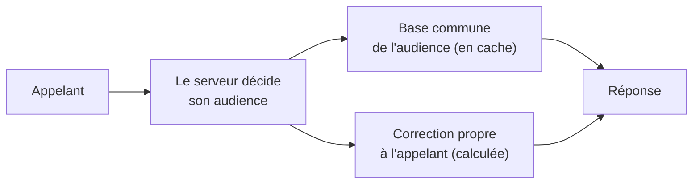

# Plan — les lectures communes à une audience, gardées une fois

> 📍 **État au 2026-11-05 (soir), confronté au code ce jour.** ✅ **En
> production** : pied de page, ouverture des commandes, zones et
> disponibilité de la livraison en cache Cloudflare — `max-age=30`
> **et `stale-while-revalidate=60`**, soit **90 s au pire**
> (`public-settings-cache-headers.ts`) ; la liste publique des points de
> retrait, `max-age=30` **sans** `stale-while-revalidate`. La purge par
> l'étiquette `reglages-publics` est **tentée** après validation à chaque
> écriture (zones, réglage global, points, rôles de site, cinq gestes de
> promotion) : un échec n'est que journalisé, sans alerte, et laisse le
> retard du cache. 🟦 **Sur `dev`** : `/delivery-zones?audience=b2b|b2c`
> (frais et seuil résolus par clientèle) — trois adresses de cache (sans
> paramètre et `b2c` servent le même contenu), toutes couvertes par la
> purge par étiquette ; l'accès aux fonctions est servi **dans `/me`** et
> `/feature-access/mine` est retirée. **Renoncé** : le cache des jours de
> service. **Reste** : prouver que Cloudflare sépare les adresses par leur
> paramètre — aucun test ne le prouve, la clé est celle par défaut de
> Workers Cache (aucun `cacheKey` dans le code) ; à vérifier une fois
> déployé. Les §1 à §3 de la partie 2 décrivent l'idée d'origine, réduite
> par le bloc « Contredit par `vitruve` ».

> 📝 **Plan, écrit le 2026-11-05**, idée de Hugo (« on définit les points de
> retrait par audience, ça pourrait être en cache »). Rien n'est bâti. Il
> touche **l'audience** — ce que chaque clientèle a le droit de voir — :
> `vitruve` avant le bâti. Partie 1 : comprendre. Partie 2 : le code.
> Voisin de [`plan-latence-de-navigation.md`](plan-latence-de-navigation.md)
> et de [`carte-des-caches.md`](carte-des-caches.md).

# Partie 1 — Comprendre

## Le problème

À chaque ouverture de la boutique, un client reconnu lit, entre autres, les
**points de retrait** (`/pickup-addresses/mine`), les **jours de service**
(`/fulfillment-days/mine`, deux fois) et l'**accès aux fonctions**
(`/feature-access/mine` — retirée le 2026-11-05, voir plus bas). Chacune de ces lectures est recalculée en base pour
chaque client, alors que l'essentiel de la réponse est **le même pour toute
une audience** — tous les particuliers, ou tous les pros actifs.

## La réponse : deux étages

1. **Une base par audience, gardée une fois** — la liste des points, les
   jours ouverts, ce qui ne dépend que de la clientèle.
2. **Une correction par appelant, calculée au serveur** — les dérogations
   d'une société, la remise d'une société en attente, le panier.

🔴 **C'est toujours le serveur qui décide de l'audience**, jamais l'URL :
« chaque audience n'a le droit qu'à son information » (Hugo, 2026-10-31). Une
base « pro » ne se sert qu'à un appelant que le serveur a reconnu pro.

## Où garder la base

| Où                       | Pour quoi                                                                      | Ce qu'on économise               |
| ------------------------ | ------------------------------------------------------------------------------ | -------------------------------- |
| Bord Cloudflare (public) | ce qui est **public par choix** : `GET /pickup-addresses` (et `?audience=pro`) | le container et la base          |
| Mémoire de l'API         | la base de ce qui passe par `/mine`                                            | les lectures en base (facturées) |

## Contredit par `vitruve` le 2026-11-05 — le plan est RÉDUIT

Ce qui suit l'emporte sur la Partie 2.

- **`GET /pickup-addresses` (public) → en cache Cloudflare, mais réduit.**
  La remise affichée sur un point ne vient pas du site, elle vient des
  **promotions**, jugées à l'heure (`announced-pickup-address.repository.ts`,
  `promotion-pickup-discount.announcer.ts`). La purge doit donc partir des
  écritures de points (créer, modifier, retirer), de `set-site-roles` (qui
  ouvre un point à une audience) ET des cinq commandes de promotion. Une
  promotion à heures s'ouvre et se ferme sans aucune écriture : avec
  `max-age=30, stale-while-revalidate=60`, la vitrine pourrait annoncer
  jusqu'à ~90 s une remise que la caisse ne fait plus. **Décidé par Hugo le 2026-11-05** : pas de `stale-while-revalidate` sur cette route (`public, max-age=30` seul) — une remise à horaires reste annoncée 30 s au plus après sa fin, la purge vide le cache à chaque écriture.
  L'en-tête se pose sur `list()` seulement — `:id/creneaux` dépend de l'heure.
  La purge de `reglages-publics` reste « non prouvée » de bout en bout.
  🟦 **Bâti le 2026-11-05, non déployé** : `apps/lfd-api/src/b2b/pickup-addresses/http/public-pickup-cache-headers.ts`,
  étiquette `reglages-publics` réutilisée (la purge partagée existe, la liste
  fermée du Worker ne grandit pas ; prix : une écriture de promotion purge
  aussi les quatre réglages, écrits rarement). Purge après validation dans
  `create-`/`update-`/`remove-pickup-address`, `set-site-roles` et les cinq
  gestes de promotion ; `set-site-colors` et la grille des créneaux ne
  changent pas la liste et ne purgent pas. `?audience=` inconnue : 400.
  Porte `lint:cache-control` : `ADMITTED` + `CALLER_BLIND` (contrôleur,
  lecture, coupe par audience, décorateur, adaptateur Prisma, annonceur).
  ⚠️ Que Workers Cache sépare `?audience=pro` de la liste nue n'est pas
  prouvé ici : c'est la même hypothèse que le rayon public (§ C0 de
  `plan-cache-du-catalogue.md`), à vérifier sur dev déployé.
- **`GET /pickup-addresses/mine` → renoncé.** Une base en mémoire ne ferait
  gagner que 1 à 2 lectures, pour un cache à estampiller (une deuxième
  instance le rendrait faux sans bruit, comme le prix avant le 2026-09-09).
- **`GET /fulfillment-days/mine` → renoncé au cache.** Il ne dépend d'aucune
  dérogation (le plan se trompait) : seulement de la PRÉSENCE d'une société.
  Mais il dépend du **stock du jour** (qui baisse à chaque commande) et des
  **plans clos** (écrits par le fournil) — un cache proposerait un jour
  impossible. À la place, trois économies sans cache : lire les points sans
  annonce (retire une estampille et un calcul de promotion inutiles), lire le
  stock par lot plutôt qu'en boucle par site, réutiliser la liste des sites.
- **`GET /feature-access/mine` → réduit.** La réponse ne dépend de personne
  aujourd'hui (les trois clés sont non exemptibles) : elle vaut la route
  publique `GET /feature-access`. Et une décision écrite interdit le cache
  (`documentation/b2b/architecture-feature-flags.md` : « Aucun cache … un
  cache laissait passer des commandes après la fermeture »). À la place : une
  seule lecture des trois réglages au lieu de trois.
  **Fait le 2026-11-05, autrement et plus loin** : la route est RETIRÉE, les
  niveaux de la personne voyagent dans `GET /me` (`AccountView.featureLevels`,
  lus en parallèle du compte), et les trois `findUnique` sont devenus un
  `findMany` (`FeatureLevelResolver.levelsFor`). Toujours sans cache.

# Partie 2 — Le code (à vérifier par `vitruve`)

## 1. Les points de retrait

- `GET /pickup-addresses` (`b2b/pickup-addresses/http/pickup-addresses.controller.ts`)
  est **public**, ne lit pas l'appelant, et sert une seule part par appel
  (visiteur, ou `?audience=pro` — vitrine pro publique par choix, 2026-10-19).
  → **Bord Cloudflare**, sous l'étiquette `reglages-publics` (même durée, même
  purge à chaque écriture d'un point), et ajout à `CALLER_BLIND` /
  `ADMITTED` de `lint:cache-control`.
- `GET /pickup-addresses/mine` (`b2b/orders/http/my-pickup-addresses.controller.ts`)
  sert en plus la remise d'une société **en attente** (« une audience qui se
  déclare ne s'établit pas », 2026-10-31). → base par audience en mémoire de
  l'API + correction pour l'appelant. **À établir** : ce qui, dans sa
  réponse, dépend de la société au-delà de l'audience.

## 2. Les jours de service

- `GET /fulfillment-days/mine` (`b2b/order-cutoffs/http/my-fulfillment-days.controller.ts`,
  `ListFulfillmentDaysHandler`) dépend de la **société qui agit** (dérogations
  à l'ouverture), des **articles du panier** (`?skus=`), et de **l'heure** :
  échéances (`OrderCutoffsInForce`), plans clos (`ClosedPlansReader`), stock
  du jour (`ShelfTodaySites`), opérations en vente (`SaleOperations`).
- → base par audience **sans panier**, gardée jusqu'à la **prochaine
  échéance** (comme le rayon gardé jusqu'à la prochaine opération), puis
  correction : dérogations de la société, filtre des articles du panier.
- **Le double appel** (avec et sans `?skus=`) au démarrage est à supprimer
  d'abord, côté front : c'est gratuit.

## 3. L'accès aux fonctions

- ⚠️ Retirée le 2026-11-05 — les niveaux sont dans `GET /me` ; ce qui suit
  est l'analyse d'avant. `GET /feature-access/mine` (ex-`my-feature-access.controller.ts`)
  dépend de la personne et de réglages rares (Hugo, 2026-11-05 : « ça change
  peu »). → gardé en mémoire **par personne**, purgé à chaque écriture d'un
  réglage d'accès, et sous l'estampille du principal si la réponse dépend
  des rattachements.

## 4. Ce que `vitruve` doit trancher

1. Pour chaque route, **ce qui dépend vraiment de l'appelant** au-delà de son
   audience (lire les handlers en entier) — une correction oubliée, c'est
   l'information d'une clientèle servie à une autre.
2. **L'invalidation** : qui écrit les points, les échéances, les
   dérogations, les réglages d'accès, et comment chacun purge la base.
3. **L'heure** : la prochaine échéance est-elle connue au calcul, comme pour
   le rayon ? Sinon, une durée courte.
4. **Le gain réel** : combien de lectures en base par appel aujourd'hui, et
   si la mémoire de l'API suffit (une instance, `max_instances: 1`).

## 5. Tests

- Pour chaque route : une société en attente, une société avec dérogation,
  un particulier et un pro actif reçoivent chacun leur réponse — jamais celle
  d'une autre audience, même quand la base est en cache.
- La purge : une écriture de point, d'échéance ou de dérogation se voit à la
  lecture suivante.
