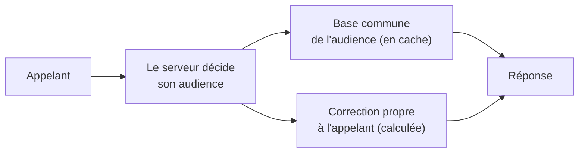

# Plan — les lectures communes à une audience, gardées une fois

> 📝 **Plan, écrit le 2026-11-05**, idée de Hugo (« on définit les points de
> retrait par audience, ça pourrait être en cache »). Rien n'est bâti. Il
> touche **l'audience** — ce que chaque clientèle a le droit de voir — :
> `vitruve` avant le bâti. Partie 1 : comprendre. Partie 2 : le code.
> Voisin de [`plan-latence-de-navigation.md`](plan-latence-de-navigation.md)
> et de [`carte-des-caches.md`](carte-des-caches.md).

# Partie 1 — Comprendre

## Le problème

À chaque ouverture de la boutique, un client reconnu lit, entre autres, les
**points de retrait** (`/pickup-addresses/mine`), les **jours de service**
(`/fulfillment-days/mine`, deux fois) et l'**accès aux fonctions**
(`/feature-access/mine`). Chacune de ces lectures est recalculée en base pour
chaque client, alors que l'essentiel de la réponse est **le même pour toute
une audience** — tous les particuliers, ou tous les pros actifs.

## La réponse : deux étages

1. **Une base par audience, gardée une fois** — la liste des points, les
   jours ouverts, ce qui ne dépend que de la clientèle.
2. **Une correction par appelant, calculée au serveur** — les dérogations
   d'une société, la remise d'une société en attente, le panier.

🔴 **C'est toujours le serveur qui décide de l'audience**, jamais l'URL :
« chaque audience n'a le droit qu'à son information » (Hugo, 2026-10-31). Une
base « pro » ne se sert qu'à un appelant que le serveur a reconnu pro.

## Où garder la base

| Où                       | Pour quoi                                                                      | Ce qu'on économise               |
| ------------------------ | ------------------------------------------------------------------------------ | -------------------------------- |
| Bord Cloudflare (public) | ce qui est **public par choix** : `GET /pickup-addresses` (et `?audience=pro`) | le container et la base          |
| Mémoire de l'API         | la base de ce qui passe par `/mine`                                            | les lectures en base (facturées) |

# Partie 2 — Le code (à vérifier par `vitruve`)

## 1. Les points de retrait

- `GET /pickup-addresses` (`b2b/pickup-addresses/http/pickup-addresses.controller.ts`)
  est **public**, ne lit pas l'appelant, et sert une seule part par appel
  (visiteur, ou `?audience=pro` — vitrine pro publique par choix, 2026-10-19).
  → **Bord Cloudflare**, sous l'étiquette `reglages-publics` (même durée, même
  purge à chaque écriture d'un point), et ajout à `CALLER_BLIND` /
  `ADMITTED` de `lint:cache-control`.
- `GET /pickup-addresses/mine` (`b2b/orders/http/my-pickup-addresses.controller.ts`)
  sert en plus la remise d'une société **en attente** (« une audience qui se
  déclare ne s'établit pas », 2026-10-31). → base par audience en mémoire de
  l'API + correction pour l'appelant. **À établir** : ce qui, dans sa
  réponse, dépend de la société au-delà de l'audience.

## 2. Les jours de service

- `GET /fulfillment-days/mine` (`b2b/order-cutoffs/http/my-fulfillment-days.controller.ts`,
  `ListFulfillmentDaysHandler`) dépend de la **société qui agit** (dérogations
  à l'ouverture), des **articles du panier** (`?skus=`), et de **l'heure** :
  échéances (`OrderCutoffsInForce`), plans clos (`ClosedPlansReader`), stock
  du jour (`ShelfTodaySites`), opérations en vente (`SaleOperations`).
- → base par audience **sans panier**, gardée jusqu'à la **prochaine
  échéance** (comme le rayon gardé jusqu'à la prochaine opération), puis
  correction : dérogations de la société, filtre des articles du panier.
- **Le double appel** (avec et sans `?skus=`) au démarrage est à supprimer
  d'abord, côté front : c'est gratuit.

## 3. L'accès aux fonctions

- `GET /feature-access/mine` (`b2b/feature-access/http/my-feature-access.controller.ts`)
  dépend de la personne et de réglages rares (Hugo, 2026-11-05 : « ça change
  peu »). → gardé en mémoire **par personne**, purgé à chaque écriture d'un
  réglage d'accès, et sous l'estampille du principal si la réponse dépend
  des rattachements.

## 4. Ce que `vitruve` doit trancher

1. Pour chaque route, **ce qui dépend vraiment de l'appelant** au-delà de son
   audience (lire les handlers en entier) — une correction oubliée, c'est
   l'information d'une clientèle servie à une autre.
2. **L'invalidation** : qui écrit les points, les échéances, les
   dérogations, les réglages d'accès, et comment chacun purge la base.
3. **L'heure** : la prochaine échéance est-elle connue au calcul, comme pour
   le rayon ? Sinon, une durée courte.
4. **Le gain réel** : combien de lectures en base par appel aujourd'hui, et
   si la mémoire de l'API suffit (une instance, `max_instances: 1`).

## 5. Tests

- Pour chaque route : une société en attente, une société avec dérogation,
  un particulier et un pro actif reçoivent chacun leur réponse — jamais celle
  d'une autre audience, même quand la base est en cache.
- La purge : une écriture de point, d'échéance ou de dérogation se voit à la
  lecture suivante.
