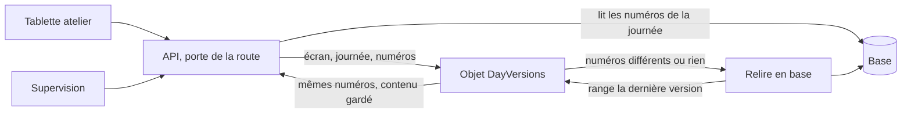

# Plan — lot 2 : le contenu des écrans de journée dans l'objet partagé

> Statut : **doc-first, rien n'est bâti.** Demandé par Hugo le 2026-11-13.
> Touche ce qui est servi à qui : à contredire par `vitruve` avant Hugo.
> Doc d'état : [`le-cache-du-back-office.md`](le-cache-du-back-office.md) § 7 ;
> cible d'origine : [`version-par-journee.md`](version-par-journee.md).

**« On classe par droit dans l'objet ? » — non, pas aujourd'hui.** Les écrans
rangeables reçoivent la date seule : aucune requête ne reçoit les droits, la
personne ou un site. Pour une journée, chaque route rend la même réponse à
tous ses appelants : **un contenu par (écran, journée)**, le droit reste à la
porte de la route. **Une exception, qui est une fuite à corriger avant tout
cache** : le comptoir reçoit les livraisons et leurs tournées, et les masque
dans le navigateur (§ 4).

## Après vitruve (2026-11-13) — ce qui prime sur les sections ci-dessus

- **Comptoir, option B décidée par Hugo** : ce n'est pas une frontière d'accès
  aux commandes — le droit `handover_counter` couvre la consultation d'une
  commande, livraison comprise, par son QR, son identifiant ou une référence
  (`OrderHandoverView` ne porte aucune tournée, vérifié le 2026-11-13). La
  seule entorse aux droits est la **tournée** (`HandoverQueueRoundView`,
  matière de `delivery_rounds`) envoyée dans la file du comptoir. Le lot 0
  retire les livraisons de `admin/handover/file` côté serveur ; le filtre du
  front à retirer est dans `handover-queue.store.ts` (`atTheCounter`, appelé
  aux deux lectures). Le mot « fuite » du § 4 vaut pour la tournée seule.
- **Le sujet global `companies` entre dans la clé** de tout écran qui lit le
  nom d'une société ou d'un client (`handover-order.query.ts` lit
  `company { raisonSociale, enseigne }` et `placedBy { … }` ; à vérifier pour
  le colisage et les tournées).
- **Plus de `read_at`** : un rangement ne remplace la ligne que si chaque
  composante de son étiquette est ≥ celle gardée (les numéros ne font que
  monter) ; aucune horloge de conteneur n'entre dans la décision.
- **Fiche du fournil** : elle lit aussi les paliers d'échéance
  (`worksheet-deadlines-reading.service.ts`) et les contrôles qualité — au
  tableau « lu hors journal » ; une fiche servie sans paliers (`deadlines`
  nul) n'est **jamais rangée**, comme les deux autres états dégradés.
- **`worksheet/current`** : la journée (aujourd'hui ou demain, selon l'heure
  et l'arrêt du plan) est résolue hors cache, puis le contenu de cette
  journée est lu par la clé datée.
- **Une clé par route** : la fiche datée (`production_worksheet` /
  `production_plan`) et `admin/supervision/preparation` ont chacune la leur,
  sauf preuve qu'elles rendent les mêmes octets.
- **À vérifier au lot 0** : les rôles qui tiennent `handover_counter` sans
  `delivery_rounds` **en production** (la graine `ROLE_GRANTS` n'est pas la
  source) ; au lot 1, que l'hôte interne `objets.interne` n'est pas joignable
  depuis la passerelle publique ; un seuil écrit sous lequel le gain mesuré
  au lot 0 fait abandonner le lot.

## Partie 1 — En clair

Aujourd'hui, quand un numéro de journée monte, chaque onglet ouvert relit son
écran en base : trois tablettes d'atelier et deux Supervision font cinq
relectures complètes de la fiche du fournil. Après le lot 2, la première
relecture range l'écran dans l'objet `DayVersions` et les autres onglets l'y
lisent. Une seule ligne par écran et par journée (la dernière) ; les journées
de plus de 3 jours s'oublient.

Les règles :

- une réponse identique pour tous = un seul contenu ; le droit se vérifie à
  la route, jamais dans l'objet ;
- une réponse qui varierait selon les droits = une variante par périmètre,
  jamais par personne, calculée par le serveur avant d'être rangée ;
- ce qui dépend de l'heure ne se range pas : recalculé à chaque réponse ;
- les numéros sont lus **en base** avant les données : son propre geste se
  voit tout de suite ;
- l'objet tombe → on lit la base, comme aujourd'hui.

## Partie 2 — Technique

### 1. Ce qui existe

- `VersionedContents.contentOf(key, version, load, accepts)`
  (`apps/lfd-api/src/platform/day-versions/versioned-contents.ts`) : lecture
  bornée, une relecture par (clé, numéro) et par instance, rangement après la
  réponse, plafond 1 Mo compressé, objet en panne → base. **Le numéro est un
  seul entier**, clé `[a-z0-9:-]{1,64}`.
- L'objet (`container/day-versions.ts`) : table `contents`, une ligne par clé,
  `INSERT OR REPLACE` **sans condition** ; servie à numéro égal ; révision du
  code dans la clé. **Pas d'alarme** : les cartes de numéros s'oublient au
  rangement après 3 jours (`FORGET_AFTER_DAYS`) ; `contents` n'est jamais
  nettoyée.
- Usages bâtis : catalogue (numéro lu avant les données ; le supplément sous
  droit lu à part à chaque appel) et PIM.
- Numéros de journée : `DayVersionSource.versionOf(serviceDay)`, un par
  journal ; `production` = fournil + colisage.

### 2. Écran par écran

| Écran (route)                                            | Droit                                      | Paramètres   | Varie selon l'appelant ? | Heure ?                  | Clé                            |
| -------------------------------------------------------- | ------------------------------------------ | ------------ | ------------------------ | ------------------------ | ------------------------------ |
| Fiche du fournil + colonne Préparation de la Supervision | `production_worksheet` · `b2b_supervision` | date         | non                      | oui (`relativeDay`)      | `day-worksheet`                |
| Colisage (poste et Supervision)                          | `production_packing` ou `b2b_supervision`  | date         | non                      | oui (`relativeDay` seul) | `day-packing`                  |
| Comptoir `admin/handover/file`                           | `handover_counter`                         | jour         | **masquage front** (§ 4) | non                      | `day-handover-counter`         |
| Retrait de la Supervision                                | `b2b_supervision`                          | jour         | non                      | non                      | `day-handover-all`             |
| Tournées `admin/delivery/rounds`                         | `delivery_rounds`                          | jour         | non                      | non                      | `day-rounds`                   |
| Bandeau de la Supervision                                | `b2b_supervision`                          | date         | non                      | oui, en profondeur       | **exclu**                      |
| Relances, Stock                                          | `b2b_supervision`                          | date         | non                      | non                      | **exclus** (lus hors journaux) |
| Ma tournée                                               | `delivery_driving`                         | **personne** | par personne             | —                        | **exclu**                      |

Aucun périmètre par site : le personnel n'a pas de rattachement à un site
dans les droits ; les onglets par point de retrait sont une présentation.

### 3. Invalidation

Le numéro de la clé est **la liste de tous les journaux de journée dont le
handler lit des tables** ; ce qu'aucun journal ne couvre est lu hors cache ou
accepté vieux, sur décision.

| Contenu          | Journaux de la clé                                                            | Lu hors journal (à trancher)                   |
| ---------------- | ----------------------------------------------------------------------------- | ---------------------------------------------- |
| `day-worksheet`  | `production` **et `orders`** (l'atelier ne suit aujourd'hui que `production`) | contenants, réglage d'affichage, rayons        |
| `day-packing`    | `production`, `orders`, `delivery`                                            | noms du personnel                              |
| `day-handover-*` | `orders`, `production`, `delivery`                                            | —                                              |
| `day-rounds`     | `delivery`, `orders`                                                          | livreurs, flotte, réglages, commandes ramenées |

Un contenu dégradé ne se range pas (rayons en échec, attente du four nulle) :
prédicat `storable(content)`.

### 4. La correction de tenancy (avant tout cache)

- Le comptoir reçoit toutes les commandes du jour, livraisons et tournées
  comprises (`HandoverQueueRoundView`, `packages/contracts/src/order-handover.ts`),
  et les retire dans le navigateur (`atTheCounter`,
  `handover-shop/handover-queue.ts`).
- Touchés : `commercial`, `comptabilite`, `support` tiennent
  `handover_counter` sans `delivery_rounds`.
- Correction : la requête prend un périmètre `counter | supervision` posé par
  **la route** ; `counter` retire les livraisons côté serveur (et ne lit plus
  leurs placements) ; on retire `atTheCounter` du front.
- À surveiller : la Supervision rejoue les requêtes des postes. Un champ un
  jour réservé à un droit plus étroit se lira à part, sur le modèle du
  catalogue — jamais par un masque.

### 5. Format dans l'objet

- Table `day_contents(key, screen, day, tag, read_at, body BLOB, raw_bytes)`,
  `key = r:<révision>/<écran>/<jour>`, `tag` = les numéros en clair
  (`o:123.p:456.d:78`), comparés par égalité ; pas de hachage (une collision
  servirait un mauvais contenu en silence).
- Route `/journees/day-contents/<écran>/<AAAA-MM-JJ>` (préfixe déjà aiguillé).
- Course : un rangement ne remplace que si son `read_at` (pris avant la
  lecture des numéros) est plus récent ; lecture servie à `tag` égal.
- Côté API : `DayContents` sur le modèle de `VersionedContents` (garde
  400 ms, disjoncteur, une relecture à la fois, gzip, 1 Mo), adaptateur réel
  et `No…` ; chaque handler coupé en `contentOf(day)` (sans horloge) et
  `served(content, now)`.

### 6. Ménage

Au rangement, comme les cartes : `DELETE FROM day_contents WHERE day <
oldestKeptDay` (révisions anciennes comprises). Une alarme n'apporte rien
quand personne ne range. Bonus : nettoyer les `contents` des révisions
anciennes.

### 7. Volumes

- Lectures par appel (ports) : fiche du fournil 9, colisage 8, comptoir 6,
  tournées ~13. Requêtes Prisma exactes et appels par jour **non mesurés**.
- Gain : K onglets sur une journée → une lecture complète au lieu de K, plus
  K lectures de numéros et K lectures dans l'objet.
- Tailles estimées 5 à 20 Ko compressés par écran et par jour (non mesuré).
- Limites Durable Object à revérifier au moment de bâtir.

### 8. Lots

0. **Mesure** (appels par route, requêtes par appel) **et correction du
   comptoir** (§ 4).
1. **Plateforme** : `day_contents`, condition `read_at`, ménage, compteurs
   `day-*` dans l'onglet Cache ; `DayContents` côté API.
2. **Fiche du fournil** (clé `production` + `orders`).
3. **Colisage.**
4. **File de retrait**, deux variantes.
5. **Tournées**, en dernier.

### 9. Tests

- Objet : `tag` égal / différent, `read_at` plus ancien n'écrase pas, ménage
  à 3 jours, 413, aiguillage.
- API : une relecture à la fois, objet lent → base, `storable` faux, charge
  illisible, plafond.
- Par écran : numéros lus avant les données ; `relativeDay` recalculé ;
  geste puis relecture immédiate → nouvel état.
- Comptoir : un rôle `support` ne reçoit aucune livraison ; la Supervision si.
- Garde-fou : une requête rangée qui recevrait `permissions`, `staffUserId`
  ou une horloge hors `served` échoue.

### 10. Ce que le plan ne fait pas

Ni bandeau, relances, stock, qualité, « Ma tournée » ; ni recalcul poussé par
l'objet ni alarme de 5 s ; ni WebSockets ; ni numéro pour réglages, flotte,
personnel.

### 11. Décisions de Hugo (2026-11-13) : les six recommandations ci-dessous sont retenues

1. Ce qui est lu hors journal accepté vieux jusqu'au prochain numéro ? _Oui
   pour la fiche et le colisage ; livreurs et flotte lus hors cache._
2. Numéros lus en base ou depuis la carte de l'objet (15 s) ? _En base._
3. Ménage au rangement ou alarme ? _Au rangement._
4. Table `day_contents` à part ? _Oui._
5. Correction du comptoir tout de suite, en lot 0 ? _Oui._
6. L'atelier suit aussi `orders` ? _Oui._
