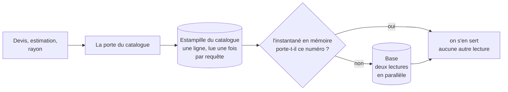
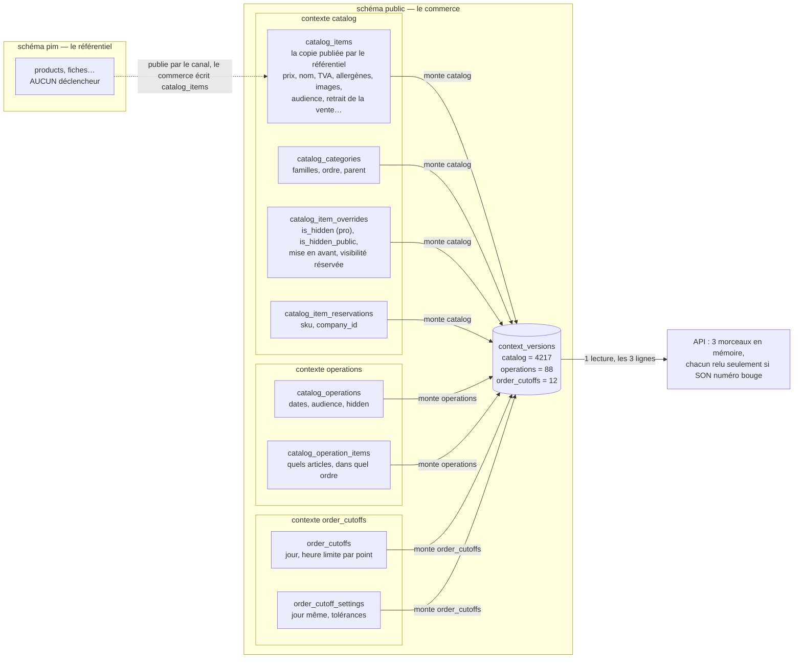

# Plan — le catalogue en un instantané, versionné par la base

> 🎯 **Le seul plan ouvert du dossier — état au 2026-11-05 (soir).** Rien
> n'est bâti au-delà de la mesure. Objectif n° 2 de
> [`carte-des-caches.md`](carte-des-caches.md).
>
> 📏 **Justifié par la mesure en production** (§ 10) : la lecture du catalogue
> pèse **127 ms sur 155** dans un devis anonyme (82 %), en **7** lectures ; et
> chaque ajout au panier d'un client connecté la paie **deux fois** — le devis
> (~130 ms, 7 lectures) et les suggestions du panier (~155 ms, 10 lectures),
> soit ~285 ms par clic. Cible à chaud : une estampille et les réservations de
> l'appelant, ~10–20 ms.
>
> ⚔️ **Contredit deux fois par `vitruve` le 2026-11-05** : 4 bloquants et 13
> sérieux au total, tous corrigés ou portés au bâti (§ 8, § 9). Décision de
> Hugo, **option (a)** : le mur entre sociétés reste dans la requête — le
> compteur de réservations dans l'instantané, la liste filtrée par société en
> SQL à chaque requête.
>
> 🔢 **Un numéro par contexte** (Hugo, 2026-11-06) : `catalog`, `operations`,
> `order_cutoffs`, chacun avec ses déclencheurs, lus en une requête (§ 2.2).
> Remplace la forme à un seul numéro, bâtie le 2026-11-05 puis mise de côté.
>
> ✅ **M1a bâti le 2026-11-06** sur `dev` (migration
> `20261106120000_les_versions_par_contexte`, porte
> `lint:context-version-columns`, e2e `apps/lfd-api/test/context-versions.e2e-spec.ts`) ; rien
> ne lit encore les versions. En production le 2026-11-06 (`5e805275a`).
>
> ✅ **M1b bâti le 2026-11-06** sur `dev` : le devis, l'estimation de la
> saisie et les suggestions du panier lisent le catalogue en mémoire
> (`apps/lfd-api/src/b2b/catalog/infrastructure/catalogue-snapshot/`), à chaud
> 1 lecture des numéros (+ 1 des réservations pour un pro). Écarts au § 12.
> En production le 2026-11-06 (`5e805275a`).
>
> 📏 **Remesuré en production le 2026-11-06** (devis anonyme, 30 appels,
> médianes) : catalogue **127 → 11 ms**, 7 → **1** lecture ; temps de l'API
> 155 → 36 ms ; requête complète 337 → 140 ms (§ 13).
>
> 🧭 **Prochain pas** : remesurer le panier connecté (devis + suggestions),
> puis M2 en option 1 (§ 12). Restent à mesurer avant M1b : le devis d'un espace pro et
> l'estimation de la saisie (§ 10.3).
>
> Ce qui a changé depuis la version du 2026-11-04 : l'invalidation par une
> **estampille tenue par la base** (déclencheurs, comme le principal) et non
> par le signal applicatif `ShelfChanges` ; **le devis et les suggestions
> d'abord**, le rayon (déjà gardé par l'objet `ProShelves`) ensuite.

# Partie 1 — Comprendre

## Ce qui se passe aujourd'hui

Pour construire un rayon, plusieurs lecteurs vont chacun chercher leur morceau
du catalogue en base. La table des articles est lue **trois fois** pour une
seule visite : les articles en vente, puis les articles réservés aux
opérations, puis les prix au kilo — alors que le prix au kilo est **une
colonne** de cette même table. Le devis et l'estimation de la saisie refont le
même genre de lectures, chacun à sa façon.

Chaque lecture est une opération facturée par la base de production, et chaque
lecteur de plus est un endroit qui peut diverger des autres.

## Ce qu'on veut

Le catalogue est **petit** (161 articles, 121 Ko bruts, mesuré en production le
2026-11-04 ; 226 lignes et 496 Ko d'index compris en base le 2026-11-05) et il
**change rarement** (une fiche modifiée, une opération posée). C'est le cas
d'école d'un **instantané** : on le charge entier, une fois, on le garde, et on
ne le relit que lorsque la base dit qu'il a changé.



Trois règles, qui sont celles des caches de lecture bien faits, et que ce dépôt
applique déjà au principal et aux règles de prix :

1. **Une seule vérité de version, tenue par la base.** Toute écriture d'une
   table du catalogue fait monter un numéro, par un déclencheur — aucune
   écriture ne peut l'oublier, d'où qu'elle vienne (le code, une migration, un
   semis, une autre instance de l'API).
2. **Jamais servi périmé pour un montant.** L'instantané n'est utilisé que s'il
   porte **le** numéro lu au début de la requête ; sinon on recharge et la
   requête attend. Pas de « servir l'ancien en rechargeant derrière » : c'est
   acceptable pour un affichage, pas pour un prix.
3. **Un seul chargement à la fois.** Si dix requêtes trouvent l'instantané
   périmé en même temps, une seule va en base ; les neuf autres attendent sa
   réponse.

Ce que ça donne, d'après le relevé M0 :

| Chemin                  | Lectures du catalogue aujourd'hui | Avec l'instantané, à froid | À chaud          |
| ----------------------- | --------------------------------- | -------------------------- | ---------------- |
| devis pro               | 4 (+ 1 heure limite)              | 1 estampille + 2           | **1 estampille** |
| estimation de la saisie | 5 (+ 2 heures limites)            | 1 + 2                      | **1**            |
| rayon recalculé         | 5                                 | 1 + 2                      | **1**            |

Et pour le rayon public, déjà servi par l'objet `ProShelves` : rien ne change
quand l'objet répond ; quand il recalcule, il lit l'instantané.

# Partie 2 — Le plan

## 1. Ce qui est lu aujourd'hui (relevé dans le code le 2026-11-04)

Le rayon (`ShopCataloguePricing.pricedFor`,
`apps/lfd-api/src/b2b/catalog/application/shop-catalogue-pricing.service.ts`) :

| Lecteur (port)                               | Adaptateur                                         | Ce qu'il lit                                                                                                        |
| -------------------------------------------- | -------------------------------------------------- | ------------------------------------------------------------------------------------------------------------------- |
| `CatalogReader.listSellable`                 | `prisma-catalog.reader.ts`                         | `catalogItem.findMany` (avec dérogations et réservations), puis `catalogCategory.findMany` (la lignée des familles) |
| `CatalogOperationsReader.operationOnlySkus`  | `operationOnlySkusOf` (`prisma-catalog.reader.ts`) | `catalogItem.findMany` (les SKU réservés aux opérations)                                                            |
| `CatalogOperationsReader.sellableOperations` | `prisma-catalog-operations.reader.ts`              | `catalogOperation.findMany` (avec leurs articles)                                                                   |
| `ShopOrderCutoffsReader.list`                | `OrderCutoffsInForce` (bloc `order_cutoffs`)       | les heures limites                                                                                                  |
| `CatalogPricePerKgReader.bySkus`             | `prisma-catalog-price-per-kg.reader.ts`            | `catalogItem.findMany` — **les colonnes du kilo, relues**                                                           |
| `CatalogViewers.forCompany`                  | `prisma-served-company.reader.ts`                  | la société servie                                                                                                   |
| `Pricer.load`                                | `PricingMaterialsLoader` (+ cache)                 | règles de prix, estampille                                                                                          |

Mesuré à chaud sur le rayon public : 6 opérations, dont `CatalogItem` **trois
fois**, `CatalogOperation`, `OrderCutoff`, `PricingEvent`.

### Le relevé M0 (mesuré le 2026-11-05)

Mesuré par `apps/lfd-api/test/catalogue-reads.e2e-spec.ts` : la sonde de
comptage (`SchemaOpsCounter`) y est remplacée par une sous-classe qui retient
aussi le **modèle** de chaque appel ORM (même point d'appel, même unité). Scène
du golden master, panier de deux lignes ; le rayon calculé par l'API, sans
`ProShelves` (absent en e2e). L'origine de chaque appel a été identifiée par
la forme de ses arguments (relevé ponctuel, non commité).

Les formes de lecture de `catalog_items` rencontrées :

| Code | Lecture                                                                                         | Adaptateur                                         |
| ---- | ----------------------------------------------------------------------------------------------- | -------------------------------------------------- |
| A    | `listSellable` — tout le catalogue en vente, avec famille, dérogation, réservations (`include`) | `PrismaCatalogReader.listSellable`                 |
| B    | `listByShopSkus` — les lignes du panier, même `include`                                         | `PrismaCatalogReader.listByShopSkus`               |
| C    | le classement des lignes (produit, famille parente, sur mesure)                                 | `prisma-order-line-classification.reader.ts`       |
| D    | les SKU réservés aux opérations (`operationOnly`)                                               | `operationOnlySkusOf` (`prisma-catalog.reader.ts`) |
| E    | les colonnes du kilo, pour **tous** les SKU du rayon (un `IN` du catalogue entier)              | `prisma-catalog-price-per-kg.reader.ts`            |
| F    | la filiation (`detachedFromSku`)                                                                | `PrismaSaleReferenceLineageReader.parentsOf`       |

Et hors de `catalog_items` : `catalogOperation.findMany` (avec ses articles en
`include`) et `orderCutoff.findFirst` (l'heure limite générale,
`prisma-stored-order-cutoff.reader.ts`).

| Chemin                                       | `CatalogItem`     | `CatalogOperation` | `OrderCutoff` | Catalogue / total des opérations, froid → chaud |
| -------------------------------------------- | ----------------- | ------------------ | ------------- | ----------------------------------------------- |
| rayon public (`GET /shop/catalogue`)         | 3 (A, D, E)       | 1                  | 1             | 5 / 11 → 5 / 6                                  |
| rayon pro de base (`?audience=pro`)          | 3 (A, D, E)       | 1                  | 1             | 5 / 11 → 5 / 6                                  |
| rayon d'un pro (`GET /shop/catalogue/mine`)  | 3 (A, D, E)       | 1                  | 1             | 5 / 19 → 5 / 13                                 |
| devis anonyme (`POST /shop/quote`)           | 3 (B, D, C)       | 0                  | 0             | 3 / 11 → 3 / 6                                  |
| devis pro (`POST /shop/quote/mine`)          | 4 (B ×2, D, C)    | 0                  | 1             | 5 / 20 → 5 / 15                                 |
| estimation (`POST /admin/orders/estimate`)   | 5 (B ×3, D, C)    | 0                  | 2             | 7 / 31 → 7 / 25                                 |
| passation pro (`POST /orders`), pour mémoire | 5 (B ×2, D, C, F) | 0                  | 1             | 6 / 75 → 6 / 67                                 |

**Froid = chaud** pour le catalogue : rien ne le garde en mémoire, seuls les
matériaux des prix (règles, planchers, barèmes, promotions) passent à zéro à
chaud. Les familles, dérogations, réservations et articles d'opération ne
coûtent **aucun** appel : ils voyagent en `include` de leur parent.
`CatalogCategory` vaut 0 ici parce que le corpus n'a que des familles à plat :
la lignée (`PrismaCatalogReader.lineage`) n'est lue que si une famille a un
parent — +1 par lecture A ou B dans ce cas, **non relevé**.

**Les doublons** (même table relue dans le même appel HTTP) :

- le rayon lit `catalog_items` trois fois — A, puis D (une colonne de A), puis
  E (deux colonnes de A, pour les SKU que A vient de rendre) ;
- le devis pro relit les lignes du panier (B ×2) ; l'estimation trois fois
  (B ×3), et l'heure limite générale deux fois ;
- la passation relit B deux fois ;
- partout, D (`operationOnly`) est une colonne que A ou B a déjà en main, et C
  (classement) relit les mêmes lignes que B sous une autre projection.

**Ce que `CatalogueMaterials` doit donc contenir** : les articles en vente avec
famille, dérogation et réservations (A — B en devient un filtre), les colonnes
du classement (C : produit, famille parente, sur mesure), le drapeau
`operationOnly` (D), les colonnes du kilo (E), la filiation (F, si la
passation entre un jour dans la porte — elle n'y entre pas d'après le § 2), la
lignée des familles, les opérations avec leurs articles, et l'heure limite
générale. Soit, d'après ce relevé, trois appels à froid (articles, opérations,
heure limite) au lieu de 3 à 7 selon le chemin, et zéro à chaud une fois M3
bâti.

**Ce qui est prouvé, et ce qui ne l'est pas** :

- **prouvé** (2026-11-05, base e2e locale, client compté) : un `findMany` avec
  `include` compte pour **un** appel dans la sonde (`$allOperations` ne voit
  que l'appel du client), et Prisma 7 sans `relationJoins` l'exécute en
  **plusieurs** instructions SQL — deux appels (`catalogItem` avec famille,
  dérogation, réservations ; `catalogOperation` avec ses articles) ont donné
  **6** instructions ;
- **affirmé, non prouvé ici** : que Prisma Postgres facture par appel du
  client et non par instruction SQL. C'est ce que disent le JSDoc de
  `SchemaOpsCounter` et la tarification publiée de Prisma ; seule la facture
  de production peut le confirmer.

## 2. La forme

### 2.1 L'instantané — ce qui est COMMUN à tous, et seulement ça

`CatalogueSnapshot`, un objet **immuable** (`readonly`, gelé) que le contexte
`catalog` construit :

- **les articles ENCORE VENDUS**, filtrés par le prédicat partagé
  `STILL_SOLD` (`src/b2b/catalog/infrastructure/sellable-filter.ts`) —
  **importé, jamais recopié** : un article retiré est absent de l'instantané
  comme il est absent de la lecture B aujourd'hui (`prisma-catalog.reader.ts:139`),
  donc aucune vue ne peut le chiffrer. Avec en `include` la famille et les
  dérogations ; les colonnes du classement (C), du kilo (E), le drapeau
  `operationOnly` (D), la filiation (F) ;
- **« l'article est-il réservé ? »** — le compteur `_count.reservations`
  (`reservationInclude`, `catalog-item-access.ts`) : un nombre, identique pour
  tous les lecteurs, sans aucun identifiant de société ;
- **la lignée des familles** (`catalog_categories`) ;
- **les opérations** non retirées, avec leurs articles (pas leur surcharge
  locale, que personne ne lit — § 9), jugées à l'instant de la requête par
  les mêmes fonctions qu'aujourd'hui ;
- **les heures limites** : `b2b/order-cutoffs` est dans le même bloc que
  `b2b/catalog`, et `lint:prisma-model-ownership` raisonne par bloc
  (`top = inSrc.split("/")[0]`) — l'objection « autre bloc » de la version
  précédente était fausse ; le critère retenu est celui de la porte.

**Ce qui n'y entre PAS, par décision (Hugo, 2026-11-05, option a)** :

- **« à qui, parmi TES sociétés ? »** — la liste filtrée des réservations
  (`reservations where companyId in viewerHolderIds(viewer)`) reste une
  **lecture SQL par requête**, filtrée par la société de l'appelant. Le mur
  entre sociétés reste **dans la requête** (CLAUDE.md § 3, sans exception).
  Prix assumé : une lecture de plus à chaud. L'option (b) — toutes les
  réservations en mémoire, filtrées en code — est écartée : une erreur de
  filtre y serait une fuite entre sociétés.
- **Les textes alternatifs des images d'opération** (`withLibraryAlts`,
  médiathèque, `prisma-catalog-operations.reader.ts:58`) : un autre bloc, que
  l'estampille ne voit pas. Ils restent lus à part, sur le chemin du rayon
  seulement, et **comptés** dans le budget.

Les vues **réutilisent** les fonctions d'aujourd'hui (`servedItem`, le mur
`CatalogViewer`, `effective-operation.ts`) en leur passant les lignes de
l'instantané et la liste de réservations de la requête : le filtrage ne change
pas de code, seulement de source.

Indexé au chargement (par SKU, par famille) : les vues lisent des `Map`.

### 2.2 Les estampilles — un numéro par contexte (décidé par Hugo le 2026-11-06)

**En une phrase :** chaque contexte du commerce dont l'instantané lit des
tables tient **son propre numéro**. À chaque écriture qui change ce que la
boutique sert, la base fait monter le numéro **du contexte qui possède la
table**, et lui seul. L'API relit les numéros à chaque requête, en une seule
lecture, et ne recharge que le morceau dont le numéro a bougé.

**Pourquoi pas un seul numéro** (la forme bâtie le 2026-11-05, puis mise de
côté) : il faisait dépendre trois contextes d'une même ligne. Masquer une
opération faisait relire tous les articles. Hugo l'a refusé le 2026-11-06 :
« le stamp est une conséquence de deux schémas qui ne devraient pas se
parler ». C'est aussi la pratique des grandes plateformes : chacun versionne
son propre domaine.

| Contexte (propriétaire, `lint:prisma-model-ownership`) | Tables sous déclencheur                                                                      | Morceau de l'instantané      |
| ------------------------------------------------------ | -------------------------------------------------------------------------------------------- | ---------------------------- |
| `catalog` (`b2b/catalog`)                              | `catalog_items`, `catalog_categories`, `catalog_item_overrides`, `catalog_item_reservations` | articles, familles, lignée   |
| `operations` (`b2b/operations`)                        | `catalog_operations`, `catalog_operation_items`                                              | opérations et leurs articles |
| `order_cutoffs` (`b2b/order-cutoffs`)                  | `order_cutoffs`, `order_cutoff_settings`                                                     | heures limites, réglages     |

Propriétaires à revérifier au bâti dans le code des écrivains (relevé le
2026-11-05, pas rouvert le 2026-11-06). `catalog_operation_overrides` n'a pas
de déclencheur : personne ne la lit (§ 9).

**La table** : `catalog_versions` est déjà prise (l'archive des arrivées du
référentiel). Nom proposé : `context_versions`, dans le schéma `public` :

| Colonne   | Type     | Exemple      | Sens                                                   |
| --------- | -------- | ------------ | ------------------------------------------------------ |
| `context` | `text`   | `operations` | clé primaire ; `CHECK` sur les trois valeurs ci-dessus |
| `value`   | `bigint` | `88`         | monte quand une table de CE contexte change            |

Elle ne contient ni le catalogue, ni la date, ni l'auteur : c'est un compteur
par contexte, pas un journal.

**Une fonction de montée par contexte** (`catalog_version_bump()`,
`operations_version_bump()`, `order_cutoffs_version_bump()`) : chaque
déclencheur appelle celle de SON contexte, qui n'écrit que SA ligne. Une
fonction générique avec le contexte en argument (`TG_ARGV`) ferait la même
chose ; écartée parce qu'un nom de fonction mal écrit échoue **à la
migration**, alors qu'un argument mal orthographié n'échouerait qu'au `CHECK`,
à la première écriture en production (`vitruve`, 2026-11-06).

**La mécanique de chaque déclencheur est celle de `principal_stamp` dans sa
forme en service** :

- un **compteur**, pas un `max(id)` (attribué à l'écriture, pas à la
  validation) ;
- `BEFORE … FOR EACH STATEMENT`, pour que le verrou de la ligne du contexte
  soit pris avant ceux des lignes écrites ;
- **resserré aux colonnes lues** (`UPDATE OF …`, comme
  `20261105120000_l_estampille_filtree_par_colonnes`) ; `INSERT` et `DELETE`
  toujours. Une réécriture de l'auteur d'une décision ou d'un état technique
  ne fait rien monter ;
- la fonction **recrée** la ligne absente (`INSERT … ON CONFLICT DO UPDATE`) :
  un `UPDATE` sur zéro ligne laisserait passer l'écriture sans faire monter le
  numéro.

**Corrigé au bâti du 2026-11-05 :** cette section disait que les visuels et
les limites de commande ne changeaient rien à l'instantané. C'était faux : les
images, vignettes, cadrages et limites de commande sont **servis** par la
boutique. Ils sont lus, donc ils font monter `catalog`.

**L'arrêt d'urgence est un réglage, pas une ligne effacée.** Puisque la
fonction recrée la ligne, « ligne absente = ne rien garder » ne coupe rien.
`CATALOGUE_SNAPSHOT_MEMORY=off`, lu par `AppConfig`, fait relire la base à
chaque requête, comme aujourd'hui. À poser en M1b, avec le premier lecteur.

**Retour arrière** de M1a : `DROP TRIGGER` des huit déclencheurs, `DROP
FUNCTION` des trois fonctions, `DROP TABLE "context_versions"`. Gratuit tant
que M1b n'est pas déployé : rien ne la lit.

**Pourquoi pas `catalog_versions`** : c'est une **archive** des arrivées du
référentiel, où « la surcharge locale n'y entre pas » (`catalog.prisma`) ; une
dérogation ou une réservation changent le catalogue servi sans créer de
version.

**Le référentiel n'y figure pas.** Aucun déclencheur dans le schéma `pim`.
Quand il publie, le commerce écrit sa copie dans `catalog_items`, et c'est
cette écriture qui fait monter `catalog`. La frontière du § 1 de `CLAUDE.md`
reste intacte.

**Ce que la promesse couvre, et ce qu'elle ne couvre pas** : « aucune écriture
ne peut l'oublier » vaut pour l'**instantané** (devis, estimation, rayon
recalculé). Le **cache des rayons** (l'objet `ProShelves`, le bord Cloudflare)
reste purgé par le signal applicatif `ShelfChanges` : une correction SQL à la
main laisse le rayon faux jusqu'à son expiration. Inchangé par ce plan.

### 2.2 bis Le schéma

> ✅ Bâti le 2026-11-06 (M1a) : la table, ses trois fonctions et ses huit
> déclencheurs existent en production depuis le 2026-11-06. La forme à un
> seul numéro, bâtie le 2026-11-05, a été abandonnée ; sa liste de colonnes et
> son registre ont été repris, rangés par contexte (§ 11).



Masquer un article fait monter `catalog` seul, et l'API ne relit que les
articles. Masquer Noël fait monter `operations` seul.

### 2.3 La porte

Un port `CatalogueSnapshotSource` (application du catalogue), un adaptateur
Prisma et une mémoire :

- `current()` lit les **trois numéros en une seule lecture** (`SELECT context,
value FROM context_versions`), **une fois par requête** (sur le contexte de
  la requête, comme l'estampille des prix) ;
- l'instantané est fait de **trois morceaux**, chacun rangé sous SON numéro :
  les articles (avec familles, dérogations, compteur de réservations ; un
  appel de plus pour la lignée si une famille a un parent), les opérations
  (avec leurs articles), les heures limites et leurs réglages. Seul le
  morceau dont le numéro a bougé est rechargé ;
- **une seule lecture en vol** par (morceau, numéro) ;
- **chaque morceau est rangé sous le numéro lu AVANT son chargement** (la
  règle d'ordre de `CachedPrincipalResolver`) ;
- une ligne absente de `context_versions` (base vidée à la main) : le morceau
  n'est **pas** gardé, il est relu à chaque requête ;
- **hors requête** (cron, semis), rien n'est gardé ;
- **une borne** : le dernier instantané, plus celui en cours de chargement.

### 2.4 Les vues

Les lecteurs gardent leur port ; leur adaptateur lit l'instantané au lieu de la
base :

| Lecteur d'aujourd'hui                                               | Devient                                                                         |
| ------------------------------------------------------------------- | ------------------------------------------------------------------------------- |
| `CatalogReader.listSellable` (A)                                    | les articles de l'instantané + les réservations de la requête, par `servedItem` |
| `CatalogReader.listByShopSkus` (B)                                  | les mêmes, par SKU dans l'index                                                 |
| classement des lignes (C)                                           | les colonnes du classement, dans l'index                                        |
| `operationOnlySkusOf` (D)                                           | un filtre sur le drapeau                                                        |
| `CatalogPricePerKgReader.bySkus` (E)                                | les colonnes du kilo, dans l'index                                              |
| `CatalogOperationsReader.sellableOperations`                        | les opérations de l'instantané, puis `withLibraryAlts` comme aujourd'hui        |
| `PrismaWithdrawnShopSkusReader`, `storefront-catalog-operations.ts` | à classer au bâti : vue de l'instantané ou liste admise datée                   |

### 2.5 Ce qui ne passe PAS par là

- **La passation** (`POST /orders`, `POST /shop/orders`) relit la base pour ce
  qu'elle **écrit**, et fait foi. Un devis calculé sur un instantané périmé
  d'une écriture est refusé à la passation en 409 `orders.total_changed`, sans
  écriture (garde existante). **À vérifier par `vitruve`** : un chemin où ils
  divergent sans que le total change (§ 6).
- **La société, les droits, l'audience** : le principal, relu à chaque requête.
- **Les écrans d'administration** du catalogue.

## 3. Par construction

- **`lint:catalogue-door`** (modèle : `lint:price-door`) : sur les chemins du
  devis, de l'estimation et du rayon, aucun fichier ne lit les tables de
  l'instantané en direct ; liste admise datée pour l'administration et la
  passation.
- **La porte des déclencheurs, par colonne et par contexte**
  (`lint:context-version-columns`, bâtie en M1a le 2026-11-06) : les colonnes lues viennent de la constante que le chargeur importe
  pour son `select` ; chaque table de la constante a son déclencheur, en
  `UPDATE OF` sur exactement ces colonnes ; chaque autre colonne est
  « ignorée » au registre avec sa raison ; toute table reliée au catalogue est
  sous déclencheur ou classée « hors de l'instantané ». **Ajouté par la forme
  par contexte** : la constante range chaque table sous son contexte, et la
  porte vérifie que son déclencheur appelle la fonction de CE contexte. Une
  table rangée sous `operations` qui ferait monter `catalog` échoue.
- **Le budget** : `test/catalogue-reads.e2e-spec.ts` devient un budget — à
  chaud, **1 estampille + 1 réservations** sur le devis et l'estimation, plus
  les textes des images sur le rayon.
- **Les e2e d'invalidation et du mur** : une fiche modifiée entre deux devis
  change le second ; une écriture SQL brute aussi (le déclencheur) ; un
  **article retiré** dans le panier est refusé pareil avant et après ; un pro
  **ne voit pas** la réservation d'une autre société.

## 4. Plusieurs instances

Réglé par construction : le numéro vient de la base, chaque instance le relit
par requête. Aucune purge en éventail.

## 5. Les lots

Après les deux passages de `vitruve` (§ 8, § 9) et la mesure (§ 10) :

| Lot     | Contenu                                                                                                                                                                                                                                                                                                                                                                           | Gain mesurable                                                |
| ------- | --------------------------------------------------------------------------------------------------------------------------------------------------------------------------------------------------------------------------------------------------------------------------------------------------------------------------------------------------------------------------------- | ------------------------------------------------------------- |
| **M1a** | les estampilles seules : la table `context_versions` (trois lignes), une fonction par contexte, les huit déclencheurs resserrés aux colonnes du `select` du chargeur ; la porte par colonne et par contexte ; la remise des trois lignes dans le harnais e2e. **Rien ne la lit** : retour arrière gratuit. Repris de ce qui est mis de côté. `lecteur-de-migrations` avant `main` | aucun (prépare M1b)                                           |
| **M1b** | l'instantané en trois morceaux (chargeur en `select` explicite), sa mémoire, ses vues, le réglage `CATALOGUE_SNAPSHOT_MEMORY` ; le **devis**, l'**estimation** et les **suggestions** (`catalog-suggestion-catalogue.ts`, qui lit aujourd'hui `listSellable` deux fois) y passent ; les réservations de l'appelant lues **avant** l'estampille ; le budget et les e2e du § 3      | devis ~130 → ~10–20 ms, suggestions ~155 → ~10–20 ms, à chaud |
| **M2**  | le **rayon** recalculé passe par la même porte ; `lint:catalogue-door`                                                                                                                                                                                                                                                                                                            | rayon recalculé 5 → 2 lectures à chaud                        |

On mesure **après chaque lot** avec les mêmes outils (§ 10) et on reporte les
chiffres dans le tableau de référence.

## 6. Ce que `vitruve` doit encore trancher

- un chemin où le devis (instantané) et la passation (base) divergent **sans**
  que le total change — un article retiré entre les deux, une réservation
  posée ;
- l'ordre des verrous des déclencheurs avec une transaction qui écrirait aussi
  une table sous `principal_stamp` (aucune trouvée, recherche non exhaustive) ;
- la liste exacte des colonnes de l'`UPDATE OF` ;
- l'écriture d'une opération puis de ses articles **sans transaction**
  (`prisma-operation.repository.ts:84-96`) : un chargement entre les deux
  rangerait une opération vide jusqu'à la prochaine écriture — défaut
  existant, que l'instantané rend plus durable ; le corriger dans M1 ?

## 7. Ce qui n'est pas vérifié

- la lignée des familles à plusieurs niveaux (corpus de test à plat) ;
- que Prisma Postgres facture par appel du client (affirmé par sa tarification) ;
- la taille de l'instantané indexé en mémoire ;
- les écritures en masse : l'ingestion des articles fait **un** `INSERT`
  (`catalog-item-upsert.ts:161`), la projection des familles un `upsert` par
  famille (`prisma-catalog-category.projection.ts:36`) — l'estampille monte N
  fois, sans danger.

## 8. Contredit par `vitruve` le 2026-11-05 — ce qui a changé

| Objection                                                       | Gravité  | Ce que le plan fait maintenant                                                                  |
| --------------------------------------------------------------- | -------- | ----------------------------------------------------------------------------------------------- |
| la lecture B n'expose pas les retirés : elle les écarte en SQL  | BLOQUANT | l'instantané ne porte que `STILL_SOLD`, importé (§ 2.1)                                         |
| les réservations filtrées par société sortiraient de la requête | BLOQUANT | option (a) de Hugo : le compteur dans l'instantané, la liste filtrée en SQL par requête (§ 2.1) |
| critère « autre bloc » faux pour les heures limites             | SÉRIEUX  | critère de la porte (par bloc) : elles entrent (§ 2.1)                                          |
| textes des images hors estampille ; « deux appels » faux        | SÉRIEUX  | lus à part, comptés (§ 2.1, § 3)                                                                |
| M1 seul plus cher qu'aujourd'hui                                | SÉRIEUX  | instantané et mémoire dans le même lot (§ 5)                                                    |
| porte des déclencheurs sans critère                             | SÉRIEUX  | modèles lus par l'adaptateur = tables sous déclencheur (§ 3)                                    |
| déclencheurs larges, alors que le principal a été resserré      | SÉRIEUX  | `UPDATE OF` sur les colonnes lues (§ 2.2)                                                       |
| promesse trop large (le rayon reste au signal)                  | SÉRIEUX  | restreinte et dite (§ 2.2)                                                                      |
| retour arrière non dit                                          | SÉRIEUX  | ligne absente = ne rien garder (§ 2.2)                                                          |
| six/sept tables ; lecteurs oubliés ; opération sans transaction | MINEUR   | corrigés ou portés au § 2.4 / § 6                                                               |

## 9. Second passage de `vitruve` (2026-11-05) — à intégrer au bâti

Aucune objection ne remet en cause l'option (a). Ce qui change :

| Objection                                                                                                                                                                                                                                                             | Gravité  | Correction                                                                                                                                           |
| --------------------------------------------------------------------------------------------------------------------------------------------------------------------------------------------------------------------------------------------------------------------- | -------- | ---------------------------------------------------------------------------------------------------------------------------------------------------- |
| `UPDATE OF` fondé sur une prémisse fausse : l'état « en revue » (`publicReviewPending`, `proReviewPending`, `catalog-item-access.ts:47-48`) est lu par le mur ; le chargeur lit toutes les colonnes (`itemInclude` sans `select`, `prisma-catalog.reader.ts:225-231`) | BLOQUANT | chargeur en `select` explicite ; la liste des colonnes écrite au bâti ; une porte **par colonne** sur le modèle de `principal-stamp-columns.spec.ts` |
| le harnais e2e tronque sans remettre l'estampille ni vider la mémoire (`test/e2e-harness.ts:258-320`)                                                                                                                                                                 | BLOQUANT | `ensureCatalogStamp` + `forget()` dans `ctx.reset()`, avec leur test                                                                                 |
| `STILL_SOLD` ne couvre pas le filtre du taux (`vatRatePercent: { not: null }`, l. 165) ni le tri à trois clés (l. 177) de la lecture A                                                                                                                                | SÉRIEUX  | la vue A les réapplique ; e2e « article sans taux : absent du rayon public » ; `findByShopSku` ajouté au § 2.4                                       |
| compteur figé au numéro N, liste lue maintenant : une réservation posée entre les deux sert un article une requête                                                                                                                                                    | SÉRIEUX  | lire la liste des réservations **avant** l'estampille ; 0 lecture pour un lecteur sans société                                                       |
| `catalog_operation_overrides` n'est lu par personne aujourd'hui                                                                                                                                                                                                       | SÉRIEUX  | retirée de l'instantané et des déclencheurs ; l'appliquer serait une fonctionnalité à décider                                                        |
| M1 trop gros, partie irréversible non isolée                                                                                                                                                                                                                          | SÉRIEUX  | **M1a** l'estampille et ses déclencheurs seuls (rien ne la lit) ; **M1b** instantané, mémoire, devis, estimation                                     |
| les heures limites : `order_cutoffs` ; `order_cutoff_settings` lue sur les mêmes chemins                                                                                                                                                                              | MINEUR   | les deux dans l'instantané et sous déclencheur, à confirmer au bâti                                                                                  |
| un déclencheur sur une ligne unique sérialise toutes les écritures du catalogue                                                                                                                                                                                       | MINEUR   | assumé : écritures rares                                                                                                                             |

Réponses au § 6 : aucune divergence nuisible devis/passation (la passation
relit et refuse sans écrire ; e2e « devis, réservation par une autre société,
passation refusée ») ; l'opération écrite sans transaction reste transitoire
(chaque instruction fait monter le numéro).

**Encore ouvert** : l'ordre des verrous avec `principal_stamp`, et désormais
entre les trois lignes de `context_versions`. **Tranché au bâti du
2026-11-05** : la fonction de montée recrée la ligne absente ; l'arrêt
d'urgence est donc un réglage (§ 2.2).

**Avant de bâtir (Hugo, 2026-11-05)** : mesurer d'abord ce que pèse la lecture
du catalogue dans un devis (marque `Server-Timing` `catalogue`, référence en
production). Si elle pèse peu, seule la suppression des doublons, sans mémoire
ni migration.

## 10. Mesurer avant de bâtir (outillage posé le 2026-11-05, référence à relever)

**En simple** : avant de construire la mémoire du catalogue, on regarde
combien de millisecondes la lecture du catalogue coûte vraiment dans un
devis. Si c'est peu, on se contente de supprimer les lectures en double
(§ 9, dernier paragraphe).

**La marque.** Chaque réponse de l'API porte, dans `Server-Timing`, deux
marques de plus dès qu'elle a lu le catalogue :

- `catalogue;dur=…` — le temps **mural** pendant lequel au moins une lecture
  du catalogue était en cours. Des lectures parallèles ne comptent qu'une
  fois (union des intervalles, `apps/lfd-api/src/platform/metrics/overlapping-span.ts`) ;
- `catalogue-reads;dur=0.0;desc="N"` — le nombre de lectures, dans la même
  unité que le relevé M0 (un appel du client Prisma).

Le mécanisme est `timeServerTimingSpan` (`platform/metrics/server-timing.ts`),
un accumulateur par requête sur le stockage de la requête ; hors requête
(tâche de fond), il ne note rien. Les lecteurs l'appellent par
`timeCatalogueRead` (`apps/lfd-api/src/b2b/catalog/infrastructure/catalogue-read-timing.ts`)
autour de chaque appel : `PrismaCatalogReader` (A, B, `findByShopSku`, la
lignée), `operationOnlySkusOf` (D), la classification (C, et sa lignée), le
prix au kilo (E), la filiation (F), les opérations et l'heure limite générale.
`catalogue` est une part de `app`, pas un temps de plus. L'e2e
`test/catalogue-reads.e2e-spec.ts` vérifie que le nombre égale le relevé M0
(devis anonyme 3, rayon public 5, estimation 7).

⚠️ La marque est publique comme les autres : inscrite à la dette
[`todo-server-timing-public.md`](../todos/todo-server-timing-public.md).

**Le script.** [`dev-toolbox/charge/reference-devis.js`](../../dev-toolbox/charge/reference-devis.js)
(k6) : un seul visiteur, `LFD_N` devis anonymes (30) à `LFD_PAUSE` secondes
d'intervalle (3), paniers tirés du catalogue public, sans acheminement (un retrait sans point est refusé quand plusieurs points sont ouverts).
Rien n'écrit. Les réponses servies du cache Cloudflare sont écartées. Il
rend médiane et p95 de `http_req_duration`, `app`, `catalogue` et
`catalogue-reads`.

```bash
LFD_BASE_URL=https://lafoliecoffee.info/api/lfd LFD_PROD=oui k6 run dev-toolbox/charge/reference-devis.js
```

**Le devis pro et l'estimation ne passent pas par le script** (pas de jeton
en production). À la main : se connecter (boutique en pro, ou back-office
pour l'estimation), ouvrir l'onglet Réseau, refaire dix fois le geste
(modifier le panier ; « Estimer » dans la saisie), lire pour chaque appel
`POST /shop/quote/mine` ou `POST /admin/orders/estimate` l'onglet « Timing »
(section Server Timing) : `app`, `catalogue`, `catalogue-reads`. Noter la
médiane. Même chose pour le rayon d'un pro (`GET /shop/catalogue/mine`).

**Référence** (à remplir après déploiement de la marque) :

**Relevé le 2026-11-05 en production : la lecture du catalogue pèse 82 % du
temps d'un devis anonyme dans l'API** (127 ms sur 155, médianes), en **7**
lectures — contre 3 dans le relevé M0 local : le catalogue de production a des
familles à plusieurs niveaux, et la lignée, absente du corpus de test (à plat),
coûte des lectures. Le plan est justifié par la mesure.

**Et chaque ajout au panier paie DEUX fois** (relevé le 2026-11-05 dans la
boutique, client connecté) : le devis (7 lectures, ~130 ms) **et** les
suggestions du panier (10 lectures, ~155 ms), soit ~285 ms de lecture du
catalogue par clic. Les suggestions ne figuraient pas au relevé M0 : elles
entrent dans le périmètre de l'instantané (à ajouter à M1b). Restent à relever
: le devis d'un espace **pro** et l'estimation de la saisie (back-office).

| Date       | Chemin                                                   | `http_req_duration` méd. / p95 | `app` méd. / p95 | `catalogue` méd. / p95 | lectures |
| ---------- | -------------------------------------------------------- | ------------------------------ | ---------------- | ---------------------- | -------- |
| 2026-11-05 | devis anonyme (`POST /shop/quote`), `bbb779a`, 30 appels | 337 / 446 ms                   | 155 / 180 ms     | **127 / 148 ms**       | **7**    |
|            | devis pro (`POST /shop/quote/mine`)                      |                                |                  |                        |          |
|            | estimation (`POST /admin/orders/estimate`)               |                                |                  |                        |          |
|            | rayon d'un pro (`GET /shop/catalogue/mine`)              |                                |                  |                        |          |

### 10.2 Ce que la mesure a appris (2026-11-05)

- **Le relevé local sous-estimait** : 3 lectures pour le devis anonyme en e2e,
  **7** en production. Le corpus de test n'a que des familles à plat ; le
  catalogue réel a des sous-familles, et la lignée coûte des lectures. Un
  budget e2e ne suffit pas : le tableau de référence en production fait foi.
- **Les suggestions** n'étaient pas dans M0 et coûtent plus que le devis :
  `CatalogSuggestionCatalogue` lit le catalogue entier pour les pros **puis**
  pour le public (`listSellable` ×2, `catalog-suggestion-catalogue.ts:25-26`).
- **Le rayon d'un pro servi par l'objet** n'a fait **aucune** lecture du
  catalogue (pas de marque `catalogue`) ; son `app` valait **362 ms** — le
  temps d'appel à l'objet `ProShelves`, à surveiller à part (cf.
  [`le-rayon-en-cache.md`](le-rayon-en-cache.md)).
- **Le script** demandait d'abord un retrait sans point : le serveur le refuse
  en 409 (« choisissez votre point ») dès que plusieurs points sont ouverts ;
  il chiffre désormais sans acheminement.

### 10.3 Ce qui reste à relever, et comment

| Chemin                                                 | Comment                                                                                                                                                              | Précaution                                                        |
| ------------------------------------------------------ | -------------------------------------------------------------------------------------------------------------------------------------------------------------------- | ----------------------------------------------------------------- |
| devis d'un espace **pro** (`/shop/quote/mine`)         | dans la boutique connectée, basculer sur l'espace société, ajouter 2–3 articles, lire `Server-Timing` (onglet Réseau, ou `performance.getEntriesByType('resource')`) | rebasculer sur l'espace d'origine ; vider le panier               |
| **estimation** de la saisie (`/admin/orders/estimate`) | back-office, « Nouvelle commande », choisir le client **Les Tommeuses** (le compte réservé à ces essais, Hugo, 2026-11-05), ajouter des lignes                       | **ne jamais enregistrer la commande** : seule l'estimation compte |
| après **M1b**                                          | le script `reference-devis.js` et les mêmes gestes dans la boutique                                                                                                  | comparer médianes et p95 au tableau                               |

## 11. Troisième passage de `vitruve` (2026-11-06) — la forme par contexte

Aucun bloquant. Ce qui change :

| Objection                                                                                                                                                                                                                   | Gravité | Ce que le plan fait maintenant                                                                                                                                                                                                                                                                                                                                                                              |
| --------------------------------------------------------------------------------------------------------------------------------------------------------------------------------------------------------------------------- | ------- | ----------------------------------------------------------------------------------------------------------------------------------------------------------------------------------------------------------------------------------------------------------------------------------------------------------------------------------------------------------------------------------------------------------- |
| « repris tels quels » est faux : la porte mise de côté code en dur une fonction (`catalog_stamp_bump`) et le suffixe `_catalog_stamp`, et la constante des colonnes est une liste plate sans contexte                       | SÉRIEUX | M1a **refait** la forme de la constante (rangée par contexte), la porte et ses tests, la remise du harnais et l'e2e. Se reprennent tels quels : la liste des colonnes de `catalog_items`, `catalog_categories`, `catalog_item_overrides`, `catalog_item_reservations` et des opérations, le registre des colonnes ignorées et ses raisons                                                                   |
| `order_cutoff_settings` : la constante mise de côté retenait l'auteur (`updated_at`, `updated_by_name`) et des réglages sans rapport avec le devis (rappel, alerte de retard, garde en rayon)                               | SÉRIEUX | le lecteur actuel (`prisma-order-cutoff-settings.reader.ts`) lit la ligne entière pour les écrans ; l'instantané, lui, ne lira que ce que le devis et l'estimation jugent (le jour même, par clientèle, et l'heure de réassort si elle y sert). La liste est relevée au bâti **depuis les appelants du devis**, le reste passe au registre « ignorée » avec sa raison                                       |
| `save` d'une opération : trois instructions hors transaction (`prisma-operation.repository.ts:84-97`) ; un chargement entre l'effacement et la recréation des articles range une opération vide jusqu'à la requête suivante | SÉRIEUX | **M1a met ce `save` en transaction.** Le reste vérifié par `vitruve` le 2026-11-06 : aucun écrivain ne touche deux contextes dans une même transaction, aucune cascade ne traverse vers `catalog_operation_items` — un devis n'assemble donc jamais un état qui n'a pas existé en base                                                                                                                      |
| ordre des verrous « encore ouvert »                                                                                                                                                                                         | SÉRIEUX | **constaté le 2026-11-06, non tenu par un mécanisme** : aucune transaction n'écrit deux contextes, ni un contexte et une table de `principal_stamp`. Si cela arrivait un jour dans les deux ordres, Postgres détecte l'interblocage et annule une des deux transactions (erreur, pas de blocage silencieux). Assumé ; l'e2e de M1a vérifie qu'une écriture dans chaque contexte ne fait monter que sa ligne |
| raison du choix « une fonction par contexte »                                                                                                                                                                               | MINEUR  | réécrite au § 2.2 : une faute de nom échoue à la migration                                                                                                                                                                                                                                                                                                                                                  |
| « ligne absente = morceau non gardé » ne sert qu'au harnais ; la fonction recrée à 1, le harnais remet à 0                                                                                                                  | MINEUR  | gardé (il ne coûte rien et protège une base vidée à la main) ; la remise du harnais **vide aussi la mémoire** (`forget()`), sans quoi un numéro qui repart d'en bas servirait un vieux morceau                                                                                                                                                                                                              |
| où vit le modèle de `context_versions`                                                                                                                                                                                      | MINEUR  | un fichier `context-versions` (à créer sous `public/`) : un nom qui n'est celui d'aucun des trois contextes                                                                                                                                                                                                                                                                                                 |
| la clé `order-cutoffs` avec un tiret                                                                                                                                                                                        | MINEUR  | `order_cutoffs`, comme les autres valeurs du dépôt                                                                                                                                                                                                                                                                                                                                                          |
| `order_cutoff_settings` est rangé dans `settings.prisma`, pas avec `order_cutoffs`                                                                                                                                          | MINEUR  | noté, non déplacé : ranger un fichier n'est pas l'objet de M1a                                                                                                                                                                                                                                                                                                                                              |

**Non vérifié** : qu'aucune transaction n'écrive `catalog_item_reservations`
avec `companies` ou `memberships` (archivage d'une société) — à remonter
depuis les appelants de `prisma-catalog-reservations.ts` au bâti de M1a.

### 11.1 Ce que le bâti de M1a a appris (2026-11-06)

- **Le `save` d'une opération était déjà presque toujours en transaction** :
  sept appelants sur huit l'appellent dans un `uow.run`. Le huitième,
  `repoint-operation-image.ts`, reçoit un `WriteTicket` de la médiathèque,
  probablement transactionnel (non vérifié). Le `uow.run` posé dans `save`
  rejoint la transaction en cours et protège un futur appelant. `add` a la
  même forme (création, puis articles) et n'a pas été touché.
- **Les réglages d'heure limite lus par le devis**, relevés depuis ses
  appelants (`OrderPlanGate.ensureNotTooSoon`, `ShelfCircuit.refusalFor`,
  `staff-settlement-refusal.ts`) : les quatre drapeaux du jour même par
  clientèle. L'heure de réassort ne sert qu'au réassort et au fournil.
- **Le « non vérifié » du § 11 est fermé** : les seuls écrivains des
  réservations (`ReserveArticleHandler`, `ReleaseArticleHandler`) ne font que
  LIRE la société ; aucune transaction n'écrit réservations et
  `companies`/`memberships`.
- **Les colonnes de `order_cutoffs`** ont été reprises de l'ancienne liste,
  pas relevées depuis le devis : à confirmer au chargeur de M1b.

## 12. Ce que le bâti de M1b a tranché (2026-11-06)

**Le chemin.** Le devis et la passation partagent les mêmes ports
(`OrderLinePricing`, `ProductCatalogReader`). Pour que la passation reste sur la
base (§ 2.5), l'instantané n'est lu que dans une **portée explicite**,
`withCatalogueSnapshot` (`apps/lfd-api/src/b2b/catalog/application/catalogue-snapshot-scope.ts`),
posée sur quatre cas d'usage : les deux devis de la boutique, l'estimation
de la saisie et les suggestions du panier. Hors de la portée, les mêmes
lecteurs lisent la base comme avant : la passation, l'administration, le rayon
(jusqu'à M2). Le port `CatalogueSnapshotSource` prévu au § 2.3 n'existe pas :
tout le dispositif vit dans l'infrastructure du catalogue.

**Ce qui est chargé.** Le morceau `catalog` (articles, familles, lignée, compteur
de réservations) et, du morceau `order_cutoffs`, l'heure limite générale. Le
morceau `operations` n'est pas chargé : seul le rayon le lit (M2). Les
réglages du jour même restent lus en base : leur port (`SameDayOrderReader`)
rend aussi la garde en rayon, que le registre classe « ignorée » ; servi depuis
l'instantané, ce champ pourrait être périmé. Resserrer ce port d'abord.

**Les suggestions du panier** passent par `ReadCartSuggestionsHandler`, pas par
`catalog-suggestion-catalogue.ts` comme le disait le § 10.2 : ce dernier sert
l'éditeur des suggestions du personnel et les commandes. Les deux sont couverts.

**L'ordre « réservations avant numéros »** n'est tenu que par le lecteur
d'articles. Si le classement ou l'heure limite sont lus avant lui dans une
requête, les numéros le sont d'abord : l'écart ne peut que refuser à
l'appelant son propre article réservé le temps d'une requête, jamais servir
celui d'une autre société (analyse du bâtisseur, non éprouvée de bout en bout).

**L'arrêt d'urgence.** `CATALOGUE_SNAPSHOT_MEMORY` (`on` par défaut, `off` relit
la base, toute autre valeur refuse de démarrer), lu par `AppConfig`, posé par
le déploiement depuis la variable GitHub du même nom. Pour couper sans
redéployer : `wrangler secret put CATALOGUE_SNAPSHOT_MEMORY` avec `off`. Une
fois posée, la retirer de GitHub ne la retire pas du Worker : poser `on`.

**Le budget**, tenu par `apps/lfd-api/test/catalogue-reads.e2e-spec.ts` : à
chaud, 1 lecture (numéros) pour un devis anonyme, 2 (numéros, réservations)
pour un devis pro et pour l'estimation. Les budgets de
`apps/lfd-api/test/pricing-budget.e2e-spec.ts` ont baissé en conséquence.

**Vu au passage.** Le tri par SKU de l'instantané compare en unités de code,
Postgres selon sa collation : deux SKU de même position qui ne diffèrent que
par la ponctuation peuvent s'ordonner autrement. Sans effet sur un prix ; à
regarder en M2, où l'ordre se voit.

**M2 (décidé par Hugo le 2026-11-06) : option 1.** Le recalcul du rayon passe
par l'instantané ; `ShelfChanges` part **après** la validation de la
transaction chez tous les écrivains, tenu par une porte ; `lint:catalogue-door`.
Écartées : une clé du rayon portant les numéros (une lecture en base à chaque
affichage, ou toutes les N secondes) — on ne fait pas attendre chaque
visiteur pour le cas d'une correction en SQL, qui veut dire qu'on a raté ;
après une telle correction, purger le rayon fait partie de l'incident.

## 13. Mesuré en production après M1b (2026-11-06)

Même script que la référence (`dev-toolbox/charge/reference-devis.js`, devis
anonyme, 30 appels), juste après le déploiement de `5e805275a` :

| Marque                | Référence (2026-11-05), médiane / p95 | Après M1b, médiane / p95 |
| --------------------- | ------------------------------------- | ------------------------ |
| requête complète      | 337 / 446 ms                          | **140 / 160 ms**         |
| `app` (l'API)         | 155 / 180 ms                          | **36 / 44 ms**           |
| `catalogue`           | 127 / 148 ms                          | **11 / 16 ms**           |
| lectures du catalogue | 7                                     | **1** (les numéros)      |

Le gain sur le catalogue est celui que le plan visait (~10–20 ms à chaud). Il
reste à remesurer le panier d'un client connecté (devis et suggestions, ~285 ms
par clic avant), sur le compte de test, panier vidé après.
