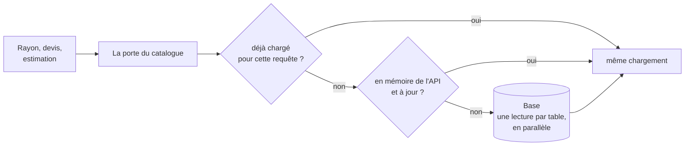

# Plan — les matériaux du catalogue, chargés une fois

> 📝 **Plan du 2026-11-04, rien n'est bâti.** Demande de Hugo : « arriver par
> construction à un seul appel pour tout ce qui concerne le catalogue, que la
> taille de cet appel grandisse, mais le prix au kilo et les opérations datées
> en font partie d'office ». Touche le devis et la commande (l'argent) :
> contredit par `vitruve` avant Hugo. Partie 1 : comprendre. Partie 2 : le
> plan.

# Partie 1 — Comprendre

## Ce qui se passe aujourd'hui

Pour construire un rayon, plusieurs lecteurs vont chacun chercher leur morceau
du catalogue en base. La table des articles est lue **trois fois** pour une
seule visite : les articles en vente, puis les articles réservés aux
opérations, puis les prix au kilo — alors que le prix au kilo est **une
colonne** de cette même table. Le devis et l'estimation de la saisie refont le
même genre de lectures, chacun à sa façon.

Chaque lecture est une opération facturée par la base de production, et chaque
lecteur de plus est un endroit qui peut diverger des autres.

## Ce qu'on veut

**Un seul chargement du catalogue par requête**, par construction : une porte
unique qui rend tout ce dont le rayon, le devis et l'estimation ont besoin —
articles avec leur prix au kilo, familles, opérations datées et leurs articles,
heures limites, réservations. Le chargement peut grossir ; il ne se répète pas.

Par-dessus, une **mémoire de l'API** garde ce chargement entre deux requêtes,
et l'oublie au signal `ShelfChanges` (le même que le cache des rayons) : tant
que rien n'a changé, le catalogue ne se relit pas du tout.

**La taille** : 161 articles font 121 Ko bruts, 11 Ko compressés (mesuré en
production le 2026-11-04). À 500 articles, ~375 Ko en mémoire : léger. Découper
par famille ne se justifierait qu'à plusieurs milliers d'articles.

# Partie 2 — Le plan

## 1. Ce qui est lu aujourd'hui (relevé dans le code le 2026-11-04)

Le rayon (`ShopCataloguePricing.pricedFor`,
`apps/lfd-api/src/b2b/catalog/application/shop-catalogue-pricing.service.ts`) :

| Lecteur (port)                               | Adaptateur                                         | Ce qu'il lit                                                                                                        |
| -------------------------------------------- | -------------------------------------------------- | ------------------------------------------------------------------------------------------------------------------- |
| `CatalogReader.listSellable`                 | `prisma-catalog.reader.ts`                         | `catalogItem.findMany` (avec dérogations et réservations), puis `catalogCategory.findMany` (la lignée des familles) |
| `CatalogOperationsReader.operationOnlySkus`  | `operationOnlySkusOf` (`prisma-catalog.reader.ts`) | `catalogItem.findMany` (les SKU réservés aux opérations)                                                            |
| `CatalogOperationsReader.sellableOperations` | `prisma-catalog-operations.reader.ts`              | `catalogOperation.findMany` (avec leurs articles)                                                                   |
| `ShopOrderCutoffsReader.list`                | `OrderCutoffsInForce` (bloc `order-cutoffs`)       | les heures limites                                                                                                  |
| `CatalogPricePerKgReader.bySkus`             | `prisma-catalog-price-per-kg.reader.ts`            | `catalogItem.findMany` — **les colonnes du kilo, relues**                                                           |
| `CatalogViewers.forCompany`                  | `prisma-served-company.reader.ts`                  | la société servie                                                                                                   |
| `Pricer.load`                                | `PricingMaterialsLoader` (+ cache)                 | règles de prix, estampille                                                                                          |

Mesuré à chaud sur le rayon public : 6 opérations, dont `CatalogItem` **trois
fois**, `CatalogOperation`, `OrderCutoff`, `PricingEvent`.

Le devis (`PricingContext.load` / `loadCart`), l'estimation de la saisie et la
passation lisent aussi le catalogue (prix de ligne, articles d'opération,
classement, mode de TVA du port) : **le lot M0 en dresse la liste exacte**, par
la sonde de comptage, avant d'écrire la forme.

## 2. La forme

- **Un port, `CatalogueMaterials`**, côté application du catalogue : `load()`
  rend un objet immuable — articles (avec prix au kilo, dérogations,
  réservations), familles (lignée), opérations datées et leurs articles, SKU
  réservés aux opérations, heures limites. Les lecteurs d'aujourd'hui deviennent
  des **vues** sur ces matériaux, sans base (fonctions pures sur l'objet).
- **Une lecture par table, en parallèle** : Prisma facture par appel du client,
  pas par requête SQL ; une lecture avec ses tables liées (`include`) compte
  pour une opération. Cible : articles + lignée + kilo en **un** appel, les
  opérations avec leurs articles en **un**, les heures limites en **un**.
- **Une fois par requête** : la porte garde le chargement pour la requête en
  cours (le contexte de requête, comme l'estampille des prix) — deux lecteurs du
  même rayon ou du même devis partagent le même.
- **En mémoire de l'API entre deux requêtes**, sur le modèle de
  `PricingMaterialsCache` : une seule lecture en cours par clé, oubli au signal
  `ShelfChanges` (après la validation), durée de vie courte en filet. Les
  tables sont celles que `lint:shelf-writes` tient déjà : aucune écriture ne
  peut oublier le signal.
- **Ce qui ne passe PAS par là** : la société et les droits (propres à
  l'appelant, relus en base à chaque requête — règle du dépôt), et la passation
  d'une commande, qui relit la base pour ce qu'elle **écrit** (elle fait foi).
- **Le mur entre audiences** : les matériaux sont le catalogue **entier** ; ce
  que chaque lecteur a le droit de voir (réservations, audience) reste décidé
  par les vues existantes (`CatalogViewer`), jamais par le chargement.

## 3. Par construction

- **Une porte de CI** (`lint:catalogue-door`, sur le modèle de
  `lint:price-door`) : sur le chemin du rayon, du devis et de l'estimation,
  aucun code ne lit `catalogItem`, `catalogCategory`, `catalogOperation`,
  `catalogOperationItem` ni les heures limites en direct ; seul l'adaptateur
  de `CatalogueMaterials` le fait. Les écrans d'administration du catalogue
  gardent leurs lecteurs (ils lisent pour écrire).
- **Le budget** (`test/pricing-budget.e2e-spec.ts`) gagne le rayon, à froid et
  à chaud : `CatalogItem` lu **une** fois à froid, **zéro** à chaud.

## 4. Plusieurs instances

La mémoire est par instance. Comme pour les prix, il faut qu'une écriture sur
une instance invalide les autres : soit une **estampille** relue une fois par
requête (le modèle de `pricing_events`, une opération par requête), soit la
purge en éventail par le Worker. **À trancher** ; aujourd'hui une seule
instance (`max_instances: 1`).

## 5. Les lots

| Lot | Contenu                                                                                                                                                                                        |
| --- | ---------------------------------------------------------------------------------------------------------------------------------------------------------------------------------------------- |
| M0  | la mesure : la liste exacte des lectures du catalogue sur le rayon, le devis anonyme et pro, l'estimation, par la sonde de comptage des modèles ; elle fixe le contenu de `CatalogueMaterials` |
| M1  | le port, l'adaptateur (une lecture par table, en parallèle), la mémoire par requête ; les lecteurs du rayon deviennent des vues ; le budget du rayon                                           |
| M2  | le devis et l'estimation passent par la même porte ; la porte de CI                                                                                                                            |
| M3  | la mémoire entre requêtes, vidée par `ShelfChanges`, et la réponse à « plusieurs instances »                                                                                                   |

## 6. Ce qui n'est pas vérifié

- la liste des lectures du devis, de l'estimation et de la passation (M0) ;
- qu'une lecture avec `include` compte bien pour **une** opération dans
  `SchemaOpsCounter` (c'est ce que dit son JSDoc ; à confirmer par la sonde) ;
- la taille du catalogue entier en mémoire (estimée, pas mesurée) ;
- que les heures limites (bloc `order-cutoffs`) puissent entrer dans le même
  chargement sans qu'un bloc lise les tables d'un autre (`lint:prisma-model-ownership`).
