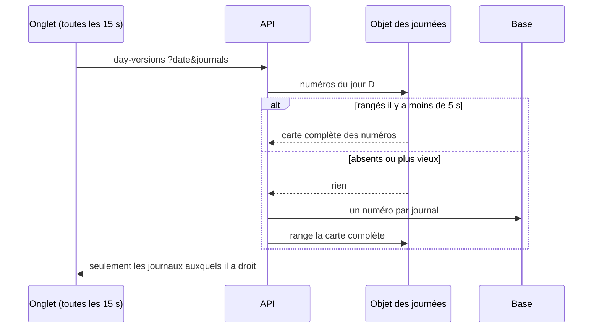

# Plan — l'objet des journées, lot 1 : les numéros

> ✅ **Lot 1 bâti le 2026-11-12** : objet `DayVersions` (Worker de l'API, migration de classe v3), hôte `journees.interne`, briques communes `platform/cache-calls/` (garde borné, disjoncteur, mesure) que le rayon utilise aussi, mesure `day_versions` sur la page Santé.
>
> 🔴 **Runbook** : la migration de classe v3 de `wrangler.jsonc` ne se défait pas par un revert. Retirer l'objet demande une migration `deleted_classes: ["DayVersions"]` dans un nouveau tag, après avoir retiré la liaison et le code qui l'appelle. Sans l'objet (URL absente), l'API lit la base : la porte reste servie.

> 📐 **Plan, 2026-11-12.** Rien n'est bâti. Demande de Hugo : « on commence
> par day-versions », de préférence dans un Durable Object pour un cache
> partagé. Décision d'origine : [`version-par-journee.md`](version-par-journee.md)
> § 4 (2026-11-04). Touche une frontière de droits (ce qu'un poste voit des
> journaux) : passe par `vitruve`.

## 1. En simple

Chaque onglet ouvert sur un écran de journée (Supervision, fiche d'atelier,
colisage, comptoir, plan des tournées) demande toutes les 15 secondes :
« la journée a-t-elle bougé ? ». Chaque question lit la base, une lecture par
journal. Au rush, avec plusieurs écrans, ce sont des dizaines de lectures par
minute pour une réponse qui change rarement.

Le lot 1 met **un seul objet partagé** devant ces numéros : la première
question d'une fenêtre de 15 secondes (5 s dans la première version) lit la base et range la réponse dans
l'objet ; toutes les autres, de tous les onglets et de toutes les instances
de l'API, la reçoivent de l'objet. Le contenu des écrans viendra au lot 2.

## 2. Ce qui existe (vérifié le 2026-11-12)

- La porte unique : `GET admin/day-versions?date&journals`
  (`apps/lfd-api/src/platform/day-versions/day-versions.controller.ts`),
  `@AdminSelfSurface`. Le droit se tranche **par journal** dans
  `get-day-versions.handler.ts` : un journal que l'appelant ne peut pas lire
  est omis. Les sources sont enregistrées par `DayVersionRegistry`, chacune
  `versionOf(serviceDay)`.
- Le veilleur du back-office (`shared/day-version/day-version-watcher.ts:105`) :
  une requête par journée et par onglet toutes les 15 s.
- Le modèle de Durable Object à suivre : `ProShelves`
  (`apps/lfd-api/container/pro-shelves.ts`, `PRO_SHELVES` dans
  `wrangler.jsonc`), son port `ShopShelfCache`, sa lecture bornée à 400 ms,
  son disjoncteur (5 échecs, 30 s) et son repli sur la base
  ([`le-rayon-en-cache.md`](le-rayon-en-cache.md) § 4, § 4 bis).

## 3. La conception

- **Tiré, pas poussé.** La décision d'origine prévoyait une alarme qui relit
  les numéros toutes les 5 s tant qu'un écran regarde. Pour les seuls
  numéros, l'alarme n'est pas nécessaire : la première question d'une
  fenêtre de 5 s relit la base et range ; les suivantes lisent l'objet. Même
  fraîcheur (5 s au plus), moins de mécanique. L'alarme reviendra au lot 2,
  pour recalculer les contenus.
- **Ce que l'objet range** : par journée, la **carte complète** des numéros
  de TOUS les journaux et l'instant de lecture. Jamais une réponse filtrée
  par droit.
- **Le droit s'applique après** : l'API rend à l'appelant les seuls journaux
  qu'il peut lire, exactement comme aujourd'hui. Les numéros ne sont pas
  personnels ; un journal non permis reste absent de SA réponse.
- **Toujours tous les journaux** à la relecture : sinon une carte partielle
  rangée par un poste limité laisserait un autre poste sans numéro.
- **Le numéro reste écrit par la base** (les déclencheurs) : l'objet ne fait
  que garder ce que l'API a lu. Un numéro ne recule jamais : l'objet refuse
  de ranger une carte plus ancienne que celle qu'il tient.
- **Repli** : objet injoignable, lent (au-delà de la borne), ou disjoncteur
  ouvert → l'API lit la base, comme aujourd'hui. La disponibilité ne dépend
  jamais de l'objet.
- **Port** : `DayVersionsCache` (lire, ranger), implémenté par l'objet dans
  `container/`, comme `ShopShelfCache`. La mesure des appels rejoint
  `cacheCalls` de la page Santé.
- **Taille** : une entrée par journée lue ; les journées de plus de 3 jours
  sont oubliées à la lecture suivante.

## 3 bis. Corrections après `vitruve` (2026-11-12) — font foi

Hugo garde le Durable Object dès le lot 1 (« ça vaut le coup de travailler
un seul point ») : l'objet est posé pour le lot 2, où il rapporte vraiment
(contenus lourds hors de la mémoire de l'API). Pour les seuls numéros, il
coûte une relecture complète (6 lectures) par fenêtre et un aller-retour par
question : sous 5 à 6 onglets par journée, il ne fait pas lire moins la base.
C'est su et accepté.

- **Révision dans la clé, pas de « refus d'une carte plus ancienne »** : la
  clé est (révision du code, journée), comme `ProShelves` avec
  `config.revision()`. Une carte se remplace par la plus récemment LUE
  (instant pris au DÉBUT de la lecture en base), jamais par comparaison des
  numéros : deux sources additionnent deux termes (`production`, `my-round`)
  et une formule qui change au déploiement ne doit figer aucun écran.
- **Lecture des sources HORS filtre** : la carte rangée contient tous les
  journaux ; le handler lit d'abord la carte (objet ou base), PUIS filtre par
  droit — l'ordre inverse d'aujourd'hui (`get-day-versions.handler.ts:22-31`).
  Un test vérifie qu'un poste limité ne reçoit aucune clé non permise.
- **Une seule relecture à la fois par journée et par instance** (single-flight
  dans l'API) : les requêtes qui arrivent pendant une relecture attendent son
  résultat au lieu de relire chacune.
- **Le chemin** : comme `ProShelves`, par l'interception sortante du
  conteneur (`Backend.outboundByHost`, `worker.ts:258-274`) sur un **second
  hôte** dédié aux journées, aiguillé vers l'objet `DayVersions`. C'est
  l'API qui joint l'objet (et non l'objet qui joint l'API comme le prévoyait
  `version-par-journee.md` § 4 pour l'alarme du lot 2).
- **Le garde, le disjoncteur et la mesure** de l'appel (`ShelfCallGuard`,
  `ShelfCacheBreaker`, `shelf_cache.*`) vivent dans
  `lafoliecoffee/catalog/application/` : `platform` ne peut pas les importer.
  Ils montent dans `platform/` en briques génériques (garde d'appel borné,
  disjoncteur, mesure par cache nommé), que le rayon et les journées
  utilisent tous deux — sans changer le comportement du rayon.
- **Migration de classe** (`wrangler.jsonc`, tag v3) : elle ne se défait pas
  par un revert ; retirer l'objet demandera une migration `deleted_classes`.
  Dit au runbook du déploiement.
- **Les e2e** tournent sans URL d'objet (adaptateur « absent » → lecture en
  base) : la porte reste éprouvée telle qu'aujourd'hui ; le cache est éprouvé
  par les tests de l'adaptateur et du handler, avec un double de l'objet.
- **Lot 2 (contenus)** : dans l'objet, clé (révision, écran, journée,
  numéro) ; ne garder que la DERNIÈRE version par écran et par journée, oublier
  les journées de plus de 3 jours (alarme de ménage) — la mémoire de l'API
  n'est jamais sollicitée.

## 4. Le bâti

- **L1** : l'objet `DayVersions` (Durable Object, SQLite comme `ProShelves`),
  sa liaison dans `wrangler.jsonc` (migration de classe), la route interne du
  Worker, le port et l'adaptateur côté API, le handler qui lit l'objet puis
  la base, le filtre par droit inchangé, le disjoncteur et la mesure.
- Tests : le handler (objet frais, périmé, absent, injoignable, plus ancien),
  le filtre par droit après l'objet (un poste limité ne voit pas un journal
  qu'un autre poste a fait ranger), l'objet (refus d'une carte plus ancienne,
  oubli des vieilles journées), un e2e de la porte inchangée.

## 5. Questions pour `vitruve`

- **V1** : la fenêtre de 5 s ajoute jusqu'à 5 s de retard à un écran (15 s
  aujourd'hui au pire, 20 s demain) : acceptable, comme décidé en § 4 ?
- **V2** : deux instances qui relisent en même temps rangent deux cartes : le
  refus d'une carte plus ancienne suffit-il ?
- **V3** : un journal ajouté demain au registre : la carte complète le prend
  sans rien changer à l'objet ?
- **V4** : le coût d'un aller-retour à l'objet face aux lectures qu'il
  remplace (une par journal) : à mesurer avant de conclure.

## 6. Ce que le lot 1 ne fait pas

- Le contenu des écrans (Supervision, atelier, colisage, comptoir, tournées) :
  lot 2, clé « écran, jour, numéro », alarme.
- La page Commandes (`/commandes`) : elle ne dépend pas des numéros de
  journée (liste paginée sur plusieurs jours, relue à l'ouverture et à chaque
  filtre). Elle relèvera d'un autre mécanisme.
