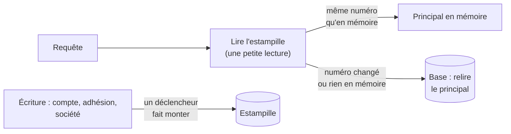

# Plan — le principal gardé en mémoire de l'API (L4)

> 📝 **Plan, écrit le 2026-11-04**, lot L4 de
> [`plan-latence-de-navigation.md`](plan-latence-de-navigation.md). 🟨 **Bâti
> le 2026-11-04, non commité** (migration `20261104120000`,
> `CachedPrincipalResolver`) ; `Server-Timing` `principal-cache` non posé. Il déplace une **frontière de sécurité** (la résolution d'accès) : il
> passe par `vitruve` avant Hugo. Partie 1 : comprendre. Partie 2 : le code.

# Partie 1 — Comprendre

## Ce qu'on a mesuré

À chaque appel, l'API relit en base **qui est la personne** : son compte, ses
sociétés, les sites qu'elle atteint par sa société principale. C'est le
« principal ». Mesuré par `Server-Timing` le 2026-11-04, sur un changement
d'espace (16 appels) :

- **63 ms** pour un appel seul ;
- **70 à 250 ms** quand onze appels partent ensemble — ils refont onze fois la
  même lecture, et se gênent sur un demi-vCPU.

Or ce principal ne change presque jamais : un compte désactivé, une adhésion
acceptée ou retirée, un statut de société.

## La réponse

Garder le principal **en mémoire de l'API**, par personne, et ne le relire que
si quelque chose a bougé. Pour le savoir sans relire le principal, **une
estampille** : un numéro que la base fait monter à chaque écriture qui peut le
changer. Chaque requête lit ce seul numéro.

**Ce qui ne change pas : un compte désactivé est coupé à la requête
suivante.** L'estampille est lue à chaque requête, jamais gardée ; une
désactivation la fait monter dans la même transaction, et la requête suivante
relit tout. Aucun délai, aucune durée de vie à attendre.

**Le numéro monte par la base, jamais par le code** (comme la version par
journée, décision D1) : un déclencheur sur les trois tables. Personne ne peut
oublier de le faire monter, et une écriture faite en SQL à la main le fait
monter aussi.

## Le gain attendu

Trois allers-retours lourds (compte et adhésions, sites hérités) remplacés par
une lecture d'une ligne. Ordre de grandeur, à remesurer : de 63–250 ms à
moins de 10 ms par appel, sur **chaque** appel identifié du site.

# Partie 2 — Le code

## 1. Ce que lit aujourd'hui `CustomerPrincipalResolver`

`b2b/account/infrastructure/customer-principal.resolver.ts` (lu le
2026-11-04), chemin ordinaire d'un compte actif :

1. `user.findUnique({ auth0Sub }, include memberships)` — compte et adhésions ;
2. `readReachableSites` (`b2b/shared/company-standing/`) — les sites atteints
   par héritage : `companies` × `memberships` du principal.

Plus des **écritures** sur des chemins rares : création du compte (premier
passage), acceptation d'une invitation, `emailVerified`, `firstLoginAt`.

## 2. Ce qu'on garde, et quand

Un `CachedPrincipalResolver` (même port `PrincipalResolver`, dans
`b2b/account/infrastructure/`) enveloppe le résolveur actuel :

- **Clé** : le `sub` du jeton. **Valeur** : le principal **sans** `subject` ni
  `scopes`, qui sont relus du jeton à chaque requête (le jeton n'est jamais
  remplacé par la mémoire).
- **Ne se garde que le chemin sans écriture** : compte trouvé et `active`,
  `enter()` sans rien à accepter, `record()` sans rien à écrire, pas de
  premier passage. (« `firstLoginAt` posé » n'est PAS un critère : les comptes
  entrés avant la colonne restent à `null` pour toujours, sans écriture.) Tout autre cas passe par le résolveur
  actuel, à chaque fois — premier passage et invitations restent exactement
  comme aujourd'hui.
- **« Aucune adhésion en attente »**, évalué sur les adhésions lues APRÈS
  `enter()`, TOUTES, avec la règle de vie d'une invitation
  (`isInvitationAlive`), jamais un simple `acceptedAt IS NULL`. Pourquoi : c'est la seule partie du
  principal qui dépend de l'HEURE (`openingMembership(now)` : une invitation
  non acceptée expire). Sans adhésion en attente, le principal ne dépend plus
  que de la base — donc de l'estampille.
- **Une lecture à la fois par personne** : onze appels simultanés d'une
  personne sans principal en mémoire n'en déclenchent qu'une ; les dix autres
  l'attendent.
- **Borne** : au plus N personnes en mémoire (la plus ancienne sort), et une
  durée de vie de filet (quelques minutes) qui ne sert pas à la justesse.

## 3. L'estampille

- Une table `public.principal_stamp`, **une seule ligne globale**, pas une
  par personne. Une écriture sur un compte fait relire tous les
  principaux en mémoire au prochain appel de chacun ; c'est rare (une
  adhésion, une désactivation), et ça évite de savoir QUI une écriture sur une
  société touche (ses membres, et les membres de ses sites par héritage).
- Déclencheurs `FOR EACH STATEMENT` sur `users`, `memberships`, `companies`
  (insertion, mise à jour, suppression) : `UPDATE principal_stamp SET
value = value + 1`. ⚠️ À trancher avec `vitruve` : un compteur sur une ligne
  verrouille cette ligne jusqu'à la fin de la transaction qui écrit.
  **Tranché après `vitruve` : le compteur, pas un journal.** Un `max(id)` ou
  une séquence est attribué à l'écriture, pas à la validation : une
  désactivation (id 10) validée APRÈS une écriture voisine (id 11) laisserait
  un principal périmé rangé sous 11, et le compte garderait son accès. Le
  verrou du compteur aligne l'ordre des validations sur l'ordre des numéros —
  c'est ce qu'on veut ici, à l'inverse de la version par journée, où un
  retard d'écran ne donne aucun droit.
- **Toute colonne** de ces tables fait monter le numéro, pas seulement celles
  que le principal lit : plus large que nécessaire, jamais trop étroit. Si des
  écritures fréquentes et sans rapport (un compteur, une date de dernière
  activité) s'y trouvent, elles videraient la mémoire sans raison — à
  inventorier avant de bâtir.
- Une **migration** ajoute la table et les déclencheurs : additive, sans
  donnée à déplacer.

## 3 bis. Après la contradiction de `vitruve` (2026-11-04)

- **L'ordre est imposé** : lire l'estampille D'ABORD, puis le principal, et
  ranger le principal sous l'estampille lue avant. La lecture partagée (une
  par personne) garde l'estampille de celle qui lit, pas de celles qui
  attendent. Un test le tient.
- **Interblocages** : un déclencheur AFTER prend le verrou de l'estampille
  APRÈS celui de la ligne écrite ; deux transactions qui écrivent deux de ces
  tables dans un ordre différent peuvent s'interbloquer (`acceptAndActivate`
  écrit `memberships` puis `users`). Avant de bâtir : inventorier les
  transactions qui touchent deux des trois tables, et leur faire prendre
  l'estampille EN TÊTE (un `UPDATE` par l'unité de travail), ou retenir des
  déclencheurs `BEFORE … FOR EACH STATEMENT`. À trancher au bâti, sur
  l'inventaire.

  **Tranché au bâti (2026-11-04) : `BEFORE … FOR EACH STATEMENT`**, parce
  qu'il fait prendre l'estampille AVANT les verrous de lignes à TOUTE écriture
  des trois tables, sans toucher aux transactions ni sérialiser celles qui ne
  les écrivent pas — ce que l'unité de travail ferait pour toute l'API.
  `AFTER` interbloquait même une transaction à une seule table : une recopie
  de preuve (`users`, puis l'estampille) contre `acceptAndActivate` du même
  compte (estampille, puis `users`).

  Inventaire des transactions qui écrivent au moins deux des trois tables
  (lu le 2026-11-04, `apps/lfd-api/src`) :

  - `b2b/account/infrastructure/customer-principal.resolver.ts:224`
    (`acceptAndActivate`) — `memberships` puis `users` ;
  - `b2b/account/infrastructure/unknown-subject-admission.ts:207`
    (`claimOrUndo`) — `users` puis `memberships` ;
  - `b2b/account/infrastructure/prisma-company.repository.ts:84`
    (`declareOwnedBy`) — `companies` puis `memberships`.

  `GrantAccountAccess` (`createInvited` puis `attach`) écrit `users` et
  `memberships` hors de toute unité de travail ; `create-sub-account`,
  `attach-account-holder`, les gestes du carnet de contacts (`alignRole`)
  n'en écrivent qu'une par transaction.

  ⚠️ **Ce que `BEFORE` ne range pas** : un verrou pris SANS déclencheur avant
  une écriture des trois tables. `SitePrincipalLock` et le carnet d'adresses
  posent `SELECT … FOR UPDATE` sur `companies` ; vérifié le 2026-11-04, ils
  le font toujours APRÈS l'écriture des trois tables dans la même transaction
  (gestes de site), ou dans une transaction qui ne les écrit pas (carnet).
  Un geste futur qui verrouillerait une société avant d'écrire `companies`
  rouvrirait l'interblocage.

- **Le harnais e2e** tronque toutes les tables (`truncateAll`) : il remet la
  ligne de l'estampille après chaque `reset()` et vide la mémoire du
  résolveur — sans quoi le déclencheur ne trouve plus de ligne et des tests
  partagent un principal.
- **Un nouveau client vide la mémoire de tous** (sa création écrit `users`).
  Rare à 200 clients ; à compter si un import en crée par centaines.
- **Le principal rendu depuis la mémoire est figé** (`Object.freeze`) : il est
  partagé entre requêtes.
- **Borne** : LRU, 1 000 personnes, filet de 10 minutes.
- `DevImpersonation` passe par le même résolveur : couvert, sans risque hors
  production.

## 3 ter. Les préférences de navigation quittent `users` (décidé par Hugo le 2026-11-04, option 1)

**Pourquoi** : `PATCH /me/nav-prefs` écrit `users.nav_prefs` à chaque
changement d'espace (`prisma-nav-preferences.repository.ts`, un `UPDATE` brut,
lu le 2026-11-04). Avec le déclencheur sur `users`, chaque changement d'espace
viderait la mémoire de TOUS les principaux, et sérialiserait une écriture de
plus sur la ligne de l'estampille. Les sortir de `users` rend le problème
inexprimable, là où exclure la colonne du déclencheur demanderait une liste
tenue par une porte.

**Forme** :

- Table `public.user_nav_prefs` : `user_id` (clé primaire, clé étrangère vers
  `users`, `ON DELETE CASCADE`), `prefs jsonb NOT NULL DEFAULT '{}'`,
  `updated_at`. **Aucun déclencheur d'estampille** : le principal ne lit pas
  les préférences.
- Même migration que l'estampille, **avant** les déclencheurs : création, puis
  `INSERT INTO user_nav_prefs (user_id, prefs, updated_at) SELECT id,
nav_prefs, now() FROM users WHERE jsonb_typeof(nav_prefs) = 'object'`. La
  copie précède le déclencheur : elle ne fait rien monter. Les valeurs
  non-objet (`'null'`, tableau) ne sont pas copiées : elles ne se lisaient
  déjà pas comme des préférences (trou hérité, fermé ici).
- Le code écrit et lit la nouvelle table. `merge` devient :
  `INSERT INTO user_nav_prefs (user_id, prefs, updated_at) VALUES ($user,
$patch::jsonb, now()) ON CONFLICT (user_id) DO UPDATE SET prefs =
user_nav_prefs.prefs || excluded.prefs, updated_at = excluded.updated_at`
  (`@updatedAt` ne s'applique pas à `$executeRaw` : le SQL pose la date). Le
  lecteur du compte (`prisma-account.reader.ts`) la joint par `user_id` ; un
  compte sans ligne se lit `null`, comme aujourd'hui.
- **`users.nav_prefs` reste en base, sans lecteur ni écrivain** (une colonne
  morte reste, CLAUDE.md §0). Un commentaire de schéma le dit, daté.
- **Un seul déploiement** (pré-release, Hugo 2026-10-04) : entre la migration
  et la bascule du code, l'ancien code peut encore écrire l'ancienne colonne
  pendant quelques secondes ; une préférence perdue (le dernier espace choisi)
  est le pire cas, sans droit ni argent en jeu.
- Les préférences du staff (`staff_users`) ne sont pas concernées.

- **Retour arrière, dans les deux sens** : un ancien binaire qui écrit après
  la copie écrit une colonne morte ; un retour au binaire précédent APRÈS des
  écritures dans la nouvelle table relit `users.nav_prefs` figée à l'instant
  de la copie. Pire cas, les deux fois : un dernier espace choisi perdu.
  `user_nav_prefs` ne se supprime pas tant qu'un binaire la lit. L'en-tête de
  la migration le dit (elle n'est plus « strictement additive » : elle copie).

**Tests (tranché)** : la copie est testée en e2e en exécutant **le bloc de
copie lu dans le fichier de migration** (délimité par deux commentaires
marqueurs) sur des `users` semés avec un objet, `'null'`, un tableau et
`NULL` — seul l'objet passe ; `PATCH /me/nav-prefs` ne fait plus monter l'estampille
(e2e) ; les préférences relues après écriture (e2e existants).

## 4. Ce qui reste hors du lot

- La **vérification du jeton** (`verify`) : à mesurer dans `Server-Timing`
  avant d'y toucher.
- Les **droits du staff** (back-office) : même idée, autre résolveur, autre
  lot après celui-ci.
- La lecture de l'estampille pourrait se joindre à celle de `pricing_events`
  (une seule lecture par requête pour les deux) : une optimisation ensuite,
  pas une condition.

## 5. Les tests

- Unitaire : un principal gardé est rendu tant que l'estampille ne bouge pas ;
  relu dès qu'elle bouge ; jamais gardé sur un chemin qui écrit ; une
  adhésion en attente n'est jamais gardée ; une lecture à la fois par
  personne.
- e2e, sur le vrai Postgres : **désactiver un compte coupe la requête
  suivante** ; retirer une adhésion la retire du principal suivant ;
  suspendre un site le retire des sites atteints ; une écriture SQL à la main
  sur `memberships` fait monter l'estampille.
- La CI : chacune des trois tables porte le déclencheur (lu dans
  `pg_trigger`, comme pour la version par journée).
