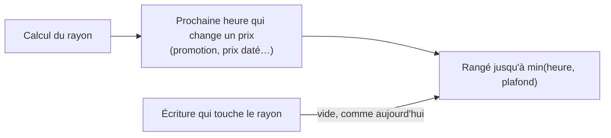

# Plan — le rayon pro gardé jusqu'à la prochaine heure qui le change

> 📝 **Plan, écrit le 2026-11-04, réécrit le même soir après `vitruve`**, point (b) du lot L2 de
> [`plan-latence-de-navigation.md`](plan-latence-de-navigation.md), validé
> dans son principe par Hugo le même jour. Rien n'est bâti. Il touche
> **l'argent** (un prix affiché) : `vitruve` avant le bâti. Partie 1 :
> comprendre. Partie 2 : le code.

# Partie 1 — Comprendre

## Le problème

Le rayon d'une société (`/shop/catalogue/mine`) est rangé dans l'objet des
rayons pro **30 secondes** (`RECOGNISED_SHELF_LIFETIME_MS`). Les 30 s
rattrapent ce qui change un prix sans écriture — une promotion qui ouvre à
midi. Mais un client qui revient dans un espace plus de 30 s après l'avoir
quitté le fait recalculer : **2,2 s mesurées** le 2026-11-04. Pour un
changement d'espace, le cache ne sert presque jamais.

## La réponse

Au moment du calcul, le serveur connaît la **prochaine heure où un prix de ce
rayon change de lui-même** : l'ouverture ou la fin d'une promotion, le début
ou la fin d'un prix daté. Le rayon est rangé **jusqu'à cette heure-là**, avec
un plafond.

- **Les écritures** vident toujours le rayon (`ShelfChanges`, inchangé).
- **Les heures** sont rattrapées à l'heure exacte, plus « dans les 30 s ».
- **Le plafond** (1 h) borne une heure oubliée : c'est le seul cas où un prix
  périmé se montrerait, et au plus une heure.

## La limite : le stock (Hugo, 2026-11-04)

**Le stock d'un produit est la limite de ce système pour l'instant.** Ce qui
reste en rayon bouge avec les commandes des AUTRES clients. **Vérifié par
`vitruve` le 2026-11-04 : la vue gardée (`ShopCatalogueView`) ne porte aucun
stock** — garder le rayon plus longtemps ne retarde donc aucun stock affiché.
Et aucune commande ne vide le rayon : la « réservation qui purge tout » est
celle d'un article sur mesure, pas une réservation de stock. La limite qui
pèse vraiment côté commandes est le **plancher dynamique** (§ 0).

# Partie 2 — Le code

## 0. Ce que `vitruve` a établi (2026-11-04)

Contredit avant tout bâti. Trois objections bloquantes contre « jusqu'à la
prochaine heure, plafond 1 h », toutes vérifiées dans le code :

1. **Les ouvertures à venir ne sont jamais chargées.** Les promotions
   (`live-promotion.ts:136`, `inForceAt`) et la mercuriale
   (`prisma-company-mercuriale.reader.ts:37`, `validFrom <= at`) ne lisent que
   ce qui est en vigueur : « une promotion qui ouvre à midi » est invisible au
   calcul. Il faut un lecteur des bornes À VENIR, distinct des matériaux.
2. **D'autres heures changent la vue, hors des prix** : les quatre instants
   des opérations datées (`operation-access.ts:130-160`), les plages
   hebdomadaires des offres d'acheminement (`promotion-offers.ts:112-121`), et
   le **plancher dynamique** (`minVolumeRatioBp`, fenêtre glissante de ventes,
   qu'aucune commande ne purge).
3. **Une purge perdue n'est rattrapée que par la durée de vie** : la fenêtre
   de regroupement d'1 s vit en mémoire (`shelf-change-window.ts`), et un
   effacement en panne est compté puis laissé à la durée de vie
   (`resilient-shop-shelf-cache.ts:53`).

Et deux sérieuses : **un déploiement ne vide pas le rayon** (rien dans la clé
ne dit la révision), et **le stock n'est pas dans la vue** — la limite notée
par Hugo ne coûte rien ici ; la vraie limite côté commandes est le plancher
dynamique.

## 1. Phase 1 — à bâtir cette nuit (la recommandation de `vitruve`)

- **Plafond : 5 minutes** au lieu de 30 s (`RECOGNISED_SHELF_LIFETIME_MS`).
  Tout ce qui n'est pas connu au calcul — une ouverture de promotion, une
  purge perdue, le plancher dynamique — est borné à 5 minutes au lieu de
  30 s. Ce qui s'affiche est un prix d'**étiquette** : la passation relit
  tout, au vrai prix, et refuse ce qui a changé.
- **`expiresAt = min(now + 5 min, prochain instant d'une opération datée du
rayon)`** : les quatre instants (`announceFrom`, `orderFrom ??
announceFrom`, `orderUntil`, fin de jour du retrait) sont déjà en main dans
  le calcul du rayon (`CatalogOperationsReader`), sans franchir la porte des
  prix. Un article qui apparaît ou disparaît le fait à l'heure.
- **La révision de l'API dans la clé du rayon** (`AppConfig.revision()`) : un
  déploiement change la clé, l'ancien rayon n'est plus jamais lu (il expire
  seul). Ferme l'objection « un déploiement ne vide rien ».
- Les commentaires qui justifient un mécanisme par « la durée de vie de 30 s
  rattrape » sont réécrits avec 5 minutes, datés.

## 2. Phase 2 — avant tout plafond au-delà de 5 minutes

- (a) Un lecteur `UpcomingShelfBoundaries` des bornes À VENIR (ouvertures
  comprises) sur chaque table datée, et une porte qui part de `SHELF_MODELS`
  et exige que chaque colonne `DateTime` métier y soit lue ou admise.
- (b) Les plages hebdomadaires des offres (prochaine bascule, à la pendule de
  Paris).
- (c) Un effacement en échec qui se rejoue, ou éteint le magasin, au lieu de
  compter sur la durée de vie.
- (d) Une décision écrite sur le plancher dynamique (`OrderLine` absent de
  `SHELF_MODELS`).

## 3. Tests (phase 1)

- Unitaire : `expiresAt` vaut le plafond sans opération ; l'instant d'une
  opération plus proche le remplace ; un instant passé est ignoré.
- Unitaire : deux révisions donnent deux clés ; la clé de la même révision
  est stable.
- e2e : le rayon reconnu est servi depuis le magasin au second appel (déjà
  couvert ?) ; une opération qui ouvre dans 2 minutes fait expirer le rayon à
  cette heure.

## 4. Ce qui reste hors du lot

- Le rayon PUBLIC (Workers Cache, 30 s) : même idée possible, autre lot.
