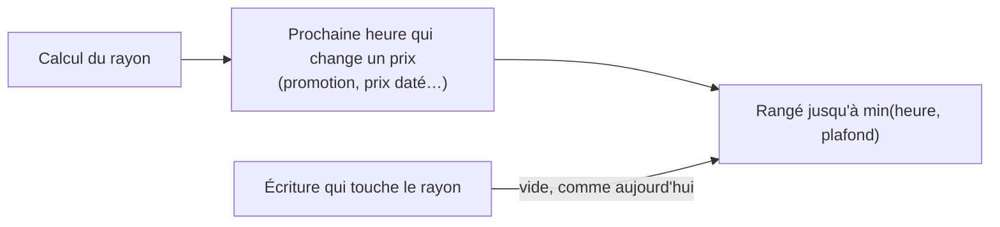

# Plan — le rayon pro gardé jusqu'à la prochaine heure qui le change

> 📝 **Plan, écrit le 2026-11-04**, point (b) du lot L2 de
> [`plan-latence-de-navigation.md`](plan-latence-de-navigation.md), validé
> dans son principe par Hugo le même jour. Rien n'est bâti. Il touche
> **l'argent** (un prix affiché) : `vitruve` avant le bâti. Partie 1 :
> comprendre. Partie 2 : le code.

# Partie 1 — Comprendre

## Le problème

Le rayon d'une société (`/shop/catalogue/mine`) est rangé dans l'objet des
rayons pro **30 secondes** (`RECOGNISED_SHELF_LIFETIME_MS`). Les 30 s
rattrapent ce qui change un prix sans écriture — une promotion qui ouvre à
midi. Mais un client qui revient dans un espace plus de 30 s après l'avoir
quitté le fait recalculer : **2,2 s mesurées** le 2026-11-04. Pour un
changement d'espace, le cache ne sert presque jamais.

## La réponse

Au moment du calcul, le serveur connaît la **prochaine heure où un prix de ce
rayon change de lui-même** : l'ouverture ou la fin d'une promotion, le début
ou la fin d'un prix daté. Le rayon est rangé **jusqu'à cette heure-là**, avec
un plafond.

- **Les écritures** vident toujours le rayon (`ShelfChanges`, inchangé).
- **Les heures** sont rattrapées à l'heure exacte, plus « dans les 30 s ».
- **Le plafond** (1 h) borne une heure oubliée : c'est le seul cas où un prix
  périmé se montrerait, et au plus une heure.

## La limite : le stock (Hugo, 2026-11-04)

**Le stock d'un produit est la limite de ce système pour l'instant.** Ce qui
reste en rayon aujourd'hui bouge avec les commandes des AUTRES clients ; le
rayon gardé peut donc montrer un stock en retard sur la réalité. Ce n'est pas
un prix : la passation de commande relit tout et refuse ce qui manque. Mais
c'est ce qui borne la durée qu'on peut se permettre, et c'est à vérifier
avant de bâtir : **le stock est-il dans la vue gardée ?** Si oui, et qu'une
réservation purge déjà « tout » (constaté le 2026-11-04 dans
`public-shelf-rules.ts`, `orderTouchesPublicShelf`), le retard est borné par
l'écriture ; sinon, le plafond le borne.

# Partie 2 — Le code

## 1. Aujourd'hui

`b2b/catalog/application/recognised-shelf.service.ts` (lu le 2026-11-04) :
`expiresAt = now + RECOGNISED_SHELF_LIFETIME_MS` (30 000 ms), passé au magasin
(`durable-object-shop-shelf-cache.ts`, paramètre `expires`).

## 2. Ce qui change

- `ShopCataloguePricing.shelf(...)` rend aussi **`nextChangeAt: Date | null`**
  : la plus proche heure future, après `now`, où une décision entrant dans le
  prix d'un article du rayon s'ouvre ou se ferme.
- `expiresAt = min(nextChangeAt ?? +∞, now + PLAFOND)`, `PLAFOND` = 1 h.
- Sources d'heure à recenser **exhaustivement** (c'est le cœur du risque) :
  les familles de `lint:dated-decisions` (toute décision qui entre dans la
  résolution du prix porte une fenêtre — six familles au 2026-11-04),
  promotions, mercuriales datées, engagements, barèmes, règles ; plus tout ce
  qui, dans la vue, dépend de l'heure sans être un prix (fenêtres de commande,
  « commander avant 12 h », disponibilité du jour, stock).
- **Une porte** si possible : toute famille de `lint:dated-decisions` doit
  être lue par le calcul de `nextChangeAt` — une famille ajoutée sans être
  lue rendrait l'heure fausse en silence.

## 3. Tests

- Unitaire : `nextChangeAt` sur chaque famille (ouverture, fermeture, aucune,
  passée) ; le plafond ; `null` → plafond.
- Unitaire : le rayon rangé jusqu'à l'heure, relu après.
- e2e : une promotion qui ouvre dans N minutes — le rayon gardé avant, recalculé
  après l'heure (horloge du harnais).

## 4. Ce qui reste hors du lot

- Le rayon PUBLIC (Workers Cache, 30 s) : même idée possible, autre lot.
- Le stock en temps réel dans le rayon : la limite ci-dessus, pas résolue ici.
