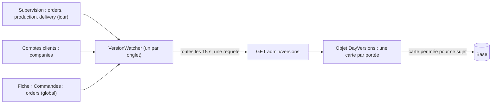

# Plan — un seul veilleur pour tout le back-office

> 📐 **Plan, 2026-11-12.** Rien n'est bâti. Demande de Hugo : « on aurait
> pas pu faire un veilleur global ? », puis « lance le plan du veilleur
> unique ». Suite de [`plan-objet-des-journees.md`](plan-objet-des-journees.md)
> (lot 1, bâti) et du lot « comptes clients : lire une fois » (`c4daddd2c`).
> Contredit par `vitruve` le 2026-11-12 (§ 5).

## 1. En simple

Aujourd'hui, seuls les écrans de journée savent « la donnée a changé » : ils
demandent toutes les 15 s les numéros de leur journée et ne se relisent que
s'ils ont bougé. Les autres écrans se relisent à l'ouverture, ou au bout de
5 minutes.

Le plan généralise le mécanisme : **un numéro par sujet** (une journée, les
comptes, les commandes, plus tard le catalogue et le PIM), **une seule porte**
pour les lire, **un seul veilleur par onglet** qui les demande en une
requête, et chaque écran déclare les sujets qu'il suit.

## 2. Ce qui existe (vérifié le 2026-11-12)

- **La porte des journées** `GET admin/day-versions?date&journals`
  (`apps/lfd-api/src/platform/day-versions/`), `@AdminSelfSurface`, le droit
  tranché par journal dans le handler ; les sources (`DayVersionSource` :
  `journal`, `readers`, `versionOf(serviceDay)`) dans un registre.
- **L'objet** `DayVersions` (`apps/lfd-api/container/day-versions.ts`) : une
  carte par (révision, journée), fenêtre `DAY_VERSIONS_FRESH_MS` (15 s), repli
  sur la base, une relecture par journée et par instance (single-flight).
- **Le veilleur de l'écran** `DayVersionWatcher`
  (`apps/lfd-backoffice-frontend/src/app/shared/day-version/day-version-watcher.ts`) :
  une requête par journée et par onglet toutes les 15 s, filet de 5 min.
- **Les journaux** sont des tables en ajout seul (`public.day_change`,
  `production.day_change`, colisage, livraison), la version = `max(id)` de la
  journée — un journal plutôt qu'un compteur, pour ne pas verrouiller une
  ligne pendant les longues transactions (`version-par-journee.md` § 1).
- **`context_versions`** (`prisma/schema/public/context-versions.prisma`) :
  un compteur par contexte (`catalog`, `operations`, `order_cutoffs`), monté
  par des déclencheurs (`le-catalogue-en-memoire.md` § 2.2).
- **Les stores des comptes clients** (`comptes-clients/company-cache/`) :
  relus après une écriture locale ou passé 5 min.

## 3. La conception

### 3.1 Des sujets, journaliers ou globaux

Le registre des journées devient un **registre de sujets**. Chaque source
déclare :

- son **nom** (`orders`, `production`, `delivery`, `my-round`, `companies`,
  `orders-all`, plus tard `catalog`, `pim`) ;
- sa **portée** : `day` (le numéro dépend d'une journée) ou `global` ;
- ses **lecteurs** (les droits qui l'ouvrent) ;
- sa **fenêtre** de fraîcheur (15 s pour les journées et les commandes, 30 s
  pour les comptes) ;
- sa lecture : `versionOf(day)` ou `versionOf()`.

### 3.2 Les deux premiers sujets globaux — deux journaux, pas de compteur

Relu après `vitruve` (2026-11-12) : un compteur d'une ligne dans
`context_versions` verrouillerait toutes les écritures de comptes jusqu'au
commit (et risquerait l'interblocage), son `CHECK` refuse un contexte neuf, et
`public.day_change` ne voit pas une commande sans `requested_delivery_date`.
D'où la même forme que les journées : **un journal en ajout seul, version =
`max(id)`**, déclencheurs `FOR EACH STATEMENT`.

- **`companies`** → `public.company_change`, alimenté par `companies` (KBIS
  compris : ce sont ses colonnes), `users`, `company_bank_accounts`,
  `company_collection_form`, les adresses de livraison,
  `delivery_procedures`, les contacts, adhésions, mandats, rattachements
  (`follows`) et demandes de support. La liste exacte se relit au bâti dans
  `prisma-admin-company.reader.ts`, `prisma-customer-sheet.reader.ts`,
  `prisma-company-address.reader.ts` et `company-hierarchy.projection.ts`.
- **`orders-all`** → `public.order_change`, alimenté par `orders`,
  `order_lines` et `order_handover`, **sans condition de date**. Au bâti :
  vérifier d'où vient l'état de paiement affiché dans `/commandes` ; s'il vient
  d'un autre schéma, la table qui le porte entre aussi au journal.
- Ce que la fiche affiche et qui dépend d'ailleurs : CA, commandes récentes et
  paniers récurrents → la fiche suit aussi `orders-all` ; l'historique
  (`activity_events`) et ce qui dépend de l'heure seule (échéance d'une
  invitation, `follows.validFrom`) ne font monter aucun numéro → **le filet de
  5 min reste**.
- Purge : comme `day_change`, lignes de plus de 7 jours ; un journal vidé
  rend 0, ce qui provoque une relecture de trop, jamais un numéro qui ment
  (la séquence ne redémarre pas).
- Un e2e lit `pg_trigger` pour chaque table nommée (le geste de
  `version-par-journee.md` § 1) : pas de nouvelle porte.

### 3.2 bis La version d'un journal : plus grand identifiant ET nombre de lignes

Décidé par Hugo le 2026-11-12. `max(id)` seul rate une validation tardive :
A prend 100, B prend 101 et valide d'abord, un lecteur voit 101 ; quand A
valide, le maximum reste 101 et son changement est invisible jusqu'à la
prochaine écriture. La version de **tous** les journaux (ceux des journées et
les deux nouveaux) devient `max(id)` + `count(*)` sur le même périmètre,
comparée à l'égalité seulement. Les compteurs de `context_versions` n'ont pas
ce trou : le verrou de leur ligne sérialise les validations. Un e2e reproduit
les deux transactions validées dans l'ordre inverse.

### 3.3 Une porte, un objet

- **`GET admin/versions?date=AAAA-MM-JJ&subjects=orders,companies,…`**
  (`date` seulement si un sujet journalier est demandé) → `{ date, versions:
{ sujet: numéro } }`. Le droit se tranche par sujet, comme aujourd'hui : un
  sujet non permis est absent. `GET admin/day-versions` **reste un déploiement
  de plus** : un onglet sur l'ancien bundle (SPA, WebView Capacitor) ne se
  recharge pas à la navigation, et son veilleur avale l'erreur. Retrait au
  déploiement suivant.
- **Droits** : `companies` sous `b2b_companies:read` ; `orders-all` sous
  `b2b_orders:read` **seul** — surtout pas les lecteurs du journal `orders`
  (comptoir, Supervision), qui liraient l'activité de toutes les journées.
  L'onglet Commandes de la fiche appelle déjà `/admin/orders` : il exige
  `b2b_orders:read`, et sans lui il ne s'abonne pas.
- **L'objet** garde deux sortes de cartes : (révision, journée) pour les
  sujets journaliers, (révision, `global`) pour les sujets globaux. Chaque
  sujet porte son **propre instant de lecture** : un sujet à 30 s n'oblige
  pas à relire un sujet à 15 s, et inversement. La carte rangée contient tous
  les sujets de sa portée ; le droit filtre après.
- La relecture, le single-flight, le repli et le disjoncteur sont ceux du
  lot 1, inchangés.

### 3.4 Le veilleur de l'écran

`DayVersionWatcher` devient `VersionWatcher` :

- un écran appelle `watch({ subjects, date?, reload })` ;
- toutes les 15 s, onglet visible, le veilleur rassemble les sujets de TOUS
  les écrans ouverts et fait **une seule requête** (une par journée affichée
  s'il y en a plusieurs) ;
- il ne rappelle que les écrans dont un sujet a bougé ; le filet de 5 min
  reste ; il s'arrête quand plus personne ne regarde.

Abonnés au premier lot : les écrans de journée (inchangés dans leurs
sujets), la liste et le détail des sociétés et le compteur du menu
(`companies`), l'onglet Commandes de la fiche client et la page
`/commandes` (`orders-all`). Les stores des comptes clients gardent leur
relecture après une écriture locale et leur filet de 5 min.

## 4. Le bâti

- **V1 — l'API** : registre de sujets, sources `companies` et `orders-all`,
  la porte `admin/versions`, l'objet étendu aux cartes globales et à la
  fenêtre par sujet, la migration des deux journaux (tables,
  déclencheurs, purge), lue par le `lecteur-de-migrations`.
- **V2 — l'écran** : `VersionWatcher`, la bascule des écrans de journée, les
  abonnements des comptes clients, du compteur du menu et des commandes.
- Tests : le registre (sujet inconnu, droit par sujet), la porte (journaliers
  et globaux mêlés, droit), l'objet (fenêtre par sujet, carte globale),
  l'e2e « une écriture sur une adresse fait monter `companies` », « une
  commande passée fait monter `orders-all` », le veilleur (une requête pour
  plusieurs écrans, un rappel ciblé).

## 5. Ce que `vitruve` a rendu (2026-11-12), et ce qui en est fait

- BLOQUANT liste des tables `companies` incomplète → § 3.2 réécrit, liste
  relue au bâti dans les quatre lecteurs.
- BLOQUANT `CHECK` de `context_versions` → plus de compteur, un journal.
- BLOQUANT `day_change` ne voit pas les commandes sans date → journal
  `order_change` sans condition.
- SÉRIEUX verrou d'une ligne → levé par le journal.
- SÉRIEUX retrait de l'ancienne route → gardée un déploiement.
- SÉRIEUX droits non tranchés → tranchés en § 3.3.
- SÉRIEUX porte non spécifiée → remplacée par l'e2e sur `pg_trigger`.

## 6. Ce que ce plan ne fait pas

- Les numéros `catalog` (avec `catalog_entries`) et `pim`, et le contenu
  partagé du catalogue et du PIM : lot suivant, sur ce registre.
- Le refus d'une écriture sur une fiche périmée (verrou optimiste des
  sociétés) : plus tard.
- Le contenu des écrans de journée dans l'objet (lot 2 de l'objet des
  journées).
