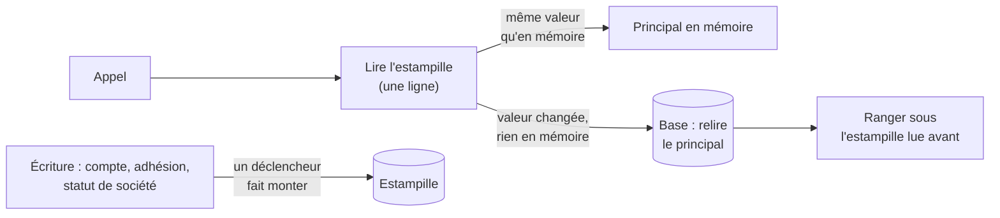

# Qui est le client — l'identité de chaque appel, gardée en mémoire

> 📍 **État au 2026-11-05.** ✅ En production. Mesuré sur la carte de santé
> (C5) : **92 % des appels** trouvent leur principal en mémoire. Cette doc
> remplace le plan du lot L4 de
> [`plan-latence-de-navigation.md`](plan-latence-de-navigation.md) ; la carte
> de tous les caches est [`carte-des-caches.md`](carte-des-caches.md).

# Partie 1 — Comprendre

## Le principal, simplement

À chaque appel, l'API doit savoir **qui appelle** avant de répondre quoi que ce
soit : quel compte, s'il est actif, de quelles sociétés il est membre et avec
quel rôle, quels sites il atteint par sa société principale, si son adresse
e-mail est prouvée. Cette fiche d'identité s'appelle **le principal**.

Le jeton de connexion ne dit qu'une chose : « je suis tel identifiant chez le
fournisseur de connexion ». Tout le reste est relu **en base**, parce que la
base fait autorité : un compte désactivé doit être coupé tout de suite, sans
attendre que son jeton expire.

## Pourquoi le garder en mémoire

Relire le principal coûtait **60 à 270 ms** par appel (mesuré le 2026-11-04) :
un changement d'espace lance une quinzaine d'appels en même temps, qui
refaisaient tous la même lecture. Or le principal ne change presque jamais.
L'API le garde donc en mémoire, par personne : servi de là, il coûte **une
dizaine de millisecondes** (12–17 ms mesurés en production).

## Comment il reste juste : l'estampille

Une mémoire peut mentir. Pour qu'elle ne mente jamais, la base tient **un
compteur unique**, l'estampille. Elle le fait monter elle-même — par des
déclencheurs — dès qu'une écriture touche une colonne que le principal lit
dans `users`, `memberships` ou `companies`.

Chaque appel lit ce compteur (une ligne), et ne se sert de la mémoire que si
le principal y a été rangé **sous la même valeur**. Sinon il relit tout.

**La révocation est immédiate.** L'estampille n'est jamais gardée : une
désactivation la fait monter dans sa propre transaction, et l'appel suivant
relit le principal. Aucun délai. Et comme c'est la base qui fait monter le
compteur, personne ne peut oublier de le faire — même une écriture faite à la
main en SQL.

Ce qui **ne** fait **pas** monter : une première connexion, un changement de
préférences de navigation, une correction de nom, d'adresse ou de conditions
d'une société. Rien de cela ne change le principal.

## Ce qu'on mesure

- **Page Santé du back-office** (C5) : le cache `principal` compte l'issue de
  chaque appel — servi en mémoire, joint à une lecture en cours, relu (et
  pourquoi). 92 % en mémoire au 2026-11-05.
- **`Server-Timing`** de chaque réponse : `stamp` (le coût de la lecture de
  l'estampille) et `principal-source` (d'où vient le principal).

# Partie 2 — Le code

Chemins relatifs à `apps/lfd-api/` ; lignes lues le 2026-11-05.

## La mémoire

`src/b2b/account/infrastructure/cached-principal.resolver.ts` —
`CachedPrincipalResolver` (l. 52) enveloppe le résolveur ordinaire, sur le même
port `PrincipalResolver`.

- **Capacité 1 000 personnes** (`PRINCIPAL_MEMORY_CAPACITY`, l. 17), la plus
  ancienne sort ; **durée de 10 minutes** (`PRINCIPAL_MEMORY_LIFETIME_MS`,
  l. 20) — un filet, pas la justesse.
- **L'ordre est la justesse** : l'estampille est lue D'ABORD (l. 72), le
  principal ensuite, et rangé sous l'estampille lue avant (`lead`, l. 98–107).
  Lu dans l'autre ordre, un principal périmé pourrait se ranger sous une
  estampille neuve.
- **Une lecture à la fois par personne** : les appels simultanés d'une même
  personne sous la même estampille attendent la lecture en vol (`inFlight`,
  l. 84) au lieu d'en lancer une chacun.
- **Clé : le `sub` du jeton.** Le `subject` et les `scopes` ne sont jamais
  gardés : ils sont repris du jeton à chaque appel, et le principal rendu est
  figé (`withToken`, `Object.freeze`, l. 151) parce qu'il est partagé.
- Si le jeton prouve une adresse que la base ne tient pas encore pour prouvée
  (`wouldRecord`), l'appel repasse par le résolveur ordinaire, qui l'écrit.
- Sans ligne d'estampille (`no-stamp`, l. 73), la mémoire n'est pas utilisée.

`src/b2b/account/infrastructure/principal-memory.ts` — `PrincipalMemory`
(l. 24), pure (l'heure lui est donnée) : `take` (l. 33) ne rend que sous la
même estampille et dans la durée ; `missReason` (l. 52) dit pourquoi on relit
(`absent`, `stamp`, `expired`) ; `keep` (l. 67) refuse d'écraser une entrée
rangée sous une estampille plus récente (l. 69) ; `storedPart` (l. 96) retire
`subject` et `scopes`.

## Quand le principal n'est pas gardé

`src/b2b/account/infrastructure/tracked-principal.resolver.ts` —
`PrincipalResolution.storable` (l. 12) : la résolution dit si elle peut être
gardée.

`src/b2b/account/infrastructure/customer-principal.resolver.ts`, l. 130–134 :
`storable` n'est vrai que si **rien n'a été écrit** (ni compte créé, ni
invitation acceptée, ni preuve recopiée, ni première entrée) **et** qu'aucune
adhésion n'attend son acceptation. C'est la seule part du principal qui
dépend de l'heure (une invitation expire) : gardée, elle échapperait à
l'estampille. Tout autre cas passe par le résolveur ordinaire, à chaque fois.

## L'estampille et ses déclencheurs

- **Lecture** : port `src/b2b/account/domain/ports/principal-stamp.reader.ts`,
  adaptateur `src/b2b/account/infrastructure/prisma-principal-stamp.reader.ts`
  (`PrismaPrincipalStampReader`, l. 15) qui lit l'unique ligne
  (`PRINCIPAL_STAMP_ROW = 1`, l. 7) de `public.principal_stamp`. Aucun code ne
  l'écrit.
- **Écriture** : `prisma/migrations/20261104120000_l_estampille_du_principal/`
  crée la table, la fonction `principal_stamp_bump()` et trois déclencheurs
  `BEFORE … FOR EACH STATEMENT`.
  `prisma/migrations/20261105120000_l_estampille_filtree_par_colonnes/` les
  remplace (`CREATE OR REPLACE TRIGGER`, une instruction atomique, aucune
  fenêtre sans déclencheur) par des `BEFORE INSERT OR DELETE OR UPDATE OF …` :

| Table         | Colonnes qui font monter                                     |
| ------------- | ------------------------------------------------------------ |
| `users`       | `id`, `auth0_sub`, `email`, `email_verified`, `status`       |
| `memberships` | `user_id`, `company_id`, `role`, `invited_at`, `accepted_at` |
| `companies`   | `id`, `status`, `parent_company_id`                          |

`INSERT` et `DELETE` font toujours monter. `UPDATE OF` monte dès que la colonne
figure dans le `SET`, même à valeur égale ; une instruction à zéro ligne aussi
(assumé : plus large que nécessaire, jamais trop étroit).

## La liste des colonnes, tenue par un test

`src/b2b/account/infrastructure/__tests__/principal-stamp-columns.spec.ts`
lit les sources de la résolution, en tire chaque champ de ces trois modèles,
et exige qu'il soit dans la migration ou exempté avec sa raison (l. 39–46) :
`users.first_login_at` (première entrée, jamais gardée),
`users.became_account_at` (écrite à l'`INSERT` seulement),
`companies.enseigne` et `raison_sociale` (noms que le principal ne porte pas).
Le jour où la résolution lit une colonne de plus, ce test rougit avant qu'une
révocation puisse passer inaperçue. `test/principal-stamp.e2e-spec.ts` éprouve
les déclencheurs sur la base migrée.

## La société ne réécrit plus son statut

`src/b2b/account/domain/entities/company.ts`, l. 195 : `statusChange` porte le
statut **seulement s'il a bougé** depuis le chargement (toujours pour une
société neuve). `prisma-company.repository.ts` (l. 280–282) n'écrit `status`
que par lui. Avant (corrigé le 2026-11-05), chaque sauvegarde de l'agrégat
réécrivait `status`, et toute correction d'identité vidait la mémoire de tout
le monde. Test : `domain/entities/__tests__/company-status-change.spec.ts`.

## Les préférences de navigation hors de `users`

`PATCH /me/nav-prefs` écrit à chaque changement d'espace. Restées dans
`users.nav_prefs`, elles auraient fait monter l'estampille à chaque clic.
Elles vivent dans `public.user_nav_prefs` (une ligne par personne, sans
déclencheur), copiées par la migration `20261104120000` ;
`src/b2b/account/infrastructure/prisma-nav-preferences.repository.ts` y écrit
par `INSERT … ON CONFLICT … prefs || excluded.prefs`. `users.nav_prefs` reste
en base, sans lecteur ni écrivain (une colonne morte reste, CLAUDE.md §0).
Test : `test/user-nav-prefs.e2e-spec.ts`.

## Le harnais e2e

`test/e2e-harness.ts` : le `TRUNCATE` emporte la ligne d'estampille ; le
harnais la remet (`ensurePrincipalStamp`, l. 285) et vide la mémoire
(`CachedPrincipalResolver.forget()`, l. 299), sans quoi deux suites
partageraient un principal rangé sous le même numéro.

# Ce qui a été décidé, et pourquoi

- **Un compteur, pas un journal ni une séquence** (vitruve, 2026-11-04). Un
  numéro de séquence est attribué à l'écriture, pas à la validation : une
  désactivation validée après une écriture voisine laisserait un principal
  périmé rangé sous le plus grand numéro. Le verrou du compteur aligne l'ordre
  des validations sur l'ordre des numéros.
- **`BEFORE … FOR EACH STATEMENT`, pas `AFTER`** (bâti, 2026-11-04). `AFTER`
  prend le verrou de l'estampille après celui de la ligne écrite et
  interblocait (`acceptAndActivate` écrit `memberships` puis `users`). `BEFORE`
  fait prendre l'estampille avant tout verrou de ligne, sans toucher aux
  transactions. ⚠️ Un geste futur qui verrouillerait une société
  (`SELECT … FOR UPDATE`) **avant** d'écrire l'une des trois tables rouvrirait
  l'interblocage (vérifié absent le 2026-11-04 : `SitePrincipalLock` et le
  carnet d'adresses verrouillent après, ou sans écrire ces tables).
- **Une estampille globale, pas une par personne** (vitruve, 2026-11-05).
  La version par personne se trompait de sens pour `companies` (rattacher un
  site change le principal des membres de l'ancien et du nouveau parent),
  recréait un piège ABA sur une clé `sub` qui change de personne, rouvrait
  les interblocages (un déclencheur par ligne verrouille la ligne métier
  avant l'estampille) et demandait deux déploiements — pour un problème non
  mesuré. Retenu à la place : **le filtre par colonnes**. Elle ne se rouvre
  qu'avec un taux de vidage mesuré qui resterait élevé après ce filtre.
- **Les préférences quittent `users`** (Hugo, 2026-11-04). Rendre le problème
  inexprimable plutôt que tenir une liste d'exclusion.

# Reste à faire

Rien sur le principal client. Hors de ce mécanisme, à savoir :

- **Le staff a son propre cache**, plus simple : `PrismaStaffAccessResolver`
  (`src/staff/permissions/prisma-staff-access.resolver.ts`, l. 27) garde
  l'accès 30 s par `sub`, vidé par `StaffAccessCache.forgetAll()` après un
  changement de rôle. Pas d'estampille : une révocation de droit staff peut
  donc attendre jusqu'à 30 s sur une autre instance.
- La **vérification du jeton** n'est pas comptée à part dans `Server-Timing`.
