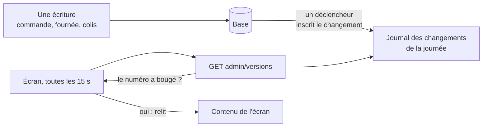

# La version par journée — ne relire que ce qui a bougé

> ✅ **Décrit le code au 2026-11-13.** Ce document remplace le plan du
> 2026-09-28 (lots V1 à V4 bâtis, la porte unique D8 le 2026-11-03) ; le récit
> des routes retirées est dans l'historique git. Le § 4 décrit
> l'objet des journées qui garde les numéros et les écrans (2026-11-13). Partie 1 :
> comprendre. Partie 2 : le code.

# Partie 1 — Comprendre

## Le problème

Les écrans de la journée — la Supervision, la fiche d'atelier du fournil, le
colisage, le comptoir, les tournées — doivent se mettre à jour seuls. Ils
relisaient tout toutes les 15 secondes : environ **2 760 opérations par heure**
pour une seule Supervision ouverte (compté le 2026-09-28).

## La réponse : un numéro par journée

Chaque journée porte un **numéro de version** qui monte à chaque écriture qui
la concerne. Toutes les 15 secondes, un écran demande seulement « le numéro
a-t-il bougé ? » ; il ne relit son contenu que si oui.

**Le numéro monte par la base, jamais par le code.** Un déclencheur Postgres
inscrit chaque changement : aucun développeur ne peut oublier de le faire, et
une table nouvelle sans déclencheur fait rougir la CI.

**Ce que l'heure change sans écriture** — un créneau dépassé à 6 h 30 — ne fait
monter aucun numéro : la Supervision relit sa journée toutes les 60 s, et tous
les écrans font une relecture complète toutes les 5 minutes, en filet.

# Partie 2 — Le code

## 1. Les journaux

Deux journaux en **ajout seul**, un par schéma, pour que la frontière tienne
(`lint:cross-schema-join`) :

| Journal                 | Tables surveillées                                                                                   | Jour lu                                              |
| ----------------------- | ---------------------------------------------------------------------------------------------------- | ---------------------------------------------------- |
| `public.day_change`     | `orders` (insertion, mise à jour, ancien ET nouveau jour si la date change)                          | `requested_delivery_date`                            |
| `production.day_change` | `production_day`, `production_order`, `production_order_line`, `production_count`, contrôles qualité | `service_day`, ou celui de sa commande de production |

- **Un journal, pas un compteur** : un `UPDATE … version + 1` verrouillerait la
  ligne de la journée pendant les longues transactions (une clôture). Chaque
  instruction insère une ligne ; la version est la paire `max(id)` +
  `count(*)` sur la journée, lue en une requête et encodée en un nombre
  (`journalVersion`) : `max(id)` seul raterait une transaction qui a pris un
  identifiant plus petit et valide après une autre. Le numéro se compare par
  égalité, jamais par ordre ; un balayage qui fait baisser le compte provoque
  une relecture de trop, jamais un numéro qui ment (décidé par Hugo le
  2026-11-12). Les journaux globaux `public.company_change` et
  `public.order_change` suivent la même règle, sur tout le journal.
- **Déclencheurs au niveau de l'instruction** (`FOR EACH STATEMENT`, tables de
  transition) : une clôture de 300 lignes écrit une ligne par journée touchée.
- Un balayage vide les lignes de plus de 7 jours.
- **La CI tient l'oubli** : un e2e lit `pg_trigger` sur la base migrée — toute
  table de `production`, et toute table de `public` qui porte un jour, a le
  déclencheur, ou figure dans une liste d'exceptions motivées.
- `order_handover` et `order_lines` ne sont pas surveillées : un retrait et une
  modification de commande écrivent `orders` dans la même transaction.

Les journaux du colisage et de la livraison suivent la même forme, lus par
leurs blocs.

## 2. La porte unique (D8, 2026-11-03)

`GET admin/versions?date=AAAA-MM-JJ&subjects=orders,production` →
`{ date, versions: { … } }` (`versionsQuerySchema` / `versionsViewSchema`,
`@lfd/contracts` ; la même porte sert aussi les sujets globaux,
`le-cache-du-back-office.md` § 2.3) :

| Journal      | Droits (l'un suffit)                                                                                                            | Source                                                        |
| ------------ | ------------------------------------------------------------------------------------------------------------------------------- | ------------------------------------------------------------- |
| `orders`     | `b2b_orders:read`, `handover_counter:read`, `b2b_supervision:read`, `production_worksheet:read`, `production_plan:read`         | `OrdersDayVersionSource` (commerce)                           |
| `production` | `production_plan:read`, `production_worksheet:read`, `production_packing:read`, `handover_counter:read`, `b2b_supervision:read` | `ProductionDayVersionSource` (fournil + colisage)             |
| `delivery`   | `delivery_rounds:read`, `delivery_loading:read`, `handover_counter:read`, `b2b_supervision:read`                                | `DeliveryDayVersionSource` (livraison)                        |
| `my-round`   | `delivery_driving:read`                                                                                                         | `MyRoundDayVersionSource` (livraison + commerce par son port) |

- Un journal inconnu est un 400 qui le nomme ; un journal non permis est
  **absent** de la réponse.
- `platform/day-versions/` déclare le port `DayVersionSource` et sert la porte ;
  chaque bloc l'implémente ; `appBootstrap/day-version-sources.module.ts` les
  relie en un `DayVersionRegistry`, qui refuse de se construire — l'API ne
  démarre pas — si un journal de `DAY_JOURNALS` n'a pas de source ou en a deux.
- **`lint:day-version-door`** : aucune autre route « version » dans l'API, et
  un seul appelant au back-office (`shared/version/version.service.ts`).

## 3. Côté écran

`VersionWatcher` (`shared/version/version-watcher.ts`) : toutes les
15 s (`REFRESH_INTERVAL_MS`), onglet visible, **une requête par journée** pour
tous les écrans de l'onglet ; relecture de l'écran si un numéro a changé
(égalité, jamais ordre) ; filet de 5 min (`SAFETY_NET_MS`) ; un échec ne relit
rien.

## 4. L'objet des journées

Au-dessus des journaux, l'objet partagé `DayVersions` (dans le Worker de
l'API) évite que chaque instance et chaque onglet relise la même chose :

- **Les numéros** : la première question d'une fenêtre de 15 s relit la base
  et range la carte des numéros, les autres la lisent dans l'objet ; une
  seule relecture à la fois par instance ; la carte contient tous les
  journaux et le droit filtre après ; la révision du code est dans la clé.
- **Le contenu des écrans de journée** (fiche du fournil et Préparation de
  la Supervision, colisage, files de retrait, tournées) : une ligne par
  écran et par journée, servie quand les numéros lus **en base** avant les
  données sont égaux à ceux du rangement ; le droit reste à la porte de la
  route. Prouvé en production le 2026-11-13.
- **Pas d'alarme, pas de recalcul poussé par l'objet, pas de WebSockets** :
  l'objet ne fait que garder ce que l'API a lu, et l'API le joint par un
  hôte intercepté (`http://objets.interne/journees`). Objet injoignable →
  l'API lit la base.
- **Le numéro reste écrit par la base** (le déclencheur), jamais par le
  code.

Le détail — clés, étiquettes, ce qui est lu hors numéro, les décisions de
Hugo, la mesure — est dans
[`le-cache-du-back-office.md`](le-cache-du-back-office.md) § 3.
