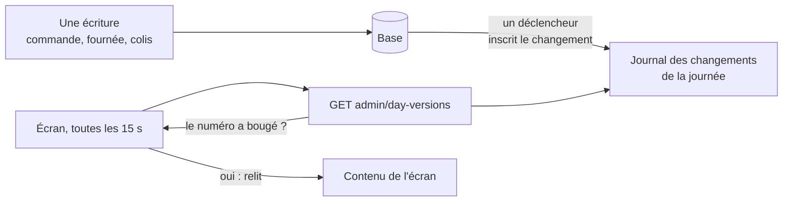
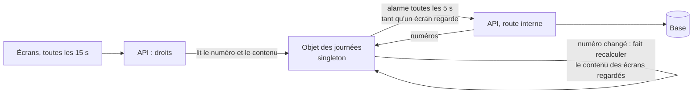

# La version par journée — ne relire que ce qui a bougé

> ✅ **Décrit le code au 2026-11-04.** Ce document remplace le plan du
> 2026-09-28 (lots V1 à V4 bâtis, la porte unique D8 le 2026-11-03) ; le récit
> des routes retirées est dans l'historique git. La partie « Ce qui reste
> ouvert » porte la suite décidée avec Hugo le 2026-11-04. Partie 1 :
> comprendre. Partie 2 : le code.

# Partie 1 — Comprendre

## Le problème

Les écrans de la journée — la Supervision, la fiche d'atelier du fournil, le
colisage, le comptoir, les tournées — doivent se mettre à jour seuls. Ils
relisaient tout toutes les 15 secondes : environ **2 760 opérations par heure**
pour une seule Supervision ouverte (compté le 2026-09-28).

## La réponse : un numéro par journée

Chaque journée porte un **numéro de version** qui monte à chaque écriture qui
la concerne. Toutes les 15 secondes, un écran demande seulement « le numéro
a-t-il bougé ? » ; il ne relit son contenu que si oui.

**Le numéro monte par la base, jamais par le code.** Un déclencheur Postgres
inscrit chaque changement : aucun développeur ne peut oublier de le faire, et
une table nouvelle sans déclencheur fait rougir la CI.

**Ce que l'heure change sans écriture** — un créneau dépassé à 6 h 30 — ne fait
monter aucun numéro : la Supervision relit sa journée toutes les 60 s, et tous
les écrans font une relecture complète toutes les 5 minutes, en filet.

# Partie 2 — Le code

## 1. Les journaux

Deux journaux en **ajout seul**, un par schéma, pour que la frontière tienne
(`lint:cross-schema-join`) :

| Journal                 | Tables surveillées                                                                                   | Jour lu                                              |
| ----------------------- | ---------------------------------------------------------------------------------------------------- | ---------------------------------------------------- |
| `public.day_change`     | `orders` (insertion, mise à jour, ancien ET nouveau jour si la date change)                          | `requested_delivery_date`                            |
| `production.day_change` | `production_day`, `production_order`, `production_order_line`, `production_count`, contrôles qualité | `service_day`, ou celui de sa commande de production |

- **Un journal, pas un compteur** : un `UPDATE … version + 1` verrouillerait la
  ligne de la journée pendant les longues transactions (une clôture). Chaque
  instruction insère une ligne ; la version est le plus grand identifiant
  (`max(id) WHERE service_day = $1`, un parcours d'index).
- **Déclencheurs au niveau de l'instruction** (`FOR EACH STATEMENT`, tables de
  transition) : une clôture de 300 lignes écrit une ligne par journée touchée.
- Un balayage vide les lignes de plus de 7 jours.
- **La CI tient l'oubli** : un e2e lit `pg_trigger` sur la base migrée — toute
  table de `production`, et toute table de `public` qui porte un jour, a le
  déclencheur, ou figure dans une liste d'exceptions motivées.
- `order_handover` et `order_lines` ne sont pas surveillées : un retrait et une
  modification de commande écrivent `orders` dans la même transaction.

Les journaux du colisage et de la livraison suivent la même forme, lus par
leurs blocs.

## 2. La porte unique (D8, 2026-11-03)

`GET admin/day-versions?date=AAAA-MM-JJ&journals=orders,production` →
`{ date, versions: { … } }` (`dayVersionsQuerySchema` / `dayVersionsViewSchema`,
`@lfd/contracts`) :

| Journal      | Droits (l'un suffit)                                                                                                            | Source                                                        |
| ------------ | ------------------------------------------------------------------------------------------------------------------------------- | ------------------------------------------------------------- |
| `orders`     | `b2b_orders:read`, `handover_counter:read`, `b2b_supervision:read`                                                              | `OrdersDayVersionSource` (commerce)                           |
| `production` | `production_plan:read`, `production_worksheet:read`, `production_packing:read`, `handover_counter:read`, `b2b_supervision:read` | `ProductionDayVersionSource` (fournil + colisage)             |
| `delivery`   | `delivery_rounds:read`, `delivery_loading:read`                                                                                 | `DeliveryDayVersionSource` (livraison)                        |
| `my-round`   | `delivery_driving:read`                                                                                                         | `MyRoundDayVersionSource` (livraison + commerce par son port) |

- Un journal inconnu est un 400 qui le nomme ; un journal non permis est
  **absent** de la réponse.
- `platform/day-versions/` déclare le port `DayVersionSource` et sert la porte ;
  chaque bloc l'implémente ; `appBootstrap/day-version-sources.module.ts` les
  relie en un `DayVersionRegistry`, qui refuse de se construire — l'API ne
  démarre pas — si un journal de `DAY_JOURNALS` n'a pas de source ou en a deux.
- **`lint:day-version-door`** : aucune autre route « version » dans l'API, et
  un seul appelant au back-office (`shared/day-version/day-version.service.ts`).

## 3. Côté écran

`DayVersionWatcher` (`shared/day-version/day-version-watcher.ts`) : toutes les
15 s (`REFRESH_INTERVAL_MS`), onglet visible, **une requête par journée** pour
tous les écrans de l'onglet ; relecture de l'écran si un numéro a changé
(égalité, jamais ordre) ; filet de 5 min (`SAFETY_NET_MS`) ; un échec ne relit
rien.

## 4. Ce qui reste ouvert — décidé avec Hugo le 2026-11-04

Chaque question coûte une lecture par journal, et chaque « oui » fait relire
**le même contenu** à chaque écran ouvert sur la même journée (la Supervision :
~11 lectures). Au rush, avec plusieurs écrans et plusieurs instances de l'API,
c'est là que part la facture.

**La cible : un Durable Object « des journées », singleton pour toutes les
instances**, construit après le déploiement du 2026-11-04 :

- **Le numéro reste écrit par la base** (le déclencheur) : l'objet ne fait que
  le relire, par l'API, jamais par son propre accès à la base. Le faire monter
  par le code serait revenir sur la décision D1 du plan d'origine.
- **5 secondes** entre deux relectures du numéro : le retard maximal d'un écran
  passe de 15 s à 20 s, et l'équipe agit sur ce qu'elle voit — plus court vaut
  mieux. Les gestes restent vérifiés au serveur (un retrait déjà fait, une
  journée close sont refusés par leur nom).
- **Le contenu des écrans partagés** est rangé sous la clé « écran, jour,
  **numéro** » : un contenu rangé sous 45 est celui de la version 45, rien à
  purger. Écrans partagés : Supervision, fiche d'atelier, colisage, comptoir
  (par point de retrait), plan des tournées. Exclus : « Ma tournée » (par
  livreur), la cloche (par personne). Chaque écran est vérifié avant d'entrer :
  son contenu ne dépend ni de la personne, ni de ses droits au-delà de l'accès
  à l'écran, ni de l'heure (un compte à rebours se calcule sur l'écran).
- **L'alarme ne tourne que si quelqu'un regarde** (chaque lecture la prolonge
  de quelques minutes), et ne fait recalculer que les écrans lus récemment.
- **L'objet joint l'API par le Worker**, comme les tâches planifiées, sur une
  route interne gardée par le jeton des balayages (`RECOMPUTE_TOKEN`).
- **Repli** : objet injoignable → l'API lit la base, comme aujourd'hui.
- **Les WebSockets sont écartés** : reconnexions, droits sur la connexion,
  passage par la passerelle, et un écran qui se croit à jour sur une connexion
  morte — pour passer de 15 s à 1 s, dont les écrans d'atelier n'ont pas
  besoin. L'objet les rendrait possibles plus tard.

**Avant de bâtir : mesurer**, au rush, combien d'écrans regardent la même
journée en même temps, et ce que coûte chaque relecture d'écran. Le plan
passera par `vitruve`.
