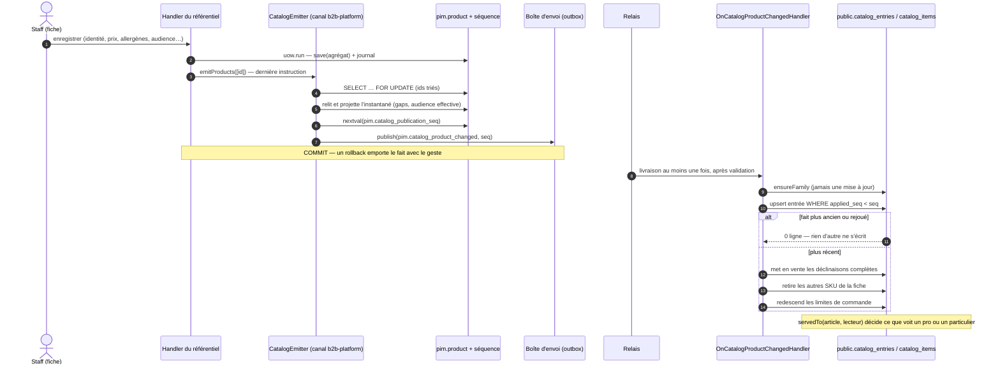

# Le catalogue synchronisé — le référentiel publie, la plateforme s'abonne

> 🟡 **Doc d'état, écrite le 2026-10-16 en ouvrant le code.** Chaque
> affirmation porteuse cite son fichier et sa ligne, vérifiés ce jour-là. Elle
> remplace six documents qui décrivaient surtout l'ancien monde — push d'un
> instantané, prix décidé sur la plateforme, publication par canal (liste en
> fin de document).
>
> **Bâti et commité** : lots 1, 2a, 2b, 3, P, S, D du plan qui fait
> foi, [`plan-catalogue-synchronise-par-audience.md`](plan-catalogue-synchronise-par-audience.md).
> 2b4 — l'ouverture en production — fait les 2026-10-16/17 ; les
> interrupteurs sont retirés du code par X1 de
> [`plan-sans-interrupteurs.md`](plan-sans-interrupteurs.md) (§6), puis le
> push, la réception, les versions, la parité, la santé et la surcharge des
> opérations par X2 (2026-10-17, §6), puis les opérations du référentiel, le
> lien au canal par fiche et l'édition de la matrice des canaux par X4
> (2026-10-17, §6).
> **Pas bâti** : W, 4, et ce qui reste du lot 5 (§9).

## En une phrase

Chaque écriture du catalogue dans le référentiel écrit, **dans sa propre
transaction**, l'instantané complet de la fiche (ou de la famille) dans la
boîte d'envoi ; la plateforme s'y abonne par un `@DurableHandler` et ne
l'applique que s'il est **plus récent** que ce qu'elle tient. Personne ne
pousse plus rien : le push est retiré du code depuis X2 (§6).

## 1. Le flux d'une écriture de fiche

## 2. Le référentiel publie

### Le port et son implémentation

Le catalogue **déclare** `CatalogEmitter` (`apps/lfd-api/src/pim/catalogue/shared/domain/ports/catalog-emitter.ts:21`) :
il dit « cette fiche a changé », jamais « envoie-la à la plateforme ». Le
canal `pim/channels/b2b-platform/` l'implémente
(`apps/lfd-api/src/pim/channels/b2b-platform/products/catalog-facts.emitter.ts:28`)
et le branche par un module global
(`apps/lfd-api/src/pim/channels/b2b-platform/catalog-facts.module.ts:46-53`) —
global parce que le canal importe le catalogue, jamais l'inverse.

Le contrat (`catalog-emitter.ts:10-19`) :

- appelé en **dernière instruction** du `uow.run` du geste. L'instantané
  n'est pas pris dans l'agrégat en mémoire : il est **relu en base** sous
  verrou, satellites compris (allergènes, rédactionnel, visuels), qui ne
  passent pas par `save` ;
- fermé, il ne fait **rien** — ni verrou, ni lecture (`catalog-facts.emitter.ts:40-42`, `:75-77`) ;
- ouvert, il lève hors d'une unité de travail : un fait sans transaction
  survivrait à une écriture annulée (`apps/lfd-api/src/platform/outbox/durable-publisher.ts:12-13`).

Au 2026-10-16, **35 fichiers** du référentiel appellent `emitter.emitProducts`
ou `emitter.emitCategories` — toutes les écritures de fiche et de famille
(par exemple `apps/lfd-api/src/pim/catalogue/product/application/create-product.ts:172`,
`apps/lfd-api/src/pim/catalogue/product/application/update-product-identity.ts:102`,
`apps/lfd-api/src/pim/catalogue/product/application/activate-product.ts:65`).

### Verrou, puis numéro

L'ordre est la garantie (`catalog-facts.emitter.ts:43-54`) :

1. `SELECT id … ORDER BY id FOR UPDATE` sur les fiches visées, triées et sans
   doublon — le seul ordre de verrou du mécanisme
   (`apps/lfd-api/src/pim/channels/b2b-platform/products/prisma-publication-sequence.ts:19-26`) ;
2. relecture et projection ;
3. un numéro par fait, tiré de `pim.catalog_publication_seq`
   (`prisma-publication-sequence.ts:46-53`, séquence posée par la migration
   `20261015200000_le_numero_de_publication`).

Deux enregistrements simultanés de la même fiche passent l'un après l'autre ;
celui qui porte le plus grand `seq` a été relu **après** l'écriture de
l'autre. Sans séquence, la transaction est annulée avec un message qui dit
d'appliquer les migrations (`prisma-publication-sequence.ts:57-65`).

### Les trois faits

| Fait                           | Clé                                       | Porte                                                                                                                                                                   |
| ------------------------------ | ----------------------------------------- | ----------------------------------------------------------------------------------------------------------------------------------------------------------------------- |
| `pim.catalog_product_changed`  | `…:<productId>:<seq>`                     | `status`, `audience` effective, `audienceInherited`, la fiche, ses déclinaisons **complètes**, `gaps` des autres, sa famille                                            |
| `pim.catalog_category_changed` | `…:<categoryId>:<seq>`                    | la famille : nom, parent, position, taux, `audience`, `archived`                                                                                                        |
| `pim.catalog_rules_changed`    | (règles globales, un numéro par émission) | l'échelle entière des limites de commande, relue en base sous verrou consultatif (`apps/lfd-api/src/pim/channels/b2b-platform/products/catalog-rules.emitter.ts:35-45`) |

Formes : `apps/lfd-api/src/pim/channels/b2b-platform/products/catalog-product-changed.fact.ts:24-36`,
`apps/lfd-api/src/pim/channels/b2b-platform/products/catalog-category-changed.fact.ts:19-29`.
Elles reprennent les schémas du fil du push (`@lfd/catalog-sync`) : un article
émis et un article poussé se valident par les mêmes règles. Deux écarts
voulus : zéro déclinaison est admis (une fiche inactive s'émet quand même), et
la fiche porte statut, audience, manques et famille.

Ce qu'un fait **n'est pas** :

- **un diff** — c'est l'instantané complet ; il se rejoue seul, et le plus
  récent gagne (`catalog-product-changed.fact.ts:43-45`) ;
- **une entrée de journal** — le référentiel trace déjà la décision
  (`product.*`) ; le fait en est la conséquence (`:49-50`) ;
- **le porteur des règles globales** — une limite de commande change en une
  ligne ; la recopier sur chaque fiche ferait réémettre tout le catalogue
  pour une décision qui tient en une ligne (`:52-54`). C'est la leçon de la
  v7 du fil : une règle globale recopiée sur N articles était indescriptible
  par un diff qui compare des SKU (« 0 changement » annoncé pour une
  fermeture avancée de deux heures). Les **règles** traversent, la
  plateforme descend l'échelle elle-même avec la même implémentation
  (`@lfd/catalog-sync`).

Les faits vivent **dans le canal**, pas dans le catalogue : un fait qu'un autre
bloc consomme fait partie de la surface publiée, au même titre qu'un port
(`catalog-product-changed.fact.ts:56-60`). `pim → b2b` reste interdit ; la
plateforme écoute un fait du canal.

### La projection : ce qui est complet part, le reste est nommé

`projectProductFact` (`apps/lfd-api/src/pim/channels/b2b-platform/products/catalog-facts.ts:135-170`)
écarte les déclinaisons arrêtées, et range chaque déclinaison incomplète dans
`gaps` avec ce qui lui manque, **au lieu de l'écarter en silence** comme le
push. Les clés de manque (`apps/lfd-api/src/pim/catalogue/product/domain/services/variant-completeness.ts:8-22`) :
`price`, `allergens`, `pro_price`, `pro_price_rule`, `vat:<contexte>`. Ce n'est
plus la matrice des canaux qui filtre : c'est l'audience.

### La réémission

`CatalogReemission` (`apps/lfd-api/src/pim/catalogue/shared/domain/ports/catalog-reemission.ts:22`)
réémet plusieurs fiches **hors** de la transaction du geste, une transaction
par fiche : un geste qui change le prix ou le taux de cent fiches ne doit pas
verrouiller le catalogue entier. Elle est appelée **après** le `uow.run`, et
une fiche en échec est journalisée et listée sans faire échouer le geste,
déjà validé (`apps/lfd-api/src/pim/channels/b2b-platform/products/catalog-reemission.service.ts:66-80`).

| Déclencheur                                                                 | Appel                                                                                                                                                                         |
| --------------------------------------------------------------------------- | ----------------------------------------------------------------------------------------------------------------------------------------------------------------------------- |
| audience, taux d'une famille (ses canaux, jusqu'à X4)                       | `productsOfCategories` (`apps/lfd-api/src/pim/catalogue/category/application/set-category-audience.ts:50`, `set-category-vat.ts:57`, set-category-channels.ts (retiré en X4)) |
| modifier ou retirer un taux de TVA                                          | `everything` (`apps/lfd-api/src/pim/vat-rates/application/update-vat-rate.ts:51`, `remove-vat-rate.ts:43`)                                                                    |
| modifier ou retirer un contexte de vente                                    | `everything` (`apps/lfd-api/src/pim/sales-contexts/application/update-sales-context.ts:63`, `remove-sales-context.ts:55`)                                                     |
| le référentiel d'allergènes (7 gestes)                                      | `everything` (par exemple `apps/lfd-api/src/pim/allergens/application/revise-allergen-entry.ts:74`)                                                                           |
| changer la méthode du prix pro                                              | `everything` (`apps/lfd-api/src/pim/accounting-rules/application/choose-pro-price-method.ts:81`)                                                                              |
| changer le rapport pro — **seulement** au premier réglage ou hors `entered` | `everything` (`apps/lfd-api/src/pim/accounting-rules/application/set-pro-price-ratio.ts:71-75`)                                                                               |
| `POST /pim/channels/b2b/reemit` — une fiche, ou tout                        | `apps/lfd-api/src/pim/channels/b2b-platform/products/reemit.controller.ts:27-35`                                                                                              |

« Tout » émet les familles d'abord, puis les fiches, puis les règles en
dernier : c'est le fait d'une fiche qui apprend à la plateforme l'identifiant
de déclinaison qu'une règle de ce rang vise (`catalog-reemission.service.ts:46-64`).
La route `reemit` refuse quand les faits sont fermés — « 0 fiche réémise » se
lirait comme un succès (`apps/lfd-api/src/pim/channels/b2b-platform/application/reemit-catalog.ts:46-48`, `:63-71`).
C'est le **filet** : un fait perdu laisse une fiche en retard, « Catalogue
publié » le montre, la réémission le répare.

## 3. Le transport durable

Les faits passent par la boîte d'envoi (`apps/lfd-api/src/platform/outbox/`,
plan [`../journalisation/plan-boite-d-envoi.md`](../journalisation/plan-boite-d-envoi.md)) :
écrits dans la transaction ambiante par `DurablePublisher`
(`apps/lfd-api/src/platform/outbox/durable-publisher.ts:15`), livrés par le
relais **après** la validation, au moins une fois, à chaque abonné déclaré par
`@DurableHandler` (`apps/lfd-api/src/platform/outbox/durable-handler.ts:32`).
La garde du relais fait qu'un abonné n'agit qu'une fois par fait, et il tourne
dans l'unité de travail qu'elle ouvre (`durable-handler.ts:17-19`).

C'est le transport qu'impose la matrice entre deux blocs
(`lint:durable-cross-block`) : un abonné sur le bus en mémoire perdrait un
fait au redémarrage, et les deux blocs divergeraient sans que personne le sache.

Un fait illisible **lève** : la livraison se rejoue, puis passe en lettre
morte, visible sur la carte de santé (`apps/lfd-api/src/pim/channels/b2b-platform/products/catalog-category-changed.fact.ts:79-95`).
L'avaler ferait enregistrer comme appliqué un fait qui ne l'a pas été.

## 4. La plateforme s'abonne

Trois abonnés, dans `apps/lfd-api/src/b2b/catalog/application/handlers/` :

| Abonné (nom stable)                | Fait                           | Fichier                                     |
| ---------------------------------- | ------------------------------ | ------------------------------------------- |
| `catalog.project-catalog-product`  | `pim.catalog_product_changed`  | `on-catalog-product-changed.handler.ts:54`  |
| `catalog.project-catalog-category` | `pim.catalog_category_changed` | `on-catalog-category-changed.handler.ts:35` |
| (règles)                           | `pim.catalog_rules_changed`    | `on-catalog-rules-changed.handler.ts:32`    |

### Une fiche reçue

`OnCatalogProductChangedHandler.handle`
(`apps/lfd-api/src/b2b/catalog/application/handlers/on-catalog-product-changed.handler.ts:61-78`),
dans la transaction de la livraison :

1. **la famille** est créée si la plateforme ne la connaît pas —
   `ON CONFLICT DO NOTHING`, jamais une mise à jour : la fiche peut arriver
   avant le fait de sa famille, et seul celui-ci la met à jour sous son
   numéro (`apps/lfd-api/src/b2b/catalog/infrastructure/prisma-catalog-product-facts.projection.ts:73-92`) ;
2. **l'entrée** `catalog_entries` s'écrit par un `INSERT … ON CONFLICT DO
UPDATE … WHERE applied_seq < EXCLUDED.applied_seq`
   (`prisma-catalog-product-facts.projection.ts:45-71`). La ligne est
   verrouillée par l'`ON CONFLICT` : deux livraisons de la même fiche passent
   l'une après l'autre. **Zéro ligne écrite, et rien d'autre ne s'écrit** — un
   fait ancien rejoué, ou livré deux fois, est inerte ;
3. les déclinaisons complètes d'une fiche active sont **mises en vente**
   (`catalog_items`, upsert par SKU). Une ligne **neuve** naît « à valider »
   pour chaque audience qu'elle sert ; une ligne existante n'y repasse jamais,
   ni sur une modification ni sur un élargissement d'audience
   (`prisma-catalog-product-facts.projection.ts:94-120`) ;
4. **tout autre SKU de la fiche** encore en vente est retiré — fiche inactive
   ou archivée, déclinaison devenue incomplète, SKU renommé — par un
   `updateMany` conditionné sur `STILL_SOLD` (`:122-131`). Retiré, pas
   supprimé : la ligne reste ;
5. les limites de commande des articles de la fiche sont redescendues de
   l'échelle reçue.

Le prix reçu est tracé dans `catalog_price_history` par la règle partagée —
le prix du référentiel seul (`:133-153`).

🔴 **Le récepteur n'écrit jamais `catalog_item_overrides`**
(`prisma-catalog-product-facts.projection.ts:23-27`) et ne passe pas par
`saveMany`, qui supprimerait une décision quand l'agrégat n'en porte plus. Un
fait réécrit les colonnes reçues du référentiel, rien d'autre. C'est la
décision de structure la plus ancienne du catalogue, et elle tient toujours :
**le reçu et le décidé ne partagent pas leurs colonnes.** Si le reçu écrasait
une décision, le fait suivant n'aurait que deux issues, toutes deux fausses —
écraser le travail du commerce, ou refuser de s'appliquer.

### Une famille reçue

`OnCatalogCategoryChangedHandler` (`on-catalog-category-changed.handler.ts:42-51`)
applique sous `catalog_categories.applied_seq`. Une famille archivée au
référentiel n'est jamais supprimée : elle pose `withdrawn_at` ; ses articles
sortent de la vente par les faits de leurs fiches. Appliquée, elle fait
redescendre les limites de **tous** les articles — un déplacement de famille
change la lignée de ses descendantes.

### `servedTo` — la règle unique de ce qui est servi

`servedTo(item, viewer)` (`apps/lfd-api/src/b2b/catalog/domain/served-to.ts:46-54`)
exige deux choses : l'audience de l'article contient celle du lecteur
(décision de **gamme**, prise au référentiel), **et** la plateforme ne l'a ni
masqué pour lui ni laissé en attente de validation (décision **locale**). Le
masquage ne fait donc que retirer : montrer aux pros un article que le
référentiel dit `public` est impossible depuis la plateforme. Une audience
`null` (jamais reçue par un fait) se lit `both` — ce que faisait tout article
avant l'audience.

Elle remplace quatre lectures directes du masquage — le rayon, la fiche et le
lot de SKU (donc la commande), l'éditeur de vitrine, l'export
(`served-to.ts:41-44`). Une seule écriture, sans quoi un jour l'un des quatre
vendrait ce que les autres cachent.

### Ce que la plateforme décide encore, et ce qu'elle ne décide plus

| Décide encore                                                                                                                                                                                                | Route                                                                                                  |
| ------------------------------------------------------------------------------------------------------------------------------------------------------------------------------------------------------------ | ------------------------------------------------------------------------------------------------------ |
| **masquer** un article pour une audience, ou l'y remettre — refusé hors de l'audience du référentiel (`MaskingOutsideAudienceError`, `apps/lfd-api/src/b2b/catalog/domain/entities/catalog-item.ts:605-611`) | `PUT admin/catalog/:sku/masking` (`apps/lfd-api/src/b2b/catalog/http/admin-catalog.controller.ts:154`) |
| **mettre en avant**                                                                                                                                                                                          | `PUT admin/catalog/:sku/featured` (`admin-catalog.controller.ts:166`)                                  |
| **valider une arrivée**, par article et par audience, tout ou rien, journalisé                                                                                                                               | `POST admin/catalog/review/approve` (`admin-catalog.controller.ts:138`)                                |

La route de masquage est **unique** depuis le 2026-10-15 (Hugo : « une seule
route qui définisse le masquage ») : les deux routes d'avant, une par
audience (`:sku/visibility`, `:sku/public-visibility`), sont retirées
(`admin-catalog.controller.ts:148-153`).

**Le prix ne se décide plus sur la plateforme** (lot D). Le remplacement d'un
prix existait parce que le référentiel ne savait que dériver le prix pro par
un rapport ; depuis le lot P, il porte un prix pro saisi qui prime toujours,
et un prix décidé sur la plateforme masquerait en silence une correction
arrivée par les faits. `catalog_item_overrides` garde ses colonnes de prix en
base, ni lues ni écrites (`apps/lfd-api/prisma/schema/public/catalog.prisma:503-510`) ;
le prix servi est celui du référentiel. Les mercuriales et paliers
s'appliquent toujours **par-dessus** ce prix reçu (`../pricing/`).

## 5. L'audience, l'activation, le prix

### L'audience — `pro`, `public`, `both`, par héritage

La famille porte une audience obligatoire, la fiche une audience
**nullable** : `null` hérite de la famille (`effectiveAudience`,
`apps/lfd-api/src/pim/catalogue/shared/domain/value-objects/audience.ts:35-40`).
Le fait porte l'audience **effective** et dit si elle est héritée
(`catalog-facts.ts:137`, `:154`). Changer l'audience d'une famille émet la
famille dans la transaction, puis réémet ses fiches
(`set-category-audience.ts:41-51`). Changer celle d'une fiche ne refuse rien,
même sur une fiche active : l'audience se juge à l'activation.

### « Activer » — l'ancien « Publier »

Une fiche existe sur la plateforme **dès sa création**, inactive : chaque
enregistrement l'y renvoie. « Activer » ne pousse rien ; il dit « vends-la à
son audience » (`apps/lfd-backoffice-frontend/src/app/pim/catalogue/product-form/publish-rail/publish-rail.html:100-107`).
Les routes `/publish` et `/unpublish` et la valeur de journal
`product.published` n'ont pas changé de nom.

Le refus appartient à l'agrégat (`Product.activate`,
`apps/lfd-api/src/pim/catalogue/product/domain/entities/product.ts:357-371`) :

- une fiche **archivée** se restaure d'abord ;
- il faut **au moins une déclinaison non arrêtée complète**
  (`apps/lfd-api/src/pim/catalogue/product/domain/services/activation-gaps.ts:33-55`) :
  prix public, allergènes déclarés (`[]` est une réponse), un prix pro que
  `proPriceOf` résout, un taux pour chaque contexte de vente en service.
  Sinon `ProductNotActivatableError` nomme, par SKU, ce qui manque — les
  mêmes clés que les `gaps` du fait, par la même fonction (`variantGaps`).

Les valeurs nutritionnelles n'y entrent pas : le règlement (UE) n° 1169/2011
les exempte dans les deux cas de vente (`product.ts:344-348`). Le handler
montre à l'agrégat ce qu'il ne voit pas — taux résolus, contextes en service,
règle du prix pro (`activate-product.ts:69-77`).

### Le prix — public TTC, pro HT saisi

Le référentiel pose le prix public TTC et, par déclinaison, le **prix pro
HT saisi** (lot P). Une seule porte le résout,
`proPriceOf` (`packages/pim-contracts/src/accounting-rules.ts:230-250`) —
appelée par le fil, la complétude, le pré-remplissage, l'écran des règles,
la fiche et la suggestion de la fiche (liste vérifiée le 2026-10-16,
`accounting-rules.ts:214-219`) :

- **la saisie prime, quelle que soit la méthode** (Hugo, 2026-10-15) ;
- sans saisie, sous `entered` : `null` — la déclinaison est incomplète
  (`pro_price`), jamais vendue aux pros, et « Activer » la refuse en le
  nommant ;
- sans saisie, sous `ratio_ttc` avec un rapport posé : le prix dérivé du
  rapport ; sans rapport, `null` (`pro_price_rule`) ;
- sans taux d'article : `null` — inventer un taux facturerait un montant que
  personne n'a décidé.

**Lot S (2026-10-16)** : le prix saisi est la seule source visée. Une base
sans règles vaut `entered` sans rapport ; le rapport n'est plus qu'une
**suggestion** — « Suggéré : … (rapport de y %) » et « Reprendre » sous le
champ, calculée par la même porte que le pré-remplissage
(`apps/lfd-backoffice-frontend/src/app/pim/catalogue/product-form/pro-price-entry.ts:85-91`).
`ratio_ttc` et son code restent pour une base qui y est encore (Hugo :
« n'efface pas le code ») ; la bascule d'une telle base est un geste écrit
au runbook (pré-remplir, relire, « Passer au prix saisi »).

Pourquoi `ratio_ttc` fige son plus haut taux **dans le réglage** plutôt que de
le lire au référentiel des taux (décision du 2026-09-13, toujours en place) :
créer, modifier ou supprimer un taux déplacerait le maximum et retarifierait
tout le catalogue professionnel sans qu'une ligne ne bouge — de l'action à
distance sur de l'argent, la pire classe de défaut du dépôt.

### Le prix public — ce qui fait foi (décisions du 2026-09-21, encore vraies)

Reprises du plan « un seul canal, deux prix », retiré le 2026-10-16 ; elles
expliquent des garde-fous encore en place (vérifié ce jour-là) :

- **D6 — le hors taxe fait foi.** La dérive d'un centime entre l'étiquette et
  le TTC encaissé est bornée, orientée et acceptée — tranchée sur mesure
  ([`arrondi-ttc-vs-ht.mjs`](../../dev-toolbox/analyses/arrondi-ttc-vs-ht.mjs),
  qui a renversé la recommandation qu'on allait faire). La déduction du hors
  taxe vit à un seul endroit, `packages/money/src/tax.ts`.
- **D12 — un prix posé est une ENTRÉE, pas un affichage** : ce qui se montre
  est le TTC **encaissé**, par `ttcCentsOf` (`packages/money/src/vat.ts:241`)
  — mesuré par [`ancrage-du-ttc-pose.mjs`](../../dev-toolbox/analyses/ancrage-du-ttc-pose.mjs).
- **D13 — le rayon d'un particulier est en TTC, celui d'un pro en hors
  taxe.** Le panier public dit le TTC de la vignette au même centime (e2e
  « dit la pièce au MÊME centime que le rayon »,
  `apps/lfd-api/test/shop-quote.e2e-spec.ts:167`), et le bon de commande
  bascule ses colonnes en « PU TTC » quand toutes ses lignes portent un TTC
  (`sheetShowsTtc`, `apps/lfd-api/src/b2b/orders/domain/services/order-sheet.ts:193`).
- 🔴 **Les lignes TTC ne s'additionnent pas en le total.** `ventilateVat`
  arrondit une fois par taux sur l'assiette entière ; le pied reste un
  décompte hors taxe puis TVA. Un test fixe la propriété
  (`packages/money/src/__tests__/vat.spec.ts:206`) pour que personne ne
  « répare » le panier en sommant ses lignes. C'est le point à regarder si un
  client se plaint.
- **D7** — la boutique publique expose `takeaway`, et rien d'autre
  (`PUBLIC_SALES_CONTEXT`, `apps/lfd-api/src/b2b/catalog/domain/public-context.ts:30`).
- **D9** — pas de facture pour le public : un bon de commande chiffré.
- **D10 — on ouvre sur ce qui est déclaré**, décision de ne rien bâtir :
  `Product.activate` refuse déjà une fiche sans allergènes déclarés (ci-dessus).
  L'ordre de saisie des déclarations manquantes est une décision commerciale.

## 6. Plus d'interrupteur

`PIM_PUBLICATION_ENABLED`, `CATALOG_FACTS_ENABLED` et `OPERATIONS_AT_COMMERCE`
ont été ouverts en production les 2026-10-16/17, puis **retirés du code** le
2026-10-17 (X1 de [`plan-sans-interrupteurs.md`](plan-sans-interrupteurs.md)) :
le code suit toujours le chemin ouvert. L'émetteur, la réémission et la
bascule d'audience émettent toujours ; plus aucun geste ne répond
`catalogue.publication.closed` ni `catalogue.facts.closed`. Le retour arrière
n'est plus un réglage : c'est un revert et un redéploiement.

**Un seul écrivain.** Les faits sont le seul chemin par lequel une fiche,
une famille ou une règle entre sur la plateforme ; les opérations datées
s'écrivent au commerce (`/admin/operations`).

### Ce que X2 a retiré (2026-10-17)

Le **push** (la route `POST /pim/channels/b2b/push`, sa commande, son service,
le port `B2bCatalogDriver` et son implémentation en processus), l'écran
« Publication » et le bouton « Publier vers les canaux » ; la **réception**
(l'arrivée en attente, sa validation, `GET /admin/catalog/delivery`, l'écran
« Réception » et son bandeau, la variable `B2B_DELIVERY_INBOX`) ; les
**versions du catalogue** (plus aucune n'est posée ni lue — X0 avait déjà
retiré l'estampille des commandes neuves) ; la **parité**
(`GET /admin/catalog/parity`), la **santé** (`GET /admin/catalog/health`,
`GET /admin/ops/catalog-health`, le workflow qui l'interrogeait) et l'aperçu
avant push ; la **surcharge des opérations reçues**
(`/admin/catalog/operations`, sa section et son panneau). Leurs routes
répondent 404, comme toute route inconnue.

**Restent en base, sans écrivain** : `catalog_deliveries`, `catalog_versions`
et `orders.catalog_version_id` (les commandes passées gardent la leur),
`catalog_operation_overrides`, `catalog_revision_publications` (plus lue non plus depuis le 2026-10-17),
`b2b_channel_binding.last_pushed_at` — et depuis X4, `b2b_channel_binding`
entière, `pim.operation` et `pim.operation_item`, sans lecteur ni écrivain.
La liste des tables mortes est l'objet de X5.

**Ce qui reste du push, et pourquoi** :

- **Les révisions du référentiel** (poser, lister, nommer, comparer deux
  ancres) restent. Aucun retour en arrière ne republiait par le push — il n'en
  existe pas. Le repère « Depuis la dernière publication » (le compteur de
  l'état du catalogue, la page `/pim/revisions/en-attente` et sa lecture
  `GET /pim/catalogue/revisions/since-last`) est **retiré le 2026-10-17**
  (Hugo) : il comptait ce que le push n'avait pas encore envoyé, et tout part
  désormais à l'enregistrement. Plus rien ne lit ni n'écrit
  `catalog_revision_publications`.
- **La frise d'une fiche** (`GET /pim/channels/b2b/products/:id/delivery`, son
  écran et son port de retour vers le miroir) est **retirée le 2026-10-17** :
  la route répond 404.
- **`projectCatalog`** (la projection d'un instantané entier) est **retirée
  en X4** ; `projectVariant`, que les faits emploient, reste avec sa suite.

### Ce que X4 a retiré (2026-10-17)

- **Les opérations au référentiel** : `pim/operations/**` (agrégat, gestes,
  routes `/pim/operations`, dépôts, refus permanent posé par X1), la
  projection des opérations du push, le fait `pim.operation_image_changed` et
  son abonné inerte côté commerce, le port qui exposait les opérations du
  référentiel au commerce, la **reprise** (`GET`/`POST
/admin/operations/migration`, ses lecteurs, sa combinaison de la
  surcharge, sa carte sur l'écran « Opérations ») et l'agrégat
  `CatalogOperation` (recevoir, rafraîchir, retirer) qui n'avait plus
  d'écrivain. Une copie reçue jamais reprise reste en lecture seule (409
  `operations.awaiting_migration`, message réécrit).
- **Le lien au canal par fiche** : `GET`/`PUT /pim/channels/b2b/products`,
  `B2bMembershipService`, la colonne « Boutique B2B » et le menu « Vendre sur
  la boutique B2B » de la liste des produits, l'encart « Diffusion par canal »
  (`integrations-form`) de la fiche, et la **bascule vers l'audience**
  (`/pim/channels/b2b/audience-switch(-preview)` et sa carte sur la page
  Intégrations), qui comparait ce lien à la matrice — elle était faite.
- **L'édition de la matrice des canaux** : `PUT /pim/catalogue/categories/:id/channels`
  et `PUT /pim/catalogue/products/:id/channels`, leurs gestes, la garde
  « ce point de vente offre-t-il ce contexte ? », l'éditeur (`ChannelMatrix`),
  la redéfinition par fiche, les colonnes « Canaux » des listes, « Vendue
  depuis » et « Au moins un canal » du rail d'une famille, l'avertissement
  « vendue dans aucun contexte » du rail d'une fiche.

**Reste, en lecture seule** : la matrice **figée** en base
(`category_channel`, `product_channel_override`, `product_channel`). La
révision la lit encore pour son champ `soldContexts` ; le point de vente la
lit pour compter ses usages et refuser de cesser d'offrir un contexte encore
coché — décision attendue de Hugo (X4, rapport). **Les contextes de vente et
la TVA par contexte ne bougent pas.**

## 7. Les écrans

| Écran                                   | Où                                                                                   | Ce qu'il fait                                                                                                                                          |
| --------------------------------------- | ------------------------------------------------------------------------------------ | ------------------------------------------------------------------------------------------------------------------------------------------------------ |
| **La fiche** (référentiel)              | `apps/lfd-backoffice-frontend/src/app/pim/catalogue/product-form/`                   | audience (héritée ou propre), prix pro HT saisi et sa suggestion, « Activer » et ce qui manque                                                         |
| **Catalogue publié** (Gestion Boutique) | `/catalogue-publie` (`apps/lfd-backoffice-frontend/src/app/app.routes.ts:115-119`)   | une ligne par article, une colonne par audience ; masquer, mettre en avant, relire. `/b2b/catalogue` et `/b2b/reception` y redirigent                  |
| **Règles comptables** (référentiel)     | `regles-comptables` (`apps/lfd-backoffice-frontend/src/app/pim/pim.routes.ts:57-61`) | « Rapport suggéré » (ne change aucun prix vendu), pré-remplissage avec aperçu, et sur une base encore en `ratio_ttc` le geste « Passer au prix saisi » |

L'**espace « E-commerce LFC »** du back-office est supprimé le 2026-10-17
(Hugo) : il n'avait plus de vue. Ses anciennes adresses `/b2b/…` redirigent
vers les nouvelles places (`apps/lfd-backoffice-frontend/src/app/b2b/b2b.routes.ts`),
hors de toute coquille ; seule la boîte des demandes clients y vit encore,
à `/b2b/demandes`, en attendant que sa place soit décidée.

Dans « Catalogue publié », chaque cellule d'audience a un état parmi
`inactif`, `en_vente`, `masque`, `pas_vendu`, `en_attente_validation`,
`incomplet` (`apps/lfd-api/src/b2b/catalog/domain/published-catalog-cells.ts:9-10`) ;
un seul est un geste — en vente ↔ masqué. « Pas vendu » est une lecture : on
change l'audience dans la fiche du référentiel. L'écran est au premier niveau
depuis le 2026-10-15 parce qu'il répond à une question de **boutique** — « que
voit un particulier aujourd'hui ? » —, pas de réglage.

## 8. Les garde-fous

| Porte                      | Ce qu'elle tient ici                                                                         |
| -------------------------- | -------------------------------------------------------------------------------------------- |
| `lint:context-boundaries`  | la plateforme n'atteint le référentiel que par `pim/channels/b2b-platform/`                  |
| `lint:durable-cross-block` | entre deux blocs, l'abonné est un `@DurableHandler`, jamais le bus en mémoire                |
| `lint:withdrawn-filter`    | aucune lecture de `catalog_items` sans `STILL_SOLD` — un oubli remettrait un retiré en vente |
| `lint:sku-never-recycled`  | un SKU n'est jamais réattribué : c'est ce qui rend le retrait non destructif sûr             |
| `lint:events-tracked`      | les `@DurableHandler` sont portés par le relais                                              |

Ce qu'aucune ne voit : une lecture Prisma directe d'une table de l'autre bloc,
ou un port qui ferait remonter une décision de la plateforme au référentiel.
Ce mur-là repose sur la revue, et les JSDoc des deux côtés le disent.

## 9. Ce qui n'est pas bâti

Tous décrits dans [`plan-catalogue-synchronise-par-audience.md`](plan-catalogue-synchronise-par-audience.md) :

- **lot W** — le webhook de la vitrine : notifier un tiers qu'un contenu a
  changé, puis le laisser relire `GET /shop/catalogue`. Rien n'existe ;
- **lot 4** — émissions en lot (TVA, limites) et révisions automatiques.
  Les opérations ne passent pas en faits : elles passent au commerce ;
- **lot 5** — le ménage : le push et la réception sont partis (X2), le lien
  au canal et l'édition de la matrice (X4). Restent la matrice figée en base
  (lue par la révision et par le point de vente, §6) et le point de vente,
  dont le code est retiré le 2026-10-17 (points-of-sale.module.ts, retiré en
  L3 de [`../sites/plan-sur-place-capacite-de-site.md`](../sites/plan-sur-place-capacite-de-site.md)) —
  ses tables restent en base ; puis X5 de [`plan-sans-interrupteurs.md`](plan-sans-interrupteurs.md).

## 10. Ce qui n'est pas vérifié

- **Rien n'a été mesuré en production** ; les comptes du plan viennent de la
  base de dev.
- Plus rien ne compare le miroir à sa source depuis X2 (décision de Hugo,
  2026-10-17) : un fait perdu se voit sur « Catalogue publié », et se répare
  par la réémission (§2).
- La séquence du diagramme du §1 regroupe la relecture et la projection en
  une étape : le détail est dans `catalog-facts.source.ts`, non relu ligne à
  ligne.
- La liste des 35 fichiers émetteurs est un compte par recherche, pas une
  revue de chaque geste.

## Documents retirés le 2026-10-16

Remplacés par celui-ci ; ce qui avait encore de la valeur y est repris, leur
texte est dans l'historique git :

| Document retiré                                       | Repris ici                                                                |
| ----------------------------------------------------- | ------------------------------------------------------------------------- |
| « Le catalogue synchronisé — le PIM pousse »          | reçu ≠ décidé (§4), la v7 et les règles qui traversent (§2)               |
| « Le push catalogue, de bout en bout »                | rien — le push est parti en X2 (§6)                                       |
| « Du catalogue à la vente — la chaîne complète »      | rien — la réception est partie en X2 (§6)                                 |
| « L'écran Catalogue B2B »                             | l'écran devenu « Catalogue publié » (§7)                                  |
| Plan « l'audience par héritage »                      | D1, D3, D7 : héritage (§5), `servedTo` (§4), route unique et vue (§4, §7) |
| Plan « la publication par faits versionnés »          | absorbé par le plan qui fait foi ; faits et séquence (§2)                 |
| Plan « deux méthodes de remise professionnelle »      | le taux figé de `ratio_ttc` (§5)                                          |
| « Audit catalogue boutique / B2B »                    | rien — photo du 2026-08-04, toute périmée                                 |
| Plan « un seul canal, deux prix »                     | D6, D7, D9, D10, D12, D13 (§5) ; ses restes ouverts au plan qui fait foi  |
| « Le cycle du catalogue — du référentiel à la vente » | rien — le chemin faits fermés est parti en X2 (§6)                        |
