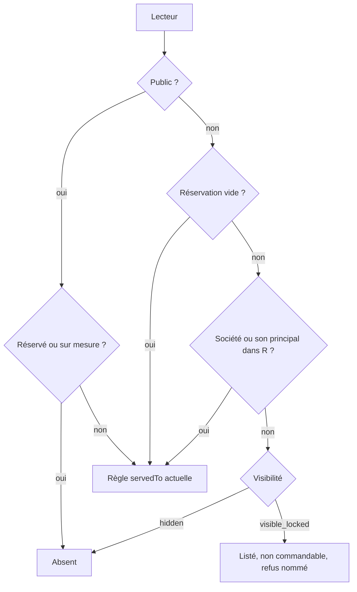
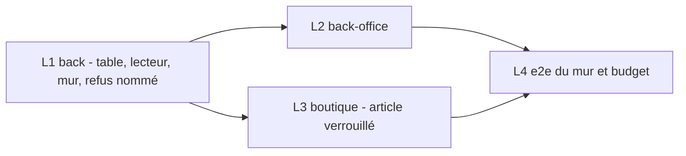

# Articles sur mesure — réservés à des comptes pros

> 📐 Plan (Hugo, 2026-10-30). L1a commité, L1b bâti (§ 10 bis). **Révision 2**
> (2026-10-30) : contredit par `vitruve`, objections intégrées — cf. § 11.
> Chaque affirmation sur l'existant cite un `fichier:ligne` ouvert le
> 2026-10-30 (chemins relatifs à `apps/lfd-api/`). Contradiction de `vitruve`
> obligatoire avant bâti : le plan déplace une frontière de sécurité (qui voit
> quoi).

## 1. Le besoin et les décisions

Hugo veut des produits faits sur demande pour certains pros. Décisions prises
le 2026-10-30 :

- **Le PIM ne change pas.** La fiche est une fiche normale, en audience `pro`.
  Le PIM ne connaît pas les sociétés (pim → b2b interdit, CLAUDE.md §3).
- **Côté commerce** (`src/b2b/catalog`), un article peut être marqué
  **« sur mesure »** et **réservé** à une liste de sociétés. Sans réservation,
  il reste ouvert à tous les pros, comme aujourd'hui.
- **Visibilité réglée article par article au back-office** (Hugo : « visibilité
  à décider en admin ») :
  - `hidden` : invisible aux autres pros — le défaut ;
  - `visible_locked` : visible mais non commandable.
- **Le marqueur « sur mesure »** existe en propre (Hugo : « j'aime bien sur
  mesure ») et s'affiche au back-office. Usages possibles plus tard : fiche
  atelier du fournil, étiquettes, rapports. Rien de tout ça n'est bâti ici.
- **La règle tient dans la REQUÊTE**, comme `company_id` : catalogue servi,
  devis, passation (refus nommé), rejeu idempotent.
- **Les sites héritent de leur principal.**
- **Le prix vient de la mercuriale du client**, qui existe déjà.
- **Un particulier ne se voit jamais servir un article sur mesure.**

## 2. L'existant (ouvert)

### Le mur d'aujourd'hui ne lit que l'audience

- `servedTo(item, viewer)` est la règle unique du masquage : audience,
  masquages, attentes de validation (`src/b2b/catalog/domain/served-to.ts:46-54`).
  Son JSDoc dit « quatre lectures directes » mais en énumère **cinq** — le
  rayon, la fiche et le lot de SKU (donc la commande), l'éditeur de vitrine, le
  résumé « en vente », l'export (`served-to.ts:41-44`, ouvert le 2026-10-30).
  Le L1 corrige le compte en y ajoutant la réservation.
- `PrismaCatalogReader` l'applique dans `findSku`
  (`src/b2b/catalog/infrastructure/prisma-catalog.reader.ts:122-132`),
  `findByShopSku` (:135-148), `listByShopSkus` (:150-171) et `listSellable`
  (:173-211), via `servedToViewer` (:249-260).
- **Aucune de ces méthodes ne reçoit de société** : leur seul paramètre est
  l'audience (`ShopAudience`).
- `findSku` n'a **aucun appelant de production** (grep du 2026-10-30) : un
  e2e (`test/catalog-ingest.e2e-spec.ts:279,287`) et des doublures de tests.
  Le L1 le **retire du port** (`domain/ports/catalog.reader.ts:176`) et
  bascule l'e2e sur `findByShopSku` : une méthode sans lecteur qu'il faudrait
  quand même murer est une surface gratuite.
- `ProductCatalogReader.all()` (`catalog-backed-product-catalog.ts:70-77`) ne
  reçoit **rien** : il lit `listSellable("pro")` en dur.

### Colonnes et prix

- L'article porte `audience`, `publicReviewPending`, `proReviewPending`
  (`prisma/schema/public/catalog.prisma:410-431`).
- Les masquages par audience vivent dans `CatalogItemOverride` (`is_hidden`,
  `is_hidden_public`) (`catalog.prisma:582-630`).
- La mercuriale est rangée par `companyId` opaque, sans clé étrangère
  (`prisma/schema/public/pricing.prisma:289-298`).

### Les deux rayons pro

- **Rayon pro anonyme** (landing `/pro`) : servi « sans société », par
  construction (`src/b2b/catalog/application/queries/read-shop-catalogue.ts:45-53`).
- **La mise en avant n'a pas de société** : `GET /shop/featured` est
  `@Public()` et reçoit l'audience en paramètre de requête
  (`src/b2b/catalog/http/shop-featured.controller.ts:40-52`). La version 1 de
  ce plan la rangeait parmi les chemins « avec société » : faux.
- **Rayon reconnu** : `src/b2b/orders/http/my-shop-catalogue.controller.ts:36-38`,
  avec `@ActingCompany()`.
- Les deux passent par `ShopCataloguePricing.priced(companyId)`
  (`src/b2b/catalog/application/shop-catalogue-pricing.service.ts:108-113`),
  puis `listSellable(audience)` (:148).

### Le chemin qui facture

- Devis : `src/b2b/orders/http/my-shop-quote.controller.ts:49-55`, avec
  `@ActingCompany()`.
- Devis et commande résolvent le catalogue en un lot par
  `ProductCatalogReader.resolveMany(skus, audience)`. L'audience est déduite de
  `parties.companyId === null`
  (`src/b2b/orders/application/services/order-line-pricing.service.ts:124-125`
  minimums d'une révision, :152-156 devis, :215-216 `priceAll`).
- Un SKU absent est refusé avant toute lecture de prix (`foundOrRefused`,
  :217-228).
- **Révision** : les lignes gardées ne passent PAS par `priceAll`. Elles
  reprennent leur prix figé ; seules les nouvelles sont tarifées, et le
  minimum d'une ligne gardée dont la quantité change se relit par
  `minimumsOf` (`order-composition.service.ts:247-278`,
  `order-line-pricing.service.ts:117-129`). Un SKU absent de la table des
  minimums est **sauté**, pas refusé (`domain/services/revised-lines.ts:146-160`).

### Les autres lecteurs du catalogue

L'inventaire complet, appelant par appelant, est au § 6 (grep refait le
2026-10-30 sur `listSellable`, `listByShopSkus`, `findByShopSku`, `findSku`,
`resolveMany`, `resolve`, `all()`, `servedTo`, `servedToAnyone`).

### Les abonnements (ouvert le 2026-10-30)

- La création (`src/b2b/subscriptions/application/commands/create-subscription.handler.ts:60-94`)
  ne résout **pas** le catalogue : elle demande seulement les SKU vendus par
  opération (`sale.operationOnlyAmong`, :64) et au poids
  (`saleUnits.weightSoldAmong`, :69), puis construit l'agrégat. Aucun mur
  d'audience aujourd'hui, a fortiori aucun mur de société.
- La dérogation d'une occurrence
  (`upsert-occurrence-override.handler.ts:43-54`) écrit aussi des lignes, par
  le même chemin.
- **La génération des occurrences en commandes n'existe pas dans le code** :
  `fromSubscriptionId` n'est écrit que par le semis
  (`prisma/seed-growth/phase-revenue.ts:93`) ; aucun service de
  `src/b2b/subscriptions/` ni de `src/b2b/orders/` n'appelle `priceAll` pour
  un abonnement (grep du 2026-10-30).

### Sites et principal

- `readCompanyStanding` donne le **rôle d'une personne** dans une société ;
  l'héritage passe par `parentCompany`
  (`src/b2b/shared/company-standing/infrastructure/read-company-standing.ts:62-88`),
  exposé en `via` (`domain/company-standing.ts:36-37`).
- ⚠️ `via` n'est rempli que si la personne hérite son rôle du principal
  (`read-company-standing.ts:112-125`) : un membre **propre** d'un site a
  `via = null`. La réservation lit donc le **`parent_company_id` de la société
  servie**, pas le `via` de la personne — même relation (:76), relue à chaque
  requête.
- L'héritage n'ouvre que si le **principal est `active`**
  (`inheritedSiteWhere`, `read-company-standing.ts:36-40`). La réservation
  suit la même condition : un principal suspendu n'ouvre plus rien à ses sites.
- Le contexte de requête ne porte que `companyId`
  (`src/platform/auth/acting-company.decorator.ts`, `resolve-company.ts:58-66`) :
  le parent n'y est pas, il faut le lire.

## 3. Les règles

R = l'ensemble des sociétés auxquelles l'article est réservé (vide = pas de
réservation).

- **S1. Qui y a droit.** Un article réservé à R est servi à un pro reconnu pour
  la société C si C ∈ R ou `parent(C)` ∈ R. R vide : rien ne change.
- **S2. Les autres pros, et le pro anonyme.**
  - `hidden` : absent, comme un SKU inconnu ;
  - `visible_locked` : listé avec `orderable: false` et la raison
    `reserved_to_other_account`. Devis et commande le refusent par une erreur
    nommée `ReservedArticleRefused`, distincte de « SKU inconnu ».
- **S3. Le public.** Un article réservé ou marqué sur mesure n'est **jamais**
  servi au public, quelle que soit son audience PIM. `ServableItem` gagne
  `isReserved` et `isMadeToOrder`, et S3 est tenu à trois endroits, chacun
  par la même fonction :
  - `servedTo(item, "public")` rend `false` (`served-to.ts:46-54`) ;
  - `servedToAnyone(item)` (`served-to.ts:63-65`) ne peut plus dire « oui »
    par sa branche `pro` pour un article réservé ou sur mesure : l'éditeur de
    vitrine (`catalog-backed-storefront-catalog.reader.ts:24`) et les ventes
    d'opération (`catalog-backed-operation-sale.reader.ts:25`) l'appellent, et
    la vitrine est publique. Réécrite : `servedTo(item, "public") ||
(servedTo(item, "pro") && !item.isReserved && !item.isMadeToOrder)` ;
  - `listSellable("public")` des coffrets (`catalog-bundle-articles.ts:31`) et
    leur verdict `servedTo(line, "public")` (:45) passent par la première
    règle, sans code propre.
- **S4. Le marqueur.** « Sur mesure » est indépendant de la réservation : il
  affiche, il ne restreint rien chez les pros. Un article sur mesure sans
  réservation reste ouvert à tous les pros, jamais au public (S3).
- **S5. Le staff** voit tout, avec une étiquette. La saisie staff **au nom
  d'une société** passe par le chemin qui facture, donc par S1–S2.
- **S6. Rejeu idempotent.** Une commande rejouée avec la même clé rend le
  résultat enregistré, sans réévaluer. Une révision réévalue les lignes
  nouvelles ; les lignes gardées ne sont pas re-refusées (cohérent avec le
  « prix figé », `order-line-pricing.service.ts:107-111`). Mécanisme au § 5.
- **S7. Le visible non commandable.** `locked` n'est traité comme tel que par
  **le rayon reconnu** et **les habituels** (staff : `list-customer-skus` ;
  client : `list-my-usuals`). **Tout autre appelant reçoit `locked` comme
  `absent`** — le port ne le leur rend même pas (§ 5).



## 4. Modèle de données

### Une table, pas une colonne

La réservation vise N sociétés. Une colonne `text[]` interdirait la clé unique
par société, l'index « quels articles pour la société C » (fiche client) et
l'audit de qui a réservé et quand. La table suit la convention de la
mercuriale : `companyId` opaque, sans clé étrangère (`pricing.prisma:289-298`).

### RGPD et irréversibilité

- `reserved_by` est l'identifiant d'un membre du staff : il entre au registre
  `documentation/legal/rgpd-registre.json` (`lint:rgpd-staff`), avec sa durée
  ou en durée non décidée comptée.
- **Retirer une réservation est irréversible côté client** : en `hidden`,
  l'article devient visible à tous les pros à l'instant même, nom, photo et
  composition d'une recette faite pour un seul client compris. Un pro qui l'a
  vu ou commandé ne l'oublie pas. L'écran demande une confirmation qui le dit,
  et le geste est journalisé.

### Migration additive `2026103xxxxxxx_les_articles_sur_mesure`

- **Table `catalog_item_reservations`** : `sku` (FK vers `catalog_items.sku`,
  `ON DELETE RESTRICT` — un article n'est jamais supprimé physiquement),
  `company_id text NOT NULL`, `reserved_at timestamptz NOT NULL`,
  `reserved_by text NOT NULL`, `PRIMARY KEY (sku, company_id)`,
  `INDEX (company_id)`. Colonne `reserved_by` au registre RGPD
  (`lint:rgpd-staff`).
- **Sur `catalog_item_overrides`** (là où vit déjà le masquage, sans toucher
  les colonnes projetées du PIM) :
  - `is_made_to_order boolean NOT NULL DEFAULT false` ;
  - `reserved_visibility text NOT NULL DEFAULT 'hidden'`,
    `CHECK (reserved_visibility IN ('hidden','visible_locked'))`.
- `SET lock_timeout = '5s'`. Retour : `DROP` des deux colonnes et de la table.

### CRUD, pas d'agrégat

Aucun invariant entre lignes : existence du SKU et unicité du couple. Des
commandes CQRS (`ReserveArticleCommand`, `ReleaseArticleCommand`,
`SetMadeToOrderCommand`, `SetReservedVisibilityCommand`) sur le modèle de
`SetMaskingCommand` (`src/b2b/catalog/application/commands/set-masking.command.ts:8-15`).
Chaque geste est journalisé et vide le cache des matériaux de prix s'il en
dépend.

## 5. Le mur : un seul endroit, le lecteur du catalogue

Le paramètre `audience: ShopAudience` devient un `CatalogViewer` :

```
{ kind: "public" }
| { kind: "pro_anonymous" }
| { kind: "pro", holders: ReservationHolders, show: "served" | "served_and_locked" }
| { kind: "staff", regarding: string | null }
```

- `ReservationHolders` = `{ companyId, activePrincipalId: string | null }`,
  **seulement** fabriqué par la requête partagée (ci-dessous) : un appelant ne
  peut pas inventer un principal.
- `show` vaut `"served"` par défaut ; seuls le rayon reconnu et les habituels
  passent `"served_and_locked"` (S7).
- `staff` voit tout ; `regarding` (une société, ou `null`) sert aux écrans de
  la fiche client, qui étiquettent « réservé à ce compte » / « réservé à un
  autre compte ».

`servedToViewer` (`prisma-catalog.reader.ts:249-260`) appelle une fonction de
domaine pure `servedToViewer(item, reservation, viewer)` qui rend `served`,
`locked` ou `absent` (S1–S3, S7).

Pourquoi un type somme : un appelant qui oublie la société ne compile plus.
Aujourd'hui, `"pro"` sans société vaut « tous les pros ».

### La lecture : deux questions, une opération

Le lecteur ne charge **jamais** la liste des réservataires d'un article pour
un client. Il pose deux questions, dans le `findMany` qu'il fait déjà :

```ts
include: {
  category: true,
  override: { select: DECISION_COLUMNS },          // + isMadeToOrder, reservedVisibility
  _count: { select: { reservations: true } },      // « est-il réservé ? »
  reservations: {                                  // « réservé à moi ? »
    where: { companyId: { in: holdersOf(viewer) } }, // [C] ou [C, parent(C)]
    select: { companyId: true },
    take: 1,
  },
}
```

`SchemaOpsCounter` compte **un appel ORM**, `include` compris
(`src/platform/database/schema-ops.counter.ts:13-17`). Pour `staff`, la
relation est chargée entière (écran du personnel, catalogue de quelques
centaines d'articles) ; pour `public` et `pro_anonymous`, seul `_count`.

### Le principal : une lecture de plus, et le budget

Le parent n'est pas dans le contexte de requête (§ 2). Il faut donc **une**
lecture de plus par requête pro reconnue — sauf à la fondre dans la résolution
d'accès, qui vit dans `platform/` et ne doit rien savoir du commerce.

- Requête partagée **`readReservationHolders(prisma, companyId)`**, dans
  `src/b2b/shared/company-standing/infrastructure/` à côté de
  `readCompanyStanding`, pour que `lint:company-role-readers` tienne la
  relation site → principal en un seul endroit. Elle rend `activePrincipalId`
  **seulement si le principal est `active`**, comme `inheritedSiteWhere`
  (`read-company-standing.ts:36-40`). Le L1 vérifie que la porte l'admet et
  que `lint:prisma-model-ownership` accepte la lecture de `Company` depuis
  `b2b/shared`.
- **Budget** (`test/pricing-budget.e2e-spec.ts`) : `COLD_QUOTE_OPS = 7`
  (:172) mesure `POST /shop/quote` **sans jeton** (:213-217), donc sans
  société. Il **ne bouge pas** : le lecteur public n'a pas de principal à lire,
  et la réservation tient dans l'`include`. Les devis et commandes **reconnus**
  coûtent **+1 constante** (le parent), indépendante du panier. Le L4 ajoute
  au fichier un cas froid sur `/shop/quote/mine` qui épingle ce +1 avec sa
  raison datée, au format des paragraphes « Il est passé de… » (:121-168).
  Promettre zéro serait faux.

### Les lignes gardées d'une révision

Elles ne passent déjà pas par `priceAll` (§ 2) : rien à exempter pour le
prix. Le seul point de contact est `minimumsOf`, qui relit le catalogue pour
les lignes gardées dont la quantité change. Il passe un lecteur
**`{ kind: "pro", …, waiveReservation: true }`** — variante qui ne lit que des
SKU déjà commandés par cette commande, et que **seul** `minimumsOf` construit.
Sans elle, un article dont la réservation a été retirée tomberait `absent`, et
`ensureKeptMinimums` sauterait son minimum en silence
(`revised-lines.ts:152-154`). Les lignes **nouvelles** passent `priceAll` avec
le lecteur ordinaire : S1–S2. Q4 est ainsi tranchée.

### Le cache

Règle écrite dans le JSDoc du lecteur : **aucun cache clé par audience ne
porte d'article réservé.** Aujourd'hui le catalogue n'est pas mis en cache
(le cache des matériaux de prix ne porte pas d'article — à rouvrir au L1 dans
le service de matériaux avant de l'affirmer dans le code). Un futur cache de
réponse du rayon **doit être clé par société**, ou ne garder que les
articles non réservés.

## 6. Inventaire des chemins, et le lecteur que chacun passe

Règle : **`staff` seulement derrière une route protégée par une permission
staff, ou pour un usage interne qui ne rend rien à un client** (fournil,
production, livraison). Tout ce qui rend un article à un client passe la
société. Grep refait le 2026-10-30 ; chemins relatifs à `apps/lfd-api/src/b2b/`.

### Ce qui sert un client

| Appelant                                   | Entrée (ouverte)                                                                                                                                                          | Lecteur                              | Pourquoi                                                                                              |
| ------------------------------------------ | ------------------------------------------------------------------------------------------------------------------------------------------------------------------------- | ------------------------------------ | ----------------------------------------------------------------------------------------------------- |
| Rayon reconnu                              | `orders/http/my-shop-catalogue.controller.ts:36-38` → `catalog/application/shop-catalogue-pricing.service.ts:108-113,148`                                                 | `pro` + holders, `served_and_locked` | S7 : `locked` listé grisé                                                                             |
| Rayon pro anonyme                          | `catalog/application/queries/read-shop-catalogue.ts:51-52`                                                                                                                | `pro_anonymous`                      | réservé = absent, même `visible_locked` (Q2)                                                          |
| Rayon public                               | `read-shop-catalogue.ts:54`                                                                                                                                               | `public`                             | S3                                                                                                    |
| Mise en avant                              | `catalog/http/shop-featured.controller.ts:40-52` → `read-shop-featured.handler.ts:34`                                                                                     | `pro_anonymous` ou `public`          | route `@Public()`, aucune société                                                                     |
| Devis                                      | `orders/http/my-shop-quote.controller.ts:49-55` → `order-line-pricing.service.ts:152-156`                                                                                 | `pro` + holders                      | `locked`/réservé → `ReservedArticleRefused`                                                           |
| Passation, lignes nouvelles d'une révision | `order-line-pricing.service.ts:215-228` (`priceAll`)                                                                                                                      | `pro` + holders, ou `public`         | 409 `reserved_article` avec le SKU                                                                    |
| Minimums des lignes gardées                | `order-line-pricing.service.ts:117-129`                                                                                                                                   | `pro` + `waiveReservation`           | § 5                                                                                                   |
| Opérations datées du panier                | `catalog/application/sale-operations.service.ts:64,95,139`                                                                                                                | celui de l'appelant (devis/commande) | même résolution que la ligne                                                                          |
| Suggestions du panier                      | `recommendations/application/queries/read-cart-suggestions.handler.ts:36-48` → `catalog-cart-suggestions.ts:25`, `recommendation-filter.ts:55,98`                         | `pro` + holders, `served`            | `locked` jamais suggéré                                                                               |
| Habituels du client                        | `recommendations/application/queries/list-my-usuals.handler.ts:45-68`                                                                                                     | `pro` + holders, `served_and_locked` | S7                                                                                                    |
| Vitrine (éditeur et page publique)         | `storefront/infrastructure/catalog-backed-storefront-catalog.reader.ts:24` (`servedToAnyone`)                                                                             | — (fonction de domaine)              | S3 dans `servedToAnyone`                                                                              |
| Opérations sur la vitrine                  | `operations/infrastructure/catalog-backed-operation-sale.reader.ts:25` (`servedToAnyone`) ; `storefront/infrastructure/catalog-backed-storefront-operations.reader.ts:41` | —                                    | S3 ; le L1 vérifie qu'une opération ne liste pas un SKU réservé hors de ce filtre                     |
| Coffrets                                   | `bundles/infrastructure/catalog-bundle-articles.ts:31,45`                                                                                                                 | `public`                             | S3                                                                                                    |
| Heure limite (refus et avis au client)     | `orders/application/services/order-cutoff-gate.service.ts:54,79`, `order-cutoff-notice.service.ts:31`                                                                     | `staff`                              | ne lit que la famille d'articles déjà admis par `priceAll` ; ne rend aucun article qu'il n'a pas reçu |
| Recherche                                  | côté front, sur le rayon                                                                                                                                                  | —                                    | **à vérifier AU L1** qu'aucune recherche serveur n'expose le catalogue                                |

### Ce qui ne rend rien à un client

| Appelant                                   | Entrée (ouverte)                                                                                                                                                   | Lecteur                                             | Protection                                                                                                                       |
| ------------------------------------------ | ------------------------------------------------------------------------------------------------------------------------------------------------------------------ | --------------------------------------------------- | -------------------------------------------------------------------------------------------------------------------------------- |
| Catalogue staff (saisie)                   | `orders/application/queries/list-catalog.handler.ts:21` via `orders/http/admin-catalog.controller.ts:51` et `catalog/http/admin-catalog.controller.ts:68`          | `staff` (`all(viewer)`)                             | `@AdminSurface("b2b_orders")` (:23), `@AdminSurface("lfc_catalog")` (:19) ; la commande passe ensuite `priceAll` avec la société |
| Habituels vus par le staff                 | `orders/http/admin-catalog.controller.ts:62-65` → `list-customer-skus.handler.ts:46`                                                                               | `pro` + holders de `companyId`, `served_and_locked` | montre au staff ce que CE client peut commander                                                                                  |
| Tarifs de la fiche client                  | `pricing/application/queries/company-pricing.query.ts:87`                                                                                                          | `staff`, `regarding: companyId`                     | étiquette Q1                                                                                                                     |
| Tableau des prix                           | `pricing/infrastructure/prisma-pricing-board.reader.ts:128`                                                                                                        | `staff`                                             | surface staff                                                                                                                    |
| Limites, planchers                         | `list-price-limits.handler.ts:25`, `set-price-floor.handler.ts:53`, `confirm-price-floor.handler.ts:48`                                                            | `staff`                                             | surface staff                                                                                                                    |
| Projection, référentiels de prix, gabarits | `price-projection.query.ts:66`, `mercuriale-benchmark.query.ts:58`, `price-templates.query.ts:48`, `pricing/infrastructure/catalog-sale-reference.reader.ts:32-33` | `staff`                                             | surface staff ; les deux audiences lues aujourd'hui deviennent une lecture `staff`                                               |
| Noms de portée, journal                    | `pricing/application/scope-names.ts:32,37`, `legacy-journal-subjects.ts:34`                                                                                        | `staff`                                             | libellés du journal staff                                                                                                        |
| Familles d'audiences                       | `audiences/infrastructure/catalog-audience-family.reader.ts:32`                                                                                                    | `staff`                                             | écran staff des audiences                                                                                                        |
| Choix de suggestions staff                 | `recommendations/infrastructure/catalog-suggestion-catalogue.ts:24-25`, `catalog-audience-sku.reader.ts:18-19`                                                     | `staff`                                             | éditeur staff ; le client reçoit la suggestion via `recommendation-filter` (au-dessus)                                           |
| Réassort                                   | `resupply/infrastructure/catalog-resupply-catalogue.ts:25,32`                                                                                                      | `staff`                                             | boutiques propres, interne                                                                                                       |
| Export CSV, résumé                         | `catalog/domain/services/catalog-csv.ts:97`, `get-catalog-summary.handler.ts:47`                                                                                   | `staff`                                             | colonnes « sur mesure », « réservé à N »                                                                                         |
| Fournil : articles vendables, étagères     | `catalog/infrastructure/catalog-sellable-articles.reader.ts:37-38`, `catalog-workshop-shelves.reader.ts:36`                                                        | `staff`                                             | production, interne                                                                                                              |
| Unités de vente                            | `catalog/application/article-sale-units.service.ts:27-28`                                                                                                          | `staff`                                             | ne rend qu'un mode de vente par SKU déjà demandé                                                                                 |
| Livraison : produits des bacs              | `catalog/infrastructure/catalog-delivery-products.reader.ts:30`                                                                                                    | `staff` (`all(viewer)`)                             | grille des bacs, interne                                                                                                         |
| `findSku`                                  | aucun appelant de production                                                                                                                                       | —                                                   | retiré du port (§ 2)                                                                                                             |

### Abonnements

- **Création** (`create-subscription.handler.ts:60-94`) et **dérogation
  d'occurrence** (`upsert-occurrence-override.handler.ts:43-54`) : le L1
  ajoute une résolution `resolveMany(skus, { kind: "pro", holders })` avant
  l'agrégat, et refuse par `ReservedArticleRefused` comme le devis.
- **Génération** : elle n'existe pas (§ 2). Le plan pose la règle pour le
  jour où elle sera bâtie : elle passera par `priceAll` avec le lecteur de la
  société, donc S1–S2 s'appliquent à **chaque** occurrence. **Q7 pour Hugo** :
  si l'article n'est plus réservé au client au moment de générer, proposition
  — l'occurrence n'est **pas** générée, et une alerte staff nommée
  (« occurrence du <date> non générée : <article> n'est plus réservé à
  <société> ») part ; **jamais** une commande silencieusement amputée d'une
  ligne.

### Mercuriale (Q1)

La garde reste au L1, **conditionnelle à la réponse de Hugo** : refus à
l'écriture d'une ligne de mercuriale de C sur un article réservé à un autre
compte. Si la réservation change après coup, la ligne de prix **reste** (pas
de suppression), mais l'article n'est plus commandable par C ; l'écran Tarifs
de la fiche (`company-pricing.query.ts:87`, lecteur `staff` `regarding: C`)
l'étiquette « réservé à un autre compte ».

## 7. Écrans

- **Fiche client, « Articles réservés »** : les articles réservés à la
  société, et ceux hérités du principal (lecture seule, « via <principal> »).
  Ajouter, retirer.
- **Article au back-office** : badge « Sur mesure », « réservé à N comptes »
  dépliable, réglage « Invisible aux autres pros » / « Visible, non
  commandable ».
- **Catalogue admin** : filtre « sur mesure ».
- **Boutique** : article `locked` grisé avec sa raison.

## 8. Lots



- **L1 back** : migration, `CatalogViewer`, `servedToViewer` pur, lecture de la
  réservation dans la même requête, `readReservationHolders`, propagation à
  chaque appelant du § 6, retrait de `findSku`, `ReservedArticleRefused`,
  mur à la création d'abonnement et à la dérogation d'occurrence,
  commandes d'administration, garde de la mercuriale (si Q1 = oui),
  vérification de la recherche serveur, correction du JSDoc de `servedTo`.
- **L2 back-office** : les écrans du § 7.
- **L3 boutique** : `orderable:false` grisé, rien dans les suggestions.
- **L4** : e2e du mur et budget.

## 9. Tests

- **Unitaires** : la table de vérité de `servedToViewer` (public, anonyme, pro
  dans R, site dont le principal est dans R, autre pro × hidden /
  visible_locked, staff).
- **e2e du mur** :
  1. A réservataire de X (`hidden`) : B ne voit X ni au rayon, ni en
     suggestions, ni en mise en avant ; devis et commande de B refusés
     (`reserved_article`).
  2. Un site S de principal A, membre **propre** de S : voit X et le commande.
  3. `visible_locked` : B voit X `orderable:false`, commande refusée.
  4. Anonyme et public : X absent, coffrets compris.
  5. Rejeu de la commande de A après retrait de la réservation : résultat
     initial rendu.
  6. Mercuriale de B sur X : refusée.
  7. X réservé à A, commandé par A, puis réservé à C seulement : la révision
     de A garde la ligne X, minimum toujours tenu ; une nouvelle ligne X
     ajoutée par A est refusée.
  8. Principal suspendu : le site S ne voit plus X.
  9. Abonnement de B sur X : refusé à la création.
- **Budget** : `COLD_QUOTE_OPS` (devis anonyme) inchangé à 7 ; nouveau cas
  froid `/shop/quote/mine` épinglé, +1 daté (le parent).

## 10. Questions ouvertes

- **Q1.** Refuser une ligne de mercuriale sur un article réservé à un autre
  compte ? Recommandé : oui, à l'écriture ; après coup, la ligne reste et
  l'écran l'étiquette (§ 6).
- **Q2.** `visible_locked` vaut-il au rayon pro anonyme ? Recommandé : non,
  invisible hors connexion.
- **Q3.** Réserver au principal ouvre à tous ses sites (supposé oui) ;
  réserver à un site n'ouvre pas le principal (supposé).
- ~~**Q4.**~~ Tranchée (§ 5) : la révision garde la ligne, minimum tenu ;
  une ligne nouvelle passe le mur.
- **Q5.** Le marqueur seul (sans réservation) bloque-t-il le public (S3) ?
- **Q6.** Usages du marqueur à bâtir plus tard : fournil, étiquettes,
  rapports — lesquels, quand ?
- **Q7.** Génération d'une occurrence d'abonnement dont l'article n'est plus
  réservé au client : ne pas la générer et alerter le staff (proposé), plutôt
  que l'amputer ?
- **Q8.** Un principal suspendu ferme les articles réservés à ses sites par
  héritage (supposé, comme `inheritedSiteWhere`) ?

## 10 bis. Réponses de Hugo (2026-10-30) et ordre des lots

- **Q1 oui**, et mieux : quand on pose une mercuriale chez un client, on ne
  **voit** que les articles auxquels il a droit (le sélecteur d'articles de la
  fiche Tarifs lit le catalogue avec le lecteur du client). Le refus à
  l'écriture reste, comme filet derrière l'écran.
- **Q2 non** : un pro non connecté ne voit jamais un article réservé.
- **Q3** : l'héritage est gardé (réservé au principal → ouvert à ses sites) ;
  réservé à un site → n'encombre pas le catalogue du principal.
- **Q5 oui** : le marqueur seul ferme le public.
- **Q6 partout** : fiche atelier, étiquettes, rapports — lots ultérieurs.
- **Q7 ok** : occurrence non générée, alerte staff nommée.
- **Q8 oui** : un principal suspendu ferme les articles hérités.

**Ordre des lots, révisé par Hugo** : « commençons par créer la manière
d'identifier un article comme sur mesure, ensuite la page du commerce dans
laquelle on donne accès à cet article, et le reste devrait découler
naturellement ».

- **L1a** — le marqueur et la réservation : migration, commandes CQRS
  d'administration (marquer, réserver, retirer, régler la visibilité),
  lectures admin, et l'écran du back-office (article : badge, réglage ; fiche
  client : « Articles réservés »). Aucun mur encore.
  ✅ **Bâti le 2026-10-30, commité `b406da16b`** : migration
  `20261030160000_les_articles_sur_mesure`, routes `admin/catalog/made-to-order`,
  `:sku/made-to-order`, `:sku/reserved-visibility`, `:sku/reservation`,
  `:sku/reservations/:companyId` (PUT, DELETE), `reservations/:companyId`
  (surface `lfc_catalog`) ; cinq faits `catalog_item.*` ; panneau « Sur
  mesure… » au catalogue publié, onglet « Articles réservés » de la fiche
  (`lfc_catalog:read`). Reste hors L1a : le filtre « sur mesure » du catalogue
  admin (§ 7), et `readReservationHolders` (L1b) — la fiche lit le principal
  par `parent_company_id` dans le lecteur d'administration.
- **L1b** — le mur (§ 5, § 6) : `CatalogViewer`, `servedToViewer`, refus
  nommé, S3, sélecteur de la mercuriale filtré.
  🟦 **Bâti le 2026-10-30, non commité.** `CatalogViewer` remplace l'audience
  dans `CatalogReader` et `ProductCatalogReader` (`findSku` retiré du port) ;
  `servedToViewer` pur (`catalog/domain/served-to-viewer.ts`) ; S3 dans
  `servedTo` et `servedToAnyone` ; `readReservationHolders` dans
  `b2b/shared/company-standing` (la fiche « Articles réservés » lit le
  principal par `readSitePrincipal`, même fichier) ; `CatalogViewers`, seule
  fabrique d'un lecteur pro reconnu ; `ReservedArticleRefusedError` (409,
  code `catalog.reserved_article`) ; lignes gardées par `keptLinesViewer` ;
  mur à l'abonnement (`ReservedArticleGuard`) et règle Q7 écrite
  (`subscriptions/domain/services/reserved-occurrence.ts`, sans appelant tant
  que la génération n'existe pas) ; Tarifs filtrés et pose/avenant/report
  refusés (Q1). E2e : `test/made-to-order-wall.e2e-spec.ts`. Écarts au texte
  du plan, à trancher : un lecteur `staff` porte une **audience** (le prix
  d'entrée en dépend) et un `regarding` avec son **principal** ; un article
  `hidden` reste un **article inconnu** au devis (S2), alors que le § 9.1
  attendait `reserved_article` ; les opérations datées du panier lisent en
  `staff` (le mur est tenu par la porte du prix). Budget : `COLD_QUOTE_OPS`
  inchangé à 7, le cas froid `/shop/quote/mine` reste au L4.
- **L2…** — la suite du § 8.

~~⚠️ Entre L1a et L1b, une réservation posée ne restreint encore rien : l'écran
le dit (« la restriction s'appliquera au prochain déploiement ») et rien ne
part sur `main` entre les deux sans que Hugo le sache.~~ Levé au L1b
(2026-10-30) : le mur est bâti, l'annonce est retirée des deux écrans.

## 11. Contradiction de vitruve (2026-10-30)

| #   | Objection                                                                                                                                                        | Réponse                                                                                                                                                                           |
| --- | ---------------------------------------------------------------------------------------------------------------------------------------------------------------- | --------------------------------------------------------------------------------------------------------------------------------------------------------------------------------- |
| B1  | Inventaire incomplet : `all()` sans société et ses appelants, familles d'audiences, fournil, référence de vente, opérations, unités de vente, étagères, vitrine. | Grep refait ; § 6 donne pour **chaque** appelant le lecteur et la raison. `all()` prend un `CatalogViewer` ; ses six appelants sont staff ou internes.                            |
| B2  | Abonnements non inventoriés.                                                                                                                                     | Ouverts (§ 2, § 6) : la création ne lit pas le catalogue, la génération n'existe pas. Mur à la création et à la dérogation ; règle posée pour la génération future, Q7 pour Hugo. |
| B3  | Révision : les lignes gardées seraient re-refusées.                                                                                                              | Elles ne passent pas `priceAll` ; seul `minimumsOf` les relit, avec `waiveReservation` (§ 5). Q4 tranchée.                                                                        |
| S   | Budget « zéro requête » non tenu.                                                                                                                                | `include` + `_count` = une opération ; `COLD_QUOTE_OPS` (anonyme) ne bouge pas ; +1 constante sur les chemins reconnus (le parent), épinglée et datée au L4.                      |
| S   | Principal non actif.                                                                                                                                             | `readReservationHolders` dans `b2b/shared/company-standing`, principal `active` seulement.                                                                                        |
| S   | `findSku` ?                                                                                                                                                      | Aucun appelant de production : retiré du port.                                                                                                                                    |
| S   | `visible_locked` fuit vers d'autres lecteurs.                                                                                                                    | S7 : seuls rayon reconnu et habituels ; les autres reçoivent `absent` du port.                                                                                                    |
| S   | S3 ne couvre pas tous les chemins publics.                                                                                                                       | Tenu dans `servedTo`, `servedToAnyone` (réécrite) et `listSellable("public")` des coffrets (§ 3).                                                                                 |
| S   | Cache par audience.                                                                                                                                              | Règle écrite (§ 5) : aucun cache clé par audience ne porte d'article réservé ; un cache du rayon sera clé par société.                                                            |
| S   | Q1 mercuriale.                                                                                                                                                   | Garde au L1 conditionnelle à Hugo ; après coup, la ligne reste et l'écran l'étiquette.                                                                                            |
| S   | RGPD, irréversibilité.                                                                                                                                           | § 4 : `reserved_by` au registre ; retrait = exposition immédiate, confirmation et journal.                                                                                        |
| m   | « quatre lectures ».                                                                                                                                             | Cinq ; JSDoc corrigé au L1.                                                                                                                                                       |
| m   | Mise en avant « avec société ».                                                                                                                                  | Faux : route `@Public()` ; lecteur anonyme ou public.                                                                                                                             |
| m   | Recherche à vérifier au L2.                                                                                                                                      | Au L1.                                                                                                                                                                            |
