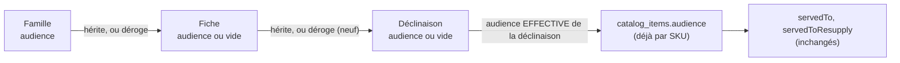

# L'audience par déclinaison — plan

> **Plan**, ouvert et contredit par `vitruve` le 2026-11-24, sur la demande de Hugo : le cookie des
> formules doit pouvoir être une **déclinaison** du cookie vendu, réservée au
> réassort des boutiques, et non une fiche à part. Suite de
> [`../reassort-boutiques/plan-articles-de-reassort.md`](../reassort-boutiques/plan-articles-de-reassort.md)
> (l'audience `resupply`, bâtie le même jour). Modèle suivi :
> [`plan-sur-mesure-par-declinaison.md`](plan-sur-mesure-par-declinaison.md),
> qui a fait le même trajet pour la case « Sur mesure ».

## 1. En deux mots

Aujourd'hui, « à qui l'on vend » se règle sur la **famille**, et la fiche peut
y déroger. Toutes les déclinaisons d'une fiche suivent la fiche. Demain, une
déclinaison peut déroger à son tour : le cookie se vend au public, sa
déclinaison « formule » se commande seulement en réassort.

Ce qui ne change pas : le mur `servedTo`, le réassort, les rayons, le devis,
la commande et le fournil lisent **déjà** l'audience par article
(`catalog_items.audience`, une ligne par SKU de déclinaison). Une exception
au commerce : la vue « Catalogue publié » du back-office juge ses cellules
sur l'audience de la **fiche** (§ 4 bis, 2). Le reste du changement tient au
référentiel, au fil et à l'écran de la fiche, comme pour le sur mesure.

⚠️ **Le cookie formule demandera les vignettes.** Une déclinaison autre que le
défaut ne paraît nulle part — ni au rayon, ni au réassort — si sa fiche ne
montre pas chaque déclinaison (`isShownAsTile`,
`lafoliecoffee/catalog/domain/shop-sku.ts` ; le réassort applique le même filtre,
`resupply/infrastructure/catalog-resupply-catalogue.ts`). La fiche du cookie
devra avoir « Montrer chaque déclinaison » coché.

## 2. Ce qui existe (ouvert le 2026-11-24)

- **Le référentiel** : `pim.product.audience` (nullable, hérite de la famille)
  et `pim.category.audience`, tenues par un `CHECK` qui admet `resupply`
  depuis `20261124140000_l_audience_du_reassort`. `ProductVariant`
  (`prisma/schema/pim/product.prisma`, modèle `ProductVariant`) n'a **aucune**
  colonne d'audience. Dans le domaine, l'audience de la fiche vit dans
  `ProductCommerceOptions` (`domain/value-objects/product-commerce-options.ts`),
  se règle par `SetProductAudienceCommand` (`sale/set-product-audience.ts`).
- **L'héritage** : `effectiveAudience(product, category)`
  (`shared/domain/value-objects/audience.ts`) — deux niveaux.
- **La complétude** : `variantGaps(variant, …, audience)` et
  `missingAudiencePrices` (`domain/services/variant-completeness.ts`) jugent
  **déjà une déclinaison** contre une audience, mais reçoivent celle de la
  fiche : `ProductCompleteness` (`product-completeness.ts:76`), la projection
  du fait (`catalog-fact-projection.ts:64,71`), les constats
  (`product-compliance.ts:89,97`).
- **Le fil** : le fait `catalog.product_changed` porte **une** audience, sur
  l'en-tête (`catalog-product-changed.fact.ts`, `audience` et
  `audienceInherited`). Les déclinaisons du fait (`syncVariantSchema` de
  `packages/catalog-sync`, étendu dans le fait) n'en portent pas.
- **Le commerce** : `on-catalog-product-changed.handler.ts:71` appelle
  `putOnSale(onSale, product.audience)`, qui écrit **la même** audience sur
  chaque article (`prisma-catalog-product-facts.projection.ts`, `putOnSale`),
  et pose les deux drapeaux de validation **à la création** de la ligne
  d'après elle (`awaitsReview`). `catalog_entries.audience` garde l'audience de
  la fiche (une ligne par fiche).
- **Le précédent du défaut** : `refuseCustomDefaultWithoutTiles`
  (`domain/entities/variant-lineup.ts`) refuse qu'un défaut sur mesure vive
  sur une fiche sans vignettes, aux trois gestes qui créeraient le cas
  (cocher le défaut, décocher les vignettes, changer de défaut). Décision (a)
  de Hugo du 2026-11-18.

## 3. Décisions proposées

- **A1. Trois niveaux d'héritage.** `pim.product_variants.audience text NULL`,
  `CHECK` sur les quatre valeurs. `NULL` = la déclinaison suit sa fiche (qui
  suit peut-être sa famille). `effectiveAudience` prend trois arguments ;
  écrite une fois, comme aujourd'hui. Aucune donnée à reporter : toute
  déclinaison naît `NULL`, c'est-à-dire exactement ce qu'elle vend aujourd'hui.
- **A2. Le défaut suit toujours la fiche.** Le défaut d'une fiche **n'a pas**
  d'audience propre : l'audience de la fiche _est_ celle de son défaut. C'est
  le seul moyen que « la fiche se vend à X » reste vrai à l'écran, et que la
  fiche ne disparaisse pas d'un rayon par son défaut. Inexprimable plutôt que
  refusé : le geste ne s'applique qu'à une déclinaison autre que le défaut.
  Trois gestes peuvent créer le cas, et refusent comme V5 (a) du sur mesure :
  - **changer de défaut** vers une déclinaison qui a sa propre audience :
    refus nommé (« cette déclinaison a sa propre audience : la remettre sur
    celle de la fiche avant d'en faire le défaut ») ;
  - **décocher les vignettes** d'une fiche dont une déclinaison a sa propre
    audience : refus nommé, puisque cette déclinaison ne paraîtrait plus nulle
    part. Les déclinaisons **arrêtées** comptent : sinon on arrêterait la
    formule, décocherait les vignettes, puis la restaurerait ;
  - **restaurer** une déclinaison à audience propre sur une fiche sans
    vignettes : refus nommé (`restoreVariant` reçoit les vignettes).
- **A3. Poser une audience demande les vignettes.** Le geste refuse sur une
  fiche qui ne montre pas chaque déclinaison (même raison qu'A2, second refus).
- **A4. Toute audience, plus large ou plus étroite.** Comme la fiche envers sa
  famille : une déclinaison peut se vendre aux pros seuls sur une fiche « les
  deux », ou au public sur une fiche « pros ». Pas de règle d'inclusion à tenir.
- **A5. La complétude est jugée par déclinaison**, contre son audience
  effective. Un prix n'est exigé que pour l'audience de **cette** déclinaison ;
  une déclinaison `resupply` n'exige aucun prix (`servedAudiences` rend `[]`).
  Les constats (`price_missing_for_audience`) suivent.
- **A6. Le fil porte l'audience effective de chaque déclinaison**, en plus de
  celle de l'en-tête (que `catalog_entries` garde). Champ **optionnel** à la
  réception : présent, il gagne ; **absent** (fait d'avant ce plan), on prend
  l'en-tête — c'est ce que fait le commerce aujourd'hui, donc rien ne
  s'élargit pendant le déploiement. Le champ entre dans `syncVariantSchema`
  (`packages/catalog-sync`, importé par une vingtaine de fichiers de `src/`)
  selon la règle maison « ajouté sans changer de version ».
  🔴 **L'autre sens n'est pas couvert : un retour arrière du code ouvre la
  formule au public.** Un code d'avant AD1 qui relit un fait neuf ignore le
  champ (le schéma n'est pas strict) et écrit l'audience de l'en-tête sur
  l'article. Après AD1, on ne revient pas en arrière sans d'abord remettre
  chaque déclinaison sur l'audience de sa fiche.
- **A7. `putOnSale` écrit l'audience de chaque article**, et pose les drapeaux
  de validation à la création **d'après l'audience de l'article**. Un
  élargissement ultérieur ne repasse rien en attente (inchangé) — **à
  trancher par Hugo** (§ 4, Q1).
- **A8. Le journal** : `variant.audience_changed` (`from` / `to`, nullable),
  émis par la méthode de l'agrégat `Product` (la déclinaison n'est pas un
  agrégat), dans la même unité de travail que l'émission de la fiche.

## 4. Questions pour Hugo

- **Q1 — l'élargissement d'une déclinaison vers le public.** Les drapeaux de
  validation se posent à la **création** de la ligne, d'après son audience
  d'alors, et ne se reposent jamais. Deux cas sortent de là :
  - une déclinaison **née** sur une fiche `pro` ou `resupply` (aucune attente
    publique posée), puis passée à `public` ou `both` : elle entre en vitrine
    **sans validation** ;
  - une déclinaison ajoutée sur la fiche publique du cookie naît `NULL`, donc
    `public` : elle attend sa validation publique, et quelqu'un peut la valider
    **avant** qu'on la passe en `resupply`. (Repassée au public plus tard, elle
    n'attendra rien.)
    Le premier cas existe déjà pour une fiche (élargie de `pro` à `both`, choix
    du lot 3). Proposé : **poser l'attente publique quand l'audience d'un
    article s'élargit au public** — par article, au commerce, à la réception du
    fait ; un geste du staff au référentiel reste un geste à regarder avant la
    vitrine. Alternative : garder la règle d'aujourd'hui et le dire à l'écran.
- **Q2 — l'écran.** Proposé : un sélecteur « Audience » dans la carte de chaque
  déclinaison autre que le défaut, à côté du nom de vitrine, avec « Comme la
  fiche (…) » en premier choix ; grisé avec sa raison sur une fiche sans
  vignettes.

## 5. Lots

- **AD1 back** : migration additive (colonne + `CHECK`, aucune donnée),
  `Variant` du domaine et ses mappers, `effectiveAudience` à trois niveaux,
  gestes A2/A3 dans `VariantLineup`, `SetVariantAudienceCommand` + route
  `PUT /pim/catalogue/products/:id/variants/:variantId/audience`, journal,
  complétude par déclinaison (A5), fil (A6), `putOnSale` par article (A7).
  Une déclinaison ajoutée naît `NULL`. Un **détachement** donne à la fiche
  neuve l'audience propre de sa déclinaison si elle en a une, sinon celle de
  la fiche d'origine telle qu'elle est posée (`null` compris : la fiche neuve
  continue de suivre sa famille) — jamais l'audience effective, qui figerait
  toute fiche détachée. Une restauration garde la valeur (sous le refus d'A2).
  **Au commerce**, dans le même lot : `catalog_entries.variants` (jsonb) porte
  l'audience de chaque déclinaison, et `cellInputOf`
  (`published-catalog-view.ts:137`) juge chaque cellule sur l'audience de sa
  déclinaison — `onSaleViewOf`, `proposedViewOf`, `incompleteViewOf` ;
  aujourd'hui seule la liste à valider lit `item.audience`. Côté référentiel,
  `list-products.ts:102`, `list-product-compliance-warnings.ts:71,119` et
  `activate-product.ts:89` passent à l'audience de chaque déclinaison pour la
  complétude et les constats.
- **AD2 back-office** : le sélecteur (Q2), la phrase du journal, l'audience
  affichée par ligne de déclinaison au catalogue publié (servie par AD1).
- **Tests** : domaine (héritage à trois niveaux, refus A2/A3, journal
  seulement si changé) ; complétude (une déclinaison `resupply` sans prix est
  complète ; une `pro` sur fiche `public` exige le prix pro) ; mapping (champ de
  la déclinaison, repli sur l'en-tête) ; e2e « cookie public, déclinaison
  formule `resupply` → absente de la vitrine et du catalogue pro, présente au
  réassort ; le cookie reste en vitrine » ; une déclinaison `resupply` **sans
  prix** s'active (régression corrigée le 2026-11-24 pour une fiche,
  `790bc3b8e`) ; une déclinaison masquée au public pendant sa vie publique
  reste absente du réassort une fois passée en `resupply` (`servedToResupply`
  refuse un article masqué) — comportement voulu, que l'e2e fixe.

## 5 bis. Contradiction de vitruve (2026-11-24), et ce qu'elle a changé

- **BLOQUANT — un article `resupply` sans prix levait une 500.** Vrai dès le
  lot B, pour une fiche : la projection du fait le jugeait « vendable sans
  prix » (`IncompleteVariantProjectedError`). Corrigé avant ce plan
  (`790bc3b8e`), test de régression compris.
- **SÉRIEUX** intégrés : le catalogue publié lisait l'audience de la fiche
  (AD1) ; le détachement aurait figé l'audience de toute fiche détachée (AD1) ;
  l'arrêt puis la restauration contournaient A2 (troisième refus) ; Q1 reposée
  sur ses deux vrais cas ; le retour arrière du code ouvre la formule (A6).
- **MINEURS** intégrés : `catalog-sync` est bien lu (A6) ; les lecteurs
  `list-products`, constats et `activate-product` (AD1).

## 6. Ce qui n'est pas vérifié

- `product-state.ts`, `product-rows.ts` : lecteurs de l'audience de la fiche
  — persistance seulement, à confirmer.
- Les mises en avant (`set-catalog-featured.handler.ts`) d'un article resserré
  en `resupply` : le drapeau reste posé ; filtré à la lecture par `servedTo`
  (à vérifier).
- `lint:context-version-columns` : la colonne neuve est au référentiel, pas
  dans une table que l'instantané du catalogue lit ; à confirmer au bâti.
- La route neuve et `lint:write-idempotence` : `@Idempotent` avec sa raison
  (poser une valeur est idempotent), comme ses voisines.
- Les quantités minimales par audience (`set-product-min-quantities.ts`) :
  posées sur la fiche, elles s'appliqueraient à une déclinaison d'une autre
  audience. Probablement sans conséquence (le minimum d'une audience que la
  déclinaison ne sert pas n'est jamais lu), à confirmer.
- Le semis (`prisma/seed-pim/`) et les e2e qui construisent des fiches : aucun
  ne pose d'audience de déclinaison, rien ne devrait casser.
