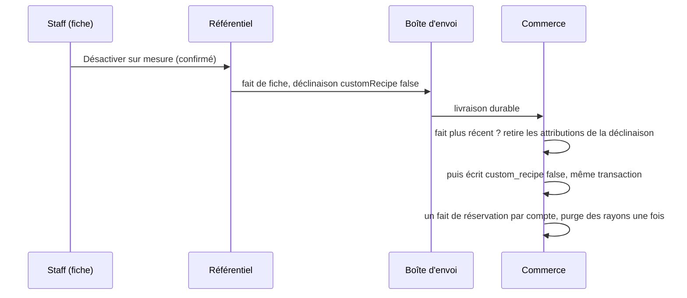

# Plan — une vignette par déclinaison, et seul le sur mesure s'attribue

> 🟦 Demandé par Hugo le 2026-11-27. **V1, V2, F1, F2 bâtis et partis en
> production ensemble.** F3 a été bâti (`561f72521`) puis **retiré de dev par
> un revert** pour ne pas partir avec eux : il se réapplique (`git revert` du
> revert) une fois l'opération ops appliquée et sa simulation à zéro (§ 4 bis). Contredit
> deux fois par `vitruve` le même jour (v1 et v2) ; cette v3 intègre ses
> objections et les décisions de Hugo qui ont suivi.
>
> Origine : le « Pain de campagne 2kg » (P-MCABJN-3), décoché « sur mesure »
> au référentiel, gardait ses quatre comptes attribués au commerce — donc
> restait caché à tous les autres pros, sans écran pour les retirer.

## 1. En simple

Trois changements, dans cet ordre :

1. **Chaque déclinaison en vente a sa vignette au rayon.** L'option « Montrer
   chaque déclinaison en vignette » disparaît, et ses colonnes avec.
2. **Seul un article sur mesure s'attribue à des comptes clients**, et la base
   le garantit. Quand une déclinaison cesse d'être sur mesure, le commerce
   retire lui-même ses comptes attribués en recevant la fiche.
3. **Le sur mesure a sa carte** sur la fiche, « Produit sur mesure (clientèle
   restreinte) », avec un bouton à confirmer.

Au déploiement, les articles ordinaires qui ont encore des comptes attribués
sont **passés sur mesure au référentiel** : la décision humaine est gardée,
pas effacée.

## 2. Ce qui existe (ouvert le 2026-11-27)

**Vignettes.**

- `pim.product.variants_as_tiles` (`prisma/schema/pim/product.prisma:75`) et
  sa copie `public.catalog_items.variants_as_tiles` (`catalog.prisma:401`),
  `NOT NULL DEFAULT true`.
- Règle du rayon : `isShownAsTile = isDefault || variantsAsTiles`
  (`lafoliecoffee/catalog/domain/shop-sku.ts:26`).
- Fil : `variantsAsTiles` requis au niveau fiche
  (`packages/catalog-sync/src/snapshot.ts:652`), optionnel ailleurs (`:819`) ;
  fil en v19.
- Geste : « set-product-variants-as-tiles » et son contrôleur (retirés en V1) ; journal
  `product.variants_as_tiles_changed` (`packages/contracts`) ; écran
  `variants-as-tiles-form` sur la fiche.
- L'agrégat refuse le défaut sur mesure d'une fiche sans vignettes (V5,
  `product.ts:108`, `CustomRecipeDefaultWithoutTilesError`).

**Sur mesure.**

- Référentiel : `SetVariantCustomRecipeHandler`
  (`pim/catalogue/product/variants/set-variant-custom-recipe.ts`) déclare,
  journalise `variantCustomRecipeChanged`, sauvegarde et émet la fiche dans
  **une** `uow.run`. Le fait porte `customRecipe` par déclinaison
  (`channels/b2b-platform/products/projection.ts:106`), pour les seules
  déclinaisons complètes et non arrêtées (`catalog-facts.ts:117-127`).
- Commerce : `OnCatalogProductChangedHandler` — `recordEntryIfNewer`
  (n'écrit que `catalog_entries`, garde `applied_seq`), puis `putOnSale`, qui
  écrit `catalog_items.custom_recipe` (`catalog-item-columns.ts:111`,
  `NOT NULL DEFAULT false`) pour les articles de `itemsOnSale` — vide pour une
  fiche inactive (`catalog-product-facts.ts:71-73`).
- Attributions : `public.catalog_item_reservations` (`sku`, `company_id`,
  `reserved_at`, `reserved_by`). `ReserveArticleHandler` lit l'article sans
  verrou puis `createMany({ skipDuplicates })` ; l'adaptateur de
  `ReleaseArticleHandler` fait le `deleteMany`.
- Le mur : `servedToViewer` — réservé → seuls les réservataires (sites
  compris) ; sur mesure sans réservataire → aucun pro (D3 de
  `plan-articles-sur-mesure.md`).
- Écran : `fold-checkbox` « Sur mesure » dans la section Identité
  (`product-form-page.html:225-249`) ; « Attribuer… » au Catalogue publié pour
  le seul sur mesure ; lecteur d'administration
  `prisma-made-to-order-admin.reader.ts:54` (`customRecipe OR réservé`).

## 3. Décisions

### V — Une vignette par déclinaison (Hugo, 2026-11-27)

- `isShownAsTile` disparaît : tout article en vente est en rayon. Ses
  appelants (rayon, mise en avant, réassort, filtres de SKU) perdent la
  condition.
- V5 tombe : le défaut d'une fiche peut être sur mesure.
- Le geste, son contrôleur, son écran et sa route disparaissent. Le **type**
  de fait `product.variants_as_tiles_changed` reste lisible au journal (une
  valeur écrite ne se renomme ni ne s'efface) ; plus rien ne l'émet.
- Le fil : `variantsAsTiles` devient optionnel au récepteur, puis l'émetteur
  ne l'envoie plus. Pas de nouvelle version de fil : un champ optionnel ignoré
  n'en demande pas.
- **Les deux colonnes disparaissent**, sur ordre de Hugo (§ 0 du CLAUDE.md :
  pas de suppression sans ordre explicite — donné le 2026-11-27). En **deux
  déploiements** : le code cesse de les lire et de les écrire ; la migration
  `DROP COLUMN` part au suivant. Une seule passe ferait tomber le conteneur
  encore en service entre la migration et le nouveau code.
- V5 n'était pas seul : trois refus de l'audience par déclinaison
  (`VariantAudienceWithoutTilesError`, `TilesHoldVariantAudienceError`,
  `RestoredVariantAudienceWithoutTilesError`) n'existaient que par l'option ;
  ils partent avec elle, et le sélecteur d'audience n'est plus grisé (constaté
  au bâti de V1, 2026-11-27).
- Le déclencheur `UPDATE OF` qui fait monter `context_versions` (migration
  `20261106120000`) cite `catalog_items.variants_as_tiles` : la colonne reste
  dans `CATALOGUE_SNAPSHOT_COLUMNS` en V1 (lue par le chargeur, ignorée de
  tous), et `test/context-versions.e2e-spec.ts` l'écrit encore. V2 recrée le
  déclencheur sans elle, la retire de la constante et de l'e2e, **puis** la
  supprime.
- Effet visible : les fiches à `variants_as_tiles = false` montrent leurs
  autres déclinaisons au rayon dès le premier déploiement. **À compter en
  production avant** (lecture seule).

### D1 — La carte « Produit sur mesure (clientèle restreinte) »

Une carte par déclinaison, sa propre section de la fiche (clé et navigation,
sortie de `section.key === 'identite'`). Elle dit l'état et porte un bouton
dans un `fold-inline-confirm` :

| État actuel | Bouton                    | Message de confirmation                                                                                                          |
| ----------- | ------------------------- | -------------------------------------------------------------------------------------------------------------------------------- |
| ouverte     | « Activer sur mesure »    | « Plus aucun pro ne verra cette déclinaison tant qu'elle n'est attribuée à aucun compte client, dans Catalogue publié. »         |
| sur mesure  | « Désactiver sur mesure » | « Cette déclinaison sera à nouveau accessible à toute son audience. Les comptes clients qui lui sont attribués seront retirés. » |

### D2 — Seul le sur mesure s'attribue (Hugo, 2026-11-27)

Réserver un article ordinaire est **abandonné**. La règle S1 de
[`plan-articles-sur-mesure.md`](plan-articles-sur-mesure.md) (réservation
indépendante du marqueur) et « un article réservé non sur mesure garde son
badge » (même doc, § 13) cessent de valoir ; cette doc est corrigée au même
commit.

**Invariant : un article qui n'est pas sur mesure n'a aucune attribution.**

### D3 — L'invariant est tenu en base

Un refus dans le handler ne suffit pas : `ReserveArticleHandler` lit
`custom_recipe` sans verrou, l'abonné l'écrit dans une autre transaction, et
au niveau `READ COMMITTED` l'attribution peut s'insérer après une mise à
`false` validée. La base le rend impossible :

- `catalog_items` : unicité `(sku, custom_recipe)` (cible de la clé) ;
- `catalog_item_reservations` : `custom_recipe boolean NOT NULL DEFAULT true
CHECK (custom_recipe)`, clé étrangère composite `(sku, custom_recipe) →
catalog_items (sku, custom_recipe)`, `ON UPDATE NO ACTION` ;
- passer à `false` un article attribué viole la clé. Modifier une colonne de
  clé référencée verrouille la ligne `FOR UPDATE`, ce qui sérialise la course
  avec le `FOR KEY SHARE` d'une insertion.

Le handler garde son refus pour la parole : `BusinessError`, « Seul un article
sur mesure s'attribue à des comptes clients. » La base est le filet.

### D4 — L'abonné retire avant d'écrire

Dans `OnCatalogProductChangedHandler`, après `recordEntryIfNewer` et **avant**
`putOnSale` : pour chaque article de `itemsOnSale(product)` dont
`customRecipe === false` (strict : un `undefined` venu d'un vieux fait ne
retire rien), retirer ses attributions. Même transaction que le reçu.

- L'ordre inverse ferait échouer la clé, et le fait finirait en lettre morte.
  L'ordre est éprouvé par un e2e.
- **Périmètre : les articles en vente.** Une fiche inactive ou une
  déclinaison arrêtée n'est pas réécrite : `custom_recipe` reste `true`, les
  attributions restent, la base est cohérente et rien n'est servi. Elles
  partent à son retour en vente, si elle revient décochée.
- Côté commerce, les deux écritures sont dans une seule transaction ; entre
  l'écriture du référentiel (`pim`) et la livraison, le commerce sert l'ancien
  état entier — le délai de toute fiche.
- Un fait ancien est inerte (`applied_seq`), sans danger : la base interdit
  l'état sale qu'il aurait pu laisser.
- Journal : un `ReservationChangedEvent` par compte, acteur `system` (l'abonné
  tourne hors requête ; la trace PIM nomme le staff), clé d'idempotence qui
  inclut la société. Noms des sociétés en **une** lecture ; `ShelfChanges`
  **une** fois.

### D5 — Rapprocher l'existant avant de poser la clé (Hugo, 2026-11-27)

Une attribution sur un article ordinaire est une décision humaine : on la
garde, en passant l'article **sur mesure au référentiel** — jamais au
commerce, que la fiche suivante écraserait.

1. **Lister** (lecture seule, commerce) les SKU qui ont une attribution et
   `custom_recipe = false`. Montrer la liste à Hugo.
2. **Passer chacun sur mesure** par le vrai geste `SetVariantCustomRecipe`,
   lancé par un outil ponctuel (`pnpm tool`) qui passe par le bus : trace au
   journal, fait de fiche émis, refus de l'agrégat le cas échéant. Pas de SQL
   sur `pim`, qui ne tracerait ni n'émettrait rien.
3. **Attendre la livraison** : chaque article repasse à `true` au commerce,
   attributions intactes. Relister : la liste doit être vide.
4. **Seulement alors**, la migration de D3. Si une ligne viole encore la clé,
   la migration échoue au déploiement — elle n'efface rien.

V (vignettes) passe d'abord : V5 tombé, aucun défaut ne refuse d'être sur
mesure à l'étape 2.

### D6 — Les écrans

- Catalogue publié : le lecteur d'administration ne rend plus que le sur
  mesure ; « Attribuer… » reste au seul sur mesure.
- `fiche-client/articles-reserves` : vérifier qu'il ne propose pas d'attribuer
  un article ouvert.

## 4. Lots

| Lot | Contenu                                                                                      | Tests                                                                                                                                                                                                                                                                                                                                                                                                                                         |
| --- | -------------------------------------------------------------------------------------------- | --------------------------------------------------------------------------------------------------------------------------------------------------------------------------------------------------------------------------------------------------------------------------------------------------------------------------------------------------------------------------------------------------------------------------------------------- |
| V1  | Vignettes : règle, V5, geste, écran, fil optionnel, plus rien ne lit ni n'écrit les colonnes | rayon : toute déclinaison en vente paraît ; défaut sur mesure accepté ; fil sans `variantsAsTiles` reçu                                                                                                                                                                                                                                                                                                                                       |
| V2  | Migration `DROP COLUMN` des deux colonnes (déploiement suivant)                              | `schema-drift`                                                                                                                                                                                                                                                                                                                                                                                                                                |
| F1  | Carte du sur mesure (D1) ; lecteur d'administration (D6)                                     | spec : libellé et message selon l'état, rien n'est envoyé sans confirmation                                                                                                                                                                                                                                                                                                                                                                   |
| F2  | Rapprochement (D5, étapes 1 à 3) : l'outil, la liste, le passage sur mesure                  | outil : liste juste, geste rejoué sans effet sur un SKU déjà sur mesure                                                                                                                                                                                                                                                                                                                                                                       |
| F3  | Refus à l'attribution ; retrait dans l'abonné (D4) ; migration de la clé (D3, D5 étape 4)    | les ~7 suites e2e qui réservent un article ordinaire (`made-to-order-wall`, `made-to-order`, `counter-particular-shelf-prices`, `staff-shelf-prices-parity`, `catalogue-snapshot-shelf`, `catalogue-snapshot`, `price-rule-carry-over`) marquent l'article sur mesure ; fiche décochée → pro tiers servi ; attribuer un ouvert → 409 ; mise à `false` d'un article attribué en SQL → refusée ; fiche inactive décochée → attributions gardées |

Ordre : V1 → (déploiement) → V2 ; F1 indépendant ; F2 après V1 déployé ; F3
après F2 constaté vide en production. F3 attend aussi le commit du lot G2 des
options de commande (même abonné, même module). `lecteur-de-migrations` avant
toute promotion vers `main` (V2, F3).

## 4 bis. Déployer — l'ordre compte

Deux déploiements (décidé par Hugo le 2026-11-27, pré-release : la bascule
V1 → V2 dans le même passage est admise, au prix de quelques minutes
d'erreurs du catalogue pendant que l'ancien conteneur lit encore les colonnes
supprimées) :

1. **V1, V2, F1, F2 ensemble.** Puis **Hugo applique l'opération** « Passer
   sur mesure les articles attribués à des comptes clients » dans ops,
   attend le relais, relance la simulation : elle doit dire 0.
2. **F3** seulement alors : refus, retrait par l'abonné, clé en base. Avec
   le premier déploiement, la migration de la clé échouerait sur les
   attributions encore posées sur des articles ordinaires, et l'abonné
   retirerait celles que l'opération garde.

Choix fait au bâti (2026-11-27) : un article **retiré de la vente** et
attribué n'est pas passé sur mesure — la fiche ne le réécrit plus, la clé
resterait violée — ; l'opération retire ses attributions par le geste
journalisé du commerce. Il n'est servi à personne ; la limite de l'opération
le dit avant « Appliquer ».

## 5. Ce qui n'est pas vérifié

- Le nombre de fiches à `variants_as_tiles = false` et d'attributions sur un
  article ordinaire en production.
- Que `handle` d'un `@DurableHandler` tient dans une seule transaction Prisma
  (JSDoc de `durable-delivery-guard.ts:22`, non ouvert plus loin).
- Le verrou exact de `upsertCatalogItems` : déduit de la sémantique Postgres,
  l'e2e de la clé le prouvera.
- Un SKU renommé : ses attributions restent sur l'ancien article retiré (FK
  `Restrict`), qui ne sert plus personne. Hors périmètre.
