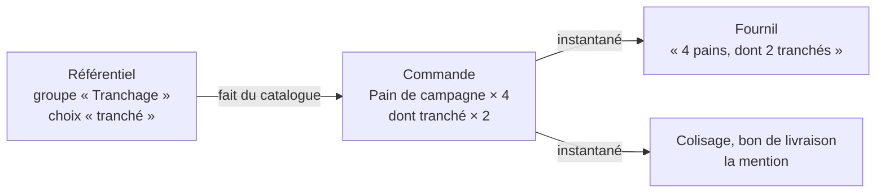

# Plan — les options de commande (« tranché »), gratuites d'abord

> ✅ **G1→G4 bâtis le 2026-11-27, sur `dev`, pas en production.** Demandé
> par Hugo le 2026-11-19 : « ajouter des options du produit, par exemple
> tranché pour le pain ». Hugo a décidé le 2026-11-19 : **les options
> gratuites d'abord** ; aucun montant ne bouge, le payant aura sa propre
> conception (§ 7). Les décisions prises en bâtissant sont au § 4, ce qui
> reste au § 6.

## 1. En deux mots

Un client commande **4 pains de campagne, dont 2 tranchés**. La commande garde
**une seule ligne** pour le pain ; le tranchage y est **compté**. Le fournil
lit « dont 2 tranchés », le colisage et le bon de livraison aussi. Rien ne se
facture : aucun prix, aucune TVA, aucune remise ne change.

## 2. Ce qui existe (ouvert le 2026-11-19)

| Constat                                                                                      | Où                                                             |
| -------------------------------------------------------------------------------------------- | -------------------------------------------------------------- |
| Une commande a une ligne par SKU : `@@unique([orderId, sku])`. Le plan ne la touche pas.     | `prisma/schema/public/orders.prisma`, `OrderLine`              |
| L'empreinte d'idempotence d'une passation hache `sku:quantité`.                              | `lafoliecoffee/orders/domain/services/order-fingerprint.ts:62` |
| Une révision ne juge que les lignes dont la quantité change (`KeptQuantityChange`, par SKU). | `orders/domain/services/kept-line-prices.ts`                   |
| Le fournil reçoit la ligne (`sku`, nom, quantité, unité).                                    | `prisma/schema/production.prisma`, `ProductionOrderLine`       |
| Le colisage range une ligne par `(jour, commande, rang, sku)`.                               | `prisma/schema/packing.prisma`, `packing_line`                 |
| Une déclinaison se vend à la pièce ou au poids.                                              | `documentation/pricing/vente-au-poids.md`                      |

## 3. Le modèle

### 3.1 Le référentiel : un groupe, des choix

- **Un groupe d'options** (« Tranchage ») est un référentiel de base
  (`reference/product-options/`) : un nom, des **choix** ordonnés ; « sans »
  est implicite (le pain entier).
- **Un choix** porte un libellé et une **clientèle** (pros, particuliers, les
  deux). Pas de prix dans cette version.
- **La fiche active un groupe** pour toutes ses déclinaisons ou une liste,
  qu'elles se vendent à la pièce ou au poids.
- Archive, jamais suppression ; une fiche archivée refuse l'activation ; un
  groupe ou un choix archivé n'est plus proposé, les commandes passées gardent
  leur instantané.
- Le référentiel suit ses portes : le groupe écrit ses tables, la fiche
  écrit son activation, chacun publie ses lectures.

### 3.2 Le fait du catalogue et le miroir

Le fait de la fiche transmet, par SKU, les groupes actifs et leurs choix
(clé, libellé, clientèle). Nouvelle version du format (v19). Le miroir du
commerce les garde par SKU, **filtrés par l'audience** de l'appelant à la
lecture.

### 3.3 La ligne de commande

- **La ligne demandée** gagne `options: [{ group, choice, quantity }]`,
  facultatif. L'agrégat refuse : un groupe non actif sur ce SKU, un choix
  hors de l'audience **du client** (l'équipe qui commande à sa place applique
  sa clientèle), une quantité nulle, une somme des quantités d'un groupe
  supérieure à celle de la ligne (le reste est « sans »).
- **Une ligne vendue au poids** (quantité en grammes) ne se partage pas : un
  choix y vaut pour **toute la ligne** (« 1,2 kg de pain de seigle,
  tranché »), et sa quantité est celle de la ligne. Décidé par Hugo le
  2026-11-19 : un pain au poids se tranche aussi.
- **La ligne figée** garde ses options dans une table fille
  `order_line_option` (ligne, groupe, choix, libellés figés, quantité). Aucune
  colonne d'argent.
- **L'empreinte** : une ligne sans option garde exactement son matériau
  (`sku:quantité`) ; une ligne avec options ajoute un suffixe trié. Un rejeu
  à cheval sur le déploiement reste reconnu.
- **La révision** : changer les options d'une ligne est un geste de
  modification comme changer sa quantité, soumis aux mêmes droits et à la
  même heure limite. Une révision qui ne change **que** des options passe
  sans juger de prix (il n'y en a pas). Diminuer la quantité d'une ligne
  réduit d'abord le compte « sans », puis les options, et l'agrégat refuse
  une somme d'options supérieure à la nouvelle quantité.

### 3.4 Le fournil, le colisage, le bon

- **Le fournil** reçoit, dans l'instantané de la ligne, ses options
  (`{ groupe, choix, quantité }`) — évolution du canal
  `production/channels/commerce/`, colonne `options` (jsonb) sur
  `ProductionOrderLine`. La fiche d'atelier : « 4 pains de campagne, dont
  2 tranchés ». Le compte à produire ne change pas.
- **Le colisage** reçoit la même mention dans sa liste ; ses clés ne
  changent pas.
- **Le bon de livraison** porte la mention ; un départ partiel la plafonne à
  la quantité qui part (au plus « dont 2 tranchés » si 2 pains partent) ; au
  poids, la mention suit la ligne entière.
- **La facture** ne change pas.

## 4. Les décisions

- **Hugo, 2026-11-19** : options gratuites d'abord ; le supplément payant
  plus tard, avec sa propre conception (§ 7).
- **Hugo, 2026-11-19** : une déclinaison vendue au poids accepte les
  options ; le choix vaut pour toute la ligne.
- **Proposé** : plusieurs groupes sur une ligne (tranché + emballé), chacun
  compté indépendamment.
- **Décidé le 2026-11-27 (lot G3)** : changer les options d'une commande
  déjà inscrite au fournil est permis, comme changer une quantité — mêmes
  droits (l'équipe, commande au compte, à régler en boutique ou offerte),
  même chemin. La révision « quantités seulement » (`isQuantitiesOnly`)
  admet déjà une révision qui ne change que les options (mêmes articles) ;
  le guichet du fournil (`OrderRevisionDesk`) et celui du colisage
  (`PackingRevisionDesk`) reçoivent désormais, par ligne, les options à jour
  avec le dû, les écrivent, et le bon de livraison prévu suit. Le compte à
  produire ne bouge pas : une révision qui ne change que les options ne
  monte rien.
- **G3, la mention** : « Tranchage : 2 × tranché » — un groupe par segment,
  le compte devant le choix quand il ne vaut pas pour toute la ligne ; au
  poids, ou quand toute la ligne le porte, le choix seul. Le libellé est
  celui du référentiel : son pluriel ne se fabrique pas.
- **G3, le départ partiel et le reliquat** : les options se plafonnent à ce
  qui part par la règle de la révision (`carriedOptionChoices`, le « sans »
  d'abord). Le reliquat reprend les options d'origine plafonnées à sa
  quantité, par la même règle : le colisage ne dit pas quelles pièces
  manquaient.
- **Décidé au lot G4, 2026-11-27** : le panier **garde** les options. Le
  panier enregistré (`shop_carts.payload`, schéma `cart`) range déjà ses
  lignes sous la forme d'`orderLineInputSchema`, qui porte `optionChoices` :
  aucune migration. La copie du navigateur les range dans une clé à part
  (`cart.options`, comme `cart.units`), et la passation les renvoie.
- **Décidé au lot G4, 2026-11-27** : les options se **choisissent sur la
  ligne du panier** (boutique) et sur la ligne de la saisie (équipe), pas sur
  la fiche produit — c'est là que la quantité, qui les borne, est connue. À
  la pièce, un compteur « Dont tranché » par choix, borné par ce que le groupe
  laisse ; au poids, une case qui vaut pour toute la ligne. Diminuer la
  quantité réduit d'abord le « sans ».
- **Décidé au lot G4, 2026-11-27** : les écrans lisent les options par une
  route à part du rayon (`GET /shop/catalogue/options`, sans jeton,
  `?audience=pro` pour la visite pro ; `GET /shop/catalogue/options/mine`,
  murée, à la clientèle de la société de l'appelant) et, pour l'équipe, dans
  la table des prix du client (`optionGroups` sur
  `GET /admin/catalog/companies/:companyId/shelf-prices`, à la clientèle du
  CLIENT). Le rayon est gardé en cache et tiré de l'instantané du catalogue,
  dont le miroir des options ne fait pas partie : l'y ajouter aurait demandé
  un déclencheur de version et une purge des rayons pour un champ d'écran.

## 5. Les lots

| Lot | Ce qu'il fait                                                                                                      | État                    |
| --- | ------------------------------------------------------------------------------------------------------------------ | ----------------------- |
| G1  | Référentiel : groupes, choix, activation par fiche (au poids comme à la pièce) ; écrans du référentiel ; fait v19. | ✅ `ace43cac8` + écrans |
| G2  | Commerce : miroir par audience ; options sur la ligne, `order_line_option`, empreinte, révision.                   | ✅ `ccf716ff0`          |
| G3  | Fournil, colisage, bon de livraison : la mention ; le reliquat recopie les options.                                | ✅ `94d211b74`          |
| G4  | Écrans : boutique et saisie par l'équipe (sur la ligne), panier enregistré, détail de commande.                    | ✅ `f65cd66d5`          |

Trois migrations additives (`20261127100000`, `20261127120000`,
`20261127150000`) ; `lecteur-de-migrations` avant `main`.

## 6. Ce qui reste

- **Non vérifié** : `pnpm test` à la racine et `lint:gates` en entier n'ont
  pas tourné (choix de Hugo, 2026-11-27) ; chaque lot a passé ses tests
  ciblés, ses e2e et ses portes.
- **À trancher** :
  - un reliquat ne sait pas quelles pièces manquaient : il retire d'abord le
    « sans », comme le bon (4 pains dont 2 tranchés, 1 manquant → « dont 1
    tranché ») ;
  - un départ incomplet au colisage ne plafonne pas les options de la
    feuille, quand le bon les plafonne ;
  - la mention s'écrit « Tranchage : 2 × tranché », pas « dont 2 tranchés » ;
  - aucun verrou entre l'archive d'un groupe et son activation (au pire, une
    activation sur un groupe archivé, que le fait n'émet pas) ; aucune
    unicité du nom d'un groupe.
- **Pas fait** : le pro ne voit pas les options de ses commandes passées dans
  la boutique (l'écran ne montre pas les lignes d'un pro) ; pas de choix sur
  la fiche produit ni à la saisie du comptoir pour un particulier ; une
  lecture des options en échec laisse la ligne partir sans option, sans
  message ; la réception d'un réassort reste sans option.
- **Doc** : ce plan reste cité par une centaine de commentaires ; il deviendra
  une doc d'état au présent quand le chantier sera déployé.

## 7. Le supplément payant, pour plus tard

Trois conceptions ont été contredites le 2026-11-19 :

- **Une ligne liée** (v1) : une option sans taux propre n'a pas de prix ; le
  calcul fusionne par SKU ; colisage et fournil ont le SKU dans leurs clés ;
  lever l'unicité `(commande, sku)` touche 157 lecteurs.
- **Un supplément sur la ligne** (v2, v3) : tout le circuit de l'argent
  suppose qu'un montant a sa ligne et son SKU — la couverture des remises est
  rangée ligne par ligne et rejouée par SKU sur le bon, la facture regroupe et
  contrôle par SKU, la révision ne connaît que le prix figé, et la TVA d'un
  taux se répartit entre tous ses termes.

La prochaine conception partira de cette contrainte, probablement avec le
chantier de l'unicité `(commande, sku)` que partagent les formules.
