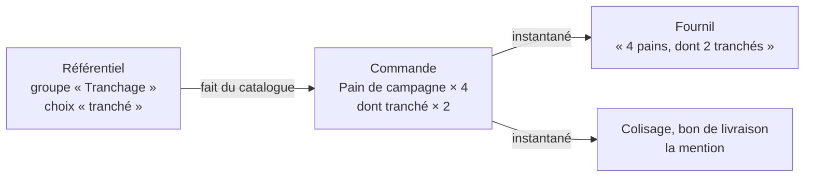

# Plan — les options de commande (« tranché »), gratuites d'abord

> 📐 **Plan v4, rien n'est bâti** (2026-11-19). Demandé par Hugo le
> 2026-11-19 : « ajouter des options du produit, par exemple tranché pour le
> pain », qui peuvent être payantes. Après trois contradictions de `vitruve`
> (§ 7), Hugo a décidé le 2026-11-19 : **les options gratuites d'abord**.
> Aucun montant ne bouge ; le payant aura sa propre conception.

## 1. En deux mots

Un client commande **4 pains de campagne, dont 2 tranchés**. La commande garde
**une seule ligne** pour le pain ; le tranchage y est **compté**. Le fournil
lit « dont 2 tranchés », le colisage et le bon de livraison aussi. Rien ne se
facture : aucun prix, aucune TVA, aucune remise ne change.

## 2. Ce qui existe (ouvert le 2026-11-19)

| Constat                                                                                      | Où                                                             |
| -------------------------------------------------------------------------------------------- | -------------------------------------------------------------- |
| Une commande a une ligne par SKU : `@@unique([orderId, sku])`. Le plan ne la touche pas.     | `prisma/schema/public/orders.prisma`, `OrderLine`              |
| L'empreinte d'idempotence d'une passation hache `sku:quantité`.                              | `lafoliecoffee/orders/domain/services/order-fingerprint.ts:62` |
| Une révision ne juge que les lignes dont la quantité change (`KeptQuantityChange`, par SKU). | `orders/domain/services/kept-line-prices.ts`                   |
| Le fournil reçoit la ligne (`sku`, nom, quantité, unité).                                    | `prisma/schema/production.prisma`, `ProductionOrderLine`       |
| Le colisage range une ligne par `(jour, commande, rang, sku)`.                               | `prisma/schema/packing.prisma`, `packing_line`                 |
| Une déclinaison se vend à la pièce ou au poids.                                              | `documentation/pricing/vente-au-poids.md`                      |

## 3. Le modèle

### 3.1 Le référentiel : un groupe, des choix

- **Un groupe d'options** (« Tranchage ») est un référentiel de base
  (`reference/product-options/`) : un nom, des **choix** ordonnés ; « sans »
  est implicite (le pain entier).
- **Un choix** porte un libellé et une **clientèle** (pros, particuliers, les
  deux). Pas de prix dans cette version.
- **La fiche active un groupe** pour toutes ses déclinaisons ou une liste.
  `Product` refuse d'activer un groupe sur une déclinaison **vendue au
  poids**, et refuse de passer au poids une déclinaison qui en porte un.
- Archive, jamais suppression ; une fiche archivée refuse l'activation ; un
  groupe ou un choix archivé n'est plus proposé, les commandes passées gardent
  leur instantané.
- Le référentiel suit ses portes : le groupe écrit ses tables, la fiche
  écrit son activation, chacun publie ses lectures.

### 3.2 Le fait du catalogue et le miroir

Le fait de la fiche transmet, par SKU, les groupes actifs et leurs choix
(clé, libellé, clientèle). Nouvelle version du format (v19). Le miroir du
commerce les garde par SKU, **filtrés par l'audience** de l'appelant à la
lecture.

### 3.3 La ligne de commande

- **La ligne demandée** gagne `options: [{ group, choice, quantity }]`,
  facultatif. L'agrégat refuse : un groupe non actif sur ce SKU, un choix
  hors de l'audience **du client** (l'équipe qui commande à sa place applique
  sa clientèle), une quantité nulle, une somme des quantités d'un groupe
  supérieure à celle de la ligne (le reste est « sans »).
- **La ligne figée** garde ses options dans une table fille
  `order_line_option` (ligne, groupe, choix, libellés figés, quantité). Aucune
  colonne d'argent.
- **L'empreinte** : une ligne sans option garde exactement son matériau
  (`sku:quantité`) ; une ligne avec options ajoute un suffixe trié. Un rejeu
  à cheval sur le déploiement reste reconnu.
- **La révision** : changer les options d'une ligne est un geste de
  modification comme changer sa quantité, soumis aux mêmes droits et à la
  même heure limite. Une révision qui ne change **que** des options passe
  sans juger de prix (il n'y en a pas). Diminuer la quantité d'une ligne
  réduit d'abord le compte « sans », puis les options, et l'agrégat refuse
  une somme d'options supérieure à la nouvelle quantité.

### 3.4 Le fournil, le colisage, le bon

- **Le fournil** reçoit, dans l'instantané de la ligne, ses options
  (`{ groupe, choix, quantité }`) — évolution du canal
  `production/channels/commerce/`, colonne `options` (jsonb) sur
  `ProductionOrderLine`. La fiche d'atelier : « 4 pains de campagne, dont
  2 tranchés ». Le compte à produire ne change pas.
- **Le colisage** reçoit la même mention dans sa liste ; ses clés ne
  changent pas.
- **Le bon de livraison** porte la mention ; un départ partiel la plafonne à
  la quantité qui part (au plus « dont 2 tranchés » si 2 pains partent).
- **La facture** ne change pas.

## 4. Les décisions

- **Hugo, 2026-11-19** : options gratuites d'abord ; le supplément payant
  plus tard, avec sa propre conception (§ 7).
- **Proposé** : plusieurs groupes sur une ligne (tranché + emballé), chacun
  compté indépendamment.

## 5. Les lots

| Lot | Ce qu'il fait                                                                                          | Coût | Risque                           |
| --- | ------------------------------------------------------------------------------------------------------ | ---- | -------------------------------- |
| G1  | Référentiel : groupes, choix, activation par fiche, refus au poids ; écrans du référentiel ; fait v19. | 2 j  | moyen (migration additive, fait) |
| G2  | Commerce : miroir par audience ; options sur la ligne, `order_line_option`, empreinte, révision.       | 1½ j | moyen (migration additive)       |
| G3  | Fournil, colisage, bon de livraison : la mention.                                                      | 1 j  | faible                           |
| G4  | Écrans : boutique (choisir), saisie par l'équipe, panier, commande.                                    | 1½ j | moyen                            |

Total : **6 jours**. Les migrations sont additives ; `lecteur-de-migrations`
avant `main`.

## 6. Ce qui n'est pas vérifié

- La forme exacte de l'instantané envoyé au fournil et au colisage : canal
  repéré, non lu.
- Les écrans de la saisie par l'équipe et de la boutique : non ouverts.
- La réception d'un réassort : supposée sans option.

## 7. Le supplément payant, pour plus tard

Trois conceptions ont été contredites le 2026-11-19 :

- **Une ligne liée** (v1) : une option sans taux propre n'a pas de prix ; le
  calcul fusionne par SKU ; colisage et fournil ont le SKU dans leurs clés ;
  lever l'unicité `(commande, sku)` touche 157 lecteurs.
- **Un supplément sur la ligne** (v2, v3) : tout le circuit de l'argent
  suppose qu'un montant a sa ligne et son SKU — la couverture des remises est
  rangée ligne par ligne et rejouée par SKU sur le bon, la facture regroupe et
  contrôle par SKU, la révision ne connaît que le prix figé, et la TVA d'un
  taux se répartit entre tous ses termes.

La prochaine conception partira de cette contrainte, probablement avec le
chantier de l'unicité `(commande, sku)` que partagent les formules.
