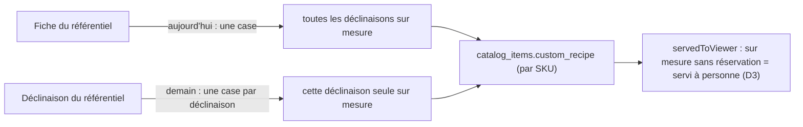

# Le sur mesure par déclinaison — plan

> 🟦 **Bâti le 2026-11-18 (D1 serveur, D2 back-office), non déployé.** Demande de Hugo le 2026-11-18 : « si un
> produit a des déclinaisons, toutes les déclinaisons passent en mode
> réservation, je veux qu'on descende la granularité au niveau déclinaison ».
> Revient sur D1 du § 13 de [`plan-articles-sur-mesure.md`](plan-articles-sur-mesure.md)
> (« un attribut de la fiche, toutes ses déclinaisons »). Contradiction de
> `vitruve` obligatoire : migration de données et frontière de visibilité.
> Chemins relatifs à `apps/lfd-api/` sauf mention ; affirmations ouvertes le
> 2026-11-18.

## 1. En deux mots

Aujourd'hui, la case « Sur mesure » est posée sur la **fiche** : la cocher
cache **toutes** ses déclinaisons à tous les pros, sauf ceux à qui l'article
est attribué. Demain, la case est posée sur **chaque déclinaison** : on peut
réserver la « part » d'une tarte à un client tout en laissant la « tarte
entière » ouverte à tous.

Ce qui ne change pas : la réservation à des comptes, la visibilité
(`hidden` / `visible_locked`), la règle D3 et tout ce qui est en aval
(commandes, fournil, rapports) sont **déjà par SKU de déclinaison**. Le
changement se limite au référentiel, au fil et à l'écran de la fiche.

## 2. Ce qui existe (ouvert le 2026-11-18)

- **Le fait** : `pim.products.custom_recipe` (`prisma/schema/pim/product.prisma`,
  modèle `Product`), écrit par `SetProductCustomRecipeCommand`
  (retiré par D1, remplacé par `set-variant-custom-recipe.ts`), qui
  appelle `Product.declareCustomRecipe` (`domain/entities/product.ts:367`),
  journalise `productCustomRecipeChanged` et émet la fiche.
- **`ProductVariant`** (`product.prisma`, modèle `ProductVariant`) n'a aucune
  colonne de sur mesure.
- **Le fil** : `customRecipe` est sur l'**en-tête** de la fiche
  (`CatalogProductHead`, `src/pim/channels/b2b-platform/products/catalog-facts.ts:76-81`,
  émis `:245`), optionnel depuis la v17 ; absent d'un fait d'avant, le commerce
  laisse sa colonne intacte (13.6-4) — `catalog-item-columns.ts:110`.
- **Le commerce** recopie la valeur de l'en-tête sur chaque article
  (`src/lafoliecoffee/catalog/application/handlers/catalog-fact-mapping.ts:78`)
  dans `catalog_items.custom_recipe`, **déjà par SKU**.
- **La réservation** : `catalog_item_reservations`, clé `(sku, company_id)`
  (`prisma/schema/public/catalog.prisma:679`) ; routes `/admin/catalog/:sku/…`
  ; écran « Attribuer… » et fiche client par SKU
  (`apps/lfd-backoffice-frontend/src/app/b2b/catalogue/made-to-order.service.ts`).
- **Le mur** : `servedToViewer` (`src/lafoliecoffee/catalog/domain/served-to-viewer.ts`)
  lit `isCustomRecipe` et `isReserved` d'une ligne d'article (par SKU).
- **Le rayon** : `isShownAsTile` (`src/lafoliecoffee/catalog/domain/shop-sku.ts`)
  — le défaut toujours, les autres seulement si `variantsAsTiles`.
- **L'écran** : `custom-recipe-form` dans les sections de la fiche
  (`apps/lfd-backoffice-frontend/src/app/pim/catalogue/product-form/form-sections/custom-recipe/`),
  une case, sa propre route, hors de « Tout enregistrer ».

## 3. Décisions proposées

- **V1. Le fait descend sur la déclinaison.** `pim.product_variants.custom_recipe
boolean NOT NULL DEFAULT false`. Un geste dédié
  `SetVariantCustomRecipeCommand(productId, variantId, customRecipe)`, une
  méthode de l'agrégat `Product` (la déclinaison n'est pas un agrégat : le
  produit protège ses déclinaisons), journal `variantCustomRecipeChanged`,
  émission de la fiche dans la même unité de travail — la mécanique de
  l'actuel geste, déplacée.
- **V2. La case de la fiche disparaît** au profit d'une case par déclinaison,
  dans la carte de la déclinaison (à côté de `variant-identity`). Pas de case
  « toutes » : cocher toutes les déclinaisons une par une suffit, et une case
  de fiche qui écrirait N déclinaisons referait l'ambiguïté qu'on retire.
- **V3. Le fil v18.** `customRecipe` passe sur `CatalogVariantFact`, toujours
  émis. L'en-tête cesse de le porter. Réception : le champ de la déclinaison
  gagne ; **absent** (fait d'avant la v18), on retombe sur l'en-tête v17 s'il
  est là ; sinon la colonne reste intacte (13.6-4 inchangée). Jamais lu `false`
  par défaut : un fait en vol rouvrirait au public un article reporté.
- **V4. Le report** (migration `2026111812xxxx_le_sur_mesure_par_declinaison`) :
  toute déclinaison d'une fiche `custom_recipe = true` passe à `true`.
  **Aucun article ne s'ouvre** ; Hugo décoche ensuite à la main ce qui doit
  s'ouvrir. `pim.products.custom_recipe` reste en base, colonne morte
  documentée (CLAUDE.md § 0), plus lue ni écrite.
- **V5. Le défaut sur mesure non attribué** — 🔴 **à trancher par Hugo**. Une
  fiche sans vignettes par déclinaison (`variantsAsTiles = false`) ne montre
  au rayon que son défaut. Si le défaut est sur mesure sans réservation, la
  fiche disparaît pour tous les autres pros, alors que ses autres déclinaisons
  sont ouvertes. Trois options :
  - **(a) Refuser** : le domaine refuse de cocher le défaut d'une fiche
    `variantsAsTiles = false` (et de décocher `variantsAsTiles`, ou de changer
    de défaut, quand ça créerait ce cas). Inexprimable, mais trois gestes à
    garder.
  - **(b) Accepter** et l'annoncer à l'écran : « la fiche ne paraît au rayon
    que par son défaut ; sur mesure, elle disparaît pour les autres ».
  - **(c) Vignette de repli** : le rayon montre la première déclinaison servie.
    Touche `isShownAsTile` et le cache du rayon — le plus cher.
    **Recommandation : (b)** — l'option par défaut est cochée sur toutes les
    fiches existantes (`variantsAsTiles @default(true)`), le cas est rare et un
    message suffit ; (a) si Hugo veut l'inexprimable.
- **V6. Rien ne change au commerce** au-delà du mapping : colonnes, mur,
  réservation, « Attribuer… », fiche client, aval (commandes, fournil) déjà
  par SKU. Le badge « Sur mesure · à attribuer » de Catalogue publié est déjà
  par ligne de déclinaison (`shelf-catalogue.ts:121`, `markOf(row)` par
  `row.variant.sku`).

## 4. Lots

- **D1 back** : migration (colonne + report), `ProductVariant` du domaine et
  ses mappers, `SetVariantCustomRecipeCommand` + route
  `PUT /pim/products/:id/variants/:variantId/custom-recipe`, journal, fil v18
  (émission et schéma Zod du fait), mapping commerce avec repli v17, retrait
  de `SetProductCustomRecipeCommand` et de sa route. Une variante nouvelle
  (`add-product-variant`) naît `false` ; un détachement
  (`detach-product-variant`) **emporte** la valeur de sa déclinaison — à
  vérifier au bâti.
- **D2 back-office** : case dans la carte de la déclinaison, retrait de
  `custom-recipe-form`, phrase du journal (`referential-phrases.ts`),
  procédure [`procedure-reserver-un-produit-a-des-pros.md`](procedure-reserver-un-produit-a-des-pros.md)
  mise à jour.
- **Tests** : domaine (la déclinaison seule bascule, journal seulement si
  changé) ; mapping (v18 par déclinaison, repli v17, absent = intact) ; e2e
  « fiche à deux déclinaisons, une cochée sans réservation → seule elle est
  absente du rayon d'un pro ; réservée → servie au seul titulaire » ; e2e du
  report.

## 4 bis. Contradiction de vitruve (2026-11-18), et ce qu'elle change

Aucun bloquant : le repli v17/v18 à la réception ne rouvre aucun article.
Cinq sérieux, intégrés ainsi :

1. **Le fil passe par `packages/catalog-sync`** : `SyncProduct`
   (`packages/catalog-sync/src/snapshot.ts:588`, `customRecipe` obligatoire),
   le schéma par version (`:756`), `syncVariantSchema` et la constante de
   version entrent dans D1. `packages/` bouge : `pnpm test` à la racine fait foi.
2. **Une déclinaison ajoutée hérite de la déclinaison par défaut** (et non
   `false`) : sur une fiche sur mesure aujourd'hui, elle naissait fermée ; elle
   le reste. Corrige D1.
3. **La colonne morte n'est plus écrite** : `prisma-product.repository.ts:238`
   (`customRecipe: snapshot.customRecipe ?? false` à chaque `save`) est
   retirée dans D1, sans quoi chaque enregistrement remettrait
   `products.custom_recipe` à `false` et un retour au code v17 ouvrirait les
   fiches. D1 livre aussi `prisma/rollback/` de la nouvelle migration.
4. **Les lecteurs sont inventoriés** (et non plus « au bâti ») :
   `packages/pim-contracts/src/product.ts:405` et `:646` ; au back-office
   `pim/data/models.ts`, `product-form-store.ts`, `product-form-page.ts`,
   `product-http-api.ts` ; au journal
   `packages/contracts/src/journal-facts/referential-catalogue.ts:489` (nouveau
   fait `variantCustomRecipeChanged`), `content-facts.ts:110`,
   `revision/domain/attribution.ts:108`, `pim-journal.ts:133` ; au semis
   `prisma/seed-pim/capabilities.ts:42-45` (appelle la commande retirée),
   `seed-pim/catalogue.ts:1137`, `corpus.ts:96` ; ~18 e2e et
   `test/custom-recipe-fixture.ts`.
5. **V5 : la recommandation passe à (a)**. (b) était une promesse sans
   mécanisme, et `make-variant-default.ts` crée le cas sans toucher à la case.
   (a) se garde dans l'agrégat `Product` aux trois gestes : cocher le défaut,
   décocher `variantsAsTiles`, changer de défaut — refus nommé (« le défaut
   d'une fiche sans vignettes ne peut pas être sur mesure : montrer chaque
   déclinaison, ou choisir un autre défaut »). **Décidé par Hugo le
   2026-11-18 : (a).**

Mineurs tranchés : le **détachement** emporte la valeur de sa déclinaison par
`resolvedSnapshot` (`variant.ts:476`), l'argument fiche de `product.ts:790`
disparaît ; **`restoreVariant`** garde la valeur de la déclinaison ;
**`align-variant-on-default`** n'y touche pas (il n'aligne que la fiche
réglementaire).

Non vérifié par vitruve, à ouvrir au bâti : `lint:context-version-columns`
pour la colonne PIM (seule `catalog_items.custom_recipe` est au déclencheur),
la réception d'un fait v18 par une instance v17 pendant le déploiement, et
`revision.ts`.

## 5. Ce qui n'est pas vérifié

- Les lecteurs PIM de `product.customRecipe` hors du fil (vue de la fiche,
  export, journal) : à inventorier au bâti par `graphify explain`.
- La réémission d'une fiche reportée par la migration v17 : on suppose que le
  premier fait v18 relit les déclinaisons reportées ici, puisque le report et
  l'émission lisent la même table.

### Vérifié au bâti de D1 (2026-11-18)

- **`lint:context-version-columns`** : la porte ne couvre que les tables de
  l'instantané du catalogue côté commerce (`catalogue-snapshot-columns.ts`) ;
  `pim.product_variant` n'en est pas et n'a pas à y être. La colonne servie,
  `catalog_items.custom_recipe`, est déjà sous déclencheur depuis la v17, et la
  v18 ne change que la valeur qu'elle reçoit par SKU. Porte verte sans
  modification du registre.
- **Un fait v18 reçu par le code v17** (pendant le déploiement) : le schéma du
  fait est un `z.object` qui retire les clés inconnues ; la déclinaison y perd
  son `customRecipe`, l'en-tête n'en porte plus, donc le champ est **absent**
  et le commerce laisse sa colonne intacte (13.6-4). Aucun article ne s'ouvre.
  Un fait v17 reçu par le code v18 retombe sur l'en-tête. Un **instantané** v18
  poussé à un code v17 est refusé (version inconnue), comme à chaque montée.
- **`revision.ts`** : aucun champ de révision ne porte le sur mesure ;
  `attribution.ts` classe `variantCustomRecipeChanged` sans champ touché.
- **Lecteurs PIM hors du fil** : la vue de la fiche (`ProductView` →
  `VariantView.customRecipe`), le journal et le semis ; aucun export.
- **Le report crée tel quel l'état que V5 refuse aux gestes** : une fiche
  `custom_recipe` à vignettes décochées a, après report, son défaut sur
  mesure. La reconstitution ne le refuse pas (sinon la fiche ne se chargerait
  plus) ; les trois gestes, eux, refusent d'y entrer. La requête de comptage
  est en tête de la migration. Après report, décocher le défaut est toujours
  permis, et recocher « chaque déclinaison en vignette » aussi.
