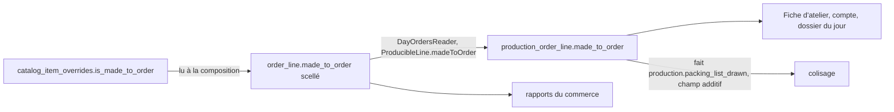

# Le marqueur « sur mesure » partout — plan

> 🟨 **Partiel, 2026-10-30.** M1 à M4 bâtis le 2026-10-30 (non commités à
> l'écriture de cette ligne) ; le lot R attend Hugo (Q6). Q1–Q5 et Q7
> **décidées par défaut le 2026-10-30, sur mandat de Hugo** (« fais tout ») :
> les recommandations du plan, § 6. Ce qui suit était doc-first ; les écarts
> bâtis sont dits en § 5 bis. Origine : Q6 du
> plan [`plan-articles-sur-mesure.md`](plan-articles-sur-mesure.md) (§ 10 bis,
> réponse de Hugo : « Q6 partout : fiche atelier, étiquettes, rapports — lots
> ultérieurs »). Chaque affirmation sur l'existant cite le fichier et la ligne
> **ouverts le 2026-10-30**.

## 1. Ce qui existe

- Le marqueur vit côté **commerce**, sur la décision catalogue :
  `CatalogItemOverride.isMadeToOrder Boolean @default(false) @map("is_made_to_order")`
  (`apps/lfd-api/prisma/schema/public/catalog.prisma:647`). Il est lu par le
  lecteur du catalogue (`apps/lfd-api/src/b2b/catalog/infrastructure/prisma-catalog.reader.ts:101`).
  Le PIM ne le connaît pas, et ce plan ne change pas ça.
- La ligne de commande fige déjà ce qu'elle a vendu : « Snapshots au moment de
  la commande : le prix/nom/TVA du PIM peut changer »
  (`apps/lfd-api/prisma/schema/public/orders.prisma:591-593`). Elle fige aussi
  un drapeau booléen tiré d'une règle du commerce, `pickupDiscountEligible`
  (`orders.prisma:724`), calculé à la composition
  (`apps/lfd-api/src/b2b/orders/application/services/order-composition.service.ts:435`)
  et écrit par la fonction unique d'écriture de ligne
  (`apps/lfd-api/src/b2b/orders/infrastructure/order-line.data.ts:28`). **C'est
  le modèle à copier** : un fait du commerce, scellé à la passation, relu
  jamais recalculé.
- Le fournil reçoit une ligne par `ProducibleLine` — `sku`, `productName`,
  `quantity`, `saleUnit`, et délibérément aucun montant
  (`apps/lfd-api/src/production/channels/commerce/day-orders.reader.ts:13-25`).
  Le commerce la remplit depuis le snapshot
  (`apps/lfd-api/src/b2b/orders/infrastructure/prisma-day-orders.source.ts:84,106`).
  Le fournil la fige à son tour dans `ProductionOrderLine`
  (`apps/lfd-api/prisma/schema/production.prisma:305-318`) et dans
  `ProductionLineSnapshot` (`apps/lfd-api/src/production/domain/entities/production-day.snapshot.ts:24`).
- L'attendu des jours à venir passe par `ExpectedItem`
  (`apps/lfd-api/src/production/channels/commerce/expected-production.reader.ts:6-12`),
  fusionné **par SKU tous clients confondus** ; l'implémentation reprend le nom
  du catalogue s'il est connu, le snapshot sinon
  (`apps/lfd-api/src/b2b/orders/infrastructure/prisma-expected-production.reader.ts:87`).
- Le colisage reçoit les lignes par le fait durable
  `production.packing_list_drawn`, `PackingListLine { sku, productName, quantity, saleUnit }`
  (`apps/lfd-api/src/production/channels/packing/packing-list-drawn.event.ts:16-26`),
  relu champ par champ (`:180-186`).

### Les PDF produits (inventaire par la règle de `lint:pdf-specimens`)

La porte appelle document toute fonction exportée `render…Pdf|Document`
(`dev-toolbox/gates/pdf-specimens.mjs:44`). Relevé le 2026-10-30 :

| Document                                                 | Fichier                                                                          | Porte des lignes d'article ?                                                      | Concerné                       |
| -------------------------------------------------------- | -------------------------------------------------------------------------------- | --------------------------------------------------------------------------------- | ------------------------------ |
| Fiche d'atelier                                          | `production/domain/services/atelier-sheet-pdf.ts:68`                             | oui (`ProductionOrderSnapshot`)                                                   | **oui**                        |
| Compte à produire                                        | `production/domain/services/atelier-sheet-pdf.ts:167`                            | oui, par SKU                                                                      | **oui**                        |
| Dossier du jour                                          | `production/domain/services/day-dossier-pdf.ts:83`                               | oui                                                                               | **oui**                        |
| Bon de livraison transport / client                      | `b2b/delivery-notes/domain/services/delivery-note-pdf.ts:156,239`                | oui                                                                               | à trancher (Q3)                |
| Confirmation de commande                                 | `b2b/orders/domain/services/order-sheet-pdf.ts:406`                              | oui                                                                               | à trancher (Q3)                |
| Récapitulatif de commandes                               | `b2b/orders/domain/services/order-summary-pdf.ts:185`                            | oui                                                                               | à trancher (Q3)                |
| Étiquette de sac                                         | `packing/domain/services/bag-labels-pdf.ts:41`                                   | **non** — un sac, son rang (`packages/contracts/src/packing-bag-labels.ts:32-41`) | Q4                             |
| Étiquette de bac                                         | `delivery/domain/services/bin-labels-pdf.ts:65`                                  | à ouvrir au lot                                                                   | Q4                             |
| Feuille / dossier de tournée                             | `delivery/domain/services/round-paper-pdf.ts:46`, `day-rounds-dossier-pdf.ts:53` | non visé                                                                          | non                            |
| Facture, Factur-X, mandats, pain.008, matrice allergènes | `b2b/accounting/…`, `pim/…`                                                      | —                                                                                 | **non** (document légal / PIM) |

La planche (`apps/lfd-backoffice-frontend/src/app/comptabilite/document-specimen-catalogue.ts:23-40`)
a une clé par document ; aucun document neuf n'est créé ici, donc **aucune clé
neuve** — seules les données d'exemple changent.

⚠️ **L'astérisque est déjà pris.** Le bon de livraison écrit `nom *` pour une
ligne exclue (`delivery-note-pdf.ts:114`), la confirmation de commande pour une
ligne non éligible à la remise de retrait (`order-sheet-pdf.ts:233`). Le
marqueur ne peut **pas** être un `*`.

### Les rapports

Le CA par secteur existe (`apps/lfd-api/src/b2b/growth/application/queries/get-sector-revenue.handler.ts`).
**Aucun rapport « ventes par article » n'a été trouvé** (recherche `ventes par
article` dans le back-office et `documentation/`, vide le 2026-10-30 — un grep
vide n'est pas une preuve, à confirmer au lot R). Le tableau de bord de la
comptabilité compte des articles en vente, pas des ventes
(`apps/lfd-backoffice-frontend/src/app/comptabilite/tableau-de-bord/tableau-de-bord-page.html:140`).

## 2. La décision structurante : le snapshot fige

Le marqueur se **scelle sur la ligne de commande à la passation**, comme le
nom, le prix, la TVA et `pickupDiscountEligible`. Puis il **voyage** — il n'est
jamais relu au catalogue par l'aval.

**Si le marqueur change après la commande, rien ne bouge** : la commande a été
passée pour un article sur mesure (ou non), et c'est ce qu'elle reste. Le
staff qui retire le marqueur aujourd'hui ne réécrit pas l'histoire d'hier. Une
**révision** de commande réécrit ses lignes par la même fonction
(`order-line.data.ts:5-10`) : elle relit donc le marqueur du jour pour la ligne
révisée — même règle que le prix d'une ligne nouvelle.

### Pourquoi pas une lecture du catalogue côté fournil

- `production → b2b` est interdit (CLAUDE.md § 3) ; le fournil ne connaît une
  commande que par identifiant opaque + snapshot.
- Une relecture au rendu ferait changer une fiche déjà imprimée au premier
  geste du staff — la même faute que `unitPriceTtcCents` refuse
  (`orders.prisma`, commentaire R3 au-dessus de `unit_price_ttc_cents`).

### La frontière tient sans case nouvelle

| Arête              | Par où                                                                             | Matrice         |
| ------------------ | ---------------------------------------------------------------------------------- | --------------- |
| commerce → fournil | `ProducibleLine` étendue (port déclaré par le fournil, implémenté par le commerce) | inchangée       |
| fournil → colisage | fait durable `production.packing_list_drawn`, champ additif                        | inchangée       |
| rapports           | lecture du commerce sur ses propres tables                                         | interne à `b2b` |

## 3. Migrations (additives)

1. `order_line.made_to_order BOOLEAN NULL` — **trois états**, comme
   `pricing_clamped_to_zero` (`orders.prisma`, commentaire « `NULL` = ligne
   écrite avant ») : `NULL` = ligne d'avant le lot, on ne savait pas ;
   `false` affirmé ; `true` affirmé. **Aucune reprise** : remplir le passé
   depuis le marqueur d'aujourd'hui serait inventer (le marqueur a pu changer).
2. `production_order_line.made_to_order BOOLEAN NULL` — même sémantique,
   recopiée à l'arrêt.
3. Le fait `production.packing_list_drawn` gagne `madeToOrder?: boolean` ;
   un fait ancien se relit `null` (même figure que `saleUnit` relu `piece`,
   `packing-list-drawn.event.ts:22-24`).

`vitruve` d'office (CLAUDE.md § 9 bis) : le plan porte deux colonnes et un
champ de fait durable — pas une migration de données, mais un champ ajouté à
un fait rejoué ; à confier avant Hugo si Hugo le juge utile (Q8).

## 4. Ce que chaque surface affiche

Un **mot**, « Sur mesure », jamais un pictogramme seul : un pictogramme sur
papier noir et blanc ne se lit pas sans légende, et l'accessibilité vaut aussi
à l'écran (alternative textuelle obligatoire).

| Surface                                       | Rendu proposé                                                                                            | `NULL`             |
| --------------------------------------------- | -------------------------------------------------------------------------------------------------------- | ------------------ |
| Fiche d'atelier (PDF)                         | mention `SUR MESURE` en petites capitales sous le nom de la ligne                                        | rien               |
| Compte à produire (PDF)                       | l'article sur mesure garde une ligne à lui — **jamais fusionné** avec la même référence non marquée (Q2) | rien               |
| Dossier du jour (PDF)                         | comme la fiche d'atelier                                                                                 | rien               |
| Écran du fournil / supervision                | badge fold « Sur mesure » sur la ligne                                                                   | rien               |
| Colisage (écran)                              | badge sur la ligne à coliser                                                                             | rien               |
| Étiquettes sac / bac                          | aucune, sauf décision Q4                                                                                 | —                  |
| Bons client (confirmation, BL, récapitulatif) | rien par défaut (Q3)                                                                                     | —                  |
| Rapports                                      | colonne/filtre « Sur mesure » sur la ligne vendue                                                        | « avant le suivi » |

## 5. Lots

| Lot                                                                | Contenu                                                                                                                                                                                    | Tests                                                                                                                                                                                                       |
| ------------------------------------------------------------------ | ------------------------------------------------------------------------------------------------------------------------------------------------------------------------------------------ | ----------------------------------------------------------------------------------------------------------------------------------------------------------------------------------------------------------- |
| ~~**M1**~~ ✅ 2026-10-30                                           | Colonne `order_line.made_to_order` ; `OrderLineSnapshot.madeToOrder` scellé à la composition (lecture du marqueur par le lecteur du catalogue) ; `orderLineDataOf` l'écrit ; révision idem | domaine : la ligne scelle la valeur ; application : composition lit le marqueur ; **e2e** : marqueur retiré après la passation → la ligne reste `true` ; ligne d'avant → `null`                             |
| ~~**M2**~~ ✅ 2026-10-30                                           | `ProducibleLine.madeToOrder` (port du fournil) ; `prisma-day-orders.source.ts` le remplit ; colonne `production_order_line.made_to_order` ; `ProductionLineSnapshot`                       | e2e arrêt de journée : la valeur traverse ; le fournil ne lit aucune table du commerce (`lint:context-boundaries`, `lint:prisma-model-ownership` verts)                                                     |
| ~~**M3**~~ ✅ 2026-10-30                                           | Fiche d'atelier, compte à produire, dossier du jour : rendu « SUR MESURE » ; `ExpectedItem` distingue sur mesure / non (Q2)                                                                | unitaires de rendu ; **spécimens** : les données d'exemple de la planche portent au moins une ligne sur mesure, et un test vérifie que le texte `SUR MESURE` figure dans le PDF de chaque spécimen concerné |
| ~~**M4**~~ ✅ 2026-10-30 — fait et écran du colisage, voir § 5 bis | Fait `production.packing_list_drawn` + écran du colisage ; étiquettes selon Q4                                                                                                             | relecture d'un fait ancien → `null` ; spécimen d'étiquette si Q4 = oui                                                                                                                                      |
| **R**                                                              | Rapports : confirmer l'existence (ou non) d'un rapport par article, puis filtre/colonne                                                                                                    | e2e : mur `company_id` sur l'agrégat, et somme par marqueur                                                                                                                                                 |

Un lot à la fois, dans cet ordre ; M1 est le seul préalable de tous les autres.

## 5 bis. Ce qui a été bâti, et où il s'écarte (2026-10-30)

- **Migration** `20261030210000_le_sur_mesure_scelle_sur_la_ligne` : les deux
  colonnes du § 3, `BOOLEAN NULL`, sans reprise.
- **M1.** Le marqueur est lu par `OrderLineClassificationReader` (le lecteur
  du catalogue que la passation lisait déjà pour produit et famille — une
  lecture, pas deux) et scellé par `OrderComposition` (`madeToOrderOf`). En
  révision, une ligne **gardée** garde ce qu'elle a scellé, `NULL` compris
  (même règle que son prix figé, R3) ; une ligne **nouvelle** lit le
  catalogue du jour. Un SKU que le catalogue ne range pas reste `NULL`.
- **M2.** `ProducibleLine.madeToOrder` (requis), `ProductionLineSnapshot.madeToOrder`
  (facultatif : les lignes de réassort le partagent et ne le portent pas, Q7).
- **M3.** « SUR MESURE » en petites capitales sous le nom, sur la fiche
  d'atelier, le compte à produire et les bons du dossier du jour.
  ⚠️ **Le compte arrêté reste UN total par SKU** : `production_count` est
  unique sur `(service_day, sku)` et les fournées se cochent par SKU. La
  ligne séparée de Q2 se fait donc **au papier** (`countPaperRowsOf`), depuis
  les lignes de commande figées : la part sur mesure d'une référence y a sa
  propre ligne. Séparer le compte lui-même demanderait de changer une clé
  unique servie — hors d'une migration additive. Le **récapitulatif** du
  dossier du jour (par rayon) ne sépare pas : le § 4 ne le demandait pas.
  `ExpectedItem.madeToOrderQuantity` porte la part sur mesure de l'attendu
  (facultatif : l'attendu des réassorts partage le type) ; **aucun écran ne
  le lit encore** — l'écran du fournil n'est dans aucun lot.
- **M4.** Le fait `production.packing_list_drawn` porte `madeToOrder` par
  ligne, additif ; un fait ancien se relit sans le champ. Étiquettes : rien (Q4).
- ~~**M4 bis — l'écran du colisage**~~ ✅ bâti le 2026-10-30 (décision de
  Hugo du même jour). Migration `20261031000000_le_sur_mesure_au_colisage` :
  `packing.packing_line.made_to_order BOOLEAN NULL` (écrit par l'abonné du
  fait, `NULL` pour un fait ancien ; un article répété sur la commande est sur
  mesure dès qu'une de ses lignes l'est — `linesBySku`) et
  `packing.packing_settings.show_made_to_order` (défaut vrai). `PackingLine.madeToOrder`
  au contrat de la feuille ; Réglages › Colisage porte « Afficher le sur
  mesure à l'écran du colisage » (`PackingSettingsView.showMadeToOrder`,
  facultatif au `PUT` : absent, il reste) ; le tableau des contenants du
  poste pose une pastille fold « Sur mesure » sur la ligne quand le réglage
  la demande. Le serveur sert le marqueur de toute façon : c'est l'écran qui
  le tait. Le réglage n'est pas journalisé (le partage d'une moitié ne
  l'était pas). Non couvert : la ligne en lecture seule d'une commande
  déclarée prête (`app-packing-line`), qui ne lit pas les réglages.
- **Spécimens** : la commande d'exemple du fournil porte un « Entremets
  signature » sur mesure ; fiche, compte et dossier d'exemple disent « SUR
  MESURE ». Les spécimens du commerce ne changent pas (Q3).

## 6. Questions ouvertes

- ~~**Q1.**~~ Le nom du client réservataire figure-t-il sur la fiche atelier ?
  La fiche porte déjà le client de la commande ; « réservé à X » ajouterait
  une information qui n'est pas un fait de la commande. Recommandé : non.
  → **Non — décidé par défaut le 2026-10-30, sur mandat de Hugo.**
- **Q2.** Compte à produire et attendu des jours : une ligne « Sur mesure »
  séparée par SKU, ou la référence fusionnée avec une mention ? Recommandé :
  séparée — c'est souvent une recette différente.
  → **Séparée — décidé par défaut le 2026-10-30, sur mandat de Hugo** (au
  papier, cf. § 5 bis).
- **Q3.** Les documents qui sortent chez le client (confirmation, BL,
  récapitulatif) disent-ils « sur mesure » ? Recommandé : non par défaut.
  → **Non — décidé par défaut le 2026-10-30, sur mandat de Hugo.**
- **Q4.** Étiquettes de sac / bac : elles ne portent pas de lignes aujourd'hui.
  Faut-il une mention « contient du sur mesure » ? Recommandé : non.
  → **Non — décidé par défaut le 2026-10-30, sur mandat de Hugo.**
- **Q5.** Un article sur mesure sans réservation (marqueur seul, Q5 du plan
  parent) se marque-t-il pareil ? Supposé oui : le marqueur est indépendant.
  → **Oui — décidé par défaut le 2026-10-30, sur mandat de Hugo.**
- **Q6.** Quels rapports exactement : CA par article, ventes par client, export
  comptable ? Aucun « ventes par article » trouvé (§ 1).
- **Q7.** Un réassort de boutique (`resupply-list-drawn.event.ts:11`) porte-t-il
  le marqueur ? Supposé non : un réassort n'est pas une commande client.
  → **Non — décidé par défaut le 2026-10-30, sur mandat de Hugo.**
- **Q8.** `vitruve` sur ce plan avant bâtisse ?
