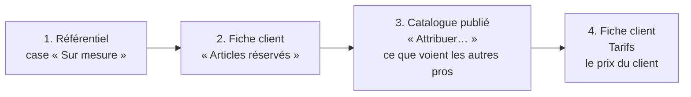

# Procédure — Réserver un produit à des clients pros

**État : ✅ en production** (bâti le 2026-10-30, révisé le 2026-11-02).
Libellés relus dans le back-office le 2026-11-18.

Un produit **sur mesure** est fait pour un ou quelques comptes pros : une
recette à part, un format spécial. Seuls les comptes à qui il est réservé
peuvent le commander. Les autres pros ne le voient pas, ou le voient grisé
selon le réglage. Les particuliers ne le voient jamais.

## 1. En simple

### Les quatre gestes, dans l'ordre

**1. Déclarer la déclinaison sur mesure** — au **Référentiel**, sur la fiche
du produit, ouvrir l'onglet de la déclinaison, carte **« Identité de la
déclinaison »**, cocher **« Sur mesure »**. La case s'enregistre tout de
suite, à part de « Tout enregistrer ».

- La case vaut pour **cette déclinaison seulement** : une fiche peut avoir
  une déclinaison sur mesure et les autres ouvertes à tous. Pour tout le
  produit, cocher chaque déclinaison.
- 🔒 **Le défaut d'une fiche sans vignettes ne peut pas être sur mesure** :
  le rayon ne montrerait que lui, et la fiche disparaîtrait pour tous. Le
  serveur refuse, la case revient et le message le dit : cocher « montrer
  chaque déclinaison en vignette », ou choisir un autre défaut.
- La fiche reste en audience « pro », comme d'habitude.
- 🔒 **Tant qu'aucun compte ne lui est attribué, aucun pro ne voit cette
  déclinaison**, et
  aucun particulier. C'est voulu : un produit fait pour un client ne peut pas
  apparaître chez tous les pros pendant qu'on le prépare.

**2. Le réserver à un compte** — dans **Comptes clients**, ouvrir la fiche du
client, onglet **« Articles réservés »**, champ **« Réserver un article à ce
compte »** : chercher le produit par son nom ou sa référence, l'ajouter.

- Seuls les produits cochés **« Sur mesure »** au geste 1 y sont proposés :
  un produit absent de la liste n'a pas encore sa case.

- **Un compte principal** : ses sites en profitent aussi. L'onglet du site
  les montre « via » le principal, en lecture seule.
- **Un site seul** : le principal ne le voit pas.
- Pour arrêter : **« Retirer »** sur la ligne, dans le même onglet.
- Répéter pour chaque compte concerné.

**3. Régler ce que voient les autres pros** — dans **Catalogue publié**, le
produit porte un badge et un bouton **« Attribuer… »**. Le panneau montre à
qui il est réservé (avec un lien vers chaque fiche) et propose :

| Réglage                       | Les autres pros…                                    |
| ----------------------------- | --------------------------------------------------- |
| **Invisible aux autres pros** | ne le voient pas (le défaut)                        |
| **Visible, non commandable**  | le voient grisé, avec « Réservé à un autre compte » |

**4. Fixer son prix** — dans la fiche du client, la **mercuriale** (onglet
Tarifs) : le sélecteur n'y propose que les produits auxquels ce client a
droit, donc le produit réservé apparaît pour lui seul.

### Ce que voit chacun

| Qui                                 | Le produit sur mesure                                                            |
| ----------------------------------- | -------------------------------------------------------------------------------- |
| Un compte à qui il est réservé      | dans son catalogue, commandable, à son prix                                      |
| Un site dont le principal l'a       | pareil                                                                           |
| Un autre pro                        | rien, ou grisé « Réservé à un autre compte » (réglage 3)                         |
| Un pro non connecté, un particulier | jamais                                                                           |
| L'équipe au back-office             | tout, avec le badge (« Sur mesure · à attribuer » s'il n'est réservé à personne) |

### Avant la première fois

- **Le droit `lfc_made_to_order`** : les gestes 2 et 3 (et la lecture des
  comptes qui ont un produit) le demandent, à part du droit du catalogue —
  décider qu'un produit est masqué ne dit pas à qui il est réservé. À
  accorder dans l'écran **Rôles** de l'administration (`/admin/roles`), aux
  rôles concernés, administrateur compris.
- **Un produit déjà vendu à tous** que l'on passe sur mesure **disparaît**
  du catalogue de tous les pros dès que la case est cochée, tant qu'aucun
  compte ne lui est réservé. Les commandes déjà passées gardent leurs lignes
  et leurs prix.

### Ensuite

- Le marqueur **suit le produit** : la fiche d'atelier du fournil, le dossier
  de production, le colisage et les lignes de commande portent « Sur mesure ».
- **Analytics › Sur mesure** lit les ventes de ces produits.

## 2. Partie technique

Le plan d'origine et ses décisions : [`plan-articles-sur-mesure.md`](plan-articles-sur-mesure.md)
(§ 13 pour la révision qui a mis le fait au référentiel), et le marqueur dans
le fournil et le colisage : [`plan-sur-mesure-partout.md`](plan-sur-mesure-partout.md).

### Qui tient quoi

- **Le fait « sur mesure » appartient au référentiel, par déclinaison**
  (`pim.product_variants.custom_recipe` ;
  [`plan-sur-mesure-par-declinaison.md`](plan-sur-mesure-par-declinaison.md)),
  posé par la case de la déclinaison
  (`apps/lfd-backoffice-frontend/src/app/pim/catalogue/product-form/form-sections/variant-custom-recipe/`,
  route `PUT /pim/catalogue/products/:id/variants/:variantId/custom-recipe`,
  fait `product.variant_custom_recipe_changed`). `pim.products.custom_recipe`
  est une colonne morte, plus lue ni écrite.
  Il traverse le canal `pim/channels/b2b-platform/` vers le commerce
  (`catalog_items.custom_recipe`). Le référentiel ne connaît aucun compte.
- **La réservation appartient au commerce** (`src/lafoliecoffee/catalog`) :
  une ligne par couple article × société, et la visibilité `hidden` /
  `visible_locked` par article. Commandes `ReserveArticleCommand`,
  `ReleaseArticleCommand`, `SetReservedVisibilityCommand`, sous la surface
  `@AdminSurface("lfc_made_to_order")`.

### La règle, dans la requête

`servedTo` / `servedToViewer` (`src/lafoliecoffee/catalog/domain/`) décident
de ce qu'un lecteur voit, dans le lecteur du catalogue — le même mur que
`company_id` :

- **sur mesure et réservé à personne** : servi à aucun pro (inexprimable,
  pas vérifié après coup) ;
- **réservé** : servi aux réservataires et aux sites de leur principal actif
  (`readReservationHolders`, `lafoliecoffee/shared/company-standing`) ;
  aux autres pros selon la visibilité ;
- **jamais au public**.

Le devis et la passation refusent un article réservé à un autre compte :
`ReservedArticleRefusedError` (409, code `catalog.reserved_article`). Une
commande rejouée ou révisée garde ses lignes déjà passées.

### Écrans

| Écran                                     | Fichier                                                           |
| ----------------------------------------- | ----------------------------------------------------------------- |
| Case « Sur mesure » de la déclinaison     | `pim/catalogue/product-form/form-sections/variant-custom-recipe/` |
| Onglet « Articles réservés »              | `fiche-client/articles-reserves/`                                 |
| Panneau « Attribuer » du catalogue publié | `b2b/catalogue/made-to-order-panel/`                              |
| Analytics › Sur mesure                    | `analytics/sur-mesure/`                                           |

(chemins relatifs à `apps/lfd-backoffice-frontend/src/app/`.)

### Tests

L'e2e du mur : `apps/lfd-api/test/made-to-order-wall.e2e-spec.ts`.
