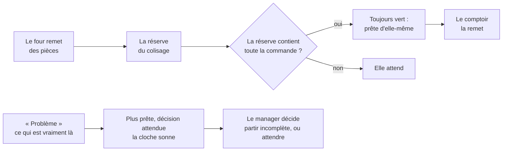

# Plan — les niveaux de suivi du colisage, le retrait d'abord

**État : 📐 plan, rien n'est bâti** (2026-11-18). Décisions de Hugo des
2026-11-17 et 2026-11-18. Contredit par `vitruve` le 2026-11-18 : ses trois
objections bloquantes et ses cinq sérieuses sont reprises dans les décisions
ci-dessous (§ 8). La réflexion qui le précède :
[`reflexion-colisage-simple.md`](reflexion-colisage-simple.md). La carte des
blocs et de tous les cas de figure :
[`../commandes/la-chaine-de-la-commande.md`](../commandes/la-chaine-de-la-commande.md).
Le pendant au fournil, bâti :
[`../fournil/les-niveaux-de-suivi.md`](../fournil/les-niveaux-de-suivi.md).

Chaque affirmation sur l'existant a été ouverte le 2026-11-18 (chemins relatifs
à `apps/lfd-api/src/`).

---

## 1. En simple

Le colisage d'aujourd'hui demande, pour chaque commande, d'ouvrir des
contenants, d'y répartir chaque produit, puis de déclarer la commande prête.
C'est le niveau **détaillé** ; il reste tel quel.

On ajoute deux niveaux, réglés à l'écran, **pour le retrait au comptoir
seulement** (décidé par Hugo le 2026-11-18). La livraison garde le colisage
détaillé : ses bacs, leurs étiquettes et le chargement ne changent pas.

| Niveau                     | Ce que fait l'équipe pour une commande à retirer                                                        |
| -------------------------- | ------------------------------------------------------------------------------------------------------- |
| **Toujours vert** (défaut) | rien : elle passe **prête d'elle-même** quand tout est arrivé du four ; un seul geste, **« Problème »** |
| **Simple**                 | **« Tout est prêt »** ou **« Problème »**                                                               |
| **Détaillé**               | contenants, répartition, « Déclarer prête », « Il manque » (aujourd'hui)                                |

**« Problème »** dit, produit par produit, combien est vraiment là. La commande
**cesse d'être prête** et attend la décision du manager ; la **cloche** sonne
chez qui peut décider, et la commande reste en rouge dans la **Supervision**.
Les pièces dites absentes **sortent de la réserve** : elles ne seront pas
données à une autre commande. Le manager décide comme aujourd'hui.

### Les faits du colisage sont à lui (Hugo, 2026-11-18)

Le colisage publie ce qu'il a fait, dans ses mots, et **ne sait pas qui
écoute** ; chaque voisin apprend à traiter ses faits. Aujourd'hui, deux faits
du colisage sont **déclarés dans le canal du fournil** : `packing.order_packed`
(`production/channels/packing/packing-order-packed.event.ts`) et
`packing.returned`. Ils rentrent au colisage (lot C0).

La livraison n'apprend pas encore : en retrait, rien ne la concerne. Le jour où
le colisage à niveaux vaudra pour la livraison, c'est **elle** qui traitera
« commande colisée » pour créer son bac et son étiquette, au lieu que le
colisage l'appelle (`BinDesk`, dans la transaction du colisage). Ce sera un
plan à part.

## 2. Ce qui ne change pas

| Règle d'aujourd'hui                                                                                 | À tous les niveaux                                                         |
| --------------------------------------------------------------------------------------------------- | -------------------------------------------------------------------------- |
| **La réserve** : on ne colise que ce que le four a sorti (`PackingStock.take`), jamais à découvert  | toujours vert et « Tout est prêt » passent par `take`, sous le même verrou |
| **Le manque** : `PackingSheet.reportShortfall` fige ce qui est au sac, `packing.shortfall_reported` | « Problème » **est** ce geste                                              |
| **La décision** : un sac incomplet ne se ferme pas sans décision (`ShortfallAwaitingDecisionError`) | inchangé                                                                   |
| **Carte et bon de fidélité** : jamais de départ incomplet                                           | inchangé                                                                   |
| **La remise d'une commande pas colisée** (`leaveAtHandover`)                                        | inchangé                                                                   |
| **La livraison, les réassorts**                                                                     | toujours en détaillé                                                       |

## 3. Les décisions

- **D1 — Le retrait d'abord** (Hugo, 2026-11-18). Une fiche de livraison
  (`fulfillmentMethod: "delivery"`) et une fiche de réassort sont toujours
  détaillées, quel que soit le réglage ; chaque requête du toujours vert filtre
  `pickup`.
- **D2 — Un réglage du colisage**, `pickupTrackingLevel`
  (`packing/domain/entities/packing-settings.ts`), défaut **toujours vert**,
  réglé sur la page transverse **Réglages › Niveau de suivi** (ligne
  « Colisage — retrait »). La page lit et écrit chaque bloc par sa porte.
- **D3 — Le niveau est figé par fiche** à sa naissance
  (`on-packing-list-drawn.handler.ts`), que la liste vienne de l'arrêt ou du
  retirage : les deux publient `production.packing_list_drawn`
  (`production/plan/application/services/packing-list-facts.ts`). Une fiche de
  **reliquat** (rang > 1) prend le niveau de la fiche d'origine. Changer le
  réglage vaut pour les fiches suivantes.
- **D4 — Toujours vert : prête dès que la réserve contient tout** (proposé,
  à valider par Hugo). Une tentative ne vise que les fiches du jour **à
  retirer, en toujours vert, ouvertes, sans manque signalé**, qui portent le
  SKU reçu, par **échéance croissante** (`ready-by.ts`), une fiche par
  transaction. Une fiche qui porte un manque **sort du toujours vert** : seul le
  manager la fait avancer.
- **D5 — « Problème » à tous les niveaux du retrait**, y compris sur une fiche
  fermée : le geste rouvre le sac (`PackingSheet.reopen`), y laisse ce qui est
  vraiment là, puis déclare le manque. Une fiche **déjà remise** est refusée
  (le retrait l'a fermée). Saisir tout comme présent est refusé par le refus
  existant `nothing_short`, avec ses mots.
- **D6 — Les pièces dites absentes sortent de la réserve.** Rendues à la
  réserve, elles redeviendraient libres : le toujours vert les remettrait dans
  la même commande et effacerait le manque (`seal` l'efface,
  `packing-sheet.ts:177`). La réserve gagne un compteur **« manquant »**
  (`PackingStock`, nouvelle colonne) ; l'invariant devient
  `au sac + rendu + envoyé + manquant ≤ reçu`. Un manquant retrouvé se rend à
  la réserve par un geste du manager, qui le diminue.
- **D7 — Le commerce retire « prête » à un manque** (objection de `vitruve`).
  Aujourd'hui, `OrderShortfall.report` ne regarde pas le statut, et rouvrir un
  sac ne publie rien : le comptoir remettrait une commande dont la décision est
  attendue. Le commerce, propriétaire de « prête », fait repasser une commande
  prête en **« décision attendue »** quand il enregistre un manque sur elle.
  C'est le premier changement du lot C2, avec son test.
- **D8 — La cloche sonne chez le commerce**, celui qui décide, quand il
  enregistre un manque (sur le modèle de `ring-failed-order-mail.handler.ts`).
  Le colisage ne connaît pas la cloche du commerce. Vérifié le 2026-11-18 :
  aucun manque ne sonne aujourd'hui.
- **D9 — Annuler ou modifier une commande auto-prête.** Une fiche fermée
  refuse le retrait (`withdrawSheet`) et la révision (`reviseDue`), et le
  retrait de la liste l'ignore (`prisma-packing-list-withdrawal.ts:55`). En
  toujours vert, une commande se ferme parfois des heures avant son échéance :
  pour une fiche à retirer **pas encore remise**, `PackingWithdrawalDesk` et
  `PackingRevisionDesk` rouvrent d'abord le sac, dans la même transaction, puis
  retirent ou révisent ; le contenu rendu repasse à la réserve.
- **D10 — L'auteur système.** `order_packed` porte `packedBy`, que le commerce
  traite comme une fiche staff (`on-packing-order-packed.handler.ts:45` →
  `MarkOrderReadyCommand` → `staffAuthors.identify`). Le commerce admet
  l'auteur `system:always-green`, nommé « Automatique » ; un test de bout en
  bout le tient.
- **D11 — La correction du fournil** (`production.output_corrected`, « N pièces
  déclarées n'existent pas »). La séquence, dans une unité de travail :
  1. lire sans verrou la part libre de la réserve et les fiches candidates
     (à retirer, toujours vert ou simple, pas remises, **les plus tardives
     d'abord**) ;
  2. verrouiller les fiches candidates **par identifiant croissant**, puis les
     réserves **par SKU croissant** (l'ordre du poste : fiche, puis réserve,
     `colisage.md` § 4.3) ;
  3. revalider sous verrou : si la part libre a changé, tout relâcher et
     recommencer (borné à trois essais, puis l'abonné échoue et la boîte
     d'envoi rejoue) ;
  4. prendre d'abord sur le libre, puis rouvrir et retirer des fiches
     candidates en y déclarant le manque ;
  5. baisser la réserve.

  Une fiche détaillée ou déjà remise n'est jamais reprise : ce qui ne se
  couvre pas est **signalé** au manager, pas inventé (proposé, à valider).
  Les corrections déjà publiées avant ce lot se rattrapent par
  `OutputCorrectionsReader` (`production/channels/packing/output-corrections.reader.ts`,
  déjà relié dans `appBootstrap/packing-feed.module.ts`), qui donne un **cumul
  par fournée** : le colisage garde **ce qu'il a déjà appliqué par fournée**
  (nouvelle colonne) et n'applique que la différence ; un rattrapage idempotent
  tourne au déploiement.

## 4. Données

Migration `2026111xxxxxxx_les_niveaux_du_colisage`, schéma `packing`
(`prisma/schema/packing.prisma`), additive :

- `packing_settings.pickup_tracking_level text NOT NULL DEFAULT 'always_green'`,
  CHECK sur les trois valeurs ;
- `packing_order.tracking_level text NULL`, même CHECK : `NULL` pour une fiche
  d'avant la colonne, une livraison ou un réassort, lue **détaillé** ;
- `packing_stock.missing integer NOT NULL DEFAULT 0`, CHECK `>= 0`, et le CHECK
  de la réserve élargi au manquant (D6) ;
- une table `packing_applied_correction (service_day, batch_id, applied)` pour
  D11.

Toute fiche existante est détaillée, comme aujourd'hui ; aucune donnée ne
change de sens. Cette migration passe par `lecteur-de-migrations`.

## 5. Les gestes

| Geste             | Route (sous `production_packing:write`, par intention) | Ce qu'il compose, dans une transaction                                                                |
| ----------------- | ------------------------------------------------------ | ----------------------------------------------------------------------------------------------------- |
| « Tout est prêt » | `POST …/orders/:id/all-ready`                          | ouvrir **un sac** (jamais un bac : pas de `BinDesk`), `allocate` chaque ligne, `seal`, `order_packed` |
| « Problème »      | `POST …/orders/:id/problem` (quantités par SKU)        | rouvrir si fermé, ajuster le sac, sortir l'absent de la réserve (D6), `reportShortfall`               |
| Toujours vert     | aucun — l'abonné de `handed_to_packing` et un balayage | la composition de « Tout est prêt », auteur `system:always-green`                                     |

« Tout est prêt » est refusé, avec ce qui manque nommé, si la réserve ne suffit
pas.

## 6. Lots

- **C0** — `PackingOrderPackedEvent` et l'événement de `packing.returned`
  passent de `production/channels/packing/` à `packing/channels/` ; valeurs et
  clés inchangées (aucune migration, aucun abonné renommé). Importeurs à
  basculer, relevés le 2026-11-18 : `production/channels/commerce/index.ts`
  (réexport), `lafoliecoffee/orders/application/handlers/on-packing-order-packed.handler.ts`,
  `lafoliecoffee/delivery-notes/application/handlers/on-remainder-packed.handler.ts`,
  `packing/application/station/close-packing-order.handler.ts`, et l'abonné du
  fournil à `packing.returned`. Portes à relancer : `context-boundaries`,
  `production-subcontexts`, `durable-cross-block`.
- **C1** — migration, réglage, niveau figé, ligne de la page Niveau de suivi.
- **C2** — « Problème » (serveur et écran), D6, D7, D8, D9.
- **C3** — « Tout est prêt » (serveur et écran du niveau simple).
- **C5** — la correction du fournil (D11), **avant** C4 : sans elle, le
  toujours vert colise des pièces qui n'existent pas.
- **C4** — toujours vert (D4, D10), le balayage, la mesure du coût.
- **C6** — doc d'état, la réflexion retirée, la carte de la chaîne mise à jour.

## 7. Questions ouvertes pour Hugo

- **Q1** — D4 : prête dès que la réserve contient tout (proposé), ou à son
  heure ?
- **Q2** — D11 : la correction reprend aux commandes les plus tardives d'abord,
  jamais à une détaillée ni à une remise (proposé).
- **Q3** — D6 : un manquant retrouvé, rendu à la réserve par le manager —
  suffit-il, ou faut-il un geste au poste ?

## 8. Ce que `vitruve` a contredit (2026-11-18)

| Objection                                                                             | Où elle est reprise |
| ------------------------------------------------------------------------------------- | ------------------- |
| B1 « Problème » défait par le toujours vert                                           | D4, D6              |
| B2 le commerce garde « prête » une commande en manque                                 | D7                  |
| B3 l'ordre des verrous de la correction                                               | D11                 |
| S4 le rattrapage des corrections déjà publiées                                        | D11, § 4            |
| S5 annulation et modification d'une auto-prête                                        | D9                  |
| S6 l'auteur système chez le commerce                                                  | D10                 |
| S7 tous les importeurs du fait déplacé                                                | C0                  |
| S8 reliquats et réassorts                                                             | D1, D3              |
| m — « Problème » sur un sac fermé, `nothing_short`, sac sans `BinDesk`, borne du coût | D4, D5, § 5         |
