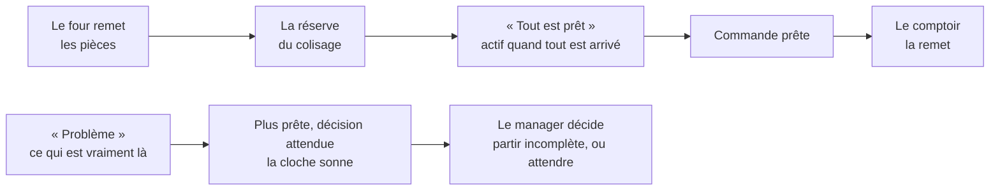

# Plan — le colisage simple, le retrait d'abord

**État : 📐 plan, rien n'est bâti** (2026-11-18). Décisions de Hugo des
2026-11-17 et 2026-11-18. Contredit par `vitruve` le 2026-11-18 (§ 8). La
réflexion qui le précède :
[`reflexion-colisage-simple.md`](reflexion-colisage-simple.md). La carte des
blocs et de tous les cas de figure :
[`../commandes/la-chaine-de-la-commande.md`](../commandes/la-chaine-de-la-commande.md).

Chaque affirmation sur l'existant a été ouverte le 2026-11-18 (chemins relatifs
à `apps/lfd-api/src/`).

---

## 1. En simple

Le colisage d'aujourd'hui demande, pour chaque commande, d'ouvrir des
contenants, d'y répartir chaque produit, puis de déclarer la commande prête.
C'est le niveau **détaillé** ; il reste tel quel.

On ajoute un niveau **simple**, réglé à l'écran et **par défaut**, **pour le
retrait au comptoir seulement**. La livraison garde le colisage détaillé : ses
bacs, leurs étiquettes et le chargement ne changent pas.

| Niveau              | Ce que fait l'équipe pour une commande à retirer                         |
| ------------------- | ------------------------------------------------------------------------ |
| **Simple** (défaut) | **« Tout est prêt »** ou **« Problème »**                                |
| **Détaillé**        | contenants, répartition, « Déclarer prête », « Il manque » (aujourd'hui) |

**Pas de toujours vert au colisage** (décidé par Hugo le 2026-11-18) : une
commande est toujours regardée par quelqu'un, au minimum un vert ou un rouge.
Le fournil, lui, garde son toujours vert.

- **« Tout est prêt »** s'active dès que le four a remis toutes les pièces de la
  commande (sans marge horaire, décidé par Hugo le 2026-11-18). Un appui : la
  commande est prête.
- **« Problème »** dit, produit par produit, combien est vraiment là. La
  commande **cesse d'être prête** et attend la décision du manager ; la
  **cloche** sonne chez qui peut décider, et la commande reste en rouge dans la
  **Supervision**. Les pièces dites absentes **sortent de la réserve** : elles
  ne seront pas données à une autre commande.

### Les faits du colisage sont à lui (Hugo, 2026-11-18)

Le colisage publie ce qu'il a fait, dans ses mots, et **ne sait pas qui
écoute** ; chaque voisin apprend à traiter ses faits. Aujourd'hui, deux faits
du colisage sont **déclarés dans le canal du fournil** : `packing.order_packed`
(`production/channels/packing/packing-order-packed.event.ts`) et
`packing.returned`. Ils rentrent au colisage (lot C0).

La livraison n'apprend pas encore : en retrait, rien ne la concerne. Le jour où
le colisage simple vaudra pour la livraison, c'est **elle** qui traitera
« commande colisée » pour créer son bac et son étiquette, au lieu que le
colisage l'appelle (`BinDesk`, dans la transaction du colisage). Ce sera un
plan à part.

## 2. Ce qui ne change pas

| Règle d'aujourd'hui                                                                                 | Au niveau simple                                |
| --------------------------------------------------------------------------------------------------- | ----------------------------------------------- |
| **La réserve** : on ne colise que ce que le four a sorti (`PackingStock.take`), jamais à découvert  | « Tout est prêt » passe par `take`, même verrou |
| **Le manque** : `PackingSheet.reportShortfall` fige ce qui est au sac, `packing.shortfall_reported` | « Problème » **est** ce geste                   |
| **La décision** : un sac incomplet ne se ferme pas sans décision (`ShortfallAwaitingDecisionError`) | inchangé                                        |
| **Carte et bon de fidélité** : jamais de départ incomplet                                           | inchangé                                        |
| **Annuler, modifier** : refusés sur un sac fermé (`withdrawSheet`, `reviseDue`)                     | inchangé — comme au détaillé                    |
| **La remise d'une commande pas colisée** (`leaveAtHandover`)                                        | inchangé                                        |
| **La livraison, les réassorts**                                                                     | toujours en détaillé                            |

## 3. Les décisions

- **D1 — Le retrait d'abord** (Hugo, 2026-11-18). Une fiche de livraison
  (`fulfillmentMethod: "delivery"`) et une fiche de réassort sont toujours
  détaillées, quel que soit le réglage.
- **D2 — Un réglage du colisage**, `pickupTrackingLevel`
  (`packing/domain/entities/packing-settings.ts`), `simple` ou `detailed`,
  défaut **simple**, réglé sur la page transverse **Réglages › Niveau de
  suivi** (ligne « Colisage — retrait »). La page lit et écrit chaque bloc par
  sa porte.
- **D3 — Le niveau est figé par fiche** à sa naissance
  (`on-packing-list-drawn.handler.ts`), que la liste vienne de l'arrêt ou du
  retirage : les deux publient `production.packing_list_drawn`
  (`production/plan/application/services/packing-list-facts.ts`). Une fiche de
  **reliquat** (rang > 1) prend le niveau de la fiche d'origine. Changer le
  réglage vaut pour les fiches suivantes.
- **D4 — « Tout est prêt »** : ouvre **un sac** (jamais un bac, pas de
  `BinDesk`), répartit chaque ligne (`allocate`, `take`), ferme (`seal`) et
  publie `order_packed`, dans une transaction, par intention. Refusé, avec ce
  qui manque nommé, si la réserve ne suffit pas ; le bouton est grisé tant
  que tout n'est pas arrivé.
- **D5 — « Problème »**, y compris sur une fiche fermée par « Tout est prêt » :
  le geste rouvre le sac (`PackingSheet.reopen`), y laisse ce qui est vraiment
  là, puis déclare le manque. Une fiche **déjà remise** est refusée. Saisir tout
  comme présent est refusé par le refus existant `nothing_short`, avec ses mots.
- **D6 — Les pièces dites absentes sortent de la réserve.** Laissées libres,
  le « Tout est prêt » d'une autre commande les prendrait, alors qu'elles
  n'existent pas. La réserve gagne un compteur **« manquant »**
  (`PackingStock`, nouvelle colonne) ; l'invariant devient
  `au sac + rendu + envoyé + manquant ≤ reçu`. Des pièces retrouvées se
  rendent à la réserve par le manager, depuis la commande, quand il décide
  (proposé ; un bouton « Retrouvé » au poste viendrait plus tard s'il manque).
- **D7 — Le commerce retire « prête » à un manque.** Aujourd'hui,
  `OrderShortfall.report` ne regarde pas le statut, et rouvrir un sac ne publie
  rien : le comptoir remettrait une commande dont la décision est attendue. Le
  commerce, propriétaire de « prête », fait repasser une commande prête en
  **« décision attendue »** quand il enregistre un manque sur elle. Premier
  changement du lot C2, avec son test.
- **D8 — La cloche sonne chez le commerce**, celui qui décide, quand il
  enregistre un manque (sur le modèle de `ring-failed-order-mail.handler.ts`).
  Vérifié le 2026-11-18 : aucun manque ne sonne aujourd'hui.
- **D9 — La correction du fournil** (`production.output_corrected`, « N pièces
  déclarées n'existent pas », décidé par Hugo le 2026-11-18) : le colisage
  baisse sa réserve de ce qui est **libre**, jusqu'à N. S'il reste un écart, il
  **ne touche à aucune commande** — quelqu'un a vu ce qui est au sac — et fait
  sonner la cloche du manager, qui décide. La réserve n'est jamais à
  découvert : on ne baisse que le libre, sous le verrou de la réserve. Les
  corrections déjà publiées avant ce lot se rattrapent par
  `OutputCorrectionsReader` (`production/channels/packing/output-corrections.reader.ts`,
  déjà relié dans `appBootstrap/packing-feed.module.ts`), qui donne un cumul
  par fournée : le colisage garde ce qu'il a déjà appliqué par fournée et
  n'applique que la différence.

## 4. Données

Migration `2026111xxxxxxx_le_colisage_simple`, schéma `packing`
(`prisma/schema/packing.prisma`), additive :

- `packing_settings.pickup_tracking_level text NOT NULL DEFAULT 'simple'`,
  CHECK `simple | detailed` ;
- `packing_order.tracking_level text NULL`, même CHECK : `NULL` pour une fiche
  d'avant la colonne, une livraison ou un réassort, lue **détaillé** ;
- `packing_stock.missing integer NOT NULL DEFAULT 0`, CHECK `>= 0`, et le CHECK
  de la réserve élargi au manquant (D6) ;
- une table `packing_applied_correction (service_day, batch_id, applied)` pour
  D9.

Toute fiche existante est détaillée, comme aujourd'hui. Cette migration passe
par `lecteur-de-migrations`.

## 5. Les gestes

| Geste             | Route (sous `production_packing:write`, par intention) | Ce qu'il compose, dans une transaction                                    |
| ----------------- | ------------------------------------------------------ | ------------------------------------------------------------------------- |
| « Tout est prêt » | `POST …/orders/:id/all-ready`                          | ouvrir un sac, `allocate` chaque ligne, `seal`, `order_packed`            |
| « Problème »      | `POST …/orders/:id/problem` (quantités par SKU)        | rouvrir si fermé, ajuster le sac, sortir l'absent (D6), `reportShortfall` |

## 6. Lots

- **C0** — `PackingOrderPackedEvent` et l'événement de `packing.returned`
  passent de `production/channels/packing/` à `packing/channels/` ; valeurs et
  clés inchangées. Importeurs à basculer, relevés le 2026-11-18 :
  `production/channels/commerce/index.ts` (réexport),
  `lafoliecoffee/orders/application/handlers/on-packing-order-packed.handler.ts`,
  `lafoliecoffee/delivery-notes/application/handlers/on-remainder-packed.handler.ts`,
  `packing/application/station/close-packing-order.handler.ts`, et l'abonné du
  fournil à `packing.returned`. Portes à relancer : `context-boundaries`,
  `production-subcontexts`, `durable-cross-block`.
- **C1** — migration, réglage, niveau figé, ligne de la page Niveau de suivi.
- **C2** — « Problème » (serveur et écran), D5 à D8.
- **C3** — « Tout est prêt » (serveur et écran).
- **C4** — la correction du fournil (D9). Aujourd'hui déjà, personne ne
  l'écoute : ce lot ferme ce trou pour les deux niveaux.
- **C5** — doc d'état, la réflexion retirée, la carte de la chaîne mise à jour.

## 7. Question ouverte

- **Q1** — D6 : les pièces retrouvées, rendues par le manager depuis la
  commande. Suffit-il, ou faut-il un bouton « Retrouvé » au poste ? (Proposé :
  le manager seul, le bouton plus tard s'il manque.)

## 8. Ce que `vitruve` a contredit (2026-11-18)

La première version avait un toujours vert au colisage. Hugo l'a retiré le
2026-11-18 ; plusieurs objections tombent avec lui.

| Objection                                             | Devenir                                                                 |
| ----------------------------------------------------- | ----------------------------------------------------------------------- |
| B1 « Problème » défait par le toujours vert           | sans objet ; l'absent sort quand même de la réserve (D6)                |
| B2 le commerce garde « prête » une commande en manque | D7                                                                      |
| B3 l'ordre des verrous de la correction               | sans objet : D9 ne baisse que le libre, sous un seul verrou par réserve |
| S4 le rattrapage des corrections déjà publiées        | D9, § 4                                                                 |
| S5 annulation et modification d'une auto-prête        | sans objet : comme au détaillé, c'est un humain qui ferme               |
| S6 l'auteur système chez le commerce                  | sans objet                                                              |
| S7 tous les importeurs du fait déplacé                | C0                                                                      |
| S8 reliquats et réassorts                             | D1, D3                                                                  |
| m — sac fermé, `nothing_short`, sac sans `BinDesk`    | D4, D5                                                                  |
