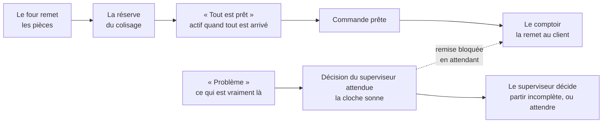

# Plan — le colisage simple, le retrait d'abord

**État : 📐 plan, rien n'est bâti** (2026-11-18). Décisions de Hugo des
2026-11-17 et 2026-11-18. Contredit deux fois par `vitruve` le 2026-11-18 ;
ses objections sont reprises dans les décisions (§ 8). La réflexion qui le
précède : [`reflexion-colisage-simple.md`](reflexion-colisage-simple.md). La
carte des blocs et de tous les cas de figure :
[`../commandes/la-chaine-de-la-commande.md`](../commandes/la-chaine-de-la-commande.md).

Chaque affirmation sur l'existant a été ouverte le 2026-11-18 (chemins relatifs
à `apps/lfd-api/src/`).

---

## 1. En simple

Le colisage d'aujourd'hui demande, pour chaque commande, d'ouvrir des
contenants, d'y répartir chaque produit, puis de déclarer la commande prête.
C'est le niveau **détaillé** ; il reste tel quel.

On ajoute un niveau **simple**, réglé à l'écran et **par défaut**, **pour le
retrait au comptoir seulement**. La livraison garde le colisage détaillé : ses
bacs, leurs étiquettes et le chargement ne changent pas.

| Niveau              | Ce que fait l'équipe pour une commande à retirer                         |
| ------------------- | ------------------------------------------------------------------------ |
| **Simple** (défaut) | **« Tout est prêt »** ou **« Problème »**                                |
| **Détaillé**        | contenants, répartition, « Déclarer prête », « Il manque » (aujourd'hui) |

**Pas de toujours vert au colisage** (décidé par Hugo le 2026-11-18) : une
commande est toujours regardée par quelqu'un, au minimum un vert ou un rouge.
Le fournil, lui, garde son toujours vert.

- **« Tout est prêt »** s'active dès que le four a remis toutes les pièces de la
  commande (sans marge horaire, décidé par Hugo le 2026-11-18).
- **« Problème »** dit, produit par produit, combien est vraiment là. La
  commande reste « prête », mais **le comptoir ne peut plus la remettre** tant
  que le superviseur n'a pas décidé ; la **cloche** sonne chez qui peut
  décider, et la commande reste en rouge dans la **Supervision**. Les pièces dites absentes sont mises de côté comme
  **manquantes** : elles ne seront données à aucune autre commande.
- Des pièces **retrouvées** se rendent au stock par le manager, depuis la
  commande, quand il décide.

### Les faits du colisage sont à lui (Hugo, 2026-11-18)

Le colisage publie ce qu'il a fait, dans ses mots, et **ne sait pas qui
écoute** ; chaque voisin apprend à traiter ses faits. Aujourd'hui, deux faits
du colisage sont **déclarés dans le canal du fournil** : `packing.order_packed`
(`production/channels/packing/packing-order-packed.event.ts`) et
`packing.returned`. Ils rentrent au colisage (lot C0).

La livraison n'apprend pas encore : en retrait, rien ne la concerne. Le jour où
le colisage simple vaudra pour la livraison, c'est **elle** qui traitera
« commande colisée » pour créer son bac et son étiquette, au lieu que le
colisage l'appelle (`BinDesk`, dans la transaction du colisage). Ce sera un
plan à part.

## 2. Ce qui ne change pas

| Règle d'aujourd'hui                                                                                 | Au niveau simple                                |
| --------------------------------------------------------------------------------------------------- | ----------------------------------------------- |
| **La réserve** : on ne colise que ce que le four a sorti (`PackingStock.take`)                      | « Tout est prêt » passe par `take`, même verrou |
| **Le manque** : `PackingSheet.reportShortfall` fige ce qui est au sac, `packing.shortfall_reported` | « Problème » **est** ce geste                   |
| **La décision** : un sac incomplet ne se ferme pas sans décision (`ShortfallAwaitingDecisionError`) | inchangé                                        |
| **Carte et bon de fidélité** : jamais de départ incomplet                                           | inchangé                                        |
| **Annuler, modifier** : refusés sur un sac fermé (`withdrawSheet`, `reviseDue`)                     | inchangé — c'est un humain qui ferme            |
| **Une commande pas colisée remise au comptoir** (`leaveAtHandover`)                                 | inchangé                                        |
| **La livraison, les réassorts**                                                                     | toujours en détaillé                            |

## 3. Les décisions

- **D1 — Le retrait d'abord** (Hugo, 2026-11-18). Une fiche de livraison
  (`fulfillmentMethod: "delivery"`) et une fiche de réassort sont toujours
  détaillées, quel que soit le réglage.
- **D2 — Un réglage du colisage**, `pickupTrackingLevel`
  (`packing/domain/entities/packing-settings.ts`), `simple` ou `detailed`,
  défaut **simple**, réglé sur la page transverse **Réglages › Niveau de
  suivi** (ligne « Colisage — retrait »). La page lit et écrit chaque bloc par
  sa porte.
- **D3 — Le niveau est figé par fiche** à sa naissance
  (`on-packing-list-drawn.handler.ts`), que la liste vienne de l'arrêt ou du
  retirage : les deux publient `production.packing_list_drawn`
  (`production/plan/application/services/packing-list-facts.ts`). Une fiche de
  **reliquat** (rang > 1) prend le niveau de la fiche d'origine.
- **D4 — « Tout est prêt »** : ouvre **un sac** (jamais un bac, pas de
  `BinDesk`), répartit chaque ligne (`allocate`, `take`), ferme (`seal`) et
  publie `order_packed`, dans une transaction, par intention. Refusé, avec ce
  qui manque nommé, si la réserve ne suffit pas ; le bouton est grisé tant que
  tout n'est pas arrivé.
- **D5 — « Problème »**, y compris sur une fiche fermée par « Tout est prêt » :
  le geste rouvre le sac (`PackingSheet.reopen`), y laisse ce qui est vraiment
  là, met l'absent de côté (D6), puis déclare le manque. Trois refus, avec
  leurs mots :
  - **la commande est déjà retirée par le client** : la fiche le sait par une
    colonne nouvelle, `handed_over_at`, écrite par l'abonné de
    `handover.handed_over` (`packing/application/handlers/on-order-handed-over.handler.ts`) ;
    c'est `reopen` qui refuse. Aujourd'hui, `leaveAtHandover` rend `unchanged`
    sur un sac fermé (`packing-sheet.ts:367`) et rien n'empêcherait de le
    rouvrir ;
  - **le manager a déjà décidé** : `reportShortfall` lève `already_authorized`
    (`packing-sheet.ts:213`) — « La décision est déjà prise : le manque se
    corrige depuis la commande. » ;
  - **tout est déclaré présent** : `nothing_short`, avec ses mots d'aujourd'hui.
- **D6 — Les pièces absentes sont mises de côté.** Laissées libres, le « Tout
  est prêt » d'une autre commande les prendrait. La réserve
  (`packing/domain/entities/packing-stock.ts`) gagne un compteur **`missing`**,
  et trois endroits le retirent : `free` (ce que peuvent prendre une commande,
  un retour au fournil et l'envoi en boutique), `availableTo` (ce qu'un
  réassort réservé peut prendre), et l'invariant du domaine vérifié à la
  relecture (`fromSnapshot`). Il n'y a **pas de CHECK** de la réserve en base
  aujourd'hui (seulement la positivité,
  `prisma/migrations/20261004180100_*/migration.sql`) : l'invariant reste dans
  le domaine, et la colonne a son CHECK `>= 0`. Le manager rend des pièces
  **retrouvées** depuis la commande (un geste du colisage, sous son droit) :
  `missing` baisse d'autant. Un bouton « Retrouvé » au poste viendrait plus tard
  s'il manque (proposé).
- **D7 — Le superviseur décide, le comptoir attend** (choix par défaut,
  réversible, posé le 2026-11-18 : Hugo veut la décision au superviseur, pas
  au comptoir). Aujourd'hui, `OrderShortfall.report` ne regarde pas le statut,
  et rouvrir un sac ne publie rien : le comptoir remettrait une commande dont
  la décision est attendue. **Le statut ne bouge pas** (« prête » est lu par
  trop d'écrans et d'e-mails pour redescendre). À la place :
  - la **remise normale** au comptoir est **refusée** tant qu'un manque attend
    une décision : « Il manque des produits : la décision du superviseur est
    attendue. » — à vérifier au bâti dans le chemin de la remise normale, et à
    ajouter s'il n'y est pas ;
  - le **départ incomplet au comptoir**
    (`lafoliecoffee/orders/http/admin-counter-incomplete-handover.controller.ts`,
    sous `handover_counter` seulement aujourd'hui) exige **aussi**
    `b2b_orders_shortfall:write`, le droit de la décision du superviseur
    (`admin-order-shortfall.controller.ts`). Un superviseur au comptoir le fait
    toujours ; un vendeur seul ne le peut plus. Frontière de droits : `vitruve`
    d'office, et à accorder à l'écran Rôles aux rôles superviseur.
  - **Rien n'est envoyé au client** au signalement : c'est la décision du
    superviseur qui déclenche la communication existante.
- **D8 — La cloche sonne chez le commerce**, celui qui décide, quand il
  enregistre un manque (sur le modèle de `ring-failed-order-mail.handler.ts`).
  Vérifié le 2026-11-18 : aucun manque ne sonne aujourd'hui.
- **D9 — La correction du fournil** (`production.output_corrected`, « N pièces
  déclarées n'existent pas », décidé par Hugo le 2026-11-18). Le compteur qui
  baisse est **`received`** : ces pièces ne sont jamais arrivées. Dans l'ordre,
  sous le verrou de la réserve `(jour, SKU)` :
  1. **elles expliquent d'abord le manquant** : `x = min(N, missing)`,
     `missing −= x`, `received −= x` — sans quoi la même pièce, déclarée
     absente au colisage puis corrigée au fournil, serait comptée deux fois ;
  2. **puis le libre** : `y = min(N − x, free)`, `received −= y` ;
  3. **le reste ne touche à aucune commande** — quelqu'un a vu ce qui est au
     sac — et fait sonner la cloche du manager.

  La réserve n'est jamais à découvert. **Idempotence et rattrapage** : une
  table `packing_applied_correction (service_day, handoff_id, sku, applied)`
  garde, par remise, ce qui a été **réellement baissé** (x + y). Une correction
  n'applique que la différence entre le cumul publié et `applied` ; un reste
  non couvert est retenté au fait suivant. Une remise retirée du fournil (le
  cumul disparaît du lecteur) ne fait **jamais remonter** la réserve. Une
  correction qui arrive **avant sa remise** (aucun `PackingReceipt` de ce
  `handoffId`) est reportée : la réception de la remise l'applique
  (`on-handed-to-packing.handler.ts`). Les corrections publiées avant ce lot se
  rattrapent au déploiement, pour les journées non closes, par
  `OutputCorrectionsReader` (`production/channels/packing/output-corrections.reader.ts`,
  relié dans `appBootstrap/packing-feed.module.ts`).

## 4. Données

Migration `2026111xxxxxxx_le_colisage_simple`, schéma `packing`
(`prisma/schema/packing.prisma`), additive :

- `packing_settings.pickup_tracking_level text NOT NULL DEFAULT 'simple'`,
  CHECK `simple | detailed` ;
- `packing_order.tracking_level text NULL`, même CHECK : `NULL` pour une fiche
  d'avant la colonne, une livraison ou un réassort, lue **détaillé** ;
- `packing_order.handed_over_at timestamptz NULL` (D5) ;
- `packing_stock.missing integer NOT NULL DEFAULT 0`, CHECK `>= 0` (D6) ;
- la table `packing_applied_correction (service_day, handoff_id, sku, applied)`,
  clé sur les trois premières, CHECK `applied >= 0` (D9).

Toute fiche existante est détaillée, comme aujourd'hui. Cette migration passe
par `lecteur-de-migrations`.

## 5. Les gestes

| Geste                           | Route (par intention)                                      | Ce qu'il compose, dans une transaction                                       |
| ------------------------------- | ---------------------------------------------------------- | ---------------------------------------------------------------------------- |
| « Tout est prêt »               | `POST …/orders/:id/all-ready` (`production_packing:write`) | ouvrir un sac, `allocate` chaque ligne, `seal`, `order_packed`               |
| « Problème »                    | `POST …/orders/:id/problem` (`production_packing:write`)   | rouvrir si fermé, ajuster le sac, mettre l'absent de côté, `reportShortfall` |
| « Pièces retrouvées » (manager) | `POST …/orders/:id/found` (`production_packing:write`)     | `missing` baisse ; les pièces redeviennent libres                            |

## 6. Lots

- **C0** — `PackingOrderPackedEvent` et l'événement de `packing.returned`
  passent de `production/channels/packing/` à `packing/channels/` ; valeurs et
  clés inchangées. Importeurs à basculer, relevés le 2026-11-18 :
  `production/channels/commerce/index.ts` (réexport),
  `lafoliecoffee/orders/application/handlers/on-packing-order-packed.handler.ts`,
  `lafoliecoffee/delivery-notes/application/handlers/on-remainder-packed.handler.ts`,
  `packing/application/station/close-packing-order.handler.ts`, et l'abonné du
  fournil à `packing.returned`. Portes à relancer : `context-boundaries`,
  `production-subcontexts`, `durable-cross-block`.
- **C1** — migration, réglage, niveau figé, ligne de la page Niveau de suivi.
- **C2** — « Problème » (serveur et écran), D5 à D8, « Pièces retrouvées ».
- **C3** — « Tout est prêt » (serveur et écran).
- **C4** — la correction du fournil (D9). Aujourd'hui déjà, personne ne
  l'écoute : ce lot ferme ce trou pour les deux niveaux.
- **C5** — doc d'état, la réflexion retirée, la carte de la chaîne mise à jour.

## 7. Questions ouvertes

Aucune : les pièces retrouvées se rendent par le manager (D6) ; un bouton au
poste viendra si l'équipe en a besoin.

## 8. Ce que `vitruve` a contredit (2026-11-18)

**Première contradiction** (avec un toujours vert au colisage, retiré depuis par
Hugo) :

| Objection                                             | Devenir                                                |
| ----------------------------------------------------- | ------------------------------------------------------ |
| B1 « Problème » défait par le toujours vert           | sans objet ; l'absent est mis de côté (D6)             |
| B2 le commerce garde « prête » une commande en manque | D7 : la remise est bloquée, la décision au superviseur |
| B3 l'ordre des verrous de la correction               | sans objet : D9 ne prend qu'un verrou, la réserve      |
| S4 le rattrapage des corrections déjà publiées        | D9                                                     |
| S5 annulation et modification d'une auto-prête        | sans objet : c'est un humain qui ferme                 |
| S6 l'auteur système chez le commerce                  | sans objet                                             |
| S7 tous les importeurs du fait déplacé                | C0                                                     |
| S8 reliquats et réassorts                             | D1, D3                                                 |

**Seconde contradiction** (la version simple) :

| Objection                                                      | Reprise                                              |
| -------------------------------------------------------------- | ---------------------------------------------------- |
| B1 le manquant et la correction comptaient deux fois une pièce | D9 étape 1                                           |
| B2 rien ne refusait de rouvrir une commande déjà retirée       | D5, `handed_over_at`                                 |
| S3 « décision attendue » n'est pas un statut                   | D7 : le statut ne bouge plus ; la remise est bloquée |
| S4 « Problème » après une décision du manager                  | D5, refus nommé                                      |
| S5 pas de CHECK de la réserve ; `free` et `availableTo`        | D6                                                   |
| S6 clé, contenu et moment du rattrapage                        | D9, § 4                                              |
| m « déjà remise » : le mot est réservé au prix                 | « retirée »                                          |
