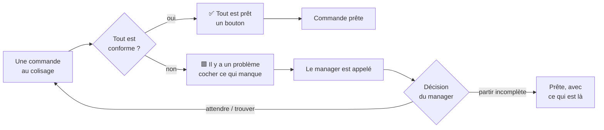

# Réflexion — un colisage simple, au choix

**État : 🗒️ réflexion, rien n'est décidé ni bâti** (2026-11-17). Demande de
Hugo : « le colisage qu'on a fait est extrêmement complet et c'est très bien,
seulement j'ai besoin d'en avoir une version simplifiée et qu'on choisisse quoi
utiliser avec un réglage (défaut simple) ». Les affirmations sur l'existant
ont été vérifiées le 2026-11-17 dans [`colisage.md`](colisage.md),
[`../commandes/reliquat/reliquat.md`](../commandes/reliquat/reliquat.md) et
`apps/lfd-api/src/packing/domain/entities/packing-sheet.ts`.

La fiche d'atelier a ses niveaux de suivi, bâtis : [`../fournil/les-niveaux-de-suivi.md`](../fournil/les-niveaux-de-suivi.md).

Ce document n'est pas un plan. Il pose l'idée, ce qu'elle garde, ce qu'elle
change, et les questions à trancher avant d'en écrire un. Le plan touchera à
ce qui est facturé (le manque) : il passera par `vitruve`.

---

## 1. En simple

Aujourd'hui, coliser une commande, c'est ouvrir des contenants (sacs, bacs),
y répartir chaque produit, imprimer les étiquettes, puis déclarer la commande
prête. C'est complet, et c'est long quand tout va bien, ce qui est le cas le
plus fréquent.

L'idée : un réglage **Réglages › Colisage › « Colisage simple / détaillé »**,
**simple par défaut**. En mode simple, une commande se traite en un geste :

- **✅ Le chemin vert, « Tout est prêt ».** Un bouton : chaque produit est
  considéré comme coché, la commande passe prête. Pas de contenant à ouvrir,
  pas de répartition, pas d'étiquette.
- **🟥 Le chemin rouge, « Il y a un problème ».** On coche les produits qui ne
  respectent pas le bon de commande, avec la quantité réellement là : 0 pour
  une absence, moins pour un manque partiel. Le manager est appelé, et il
  décide comme aujourd'hui : partir incomplète, ou attendre.

Le mode détaillé reste disponible, inchangé, pour qui en a besoin (bacs
partagés, étiquettes, plan de chargement).

## 2. Ce qui ne change pas

Le mode simple n'est **qu'un autre écran**. Ses deux gestes sont faits de
gestes qui existent déjà. Aucune règle n'est contournée :

| Règle d'aujourd'hui                                                                                                               | En mode simple                                                                                                                |
| --------------------------------------------------------------------------------------------------------------------------------- | ----------------------------------------------------------------------------------------------------------------------------- |
| **La réserve** : on ne met au bac que ce que le four a sorti (`PackingStock`, au bac ≤ reçu − rendu)                              | Le chemin vert est **refusé** tant que le four n'a pas sorti de quoi remplir la commande ; le bouton dit ce qui manque encore |
| **Le manque** : « Il manque » fige les quantités au bac et prévient le commerce (`reportShortfall`, `packing.shortfall_reported`) | Le chemin rouge **est** ce geste, avec les quantités cochées                                                                  |
| **La décision** : un bac incomplet ne se ferme pas sans décision (`ShortfallAwaitingDecisionError`)                               | Inchangé : le manager décide depuis la fiche commande                                                                         |
| **Le bon et la facture** ne comptent que ce qui part                                                                              | Inchangé                                                                                                                      |
| **Carte ou bon de fidélité** : jamais de départ incomplet (le remboursement n'est pas branché)                                    | Inchangé (question Q3)                                                                                                        |
| **Le fait `packing.order_packed`** fait passer la commande prête au commerce                                                      | Inchangé                                                                                                                      |

## 3. Ce qui change

### Le chemin vert, en coulisse

Le serveur fait en une transaction ce que le poste détaillé fait à la main :

1. ouvrir **un contenant** pour la commande (un sac pour un retrait, un bac
   pour une livraison, voir Q1) ;
2. y répartir **toutes** les quantités (`allocate`), sous le verrou de la
   réserve ;
3. fermer (`seal`).

C'est un geste par intention (une clé par clic), comme les autres écritures
du poste.

### Le chemin rouge, en coulisse

1. ouvrir le contenant et y répartir **ce qui est là**, selon les quantités
   cochées ;
2. déclarer le manque (`reportShortfall`), qui fige ces quantités et prévient
   le commerce ;
3. **appeler le manager** : c'est la seule chose vraiment neuve. Aujourd'hui,
   le manque se lit dans la page Commandes, la fiche commande et la
   Supervision, mais rien ne prévient quelqu'un (vérifié le 2026-11-17 : aucune
   notification de manque dans `staff/notifications/`).

### Les étiquettes

En mode simple, il n'y en a pas à imprimer. Pour un retrait, le sac porte le
numéro de commande écrit à la main ou rien, et le comptoir retrouve la commande
par son numéro. Pour une livraison, voir Q1.

## 4. Questions à trancher avant le plan

- **Q1 — La livraison.** Aujourd'hui, une livraison vit par ses **bacs** : ils
  sont déclarés à la livraison au colisage (`BinDesk`), ont un code court et un
  QR, se scannent au chargement, et « Partir » vérifie qu'ils sont chargés
  ([`chargement-les-bacs.md`](chargement-les-bacs.md)). Sans étiquette, deux
  voies :
  - **a.** en mode simple, une commande livrée a **un bac sans code à
    scanner**, et le chargement coche des **commandes** : il faut alors aussi
    un mode simple au chargement ;
  - **b.** le mode simple ne vaut d'abord que pour le **retrait au comptoir**,
    et la livraison garde ses bacs et leurs étiquettes. Plus petit, et ça
    permet d'essayer le principe.
- **Q2 — Appeler le manager.** Une notification dans la cloche du back-office
  suffit-elle, ou faut-il un son au poste du manager, un SMS, autre chose ?
  Qui est « le manager » : un rôle, ou une personne de garde ?
- **Q3 — Carte et bon de fidélité.** Une commande payée par carte ou par bon
  ne peut jamais partir incomplète aujourd'hui. Le chemin rouge appelle le
  manager quand même ; on garde le refus de partir incomplète (il doit trouver
  le produit ou joindre le client) ?
- **Q4 — Le chemin vert avant la fin du four.** Refuser tant que tout n'est
  pas sorti du four (proposé), ou laisser déclarer prêt « de confiance » ? La
  seconde voie casserait la réserve, qui empêche deux commandes de prendre les
  mêmes pièces.
- **Q5 — Le réglage.** Pour tout le colisage, ou par site / par acheminement
  (simple au comptoir, détaillé en livraison) ? Basculer en cours de journée :
  les commandes déjà commencées en mode détaillé restent dans leur mode.
- **Q6 — Les commandes déjà colisées en détaillé** s'affichent en lecture
  seule dans le mode simple, ou s'ouvrent dans le poste détaillé ?

## 5. Ce que le plan aura à vérifier

- Que la composition du chemin vert respecte l'ordre des verrous du poste
  (la commande, puis les bacs, puis la réserve, [`colisage.md`](colisage.md) § 4.3).
- Que le chemin rouge produit **le même** manque que « Il manque » au poste
  détaillé, pour que la décision du manager, le bon de livraison et la facture
  n'y voient aucune différence.
- Le droit : le chemin vert et le chemin rouge sous `production_packing:write`
  comme le poste ; la décision du manager reste sous son droit actuel.
- La Supervision et la page Commandes lisent le même `board` : elles doivent
  rester justes dans les deux modes.

## Ce que dit le terrain (2026-11-17)

La manager, rapportée par Hugo : **« ils ne cocheront jamais »**.

C'est la donnée qui tranche le mode par défaut. Un geste vert que personne ne
fait laisse tout « à faire » : l'écran ment alors dans l'autre sens, et le
manque réel se noie dans le faux. Donc :

- **le mode par défaut est « toujours vert »** : tout est réputé fait à
  l'heure prévue, et le seul geste demandé est le **rouge**, quand ça ne va
  pas ;
- le **rouge doit coûter le moins possible** : un geste, la quantité réelle,
  la raison facultative, et le manager prévenu sans rien faire de plus ;
- les modes simple et détaillé restent au réglage, pour qui veut suivre de
  près.
- **Au colisage aussi**, la conséquence est la même : une commande passe
  prête **d'elle-même** quand la réserve du colisage contient tout ce qu'elle
  demande, et le seul geste du poste est « Il y a un problème ». Comme au
  fournil, ce qui le déclenche est à trancher : à l'heure de l'échéance de la
  commande, ou dès que tout est reçu du four.

## Décidé par Hugo le 2026-11-17 : trois niveaux

| Niveau                     | Ce que fait l'équipe                                                 | Pour qui                          |
| -------------------------- | -------------------------------------------------------------------- | --------------------------------- |
| **Toujours vert** (défaut) | rien, sauf le rouge quand ça ne va pas                               | l'équipe qui ne cochera jamais    |
| **Simple**                 | un vert ou un rouge par produit (fournil) ou par commande (colisage) | qui veut confirmer sans détailler |
| **Détaillé**               | fournées, plaques et paliers ; contenants, répartition et étiquettes | qui veut tout suivre              |

Restent à trancher avant le plan : le moment où « toujours vert » considère un
produit sorti (proposé : l'heure de chaque palier), la façon d'appeler le
manager, la correction d'un vert après coup, et si fournil et colisage
partagent un réglage ou en ont un chacun.

## Une page transverse : Réglages › Niveau de suivi (décidé par Hugo le 2026-11-17)

Le niveau de suivi est une même question posée à chaque poste : combien de
gestes demande-t-on à l'équipe ? Elle se règle sur **une seule page**, une
ligne par poste, le même choix à trois niveaux et une phrase qui dit ce que
l'équipe aura à faire.

| Poste                    | Toujours vert           | Simple                                         | Détaillé                            |
| ------------------------ | ----------------------- | ---------------------------------------------- | ----------------------------------- |
| **Fournil**              | rien, sauf « Problème » | « Fait » ou « Problème » par produit           | fournées, plaques, paliers          |
| **Colisage — retrait**   | rien, sauf « Problème » | « Tout est prêt » ou « Problème » par commande | contenants, répartition, étiquettes |
| **Colisage — livraison** | plus tard               | plus tard                                      | bacs, étiquettes (aujourd'hui)      |
| **Chargement**           | plus tard               | plus tard                                      | scan des bacs (aujourd'hui)         |

Les réglages voisins de même nature peuvent y venir : le contrôle qualité au
fournil et au colisage, le partage des demi-bacs.

**La page rassemble, elle ne possède pas.** Chaque bloc garde son réglage et
la règle qui va avec ; la page les lit et les écrit chacun par sa porte. Une
table centrale « complexité » qui commanderait les modules mélangerait leurs
règles, et aucun ne pourrait plus changer la sienne seul.

## Décision 2 — appeler le manager (Hugo, 2026-11-17)

Comme au fournil : **la cloche du back-office** pour toutes les personnes qui
ont le droit, et le rouge **visible sur l'écran de Supervision**, dans la
colonne du colisage, tant que le manager n'a pas décidé.

## L'indépendance du colisage (Hugo, 2026-11-17)

Le colisage **ne connaît pas le niveau du fournil**. Il reçoit des faits
(« N pièces remises », « rends-moi N pièces ») et doit savoir les traiter à
**chacun de ses niveaux**, y compris en toujours vert, où il rend seul ce qui
n'est dans aucune commande et déclare un manque sur les commandes déjà prêtes.
Voir [`../fournil/les-niveaux-de-suivi.md`](../fournil/les-niveaux-de-suivi.md).

## 🔴 La correction de déclaration et la réserve (Hugo, 2026-11-17)

Le fournil publie « N pièces déclarées n'existent pas » (`production.output_corrected`,
[`../fournil/les-niveaux-de-suivi.md`](../fournil/les-niveaux-de-suivi.md), « Reste à faire »).
Le colisage baisse alors sa réserve de N. **Contrainte** : la réserve ne doit
**jamais** passer à découvert (au bac ≤ reçu − rendu, et
`PackingStock.fromSnapshot` refuse une réserve à découvert). Il faut donc
**d'abord** retirer des commandes les pièces qui n'existent plus et les
déclarer en manque, **puis** baisser la réserve, dans une seule unité de
travail, sous les verrous dans leur ordre (commande, bacs, réserve). Le plan du
colisage tranche quelles commandes perdent les pièces.
