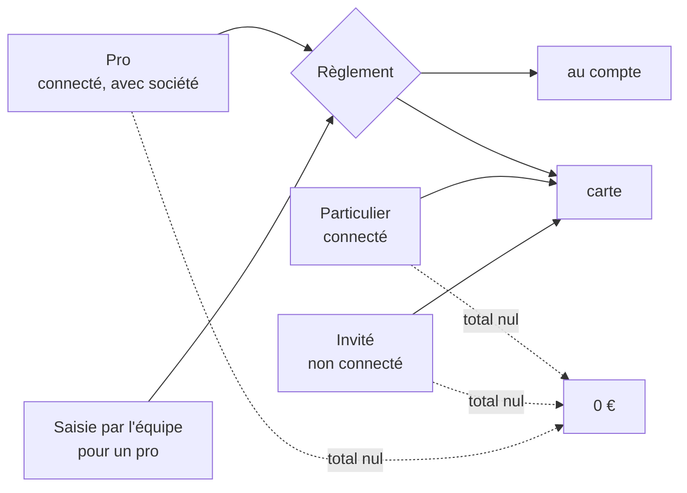
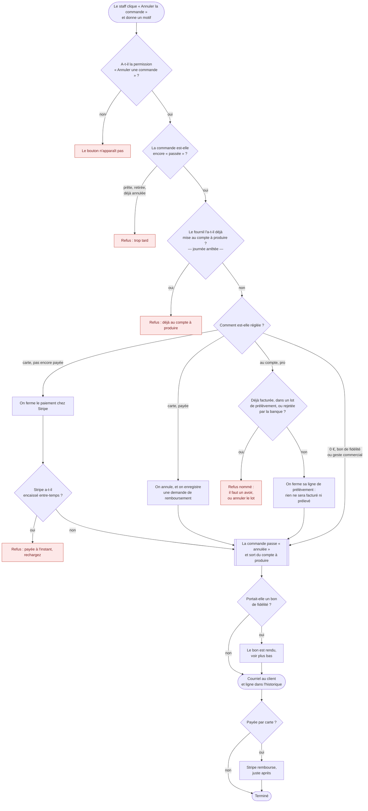
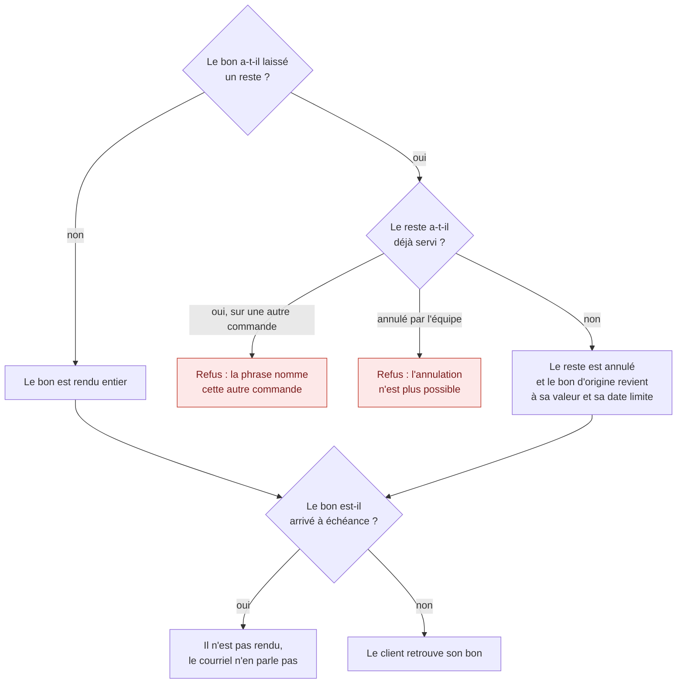
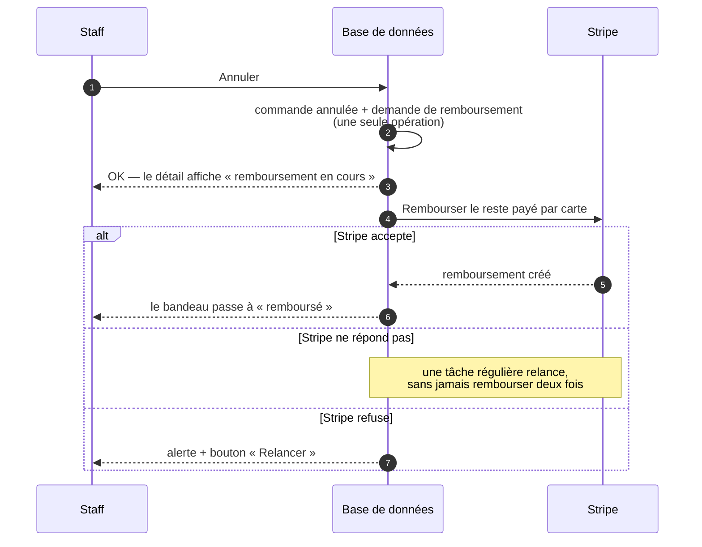
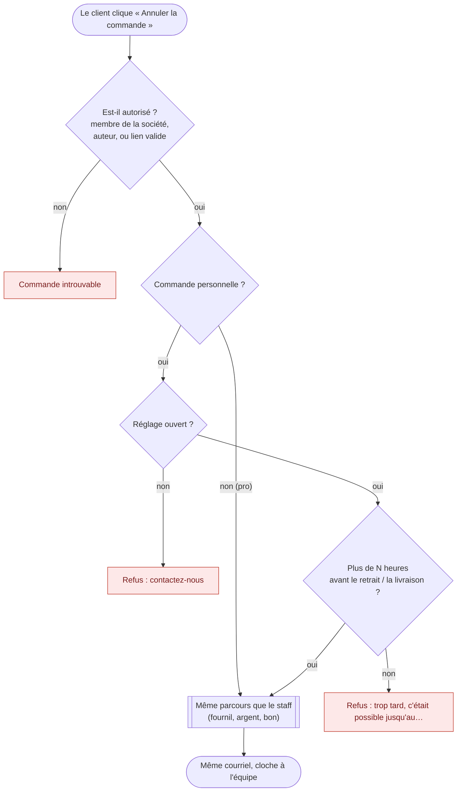

# L'annulation d'une commande, en un schéma

> **État au 2026-10-13** : tout ce qui suit est bâti et en production (lots C3,
> C3b, C5 et C4). Le détail et les raisons sont dans
> [`plan-annulation-de-commande.md`](plan-annulation-de-commande.md) ; l'ordre
> des verrous dans [`verrous-de-l-annulation.md`](verrous-de-l-annulation.md).

> 📐 **Décidé, PAS bâti : lot C6, l'annulation par le client** (Hugo,
> 2026-10-13 — [plan, Lot C6](plan-annulation-de-commande.md#lot-c6--annulation-par-le-client-depuis--mes-commandes--conçu-le-2026-10-13-pas-bâti)).
> Rien de la section « Demain » ci-dessous n'existe dans le code.

Aujourd'hui, **seul le staff annule**, depuis le détail d'une commande au
back-office, avec la permission « Annuler une commande ». Le client ne peut
pas encore annuler depuis « Mes commandes ».

## Selon le client

Le parcours est le même pour tous : ce qui change, c'est **comment le client
règle**, et ça dépend de qui il est.

| Client                                       | Comment il règle                                 | Ce que l'annulation fait de l'argent                                                     | Où part le courriel                            |
| -------------------------------------------- | ------------------------------------------------ | ---------------------------------------------------------------------------------------- | ---------------------------------------------- |
| **Pro**, connecté                            | au compte, ou carte                              | au compte : la ligne de prélèvement est fermée ; carte : paiement fermé ou remboursement | son adresse de compte                          |
| **Commande saisie par l'équipe** pour un pro | au compte si la société a du crédit, sinon carte | comme un pro                                                                             | l'adresse du compte du pro, pas celle du staff |
| **Particulier**, connecté                    | carte, toujours (jamais au compte)               | paiement fermé, ou remboursement                                                         | son adresse de compte                          |
| **Invité**, non connecté                     | carte, toujours                                  | paiement fermé, ou remboursement                                                         | l'adresse tapée au panier                      |
| N'importe lequel, **total à 0 €**            | rien à régler (bon ou geste)                     | aucun argent ; le bon est rendu                                                          | comme ci-dessus                                |

Deux précisions :

- **Le pro qui abandonne lui-même son panier** garde son paiement ouvert, pour
  pouvoir payer plus tard. **L'annulation par le staff, elle, ferme le paiement
  pour tout le monde**, pro compris.
- **Personne n'annule soi-même pour l'instant** : ni le pro, ni le particulier,
  ni l'invité. C'est toujours le staff, quel que soit le client. L'annulation
  depuis « Mes commandes » est un lot à venir.

## Le parcours

On lit de haut en bas. Les cases rouges sont des refus : l'écran affiche la
raison avant même le clic, et rien n'est écrit.

## Le bon de fidélité

Quand la commande portait un bon, l'annulation le rend au client. Si le bon
avait laissé un **reste** (un nouveau bon pour la différence), ce reste est
**refondu** dans le bon d'origine. Le staff lit ce qui va se passer avant de
confirmer.

Aucun point de fidélité n'est recrédité : le bon a déjà été payé en points.

## Le remboursement d'une commande payée

L'annulation est écrite **d'abord**, la demande de remboursement avec elle.
Stripe est appelé **ensuite**, parce qu'un remboursement parti ne se reprend
pas.

Ce qui est rendu : **tout ce qui a été payé par carte**, livraison et frais de
retard compris. Ce qui a été payé avec un bon n'est jamais rendu en argent :
c'est le bon qui revient.

## Ce que le client reçoit

| La commande était…      | Le courriel dit                                             |
| ----------------------- | ----------------------------------------------------------- |
| carte, pas encore payée | qu'aucun paiement n'a été prélevé                           |
| carte, payée            | que le remboursement est en cours                           |
| au compte               | « Rien ne sera facturé ni prélevé pour cette commande. »    |
| avec un bon             | que son bon lui est rendu (sauf s'il est arrivé à échéance) |

Le **motif** saisi par le staff reste au journal : il n'est jamais montré au
client.

## Demain : le client annule lui-même (lot C6, décidé, pas bâti)

> 📐 **Pas bâti au 2026-10-13.** Mêmes règles que le staff : le client passe
> par le même noyau, avec moins de droits, jamais plus.

| Client          | Qui peut annuler                                             | Quand                                                                              | Comment il s'identifie                                                        |
| --------------- | ------------------------------------------------------------ | ---------------------------------------------------------------------------------- | ----------------------------------------------------------------------------- |
| **Pro**         | tout membre **accepté** de **cette** société, société active | tant que le fournil ne l'a pas mise au compte à produire                           | sa session, depuis « Mes commandes »                                          |
| **Particulier** | l'auteur                                                     | si Réglages › Commandes l'autorise, jusqu'à N h avant, et pas au compte à produire | sa session, depuis « Mes commandes »                                          |
| **Invité**      | le porteur du lien                                           | comme le particulier                                                               | le lien d'annulation de son courriel de confirmation (s'il n'a pas de compte) |

Le lien de l'invité ouvre **toujours** la page de sa commande. Si elle n'est
plus annulable, la page dit pourquoi (annulations en ligne fermées, délai
passé, déjà en production, déjà annulée, déjà retirée) et propose de
contacter la boutique ; le lien ne montre plus rien 90 jours après la date de
retrait. La page ne montre que le nécessaire : ni nom de famille, ni adresse,
ni téléphone. Quand elle est annulable, elle demande de confirmer : jamais
d'annulation à la simple ouverture, parce que les messageries suivent les
liens toutes seules. Les commandes passées avant C6 n'ont pas de lien : rien
n'est rétroactif. Le lien ne contient rien que le serveur garde : il se
recalcule, et un courriel renvoyé porte le même.
