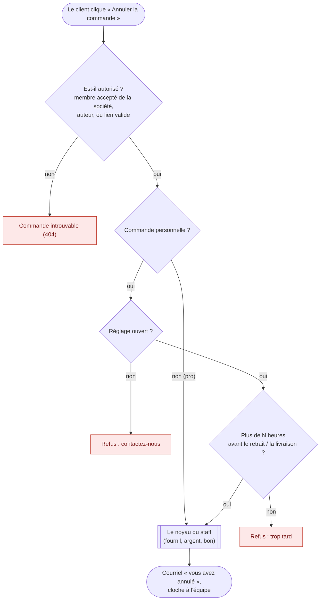

# Annuler une commande — par le client

> **État au 2026-10-13 : bâti, commité sur `dev` le 2026-10-13**
> (`bf6b7d019`, API, `@lfd/contracts`, boutique et back-office ; migration
> `20261013100000_l_annulation_par_le_client`), en cours de déploiement.
>
> Le client passe par **le même noyau** que le staff — critère, fermeture de
> l'intention Stripe, refusion du bon, ligne d'encaissement fermée,
> remboursement : tout cela est décrit **une fois**, dans
> [`annulation-par-le-staff.md`](annulation-par-le-staff.md), et l'ordre des
> verrous dans [`verrous-de-l-annulation.md`](verrous-de-l-annulation.md). Ce
> document ne décrit que ce que le client **ajoute** : qui, quand, par où, et
> ce qu'il lit.
>
> Ce document remplace le lot C6 du plan d'annulation (supprimé le
> 2026-10-13). Les numéros de section (C6.4…) sont ceux du plan :
> le code les cite.

## Les décisions de Hugo (2026-10-13)

1. **« Mêmes règles »** que l'annulation staff : le client entre par le même
   noyau, avec moins de droits, jamais plus.
2. **Pro** : « si la commande est partie en production on ne peut plus
   l'annuler » — aucun délai de plus. Qui : « ceux qui peuvent commander » au
   nom de la société.
3. **Particulier (connecté ou invité)** : « j'ai besoin qu'on ait ce réglage
   en Réglages › Commandes » — un interrupteur, et un délai avant le retrait
   ou la livraison.
4. **Invité** : « le lien annulation doit être dans son mail de
   confirmation », corrigé le même jour : le lien ne cesse pas de marcher, il
   ouvre toujours la page de la commande et dit pourquoi quand elle n'est plus
   annulable.

## Le parcours

| Client          | Qui peut annuler                                             | Quand                                                                              | Par où                                                   |
| --------------- | ------------------------------------------------------------ | ---------------------------------------------------------------------------------- | -------------------------------------------------------- |
| **Pro**         | tout membre **accepté** de **cette** société, société active | tant que le fournil ne l'a pas mise au compte à produire                           | sa session, « Mes commandes »                            |
| **Particulier** | l'auteur                                                     | si Réglages › Commandes l'autorise, jusqu'à N h avant, et pas au compte à produire | sa session, « Mes commandes »                            |
| **Invité**      | le porteur du lien                                           | comme le particulier                                                               | le lien de son courriel de confirmation, page `/annuler` |

## C6.2 Qui peut annuler — le mur

`CancellationWall` (`b2b/orders/application/services/cancellation-wall.ts`) :

- **commande personnelle** : son auteur (`placedByUserId`), et lui seul ;
- **commande de société** (saisie par l'équipe comprise) : un rattachement
  **accepté** sur la société **de la commande**, société `active`, tout rôle
  (`billing` compris). Pas `roleOf` tel quel : il admet une invitation vivante
  non acceptée. Aucune hérédité vers les sites ; l'espace actif n'entre pas
  en compte, aucun id de société n'est reçu.

Le mur est **plus strict que la passation**, et c'est voulu : la passation
fait régler par carte une société non active, l'annulation la refuse. Hors
mur : **404** « Commande introuvable », jamais 403.

## C6.3 Le critère client : celui du staff, plus deux

Pour une commande **personnelle** seulement, deux refus **devant** la règle
du staff, lus à `customer_cancellation_settings` :

| #   | Refus                                        | Code client |
| --- | -------------------------------------------- | ----------- |
| P1  | le réglage est fermé (`open_to_b2c = false`) | `closed`    |
| P2  | il reste moins de N heures avant l'**ancre** | `too_late`  |

**L'ancre** (`customer-cancellation-window.ts`) : le jour de service à l'heure
de début de la fenêtre figée, heure de Paris ; sans heure de début, **minuit**
du jour — la borne la plus tôt. P2 se compare au `now` **gelé** de la requête :
une attente de verrou ne repousse pas l'échéance. Un pro n'a ni P1 ni P2 :
seul le fournil ferme la porte.

## C6.4 L'invité : un lien d'annulation

- **Jeton déterministe, rien de stocké** : `base64url(HMAC-SHA256(orderId,
clé))`, la clé **dérivée** de `FIELD_ENCRYPTION_KEY` par HKDF sous
  l'étiquette `lfd/order-cancellation-link/v1` (`AppConfig.cancellationLinkKey`).
  Un courriel renvoyé porte le même lien. 🔴 **Une rotation de
  `FIELD_ENCRYPTION_KEY` tue tous les liens envoyés**
  ([`secrets-et-variables.md`](../../ops/secrets-et-variables.md)).
- **Dans `OrderPlacedMail`**, pour toute commande d'invité, quel que soit le
  chemin d'envoi. Les comptes (particuliers connectés, pros) reçoivent à la
  place un lien **sans secret** vers la liste `mes-commandes`
  (`order-manage-link.ts`) : un jeton contournerait le mur.
- **Le jeton voyage en fragment** : `/annuler#<orderId>.<jeton>`. Le
  navigateur ne l'envoie jamais ; la page le met dans le **corps** de deux
  `POST` publics, `shop/orders/cancellation/view` (20/min/IP) et
  `shop/orders/cancellation/confirm` (5/min/IP, `204`), tous deux
  `Cache-Control: no-store`, `Referrer-Policy: no-referrer`
  (`guest-order-cancellation.controller.ts`).
- **Vérification** en temps constant. Jeton faux, commande inconnue, commande
  d'une société, ou au-delà de **90 jours** après la date de retrait (ou la
  passation sans date) : la **même** réponse, « Lien introuvable ».
- **Le jeton identifie, il ne décide pas** : la page s'ouvre toujours et dit
  l'état réel (annulations fermées, délai passé, déjà en préparation, déjà
  annulée, déjà retirée) avec « Contactez la boutique » ; le `confirm` relit
  tout sous les verrous. **Jamais d'annulation sur un `GET`** : les messageries
  suivent les liens toutes seules.
- **La fiche a un compte** (`auth0Sub`) : « Connectez-vous pour gérer cette
  commande » ; fiche désactivée : « Contactez la boutique ».
- **La page montre le nécessaire** : numéro, date, mode (point de retrait, ou
  la seule ville), articles, montant, état, ce qui arrivera à l'argent et au
  bon, le prénom. Jamais nom de famille, adresse, téléphone, courriel, QR.
- Les commandes d'invité passées avant C6 n'ont pas de lien : le staff les
  annule.

## C6.5 Le réglage — « Réglages › Commandes »

Un CRUD honnête dans `b2b/order-opening/` (aucune règle ne refuse son
écriture), table `public.customer_cancellation_settings`, une ligne `orders` :
`open_to_b2c` (défaut **fermé**), `hours_before` (défaut **24**, entre 0 et
168), auteur figé. Routes `GET` / `PATCH /admin/customer-cancellation`, même
surface que l'ouverture de la boutique (`b2b_settings`). Écran du back-office
`/b2b/reglages/commandes` (`b2b/reglages/customer-cancellation-page/`). La
valeur n'est pas datée : elle décide d'un geste au moment où il est fait, et le
journal de l'annulation fige ce qui a été appliqué. Les colonnes d'auteur sont
au registre RGPD.

## C6.6 La route, la commande, l'auteur

- **Connecté** : `POST /orders/:id/cancel`, corps `{ reasonCode?, reasonText? }`,
  `204` → `CancelOrderByCustomerCommand`. **Invité** : C6.4 →
  `CancelGuestOrderCommand`. Les deux passent par `CustomerOrderCancellation`
  (mur, P1, P2, traduction des refus), qui appelle le noyau
  `OrderCancellation` avec l'acteur `customer` ou `guest`.
- **En base** : `cancelled_by` reste **nul** (c'est la fiche staff) ;
  `cancelled_by_kind` = `customer` | `guest` ; `cancelled_by_user_id` = le
  client (donnée client, pas staff) ; un `CHECK` à sens unique tient la paire.
  `order_refund_request.requested_by` reste nul.
- **Le motif est facultatif** : liste close `cancellation_reason_code`
  (`no_longer_needed`, `wrong_date`, `wrong_products`, `other`, valeurs
  irréversibles) et texte libre (`CustomerCancellationReason`).
- **Le fait `order.cancelled`** porte `cancelledByKind` et
  `cancelledByUserId` ; un fait d'avant C6, sans eux, se relit comme `staff`.
  Le journal cite « le client » ou le membre de la société au lieu d'un staff.

## C6.7 Les refus, pour un client

Le noyau lève les erreurs du staff ; `CustomerOrderCancellation` les traduit
en code `orders.customer_cancel.<refus>` et en phrase écrite pour un client
(`customer-cancellation-refusal.ts`) :

| Refus client                              | Vient de                                        |
| ----------------------------------------- | ----------------------------------------------- |
| `already_cancelled`, `ready`, `fulfilled` | statut                                          |
| `in_preparation`                          | inscrite au fournil (« déjà en préparation »)   |
| `closed`, `too_late`                      | P1, P2                                          |
| `payment_in_progress`                     | paiement en traitement, remboursement en vol    |
| `paid_just_now`                           | `already_paid` de Stripe                        |
| `not_recorded`                            | Stripe injoignable, transaction non écrite      |
| `invoiced`                                | tout refus du compte (facturée, en lot, rejet…) |
| `voucher_reused`                          | reliquat du bon engagé ou annulé                |
| `account_required`, `account_disabled`    | lien d'une fiche qui a un compte, ou désactivée |

Aucune phrase client ne cite le motif staff, une autre commande par son
numéro, ni le fournil comme acteur.

## C6.8 Les écrans de la boutique

`apps/lfc-ecommerce-frontend/src/app/client/order-cancellation/` :

- `GET /orders/:id` porte `cancellability` (le noyau **et** P1/P2, sans
  verrou), lue par `order-cancel-section/` dans le détail « Mes commandes » :
  bouton « Annuler la commande » si annulable ; pour un refus durable
  (fournil, prête), il disparaît ; pour « trop tard », une ligne dit jusqu'à
  quand c'était possible ;
- `cancel-order-dialog/` : ce qui arrive à l'argent et au bon, motif
  facultatif, « Annuler ma commande » / « Garder ma commande » ; relecture
  après succès ;
- `guest-cancel-page/` : la page publique `/annuler`, hors shell client, même
  formulaire (`cancel-order-form/`).

Libellés fr/en/it dans `copy/screens/order-cancel.copy.ts`, recueil régénéré
par `pnpm copy:digest`.

## C6.9 Le courriel et la cloche

- **Le même** `customer.order-cancelled` que le staff (mêmes phrases d'argent
  et de bon, [`annulation-par-le-staff.md`](annulation-par-le-staff.md)) ;
  seule l'ouverture change : « Vous avez annulé votre commande… » ou
  « {name} a annulé la commande {ref} de {company}… ». Le motif n'y figure pas.
- **Cloche à l'équipe** `order.cancelled_by_customer`, abonné durable
  `orders.ring-customer-cancellation`, une clé par commande, lien
  `/commandes/:id` — sans elle, l'équipe découvrirait l'annulation à la
  clôture. Silencieuse pour une annulation staff.

## C6.10 Les tests

E2E `order-customer-cancel.e2e-spec.ts` (mur, réglage, délai, argent, acteur
au journal), `order-guest-cancel.e2e-spec.ts` (jeton, fragment, 90 jours,
fiche avec compte, données absentes de la réponse, débits) ; unitaires du
handler, de la fenêtre, du motif, de la cloche ; specs des composants de la
boutique. Les suites `order-staff-cancel*` passent inchangées après
l'extraction du noyau.

## Reste ouvert (au 2026-10-13)

**Choix métier — tranchés par Hugo le 2026-10-13** (« 1 côté client, motif
facultatif, 2 oui 3 oui […] 5 oui 7 oui 6 oui 8 oui », puis « garde minuit »).
Ce qui est bâti est ce qu'il a choisi :

| #      | Question                                         | Défaut appliqué                          |
| ------ | ------------------------------------------------ | ---------------------------------------- |
| Q-C6.1 | motif obligatoire ?                              | facultatif, liste + texte                |
| Q-C6.2 | le rôle `billing` peut-il annuler ?              | oui, comme il peut commander             |
| Q-C6.3 | un membre annule la commande d'un autre membre ? | oui ; le courriel dit qui a annulé       |
| Q-C6.4 | ancre sans heure de début                        | minuit du jour                           |
| Q-C6.5 | nom de l'entrée                                  | « Commandes », `/b2b/reglages/commandes` |
| Q-C6.6 | réglage au déploiement                           | fermé, 24 h                              |
| Q-C6.8 | cloche à chaque annulation client                | oui                                      |
| Q-C6.9 | borne du lien d'invité                           | 90 jours                                 |

**Hors périmètre** : annulation partielle (c'est l'avenant) ; délai pour les
pros ; rattrapage des liens des commandes d'invité d'avant C6 ; un lien
profond par commande dans « Mes commandes » (le courriel des comptes mène à la
liste).

## Historique

- **2026-09-17** — le premier plan prévoyait déjà une route client ; `vitruve`
  objectait que tout membre d'une société pourrait annuler la commande d'un
  collègue (S2) et qu'un invité n'avait aucun moyen d'annuler (S6). Reporté au
  lot client.
- **2026-10-13** — décisions de Hugo (ci-dessus), lot C6 conçu, contredit par
  `vitruve` et bâti le même jour. Sort des objections, toutes tranchées par
  des décisions d'ingénierie : B1 jeton HMAC déterministe, rien de stocké
  (puis clé dérivée de `FIELD_ENCRYPTION_KEY`, sans variable de plus) ; B2
  rattachement accepté seulement et société active ; S3 fiche avec compte
  refusée ; S4 `cancelled_by_kind` et `CHECK` à sens unique ; S5 délai contre
  le `now` gelé, assumé ; S6 contrôleur invité à part, débit propre ; S7
  jeton en fragment, envoyé dans un corps ; S8 relecture d'un fait d'avant C6
  testée. Le plan devient ce document.
