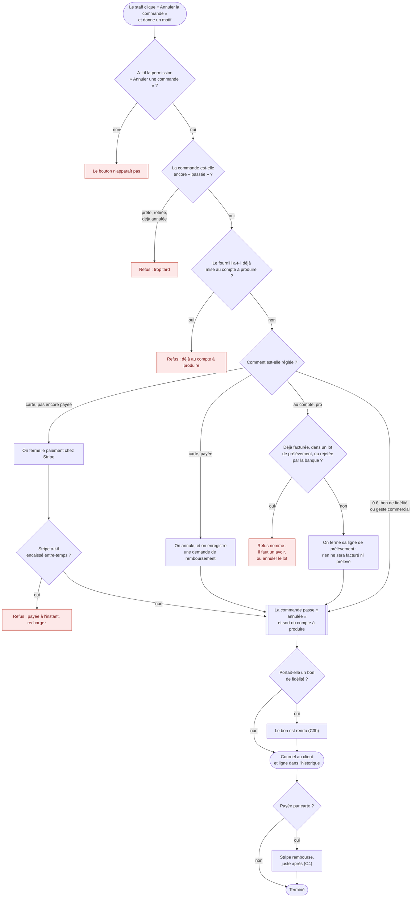
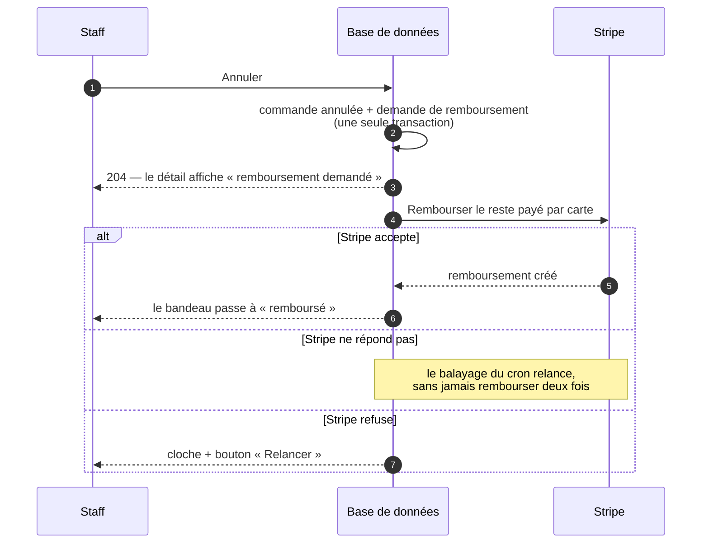

# Annuler une commande — par le staff

> Ce qui reste à faire : [`todo-annulation.md`](todo-annulation.md).

> **État au 2026-10-13 : bâti et sur `dev`.** Lots C3 (carte non payée, total
> nul), C3b (refusion du bon, [`fusion-du-bon.md`](fusion-du-bon.md)), C5 (au compte) et C4 (carte payée, avec
> remboursement), commits `76d54e9f6` à `ccde38758` (12 octobre). Le noyau
> décrit ici sert aussi l'annulation par le client :
> [`annulation-par-le-client.md`](annulation-par-le-client.md). L'ordre des
> verrous et les courses avec la comptabilité :
> [`verrous-de-l-annulation.md`](verrous-de-l-annulation.md).
>
> Ce document remplace le plan d'annulation et son schéma (supprimés le
> 2026-10-13). Les numéros de section (C3.4, C4.7…) sont ceux du plan : le
> code les cite.

**Portée** : la transition `placed → cancelled`, ce qu'elle fait de l'argent
et du bon, ce qu'elle dit au client. Ni l'avenant (modifier une commande), ni
l'annulation d'une commande déjà au compte à produire.

## La règle, en une phrase

> « on doit pouvoir annuler une commande tant qu'elle n'est pas ajoutée au
> compte à produire » — Hugo, 2026-10-12.

Le critère n'est pas le statut `placed` : c'est **le fournil ne l'a pas
inscrite**. Avant l'arrêt de sa journée, rien n'est fabriqué : tout ce qui a
été payé se rend.

## Le parcours

On lit de haut en bas. Les cases rouges sont des refus : l'écran affiche la
raison avant même le clic, et rien n'est écrit.

## Selon le client

Le parcours est le même pour tous ; ce qui change, c'est **comment le client
règle**. Le régime est figé à la passation (`settlementRegimeOf`,
`b2b/orders/domain/services/settlement-regime.ts`) : `account`
(`not_required`, total > 0), `free` (`not_required`, total nul), `due`
(`pending` ou `failed`), `paid` (`paid`, `refunded`).

| Client                                       | Comment il règle                                 | Ce que l'annulation fait de l'argent                                                     | Où part le courriel                            |
| -------------------------------------------- | ------------------------------------------------ | ---------------------------------------------------------------------------------------- | ---------------------------------------------- |
| **Pro**, connecté                            | au compte, ou carte                              | au compte : la ligne de prélèvement est fermée ; carte : paiement fermé ou remboursement | son adresse de compte                          |
| **Commande saisie par l'équipe** pour un pro | au compte si la société a du crédit, sinon carte | comme un pro                                                                             | l'adresse du compte du pro, pas celle du staff |
| **Particulier**, connecté                    | carte, toujours                                  | paiement fermé, ou remboursement                                                         | son adresse de compte                          |
| **Invité**, non connecté                     | carte, toujours                                  | paiement fermé, ou remboursement                                                         | l'adresse tapée au panier                      |
| N'importe lequel, **total à 0 €**            | rien à régler (bon ou geste)                     | aucun argent ; le bon est rendu                                                          | comme ci-dessus                                |

Le pro qui **abandonne** lui-même son panier garde son paiement ouvert pour
payer plus tard ; l'**annulation**, elle, ferme le paiement pour toutes les
clientèles.

## Le noyau commun — `OrderCancellation`

Le staff et le client passent par **le même service applicatif**,
`OrderCancellation.cancel(orderId, intent)`
(`b2b/orders/application/services/order-cancellation.service.ts`). Le handler
staff (`CancelOrderHandler`) l'appelle directement ; les deux handlers client
(`CancelOrderByCustomerHandler`, `CancelGuestOrderHandler`) passent par
`CustomerOrderCancellation`, qui ajoute les refus du client puis l'appelle.
Aucun handler n'en appelle un autre par le bus. L'intention porte l'**acteur**
(`CancellationActor`, `b2b/orders/domain/services/cancellation-actor.ts`) :

| Acteur     | `orders.cancelled_by_kind` | Colonne d'auteur                                 |
| ---------- | -------------------------- | ------------------------------------------------ |
| `staff`    | `staff`                    | `cancelled_by` — la FICHE staff, jamais un `sub` |
| `customer` | `customer`                 | `cancelled_by_user_id`                           |
| `guest`    | `guest`                    | `cancelled_by_user_id` (la fiche invité)         |

La règle (`cancellationOf`, `b2b/orders/domain/services/order-cancellation.ts`)
est la même pour tous : un client a **moins** de droits, jamais plus — il
ajoute ses refus devant elle (voir la doc client).

### C3.3 Le critère, et où il se lit

| #   | Refus, dans cet ordre                                       | Où il se lit                                             |
| --- | ----------------------------------------------------------- | -------------------------------------------------------- |
| 1   | déjà `cancelled`                                            | `orders.status`                                          |
| 2   | `draft`, `confirmed`, `in_production`, `ready`, `fulfilled` | `orders.status`                                          |
| 3   | au compte : facturée, engagée, rejetée (C5.2)               | `AccountOrderEngagement`                                 |
| 4   | carte payée : un remboursement est en vol (C4.2)            | carnet `order_refund`                                    |
| 5   | **inscrite par le fournil**                                 | `production.production_order`, par `OrderWithdrawalDesk` |
| 6   | `due` : Stripe ne confirme pas l'intention morte            | issue de `cancelIntent` (C3.4 bis)                       |
| 7   | le bon : son reliquat a resservi ou a été annulé (C3b)      | `LoyaltyVoucherRedemption.reinstate`                     |

Le statut seul ne suffit pas : la clôture enregistre l'instantané puis le
commerce passe `confirmed` dans un abonné durable ; entre les deux, une
inscrite reste `placed`. Le retirage inscrit des `placed` sans rien publier au
commerce.

### C3.4 Le retrait au fournil, et la course avec la clôture

Clôture et retirage lisent `DayOrdersReader.producibleFor` **avant**
`ProductionDayLock` : prendre le verrou de journée ne suffit pas. Ce qui tient
la course :

- le fournil déclare et implémente `OrderWithdrawalDesk.withdraw(day, orderId):
"withdrawn" | "inscribed"` (`production/channels/commerce/`), exécuté **dans
  l'unité de travail de l'appelant**. Il prend `ProductionDayLock`, lit
  `production_order`, sinon écrit `production.order_withdrawal` (clé primaire
  `order_id`, `INSERT … ON CONFLICT DO NOTHING` : idempotent) ;
- **l'agrégat du fournil écarte les retraits** : `ProductionDay.close(…)` et
  `ProductionDay.retake(…)` les reçoivent, chargés sous le verrou ;
- côté commerce, dans la même transaction, un `updateMany` conditionné sur
  `status = placed` et le régime ; `0` ligne → relire, rendre le refus exact,
  et **toute** la transaction s'annule, retrait au fournil compris.

Écriture nue justifiée (CLAUDE.md §3.1), comme `absorbIntoPlan`. Les autres
lecteurs de `producibleFor` (alerte de l'arrêt automatique, fiche) disent et
n'inscrivent pas : une annulée en disparaît d'elle-même (`planWhere()`).

### C3.4 bis Fermer l'intention Stripe d'une carte non payée

**Stripe d'abord, la transaction ensuite** — l'ordre de l'abandon : un échec
Stripe n'écrit rien, et aucun appel réseau n'est fait sous le verrou de
journée.

1. lire la commande, `cancellationOf` hors verrou — refus immédiats, aucun
   appel ;
2. si `due` et une intention existe : `cancelIntent` — `cancelled` /
   `already_cancelled` → continuer ; `already_paid` → refus `paid_just_now`
   (« payée à l'instant, rechargez : l'annulation proposera le
   remboursement ») ; `in_progress` → refus ; `unavailable` → refus « Stripe
   ne répond pas », journalisé en `warn`. Une `due` sans intention : aucun
   appel ;
3. la transaction, dans l'ordre de C3.4 ter.

Une commande n'a qu'une intention (`createIntent` n'est appelé qu'à la
passation, vérifié le 2026-10-12) : la fermer ferme tout ce qui peut encaisser.
Un webhook d'échec tardif sur une annulée n'écrit rien (`settle()` porte
`status <> cancelled`).

### C3.4 ter La transaction, le double clic, l'échec après Stripe

Dans cet ordre :

1. `SELECT … FROM orders WHERE id = $1 FOR UPDATE`, puis relire : `cancelled`
   → « déjà annulée » (409), sans écriture. Le second clic, ou le second
   staff, attend le premier sur cette ligne ;
2. au compte : lire l'engagement et fermer la ligne d'encaissement (C5.4) ;
3. `OrderWithdrawalDesk.withdraw` (verrou de journée) ;
4. `updateMany` conditionné ; `count === 1` seulement rend le bon (C3b),
   enregistre la demande de remboursement (C4.6) et publie le fait durable.

`cancelled_by`, `cancellation_reason` et `cancelled_at` ne s'écrivent que
dans cette transaction finale. **Si elle échoue après une fermeture réussie
chez Stripe**, le service la rejoue une fois dans la requête ; si elle échoue
encore, `TechnicalError` code `orders.cancel.not_recorded` (l'écran dit la
phrase d'après le code : `AppErrorFilter` masque le message d'un 500). Le
rejeu du staff obtient `already_cancelled` de Stripe et écrit. Risque
résiduel assumé : si personne ne relance, la commande reste `placed` + `due`
avec une intention morte, jamais producible, et la clôture ou l'expiration
des impayés boutique finit par l'annuler comme « paiement non abouti » —
aucun argent en jeu.

Le rejeu n'existe que pour la branche Stripe : pour une carte payée (C4), un
échec de transaction n'a rien fait chez Stripe, il rend une erreur simple.

### C3.5 Ce que devient la commande

- **`status = cancelled`**, règlement inchangé (le carnet le fera passer
  `refunded` pour une payée).
- `cancelled_at`, `cancelled_by_kind`, l'auteur (tableau ci-dessus) et le
  motif. Staff : motif **obligatoire**, borné, jamais montré au client. Les
  trois annulations automatiques (abandon, expiration boutique, échec à
  l'arrêt) laissent ces colonnes vides.
- **Le fait durable `order.cancelled`** (`OrderCancelledEvent`), écrit dans
  l'unité de travail. Abonnés : le journal (sujet = le client, charge : qui,
  motif, régime, `voucher`, `refund`), la croissance qui soustrait, le
  courriel `customer.order-cancelled` (clé `order.cancelled:<orderId>`), et la
  cloche « annulée par le client » (silencieuse pour le staff).
- 🔴 Valeurs **irréversibles** dès la première ligne en production (CLAUDE.md
  §8) : `regime` (`free`, `due`, `account`, `paid`), `cancelled_by_kind`.

### C3.6 Effets sur les autres blocs

| Bloc         | Effet                                                                                                                                           |
| ------------ | ----------------------------------------------------------------------------------------------------------------------------------------------- |
| fournil      | une ligne `order_withdrawal`, écartée par l'agrégat à la clôture et au retirage                                                                 |
| colisage     | aucun : la liste naît de l'instantané de clôture                                                                                                |
| livraison    | rien n'est défait (l'adresse géocodée reste) ; prévisionnel et départ relisent le statut                                                        |
| retrait      | les deux gestes verrouillent la ligne `orders` (voir ci-dessous) : un seul passe ; `markFulfilled` porte en plus `status <> cancelled`          |
| comptabilité | au compte : ligne `order_collection` fermée (C5.4) ; carte payée : aucune facture carte possible (elle exige une commande retirée), aucun avoir |

**Retrait × annulation — un seul gagne (2026-10-25).** Jusqu'à cette date, la
phrase « un retrait n'écrase pas une annulation » était vraie et insuffisante :
lancés ensemble, les deux gestes passaient — l'attestation `order_handover`
écrite (201), la commande annulée et remboursée (204), et le sac tendu au
comptoir. Le retrait n'apprend le statut `fulfilled` au commerce que par un
fait durable, APRÈS sa transaction ; l'annulation ne pouvait donc pas le voir.

Désormais les deux prennent la **même ligne `orders` en `FOR UPDATE`** dans
leur transaction, et le second relit sous le verrou :

- le retrait verrouille par `HandoverOrderLock` (déclaré par le retrait dans
  `handover/channels/commerce/`, implémenté par le commerce), AVANT de lire
  l'existant et d'écrire ; une commande annulée entre-temps est refusée :
  « Cette commande vient d'être annulée : ne la donnez pas. » (409,
  `handover.refused`) ;
- l'annulation, sous son verrou, demande au retrait s'il a attesté
  (`OrderHandoverHistoryReader`) ; si oui : `orders.cancel.fulfilled`,
  « déjà retirée : elle ne s'annule plus » (409), rien n'est touché.

Au comptoir, le verrou du retrait est le premier de sa transaction. À la
porte (`attestQuietly`, dans l'unité du livreur), il vient APRÈS ceux que la
clôture de l'arrêt tient déjà : l'ordre des verrous de la livraison face à
celui de l'annulation (`verrous-de-l-annulation.md`) **n'a pas été relu** le
2026-10-25. Un interblocage y serait détecté par Postgres (une des deux
transactions échoue, rien n'est écrit à moitié), pas silencieux.
Éprouvé par `test/order-staff-cancel-races.e2e-spec.ts`, rejoué cinq fois.

### C3.7 Les refus nommés

Tous des `BusinessError` (409), code `orders.cancel.<bloc>`, phrase écrite
pour du personnel qui n'a pas le code sous les yeux :

| Cas                    | Phrase                                                                                                                   |
| ---------------------- | ------------------------------------------------------------------------------------------------------------------------ |
| déjà annulée           | « Cette commande est déjà annulée (le JJ/MM à HH:mm). »                                                                  |
| inscrite au fournil    | « Le fournil a déjà inscrit cette commande au compte à produire du JJ/MM : elle sera fabriquée. Voyez avec le fournil. » |
| prête / retirée        | « Cette commande est déjà prête » / « déjà retirée ».                                                                    |
| paiement en traitement | « Un paiement par carte est en cours de traitement sur cette commande. Réessayez dans quelques minutes… »                |
| Stripe injoignable     | « Le prestataire de paiement ne répond pas : rien n'a été annulé. Réessayez dans un instant. »                           |
| motif vide             | `DomainError` (400) « Indiquez pourquoi la commande est annulée. »                                                       |

Les refus du compte sont en C5.6, ceux du bon en [C3b.7](fusion-du-bon.md), ceux de l'argent en
C4.2.

### C3.8 La route, le droit, l'écran

- **Route** : `POST /admin/orders/:id/cancel`, corps `{ reason }`, `204`,
  `CancelOrderCommand` + handler séparés.
- **Droit** : ressource **`b2b_cancel_order`**, action `write`
  (`@RequirePermission("b2b_cancel_order:write")`). La migration
  `20261012700000_le_droit_d_annuler_une_commande` n'a ajouté que la valeur ;
  le droit s'accorde **à l'écran** `/admin/staff-roles`
  (`lint:no-role-grants-in-migrations`).
- **Aperçu** : `GET /admin/orders/:id` porte `cancellability` —
  `{ cancellable: true, voucher, refund } | { cancellable: false, reason }`,
  calculée par la même règle, sans verrou.
- **Écran** (`apps/lfd-backoffice-frontend/src/app/commandes/order-cancel/`) :
  bouton « Annuler la commande » visible avec le droit, **désactivé avec la
  raison du serveur** sinon ; confirmation en ligne (motif obligatoire, phrase
  du bon, phrase du remboursement, « Confirmer l'annulation » / « Garder la
  commande ») ; relecture après succès. L'historique du détail lit
  `order.cancelled`.

## C3b — la refusion du bon

Ce que l'annulation fait du bon de fidélité (rendu, reliquat refondu, échu,
refus) a sa page : [`fusion-du-bon.md`](fusion-du-bon.md).

## C5 — une commande au compte

> Hugo, 2026-10-12 : annuler une commande au compte vient après le lot
> livraison et avant le remboursement.

La seule nouveauté est la **frontière avec la comptabilité** : l'annulation
**ferme** la ligne d'encaissement, et aucun geste comptable ne sait plus la
toucher (« interdire plutôt que vérifier »).

### C5.2 Le critère

Une commande `account` est annulable ssi, dans cet ordre : `placed` ; **non
facturée** (aucune ligne `invoice_order`) ; **non engagée** (`order_collection`
absente, `due` ou `excluded`) ; **jamais rejetée par la banque** ; non
inscrite au fournil ; bon selon C3b. Un refus comptable ne verrouille pas la
journée.

### C5.3 Le verrou commun

La ligne `orders`, `FOR UPDATE`, partout où une commande au compte entre dans
une facture, un lot, ou change d'état d'encaissement hors lot.
`PrismaOrderRowsLock.lockAll(ids)` les prend dans l'ordre `ORDER BY id
COLLATE "C"` pour l'émission mensuelle et la constitution des lots ; la
constitution relit sous verrou et ne constitue rien sur ce qu'elle a lu
avant. Schémas et ordre complet :
[`verrous-de-l-annulation.md`](verrous-de-l-annulation.md).

### C5.4 Fermer la ligne d'encaissement

L'annulation écrit, dans sa transaction, l'état terminal **`cancelled`** de
`order_collection` (`OrderCollection.close` / `closedAtCancellation` si la
ligne n'existe pas ; migration `20261012900000_la_ligne_d_encaissement_fermee`).
Aucune transition comptable n'accepte cet état. « Régler autrement » prend
`OrderInvoicingLock` avant `load`. Libellé `cancelled` : « Commande annulée »
(`ORDER_COLLECTION_STATE_LABELS`).

### C5.5 Le port côté commande

`AccountOrderEngagement` (écriture : `engagementOf`, `closeForCancellation`)
et `AccountOrderEngagementReader` (lecture, pour l'aperçu), déclarés par
`b2b/orders`, implémentés par la comptabilité (`AccountOrderEngaging`, relié
par `appBootstrap/account-order-engagement.module.ts`), exécutés dans l'unité
de travail de l'annulation. Pour `account`, un engagement illisible refuse
(`engagement_unknown`), jamais « annulable ».

### C5.6 Les refus nommés

| Bloc                 | Phrase (abrégée)                                                                               |
| -------------------- | ---------------------------------------------------------------------------------------------- |
| `invoiced`           | « … facturée le JJ/MM/AAAA (facture n° F…). … il faut un avoir… Voyez avec la comptabilité. »  |
| `collecting`         | « … dans le lot de prélèvement du JJ/MM/AAAA… Annulez d'abord ce lot… s'il n'est pas déposé… » |
| `collected`          | « … déjà été prélevée… voyez avec la comptabilité. »                                           |
| `written_off`        | « … passée en perte après un rejet de prélèvement… »                                           |
| `returned_before`    | « Le prélèvement de cette commande a déjà été rejeté par la banque puis représenté… »          |
| `settled_otherwise`  | « … réglée hors prélèvement… »                                                                 |
| `engagement_unknown` | « L'état de facturation de cette commande n'a pas pu être lu : rien n'a été annulé… »          |

Aucun appel Stripe pour une commande au compte. Le courriel dit « Rien ne
sera facturé ni prélevé pour cette commande. »

## C4 — une commande payée par carte, avec remboursement

> « je pense que souvent l'annulation aura lieu post paiement » — Hugo,
> 2026-10-12.

Une commande payée s'annule **de son paiement jusqu'à l'arrêt de sa journée
de service**.

### C4.2 Le critère

Régime `paid` (`paid` ou `refunded`), `placed`, non inscrite, **aucun
remboursement en vol** au carnet (bloc `refund_in_flight` : « Un
remboursement de X € est en cours chez Stripe… Attendez son issue, puis
annulez. »), bon selon C3b.

### C4.3 L'ordre des gestes — la base d'abord, Stripe ensuite

**L'inverse de C3.4 bis**, parce qu'un remboursement ne se reprend pas :
l'argent à rendre devient un **état persisté**, écrit dans la transaction de
l'annulation ; Stripe vient après, rejouable.

### C4.4 Le montant

`à rendre = chargedCents − Σ order_refund.amount (succeeded)`, lu sous le
verrou de la ligne `orders`. Tout ce qui a été payé par carte, livraison et
surtaxe de retard compris ; la part payée en bon n'est jamais rendue en
argent (`total_cents` est déjà net du bon). Reste nul (déjà remboursée depuis
Stripe) → annulée **sans** demande. 🔴 Ce qui protège l'argent est l'appel
**sans `amount`** : Stripe ne rend jamais plus que le reste remboursable.

### C4.5 La demande : `order_refund_request`

Table de `b2b/orders` (migration `20261012950000_la_demande_de_remboursement`),
**une demande par commande** (`order_id` PK). Cause `OrderRefundCause` :
`cancellation`, `paid_after_cancellation`, `refund_reversed`. Elle garde ce
qui a été **promis** (`announced_cents`) et **tenté** (`generation`, `round`,
`attempts`, `last_failure`, `next_attempt_at`, bail `claimed_until` /
`claim_token`) — **aucun statut stocké** : `refundRequestStateOf(request,
ledger)` lit l'état au carnet (`to_issue`, `issued`, `refunded`, `failed`).
`requested_by` est la fiche staff, nul pour une cause automatique ou un
client.

### C4.6 La transaction d'annulation

Troisième branche de `cancel()` (`paymentStatus in (paid, refunded)`,
règlement inchangé), puis `OrderRefundRequest.request(…)` dans la même unité
de travail si le reste est positif. Ordre des verrous inchangé.

### C4.7 Émettre le remboursement

`IssueOrderRefundCommand`, **jamais exécuté dans une transaction ni dans un
abonné durable**. Trois déclencheurs : `deferUntilCommit` après
l'annulation ; le balayage `POST /admin/orders/refunds/sweep` sur le cron
(`container/worker.ts`, 20 demandes par passage, jeton machine) ; le bouton
« Relancer ».

1. prendre le **bail** (5 min, `REFUND_LEASE_MS`), mesuré à l'horloge murale
   `WallClock` (`platform/time/`) — jamais au `now` gelé de la requête ;
2. hors transaction, `PaymentRefunder.refundRemainder` (port à part de
   `PaymentGateway`) : **chercher d'abord** un `re_…` de cette demande et de
   cette génération par métadonnée, sinon le créer avec la clé
   `lfd-order-refund:<orderId>:<generation>:<round>`, sans `amount` ;
3. transaction courte : constat au carnet (`ledger.record`, exactement comme
   le webhook), écriture de la demande conditionnée par jeton + génération.
   Aucune issue ne lève : `issued`, `nothing_left`, `declined` (plus de rejeu
   automatique), `unavailable` (`round + 1`, prochaine échéance par
   `retry-policy.ts`).

Un `COMMIT` perdu après un `re_…` créé : la recherche le retrouve, jamais un
second. Un remboursement émis puis `failed` : cloche, état `failed`,
« Relancer » ouvre la génération suivante — pas de relance automatique.

### C4.8 Journal, courriel, cloche

- `order.cancelled` porte `regime: "paid"` et `refund: null | { announcedCents }` ;
  faits `order.refund_attempt_failed`, `order.refund_issued` (quand l'émis
  diffère de l'annoncé), `order.refund_failed`, `order.refund_reversed`.
- Courriel **à l'annulation** : « Le montant de 23,40 € payé par carte vous
  sera remboursé sur cette même carte… » ; reste nul : « Le paiement de cette
  commande vous a déjà été remboursé. » Aucun second courriel au
  remboursement réussi.
- Cloche `order.refund_attention`, lien `/commandes/:id`, seulement sur
  incident (premier `unavailable`, `declined`, `nothing_left`, `failed`).

### C4.9 L'écran et les routes

- La confirmation affiche `cancellability.refund.sentence` (« Le client sera
  remboursé de 23,40 € sur sa carte (livraison comprise)… »).
- `GET /admin/orders/:id` porte `refund` ; le détail d'une annulée montre un
  **bandeau à quatre états** (`order-refund-banner/`) avec « Relancer le
  remboursement ».
- `POST /admin/orders/:id/refund/retry`, **`202`**, même droit
  `b2b_cancel_order:write`. Elle n'appelle pas Stripe : refus nommés (pas de
  demande, déjà remboursé, `awaiting_bank`, bail tenu « Stripe traite déjà ce
  remboursement »), sinon déclenche l'exécuteur après validation.

### C4.11 L'encaissé après annulation

Un paiement qui arrive sur une commande déjà annulée (`order.paid_after_cancellation`)
est **remboursé automatiquement** par le même chemin : l'abonné durable
`orders.refund-paid-after-cancellation` ouvre une demande
`paid_after_cancellation` si aucune n'existe et que le reste est positif.
Ces commandes restent `cancelled` + `failed` : le statut ne dit rien de
l'argent, la demande le dit.

### C4.11 bis Les filets du même passage

- le lecteur « encaissé après annulation » ne retient que `paymentStatus =
failed` : un `succeeded` relivré sur une annulée payée ne rembourse pas deux
  fois ;
- un remboursement réussi qui échoue ensuite sur une annulée publie
  `order.refund_reversed` ; l'abonné `orders.reopen-refund-on-reversal` ouvre
  ou rouvre la demande et sonne ; elle attend le bouton ;
- un remboursement fait au tableau de bord dont le webhook n'est pas arrivé
  passe `refund_in_flight` : Stripe ne rend que le reste réel, l'écart va au
  journal (`order.refund_issued`). Assumé.

## Ce que le client reçoit

Un seul courriel, `customer.order-cancelled` (fr, en, it), sans QR ni motif.
L'ouverture dit qui a annulé (« … a été annulée par notre équipe »), puis :

| La commande était…      | Le courriel dit                                                |
| ----------------------- | -------------------------------------------------------------- |
| carte, pas encore payée | « Aucun paiement n'a été prélevé. »                            |
| carte, payée            | que le montant payé par carte sera remboursé sur la même carte |
| déjà remboursée         | « Le paiement de cette commande vous a déjà été remboursé. »   |
| au compte               | « Rien ne sera facturé ni prélevé pour cette commande. »       |
| total nul               | « Rien ne vous sera facturé pour cette commande. »             |
| avec un bon             | que son bon lui est rendu (sauf s'il est arrivé à échéance)    |

## Les tests (C3.8, C3b.9, C5.9, C4.12)

Aux trois niveaux. Les e2e : `order-staff-cancel*.e2e-spec.ts` (C3 : courses
clôture et retirage, double clic, rejeu après Stripe, issues de
`cancelIntent`), `order-staff-cancel-voucher*.e2e-spec.ts` (C3b : six issues,
chaîne de reliquats, index partiel), `order-account-cancel*.e2e-spec.ts` (C5 :
annulation × émission, × constitution, × « régler autrement », pas
d'interblocage), `order-staff-cancel-refund*.e2e-spec.ts` (C4 : exécuteur,
bail, générations, balayage ; le double de Stripe refuse d'être appelé sous
transaction).

## Reste ouvert (au 2026-10-13)

**À bâtir** :

- le filtre **« remboursement à faire »** de la liste `/commandes` (demandes
  `to_issue` avec essais, et `failed`) — prévu en C4.9, pas bâti ;
- l'annulation HTTP d'un **reliquat** par le staff tombe en 500 (recrédit de
  0 point refusé par `loyalty_ledger_entries_kind_shape`) — constaté au bâti
  de C3b le 2026-10-12, non revérifié depuis.

**Choix métier, défauts bâtis, non tranchés par Hugo** :

| #     | Question                                      | Défaut appliqué                                                               |
| ----- | --------------------------------------------- | ----------------------------------------------------------------------------- |
| C5 Q1 | commande dans un lot non déposé               | refus « annulez d'abord le lot » ; plus tard, retirer une commande d'un lot ? |
| C5 Q2 | commande au compte facturée                   | refus ; l'avoir sur facture mensuelle n'existe pas                            |
| C5 Q3 | commande re-présentée après un rejet bancaire | refus ; plus tard, l'annuler en clôturant son retour ?                        |
| C4 Q1 | combien rendre                                | tout l'encaissé carte ; une retenue demanderait de passer `amount`            |
| C4 Q2 | courriel quand l'argent part                  | non                                                                           |
| C4 Q3 | remboursement refusé ou échoué chez Stripe    | cloche + bouton ; « remboursé autrement » n'existe pas                        |
| C4 Q4 | annuler après l'arrêt (commande fabriquée)    | refus ; un remboursement sans annulation serait un autre lot                  |
| C4 Q5 | encaissé après annulation                     | remboursement automatique (C4.11)                                             |

**Hors périmètre** : annulation partielle (c'est l'avenant), libération d'un
créneau de retrait (aucune réservation n'existe), restitution d'une
dérogation d'heure limite consommée (elle visait une journée).

## Historique

- **2026-09-17** — demande de Hugo : « tant qu'on n'est pas `confirmed` on
  peut cancel », « envoi d'un mail de confirmation d'annulation ». Premier
  plan contredit par `vitruve` (4 BLOQUANT, 7 SÉRIEUX) : `placed` ne veut pas
  dire « pas au fournil » (B1), un échec Stripe après l'écriture n'avait pas
  de reprise (B2, B3), « déjà payée » remboursait deux fois (B4). Abandonnés :
  la valeur `voided`, le remboursement synchrone sans webhook.
- **2026-10-12** — décisions de Hugo : critère « non inscrite », le staff
  d'abord, une permission à part, l'option (a) (fermer l'intention Stripe
  d'une carte non payée), le bon utilisé rendu ; puis Q1-Q3 de C3b (« oui aux
  trois propositions »). Lots C3, C3b, C5, C4 conçus, contredits par
  `vitruve` et bâtis le même jour. Sort des objections : C3 — B1, B2, B4, S1
  réglées, S2 (qui dans une société) reportée au client ; C3b — 2 BLOQUANT
  réglés (remplacement sec de `voucherReturned`, verrou de l'expiration et
  `save` conditionnel), index partiel défendu par un e2e ; C5 — lecture
  coupée en deux sous `lockAll`, ligne d'encaissement fermée plutôt que
  filtrée, une course préexistante « réglée autrement × constitution »
  fermée au passage, re-présentée refusée par défaut ; C4 — aucun appel Stripe
  sous transaction ni dans un abonné durable, horloge murale pour le bail,
  recherche par génération avant création, valeurs irréversibles dites.
- **2026-10-13** — C6 extrait le noyau `OrderCancellation` du handler staff,
  comportement inchangé (les suites `order-staff-cancel*` passent telles
  quelles). Le plan devient ce document.
