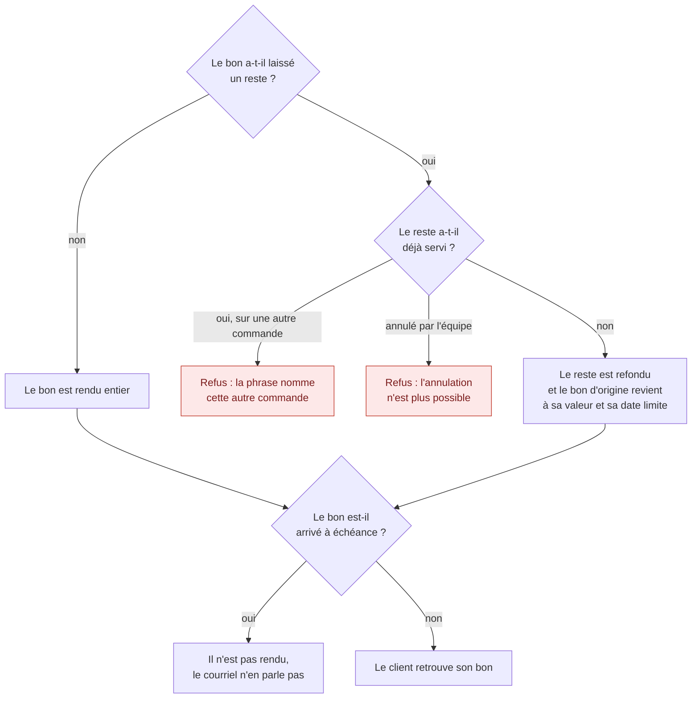

# Le bon de fidélité à l'annulation — la refusion

> **État au 2026-10-13 : bâti** (lot C3b, 12 octobre), sorti le 2026-10-13 de
> [`annulation-par-le-staff.md`](annulation-par-le-staff.md) pour avoir sa
> page. Il sert les deux annulations, staff et
> [client](annulation-par-le-client.md). Les numéros (C3b.3, C3b.5…) sont ceux
> du plan : le code les cite. L'ordre des verrous :
> [`verrous-de-l-annulation.md`](verrous-de-l-annulation.md).

> « ça permet de réconcilier le bon en cas d'annulation », « comme un remerge
> de bon » — Hugo, 2026-10-12.

Un bon engagé sur une commande peut avoir laissé un **reliquat** (un nouveau
bon pour la différence, même titulaire, même date limite, 0 point). Annuler
la commande **refond** ce reliquat dans le bon d'origine au lieu de doubler
la valeur.

### C3b.2 Le modèle

- Valeur d'enum **`merged_back`** (« refondu dans son bon d'origine ») ;
  colonnes `merged_back_at`, `merged_back_order_id` ; un `CHECK` les lie au
  statut, un autre réserve `merged_back` aux reliquats. Migrations
  `20261012800000_le_reliquat_refondu` et `20261012800100_la_refusion_du_bon`.
- L'unicité `parent_voucher_id` est remplacée par l'index partiel
  `loyalty_vouchers_live_remainder_key` (`WHERE status IN ('available',
'reserved', 'expired', 'cancelled')`) : **un seul reliquat non refondu par
  bon**. Il est écrit à la main, absent du schéma Prisma : sa seule défense
  contre une migration générée est l'e2e « refuse deux reliquats non refondus
  pour le même bon ».
- Le reliquat n'est jamais supprimé. **Aucun point n'est recrédité** : les
  points ont été payés une fois, par le bon d'origine.
- Prérequis bâtis avec : l'expiration de nuit prend le verrou du titulaire et
  relit ; `save` du bon est conditionné au statut chargé
  (`LoyaltyVoucherChangedMeanwhileError` sinon) ; `settleRemainder` relit la
  commande sous le verrou du titulaire.

### C3b.3 La règle, et ses six issues

`voucherRestitutionOf(parent, remainder, now)`
(`b2b/loyalty/domain/services/voucher-restitution.ts`), pure, lue par
l'aperçu (sans verrou) et par le geste (sous le verrou du titulaire) :

| #   | État lu                                       | Issue      | Effet                                                                  |
| --- | --------------------------------------------- | ---------- | ---------------------------------------------------------------------- |
| 1   | bon réservé, non soldé, avant sa date limite  | `returned` | bon → `available`                                                      |
| 2   | bon soldé sans reliquat, avant sa date limite | `returned` | bon → `available`, marque de solde effacée                             |
| 3   | reliquat `available`, non échu                | `merged`   | reliquat → `merged_back` ; bon → `available`, valeur et date d'origine |
| 4   | date limite passée                            | `lapsed`   | bon (et reliquat disponible) → `expired` ; **rien n'est rendu**        |
| 5   | reliquat `reserved` (engagé ailleurs)         | refus      | 409 qui nomme la commande qui le porte                                 |
| 6   | reliquat annulé par l'équipe                  | refus      | 409 (Hugo, 2026-10-12, Q1)                                             |

La règle ne remonte jamais la chaîne : elle ne regarde que le bon de la
commande et son reliquat vivant. Un rejeu rend `already` : rien n'est écrit
ni publié. `LoyaltyVoucher.release` refuse désormais un bon soldé
(`LoyaltyVoucherRemainderSettledError`) ; ses trois appelants restants
(abandon, expiration boutique, échec à l'arrêt) ne voient que des cartes non
payées, jamais un bon soldé.

### C3b.5 La frontière

La commande déclare `LoyaltyVoucherRedemption.reinstate(voucherId, order,
now): VoucherRestitution` (écriture) et `VoucherRestitutionPreview` (lecture,
pour l'aperçu) ; la fidélité les implémente (`LoyaltyVoucherRedeeming`,
`LoyaltyVoucherRestitutionPreviewing`), reliés dans `appBootstrap/`. Une
issue `blocked` devient `OrderNotCancellableError`
(`voucher_remainder_engaged`, `voucher_remainder_cancelled`) et la
transaction entière s'annule. Verrous : ligne `orders` → journée → titulaire
du bon ([`verrous-de-l-annulation.md`](verrous-de-l-annulation.md)).

### C3b.6 Le journal

Fait de fidélité `loyalty.voucher_reinstated` (issues `returned`, `merged`) ;
`lapsed` publie `loyalty.voucher_expired`. Le fait `order.cancelled` porte
`voucher: null | { outcome, voucherValueCents, remainderValueCents, expiresAt }`.

### C3b.7 Ce que lit le staff

`cancellability.voucher.sentence`, phrase du serveur montrée telle quelle
dans la confirmation : « Le bon de fidélité de 12,00 € utilisé sur cette
commande sera rendu au client, valable jusqu'au 30/11. » ; « Le bon de
12,00 € avait laissé un reliquat de 4,50 €. Ce reliquat sera annulé et le bon
de 12,00 € redeviendra disponible jusqu'au 30/11… » ; « … est arrivé à
échéance le 30/09 : il ne sera pas rendu. » Les refus 5 et 6 ne proposent que
le possible : « annulez-la d'abord, puis celle-ci » si l'autre commande est
annulable, sinon « Voyez avec la direction ». L'écran des bons affiche
`merged_back` comme « Refondu dans le bon d'origine ».

### C3b.8 Ce que lit le client

Le courriel dit « Votre bon de fidélité de 12,00 € vous est rendu… » ou
« … retrouve sa valeur de 12,00 € … », et **se tait** sur un bon échu (Hugo,
2026-10-12, Q2).
