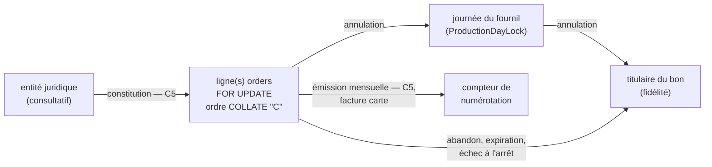
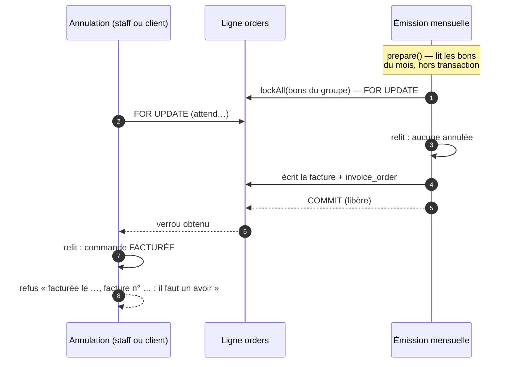
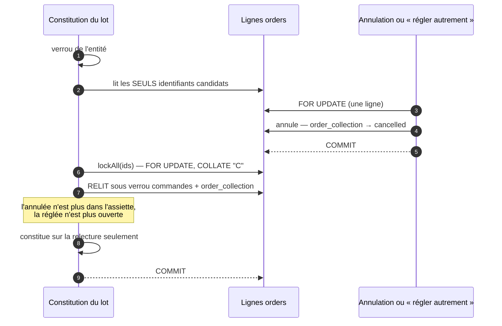

# Les verrous de l'annulation

> **État au 2026-10-13.** Tous les verrous ci-dessous sont **bâtis** (C3,
> C3b, C5 et C4 le 2026-10-12 ; marqués _C5_ quand ils viennent du compte). Le
> client (C6, 2026-10-13) passe par la même transaction et n'en ajoute aucun.
> Les gestes eux-mêmes : [`annulation-par-le-staff.md`](annulation-par-le-staff.md)
> (§C3.4 ter, §C5.3, §C5.4),
> [`fusion-du-bon.md`](fusion-du-bon.md) (§C3b.5) et
> [`annulation-par-le-client.md`](annulation-par-le-client.md).

## L'idée en une phrase

**Tout geste qui peut changer le sort d'argent d'une commande verrouille
d'abord SA ligne `orders`** (`SELECT … FOR UPDATE`). Deux gestes sur la même
commande se suivent donc, ils ne se croisent jamais. Le second **relit** la
commande sous le verrou et voit ce que le premier a écrit : une annulation qui
arrive après une facture voit « facturée » et refuse ; une facture qui arrive
après une annulation voit « annulée » et l'écarte.

## Qui prend quoi

Il y a cinq verrous :

| Verrou                       | Ce que c'est                                              | Où il vit                                         |
| ---------------------------- | --------------------------------------------------------- | ------------------------------------------------- |
| **ligne `orders`**           | `FOR UPDATE` sur la ligne de la commande                  | `OrderInvoicingLock` (une), `lockAll` (plusieurs) |
| **journée du fournil**       | consultatif `production_day:<jour>` + ligne de la journée | `ProductionDayLock`                               |
| **titulaire du bon**         | consultatif par titulaire de bons de fidélité             | fidélité (`accounts.loadLocked`)                  |
| **entité juridique**         | consultatif par entité qui prélève                        | constitution des lots de prélèvement              |
| **compteur de numérotation** | la ligne du compteur des numéros de facture               | `InvoiceIssuer`                                   |

## L'ordre, sans cycle

Une flèche se lit « est pris **avant** ». Tant que tous les gestes prennent
leurs verrous dans le sens des flèches, aucun ne peut attendre un geste qui
l'attend lui-même : il n'y a pas d'interblocage.

Ce qui rend le graphe sûr, vérifié dans le code le 2026-10-12 :

- **personne ne remonte une flèche** : ni la journée, ni le titulaire, ni le
  compteur ne prennent ensuite une ligne `orders` ;
- **l'annulation ne prend ni l'entité ni le compteur** ;
- **les deux gestes qui prennent plusieurs lignes `orders`** (émission et
  constitution) les prennent dans le **même ordre**, l'identifiant trié en
  binaire (`ORDER BY id COLLATE "C"`). La base est en `en_US.utf8`, dont le tri
  ne serait pas binaire : sans `COLLATE "C"`, deux gestes pourraient verrouiller
  les mêmes lignes dans deux ordres différents et s'attendre l'un l'autre.

| Geste                                         | Ordre des verrous                                               | État      |
| --------------------------------------------- | --------------------------------------------------------------- | --------- |
| annulation, staff ou client (C3 à C6)         | ligne `orders` → journée du fournil → titulaire du bon          | bâti      |
| abandon, expiration boutique, échec à l'arrêt | ligne `orders` → titulaire du bon                               | bâti      |
| passation qui engage un bon                   | titulaire du bon (puis insertion, aucune ligne existante prise) | bâti      |
| passage de nuit (reliquats, expiration)       | titulaire du bon ; commande relue **sans** `FOR UPDATE`         | bâti      |
| facture carte                                 | ligne `orders` → compteur                                       | bâti      |
| émission mensuelle                            | lignes `orders` du groupe (`COLLATE "C"`) → compteur            | bâti (C5) |
| constitution d'un lot de prélèvement          | entité → lignes `orders` des candidats (`COLLATE "C"`)          | bâti (C5) |
| « régler autrement »                          | ligne `orders`                                                  | bâti (C5) |

## Annulation contre facture mensuelle — _C5_

Les deux veulent la même ligne. Celui qui la prend le premier gagne, l'autre
relit ce qu'il a écrit.

Dans l'autre ordre, l'annulation passe d'abord : l'émission, sous son verrou,
relit le groupe, trouve la commande annulée, la **retire du groupe** et facture
le reste. Si le groupe devient vide, rien n'est émis.

## Annulation contre lot de prélèvement — _C5_

Le piège trouvé par `vitruve` : la constitution **lisait l'état des commandes
avant de les verrouiller**. Un geste validé entre les deux était écrasé. La
lecture est maintenant coupée en deux, et **rien de ce qui est lu avant le
verrou ne sert à constituer**.

Cette relecture ferme aussi une course qui **existait avant C5** : une commande
« réglée autrement » pendant qu'on constituait un lot était quand même
prélevée.

## Fermer plutôt que filtrer — _C5_

Une commande au compte annulée **ferme sa ligne d'encaissement**
(`order_collection` → `cancelled`) dans la même transaction que l'annulation.
Aucune transition comptable n'accepte cet état : ni le lot, ni « régler
autrement », ni la perte, ni la reprise après rejet. On ne compte donc pas sur
chaque écran pour filtrer les annulées : le geste lui-même est devenu
impossible.

## Ce que ces verrous ne couvrent pas

- **L'aperçu du lot** ne verrouille rien : il montre l'état du moment, comme
  aujourd'hui.
- **La règle « un seul reliquat non refondu par bon »** n'est pas un verrou mais
  un index unique partiel en base, écrit à la main : le seul garde-fou contre
  une migration générée qui le supprimerait est le test e2e qui insère deux
  reliquats vivants (C3b).
