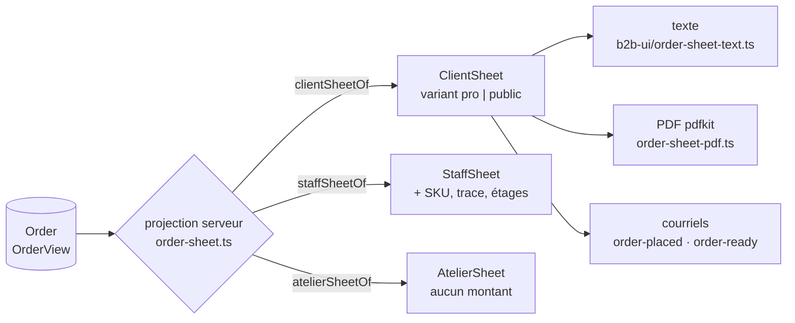

# Le bon de commande — un objet, plusieurs formats

**État : ✅ bâti, réécrit en doc d'état le 2026-10-12** après confrontation au
code. L'ancienne version (2026-09-07) était un document de conception qui
décrivait en partie un monde périmé (un QR « jamais imprimé », un PDF « sans
QR », un registre de rendus à quatre formats) ; le plan du bon « public »
(`plan-bon-public`, 2026-10-09) y est fondu. L'historique est dans git.

Ce document décrit **une pièce et une seule**, le bon de commande, et la façon
dont une même projection serveur sert plusieurs lecteurs. Il n'existe pas de
« bon de livraison » : celui qui réceptionne et celui qui retire cochent la même
feuille ; le mode d'acheminement n'est qu'un de ses champs.

## 1. Deux axes, à ne pas confondre

| Axe          | Question              | Valeurs                          | Décide                  |
| ------------ | --------------------- | -------------------------------- | ----------------------- |
| **Audience** | qui lit ?             | `client` · `staff` · `atelier`   | **ce qu'il y a dedans** |
| **Format**   | sur quoi ça se pose ? | texte · PDF · courriel (· écran) | **comment c'est rendu** |

L'audience se choisit **avant** le rendu. C'est ce qui garantit qu'**aucun prix
ne descend au fournil** : `AtelierSheet` n'a pas de champ monétaire du tout (une
union discriminée, pas un `money?` optionnel) ; `sheet.money` n'y est pas
`undefined`, c'est une erreur de compilation. Idem côté client : `sku`, tarif
d'entrée et étages n'existent que sur `StaffSheet`. Une option `withPrices` aurait
été une règle d'audience déguisée en option de rendu.

La projection est **côté serveur** (`apps/lfd-api/src/b2b/orders/domain/services/order-sheet.ts`) :
une projection front laisserait descendre l'`OrderView` complet, et un client qui
empile trois commandes reconstituerait la grille tarifaire. Le contrat est
`packages/contracts/src/order-sheet.ts` (`ClientSheet`, `StaffSheet`,
`AtelierSheet`, `SheetVariant`). Trois fonctions nommées, pas d'aiguilleur
`orderSheetOf(order, audience)` (supprimé : c'est l'appel qu'on ajoute « pour
factoriser » le jour où une route reçoit une audience).

⚠️ **Écart avec la conception d'origine (vérifié le 2026-10-12)** : le registre
exhaustif `SheetRenderers` à quatre formats (`screen`, `paper-a4`, `text`,
`mail-html`) n'existe pas. Il y a le texte (`order-sheet-text.ts`), le PDF et les
gabarits de courriel ; ni HTML d'impression A4 ni view-model d'écran issus de la
feuille (non cherchés plus loin que `packages/b2b-ui/src/order/`).

## 2. Les deux bons : pro et public

`ClientSheet.variant` vaut `public` pour une commande **sans société**
(`companyId === null`, y compris la commande personnelle d'un pro : c'est un
achat de particulier réglé à la commande), `pro` sinon. Elle est dérivée de la
commande, jamais devinée au rendu.

|        | Bon **pro**                                     | Bon **public**                                                                                          |
| ------ | ----------------------------------------------- | ------------------------------------------------------------------------------------------------------- |
| Prix   | HT, colonne référence ; au compte, HT seul (F5) | **TTC**, sans colonne référence                                                                         |
| Totaux | sous-total / total HT, TVA                      | articles, remise / bon / livraison / surtaxe, **Total TTC**, « dont TVA x % »                           |
| Client | enseigne                                        | nom, **et téléphone de l'acheteur** (`placedByUserId`, pas le staff qui saisit ; absent = pas de ligne) |
| Pied   | « Arrêté le … · révision n », mentions          | « Ce n'est pas une facture. » et la date d'arrêt, sans révision                                         |

Pour tous : logo à gauche (`apps/lfd-api/assets/logo-la-folie-coffee-noir-et-blanc.png`),
« BON DE COMMANDE » et la référence à droite ; ni « exemplaire chiffré », ni
« reçu par », ni « La Folie Coffee — B2B ». **Ce n'est pas une facture**, et le
pied le dit (§6).

## 3. Le QR de retrait — la règle de l'autoscan

Tout l'intérêt d'un scan est qu'il exige **deux parties** : l'un présente, l'autre
scanne. Imprimer le secret sur le colis ferait scanner son propre carton au
coursier, et l'attestation ne vaudrait plus rien. Donc :

- **Le jeton n'est pas un champ de la feuille.** Il est passé à part, en second
  argument, au seul rendu qui en a besoin : un rendu qui ne reçoit qu'une feuille
  ne peut pas l'imprimer (erreur de compilation, pas consigne).
- **Depuis le 2026-10-09 (Hugo), le QR de retrait figure sur le bon PDF — en
  retrait seulement.** Condition : `fulfillment.method === "pickup"`, un jeton, et
  l'origine admin configurée. **Jamais en livraison** (le papier voyage dans le
  carton). Il encode l'URL du courriel, fabriquée en un seul endroit
  (`handoverUrlOf`, `domain/services/handover-url.ts`) pour les courriels et le
  bon.
- **Le risque accepté** : le PDF archivé contient le jeton, dans le stockage privé
  des documents client. Le QR n'élargit aucun droit : `/retrait/<jeton>` exige un
  membre du staff connecté avec le droit du retrait ; le client l'a déjà dans son
  courriel ; un second retrait est refusé par l'état de la commande
  (`OrderHandover.attest`, unicité en base). Écrit dans le JSDoc d'`order-sheet-pdf.ts`.
- **Deux codes, deux natures.** Le code d'atelier (QR de colisage) **nomme** une
  commande : il n'encode que la référence déjà imprimée en clair, donc
  s'imprime sans risque. Le jeton **atteste** un changement de mains.
- **La porte du retrait ne résout que le jeton** (`findByHandoverToken`) : scanner
  une feuille d'atelier ne peut pas attester une remise, par construction.
- **Sans scan possible**, la remise se saisit **à la main** (`handedOverVia =
manual`, ou `deposit`), distinguée d'un scan : une attestation faible et honnête
  vaut mieux qu'une forte et fausse. Le jeton est émis pour **les deux**
  acheminements ; la remise en livraison est attestée par le coursier. Le fait
  est journalisé dans `growth` (`on-order-handed-over.handler.ts`).

## 4. Archivage : un artefact, pas un rendu

Le papier parti du comptoir est un **fait**, comme un prix figé sur une ligne :
recalculer après un avenant ou une correction donnerait un PDF différent de celui
que le client a en poche.

- **Rendu déterministe** : même feuille, mêmes octets. Dates tirées d'`issuedAt`
  (l'instant de la **révision**, pas du rendu), `Producer` / `Creator` posés en
  dur, QR en carrés pleins, logo fichier du dépôt ; moteur **`pdfkit`**. Le rendu
  ne lit ni horloge ni aléa.
- **Clé** : `orders/{orderId}/bon-de-commande-r{revision}-d{dessin}.pdf`
  (`orderSheetPdfKey`, `DRAWING_VERSION = 2`). La version de dessin est dans la
  clé : le dessin du 2026-10-09 a la sienne, les PDF déjà rangés restent
  en stockage sous l'ancienne et ne sont plus relus. `revision` vaut toujours 0
  (`REVISION_WITHOUT_AMENDMENTS`) : les avenants n'existent pas
  ([`architecture-commande-immuable-avenants.md`](architecture-commande-immuable-avenants.md)).
- **Qui range** : `OrderSheetArchive` (`application/services/order-sheet-archive.service.ts`)
  relit ou fabrique, partagé par la route client (`GET /orders/:id/bon.pdf`) et la
  route staff (`GET /admin/orders/:id/bon.pdf`) — pas de version staff du bon : le
  document discuté au téléphone est celui du client. La deuxième écriture
  concurrente est inoffensive (octets identiques).
- **Le courriel de confirmation joint le bon** (`customer.order-placed`, pros et
  particuliers : `order-sheet-attachment.service.ts`), donc il est archivé dès
  l'envoi et non plus au premier téléchargement (renversement de la décision du
  2026-09-07). Un échec de rendu ou de lecture n'empêche pas le courriel : il part
  sans pièce jointe, journalisé.
- **Conservation tranchée (Hugo, 2026-09-17)** : on ne supprime pas un bon émis à
  juste titre. `CustomerDocumentStore` n'a pas de `delete` (type et objet,
  `KeptDocumentStore`). Détail : [`todo-conservation-des-bons-en-r2.md`](todo-conservation-des-bons-en-r2.md)
  et [`architecture-pieces-en-r2.md`](architecture-pieces-en-r2.md).

## 5. `issuedAt` et `revision`

Champs du modèle, pas consigne de pied de page. « Arrêté le … » : l'instant où la
révision est devenue vraie ; deux tirages de la même révision portent la même
date. `revision` compte les avenants appliqués (0 partout aujourd'hui).

## 6. La facture n'est pas le bon

Un bon d'audience `client` porte des montants mais **n'est pas une facture** (pas
de numéro de série) ; son pied le dit. **Les factures existent maintenant** : la
facturation émet des factures carte (modèle `Invoice`,
`apps/lfd-api/src/b2b/accounting/`, `issue-card-invoice-on-paid` et
`-on-fulfilled`) et le prélèvement du compte ;
[`../b2b/architecture-facturation.md`](../b2b/architecture-facturation.md). Le bon
n'y est pas substitué.

## 7. Reste à faire et décisions ouvertes (relevé le 2026-10-12)

- **Durée de conservation du téléphone de l'acheteur** : il entre dans le PDF
  archivé du bon public ; la durée est à décider avec le registre RGPD
  (`documentation/legal/rgpd-registre.json`), et le bon archivé est justement ce
  qu'on ne supprime pas. Question ouverte, à poser à Hugo.
- **Un jeton renouvelé sans nouvelle révision** servirait l'ancien bon : le jeton
  est posé une fois à la création et rien ne le change aujourd'hui (vérifié le
  2026-10-09, non revérifié ce jour).
- **Les rendus HTML A4 / écran** de la conception d'origine ne sont pas bâtis (§1).
- **`mail-templates.ts` vit dans `platform/`**, qui ne devrait connaître aucun
  contexte : la dérive précède ce chantier et s'aggrave avec chaque gabarit qui
  parle de lignes de commande. Frontière à traiter, pas ici.
- **Le nom en code** : `OrderSheet` retenu (pas `purchaseOrder`, faux : c'est la
  pièce de l'acheteur).
- `vitruve` n'a pas relu cette réécriture ; le sujet touche l'argent (montants) et
  une frontière de sécurité (projection, jeton).
