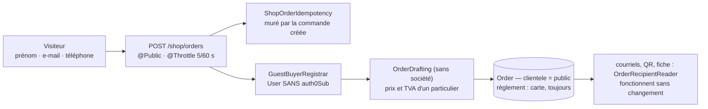

# Commander sans compte obligatoire

**État : ✅ bâti le 2026-09-17, ouvert le 2026-10-11 ; relu contre le code le
2026-10-12.** Remplace `plan-commande-sans-compte` (566 lignes, supprimé le
2026-10-12 ; l'archive de conception — les voies écartées, les objections de
`vitruve` : cinq BLOQUANTS, six SÉRIEUX —, reste dans git). Portée : la
**passation** d'un client public. Ni l'inscription, ni le tarif public, ni
l'audience.

> Demande de Hugo (2026-09-17) : « il faut qu'on puisse commander sans compte
> obligatoire » ; « une route complète pour répondre à ce cas de figure et ne
> pas polluer notre travail qui marchait bien pour les porteurs d'identité ».
> Prix et TVA tranchés le 2026-10-11 : « la même boutique que public mais juste
> pas loggé » — un visiteur paie exactement ce que paie un particulier connecté.

## 1. La décision : une surface séparée, un porteur sans identité de connexion

- **Sa route, son handler, son contrat, sa table d'idempotence** (`shop_order_idempotency`).
  Le chemin authentifié n'est pas touché (`PlaceOrderHandler`, `OrderIdempotency`).
- **La commande reste un `Order`**, sans une colonne de plus : la file du comptoir,
  le prévisionnel du fournil et le colisage le lisent tous.
- **Le porteur est un `User` sans `auth0Sub`** (`account.prisma` : `auth0Sub String?
@unique`) : une personne connue par son adresse, jamais connectable.
- **Pas de `settlement`** dans le contrat : c'est la carte, toujours. Pas de société.

## 2. Les décisions de Hugo (2026-09-17, sauf mention)

- **D1 — un invité se reconnaît à l'absence d'`auth0Sub`.** Pas de valeur de
  `UserStatus` en plus : se connecter est _inexprimable_, là où un statut déclaratif
  peut diverger. Son statut vaut `active` : ne jamais déduire « peut se connecter »
  d'un statut.
- **D2 — deux lignes pour une adresse : assumé** (`email` n'a aucune unicité), avec
  une conséquence traitée par D6.
- **D6 — un compte connectable gagne, toujours** : la résolution par adresse ne
  compte plus les invités comme des candidats. L'ambiguïté entre deux _comptes_
  reste refusée (`AccountEmailAmbiguousError`) ; sinon un anonyme qui tape l'adresse
  d'un vrai client aurait bloqué l'ouverture d'accès et le carnet de contacts.
- **D7 — prévenir par courriel, jamais par le web.** Aucune route publique ne dit
  « cette adresse existe » (fuite commerciale d'énumération de comptes). Quand une
  commande publique porte l'adresse d'un compte, un courriel part à cette adresse,
  en tâche de fond (la réponse HTTP ne bouge pas d'un octet), la commande reste
  rattachée à l'invité neuf, et l'envoi est **borné par adresse et par jour** par
  `MailJournal.rememberEvent` (`send-guest-order-notice.handler.ts`).
- **D3 — pas de rapatriement par ce chantier.** Ce geste existe depuis le
  2026-10-11 : la première entrée par code e-mail ou Google, adresse prouvée, pose
  son `sub` sur l'unique fiche invité de l'adresse (rien n'est réécrit sur les
  commandes) — [`plan-bienvenue-et-invite-rattache.md`](../comptabilite/fidelite/plan-bienvenue-et-invite-rattache.md).
- **D4 — un règlement interrompu perd le paiement, pas la commande.** Aucune route
  publique de reprise (`retrieveIntent` rendrait un secret vivant) ; non réglée, la
  commande expire. 🔴 **Rien ne se règle au comptoir** (Hugo, 2026-10-11 : « soit on
  est au compte, soit on paye, c'est tout ») : c'est ce qui tient la boutique dans
  la tolérance du BOFiP (BOI-TVA-DECLA-30-10-30, § 35) et la dispense de caisse
  certifiée.
- **D5 — `clientele` = `public`** pour toute commande sans société.
- **D8 — un invité qui revient est retrouvé, jamais recréé** (l'historique ne se
  disperse pas, la croissance ne compte pas N acheteurs). On réutilise un invité,
  **jamais un compte connectable**.
- **D9 — le téléphone est obligatoire** (schéma et domaine, `guest-identity.ts`) et
  l'adresse se saisit **deux fois** dans la carte « Qui passe cette commande ? » du
  panier (le seul geste qui _empêche_ l'erreur d'adresse).

Idempotence de la surface publique : murée par **la commande créée**, jamais par un
couple (clé, e-mail) devinable — détenir le couple rendrait une commande et un
secret de paiement vivant.

## 3. État du code (vérifié le 2026-10-12)

| Lot | Ce qui existe                                                                                                              | Où                                                                                                                                                                     |
| --- | -------------------------------------------------------------------------------------------------------------------------- | ---------------------------------------------------------------------------------------------------------------------------------------------------------------------- |
| A   | le panier retient le règlement tant qu'il ignore qui commande, offre les deux portes ensemble sans regarder l'adresse (D7) | `apps/lfc-ecommerce-frontend/src/app/client/cart/guest-identity-form/`                                                                                                 |
| B   | `auth0Sub` nullable                                                                                                        | `account.prisma`                                                                                                                                                       |
| C   | `POST /shop/orders`, ouverte le 2026-10-11                                                                                 | `b2b/orders/http/shop-orders.controller.ts`, `orders.module.ts`, `place-shop-order.handler.ts`                                                                         |
| D8  | invité retrouvé                                                                                                            | `prisma-guest-buyer.registrar.ts` (⚠️ l'invité retrouvé garde son ancien prénom et son téléphone : [`todo-adresse-de-la-commande.md`](todo-adresse-de-la-commande.md)) |
| D7  | courriel « une commande a été passée avec votre adresse »                                                                  | `send-guest-order-notice.handler.ts`, `order-sheet`                                                                                                                    |

Contrat : `packages/contracts/src/shop-order.ts`. Éprouvé : `test/shop-order.e2e-spec.ts`,
`place-shop-order.handler.spec.ts` ; D7 n'est éprouvé qu'en unitaire (le mailer y est
à blanc).

## 4. Reste à faire

- **Le débit** : 5 appels / 60 s **par IP** (`@Throttle`, clé = IP cliente) borne
  l'accident et la maladresse, pas l'acharnement ; le contrôleur le note comme non
  vérifié. À éprouver avant d'y compter.
- **La passerelle** : un `POST /shop/orders` non authentifié y est-il routé ? Non
  vérifié ce jour : aucune occurrence de `shop` dans `gateway/` n'a été trouvée par
  recherche textuelle, ce qui peut vouloir dire un routage générique.
- Alerter le staff sur le rebond d'un courriel de commande publique : non retenu
  (rien ne relie un envoi à une commande).
