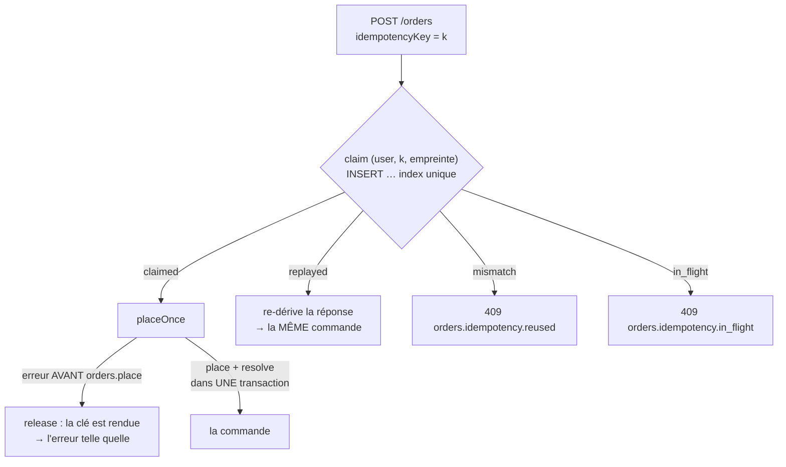

# Passer une commande deux fois n'en crée qu'une

**État : ✅ bâti, relu contre le code le 2026-10-12.** Remplace
`plan-idempotence-de-passation` (supprimé le 2026-10-12 ; l'historique, y
compris les cinq bloquants de `vitruve`, est dans git). Défaut **T12** de
[`audit-flux-de-commande.md`](audit-flux-de-commande.md).

## 1. Le défaut, et la réponse

`POST /orders` n'avait ni clé d'idempotence ni déduplication : un double clic, un
rejeu réseau ou un retour arrière du navigateur créaient deux commandes et deux
intentions Stripe. La réponse est une **clé fournie par l'appelant, arbitrée par
la base**.

Rejetés, avec raison : une clé naturelle (un client a le droit de commander deux
fois la même chose le même jour), une fenêtre de temps (résultat dépendant de
l'horloge, inexplicable au client), le seul verrou d'écran (confort, pas
garantie ; il est fait en plus).

## 2. Ce qui existe

- **Le contrat** : `idempotencyKey: z.string().uuid()` dans
  `placeOrderPayloadSchema` (`packages/contracts/src/order.ts`). Un appel sans
  clé est **inexprimable** ; la clé est bornée par son type (36 caractères — un
  index btree refuse au-delà de 2704 octets).
- **La table** `order_idempotency` (`orders.prisma`, `OrderIdempotency`) :
  `userId` (clé étrangère vers `users`, `onDelete: Cascade` — le mur : une clé
  n'est jamais partagée entre deux personnes), `key`, `orderId` (nul = en vol,
  sans clé étrangère car la ligne naît avant la commande), une **empreinte** du
  panier, `claimedAt`. Unique `(userId, key)`. On **ne stocke pas la réponse** :
  un rejeu relit la commande et, si elle attend une carte, redemande son
  intention à Stripe (jamais de `clientSecret` en base).
- **Le port** `OrderIdempotencyStore` (`domain/ports/order-idempotency.store.ts`)
  et son adaptateur Prisma. `claim` rend quatre issues : `claimed`, `replayed`,
  `mismatch`, `in_flight`.
- **Le garde** est au tout début de `PlaceOrderHandler.execute`, avant le mur de
  membre et avant `OrderDrafting` : l'intention Stripe est créée avant la
  persistance, un garde plus tard laisserait passer une seconde intention.

## 3. Les règles retenues (ce que la contradiction a décidé)

- **La clé se résout dans la transaction qui écrit la commande** :
  `OrderRepository.place` écrit la commande **et** la résolution ensemble. Il
  n'existe pas d'instant « la commande existe, la clé n'est pas résolue » ; le
  seul intervalle de crash restant est celui où rien n'est écrit, donc une
  reprise est toujours sûre.
- **Le discriminant d'une libération est la position, pas la nature de
  l'erreur** : une erreur levée avant `orders.place` (heure limite, SKU inconnu,
  zone non desservie, mur de membre) rend la clé ; à partir de `place`, la
  transaction a tranché.
- **Un bail de deux minutes** (`IDEMPOTENCY_LEASE_MS`) couvre le crash : une clé
  réclamée et non résolue depuis plus longtemps est reprise par la tentative
  suivante. Pas de planificateur : la reprise se fait à la lecture.
- **Une clé rejouée avec un autre panier est refusée**, pas honorée (sinon
  l'écran affiche les lignes du nouveau panier sur l'ancienne commande). ⚠️ Le
  plan annonçait un **422** ; le code lève une `BusinessError`, donc un **409**
  (`orders.idempotency.reused`) — vérifié le 2026-10-12, `order-errors.ts`.
- **Le statut de réponse reste 201**, le front reconnaît le code `in_flight` et
  ne l'affiche pas comme une panne, la clé survit au rechargement (stockée à
  côté du panier).

## 4. Hors périmètre, ou reste à faire

- **La porte staff `POST /admin/orders` n'est pas couverte** : la réponse porte
  `settlement` (`account` | `link`), que rien en base ne stocke ; un rejeu le
  dériverait faux (un lien sur total nul tombe en `not_required`). Il faut
  persister `settlement` ou le dériver d'un fait déjà porté. Aucune idempotence
  dans `place-order-for-customer.handler.ts` (vérifié le 2026-10-12). La
  boutique publique a sa propre table, `shop_order_idempotency`
  ([`architecture-commande-sans-compte.md`](architecture-commande-sans-compte.md)).
- **La purge** : les lignes s'accumulent, une par commande, sans fin. Aucune
  suppression hors `src/dev/` (vérifié le 2026-10-12). Chore d'exploitation à
  nommer, ou tâche du worker.
- **Le second onglet** fabrique une autre clé, donc une autre commande : correct
  au sens strict, probablement faux au sens du client. Assumé.
- **La migration est additive** (table neuve) : son retour arrière est un
  `DROP TABLE`. Elle ne déduplique pas l'existant.
