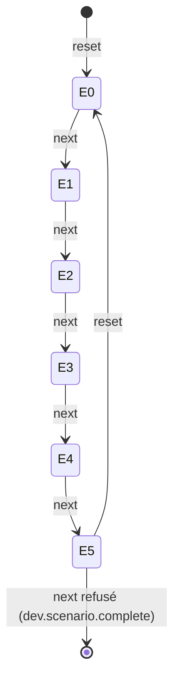

# Le jeu de données par étapes

**État : ✅ bâti (serveur J1 le 2026-10-05, écran J2), relu contre le code le
2026-10-12.** Remplace `plan-jeu-de-donnees-par-etapes` (supprimé le
2026-10-12 ; historique dans git). Outillage de développement : ni argent, ni
migration, ni sécurité. Demande de Hugo (2026-10-05) : des étapes à cocher, un
bouton « charger » et un bouton « suivant », un chargement qui explique ce qu'il
charge, et un reset qui remet à l'état de base.

## 1. Les six étapes de la journée d'aujourd'hui

Elles portent sur **la journée d'aujourd'hui** (comptoir et livraison) ; hier,
demain et J+2 sont posés par la base et ne bougent plus. Chaque étape passe par
les **vrais gestes** (handlers), jamais par une écriture à la main.

| #   | Étape                                  | Ce que le serveur fait                                                                                                |
| --- | -------------------------------------- | --------------------------------------------------------------------------------------------------------------------- |
| 0   | **Commandes passées** (la base)        | le reset du scénario, puis toutes les commandes reposées                                                              |
| 1   | **Plan de production clôturé**         | `CloseProductionDayCommand` pour aujourd'hui                                                                          |
| 2   | **Tournées composées**                 | la composition automatique (`DayComposer`, celle de l'arrêt du plan), sans bacs ; une tournée affectée à qui clique ¹ |
| 3   | **Production complète**                | toutes les fournées du jour déclarées sorties du four, remises au colisage                                            |
| 4   | **Colisage complet**                   | chaque commande prête en sac (comptoir) ou en bacs (livraison, demi-bac partagé compris), fermée                      |
| 5   | **Tournées chargées, prêtes à partir** | tous les bacs chargés dans leur tournée (un second passage à midi), ceux du transfert compris, sans départ            |

¹ **Depuis le 2026-10-14** (Hugo : « la démo doit montrer ce que la
composition automatique décide vraiment »), aucune tournée n'est écrite à la
main : le semis appelait des tournées à rangs fixes (Val d'Isère sur
Camionnette 1, le reste en tranches), et seul l'après-midi venait du calcul.
L'étape est atteinte dès que le calcul a placé une livraison — ce qu'il laisse
à répartir est sa décision. Le requérant reçoit la première tournée dont toutes
les livraisons seront colisées ; le demi-bac se partage avec l'arrêt qui suit
l'ouvreur dans SA tournée, quand il y en a un de prêt.

⚠️ **L'ordre est celui du code** : les tournées sont composées _avant_ la
production, parce que depuis K3c un bac de livraison naît au colisage et qu'un
demi-bac ne se partage qu'entre deux arrêts consécutifs d'une même tournée. Les
commandes « pas encore prêtes » restent volontairement hors colisage (aux étapes 4
et 5), pour montrer un colisage en cours.

## 2. Le serveur (`apps/lfd-api/src/dev/`)

- `GET /admin/dev/scenario` rend l'état ; **l'étape atteinte se déduit de la
  base** (plan clôturé ? livraisons routées ? fournées déclarées ? colisage
  fermé ? bacs chargés ?), jamais mémorisée : une base modifiée à la main donne
  l'étape réelle. Un résumé chiffré par étape.
- `POST /admin/dev/scenario/next` joue **une** étape ; à l'étape 5 il refuse
  (`dev.scenario.complete`). `POST /admin/dev/scenario/reset` revient à l'étape 0.
  « Charger jusqu'à » est fait par l'écran, qui enchaîne les `next` : pas de route
  « sauter à ».
- **Le reset ne laisse rien derrière lui** (Hugo : « pour éviter de saturer le
  Docker » — deux suites e2e avaient rempli le disque de la VM, Postgres avait
  planté sur `pg_wal`). Il **supprime** ce que le scénario a créé, jamais une
  table entière : commandes, fournil, colisage, bacs et tournées, faits d'outbox,
  journaux, objets de stockage (`scenario/purge/*.purge.ts`, bornés par
  `scenario-scope.ts`), une transaction par domaine, et il **dit ce qu'il a
  supprimé**. Un test (`dev-scenario-stability.e2e-spec.ts`) vérifie que
  plusieurs `reset` + cinq `next` laissent le nombre de lignes et d'objets stables.
  L'écran affiche la taille de la base (`pg_database_size`).
- Les serrures du `DevSeedService` (base locale seulement, pas en production, mur
  staff, stockage local) restent la condition de tout geste.

## 3. L'écran (`apps/lfd-backoffice-frontend/src/app/dev/`)

Principes demandés (« extrêmement clair ») : une phrase d'état en tête (« La
journée de démo du … est à l'étape N sur 5… ») et la taille de la base ; la liste
des six étapes avec pastille (Fait / Prochaine / À venir / En cours…), une phrase
qui dit ce que c'est **dans la vraie vie**, le résumé chiffré et le lien vers
l'écran où voir le résultat ; **une seule action principale dont le libellé nomme
l'étape** ; le reset séparé, dans un encadré « Repartir de zéro », avec
confirmation en place qui dit ce qui part et ce qui reste ; pas de vocabulaire
technique (« journée de démo », « état de base »). Pendant un geste, tous les
boutons sont désactivés et la bannière annonce l'étape ; un échec montre le
message du serveur tel quel et relit l'étape réellement atteinte. Les textes sont
dans `dev-scenario-steps.ts` (écrits côté écran, les nombres viennent du serveur).

## 4. Décisions par défaut et reste à faire

- Les sous-comptes de démo (« Alpes », « Cimes ») **ne suivent pas** les étapes :
  ils restent posés par `seed:sub-accounts` (défaut non contesté). Depuis le
  2026-10-21, ce semis retire au comptoir (`ConfirmManualHandoverCommand`, au
  jour de la commande) celles dont le jour est passé ; aujourd'hui et à venir
  restent en cours.
- Pas d'étape « tournées parties » : le départ se fait à l'écran, c'est ce qu'on
  montre.
- La phrase d'état dit « étape N **sur 5** » alors qu'il y a six étapes (0 à 5) ;
  cohérent avec l'étape finale 5, mais à ne pas relire « six » au sens de
  « 6/6 ». Non revérifié à l'écran.
